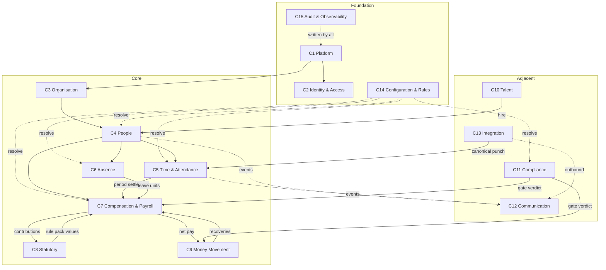

# PART V — DOMAIN MODEL

Status: DRAFT FOR PRODUCT OWNER APPROVAL
Conforms to: `SPINE.md` S0–S20. Where this part names a mechanism the spine already
defines (Scope S3.1, precedence S3.2, effective dating S4, SPX S5, engines S6–S8,
metadata S9, attendance layers S10, payroll pipeline S11, rule packs S12, security
S13, audit S14, explainability S15, data conventions S16), it references and extends
it; it never invents a parallel one.
Physical realisation: **Part XXVIII — Database Architecture and ERD**. Every aggregate
named here has a table catalogue entry there, and every table there belongs to exactly
one context named here.

---

## V.0 Purpose

This part fixes **what SmartPRS 3 is made of**: the bounded contexts the system is
divided into, the aggregates inside each, the invariants each aggregate guarantees,
the value objects shared across all of them, and the events by which contexts talk.
It decides three things that everything else depends on:

1. **That employment is effective-dated, not current-valued** — so that "what was this
   employee's branch on 15 May?" is a single service call, which SmartPRS 2 cannot
   answer at all (`D-employee-master.md` Q5).
2. **That every module's configuration is one aggregate** — the Configuration Artefact
   of spine S4 — so that a leave policy, a salary structure, a workflow and a report
   definition share one versioning, scoping, approval and resolution mechanism.
3. **That contexts share events, never tables** — so the 152-table free-for-all in which
   `attendance_pending` serves two unrelated features and whichever code path runs first
   wins (`J-database.md` §6.1.2) cannot recur.

This part does **not** specify screens, engine algorithms or endpoints in detail; those
belong to the module parts. It specifies the vocabulary those parts must use.

---

## V.1 What SmartPRS 2 has today, and why it must change

SmartPRS 2 has no domain model. It has a database that grew, and PHP that repairs it.
The evidence, carried through from the as-is analyses:

| Observation | Evidence | Consequence for the domain |
|---|---|---|
| **Two schema authorities.** 102 tables from migrations, 49 tables created only by controllers at request time, 52 defined in both places and diverging on 15 of them | `J-database.md` §2.1, §6.1 | There is no authoritative statement of what an entity *is*. `salary_components.calc_value` is `VARCHAR` on a migrated install and `DECIMAL(12,2)` on a healed one, so a formula string becomes the number `0.40` (`J-database.md` §6.1.10) |
| **No aggregate boundaries.** `attendance_pending` is two features with disjoint schemas sharing one name; whichever creator runs first permanently breaks the other | `J-database.md` §6.1.2; `B-attendance.md` §2.2 | A "table" is not a concept; it is a name that two teams happened to pick |
| **No identity.** Employee identity is resolved by **name** in 18 distinct places, including two idempotency keys; one path writes a name match back to the database as an id | `D-employee-master.md` Q6 | Two people called Suresh Kumar are one person to the hire flow, the transfer flow, the DRA register and the POSH register |
| **No history.** Every employee attribute is overwritten on every save. Branch, department, designation, manager, status, bank, statutory identifiers and name have no history at all | `D-employee-master.md` Q5 | Back-dated payroll, a statutory return for a past period, and "who reported to whom last quarter" are unanswerable |
| **No integrity.** Zero foreign keys on business tables; ~180 unconstrained `*_id` columns; an admin endpoint exists whose only job is sweeping the resulting orphans | `J-database.md` §Q4, SEC-DB-01 | A payslip can name an employee who does not exist |
| **Configuration is mutable and mostly undated.** Three tables of about twelve are effective-dated; the rest are edited in place and hard-deleted by the master screen | `J-database.md` §4.4, §Q8 row 1 | Deleting a salary component destroys the ability to re-explain a payslip issued under it |
| **Money and statutory rates live in a JSON blob in a table with no migration** | `J-database.md` §2.1.1 #44 | A `mysqldump` taken before an admin opened one screen contains no statutory rates |
| **No transactional boundary.** Zero locks, four transactions in the whole application; payroll's ledger side-effects run after `DB::commit()` in swallowed `try/catch` blocks | `M-quality-performance-testing.md` §6.2 C-2 | A payslip can say "Loan EMI ₹5,000 deducted" while the loan counter never advances — the loan is recovered forever |

Every design decision in this part exists because of one of those rows. Where a decision
looks elaborate, the row it answers is named.

---

## V.2 Modelling rules

These are the rules by which the model below is constructed. They are testable.

**R-V-001** A **bounded context** owns its tables exclusively. No table is read or written
by code outside its owning context. Cross-context reads go through the owning context's
published contract (a service interface inside the monolith) or through an event. *Test:*
the Deptrac dependency rule of spine S2 fails the build on a `Domain\<ContextA>` class
referencing a `Domain\<ContextB>` persistence class.

**R-V-002** An **aggregate** is the unit of transactional consistency. One transaction
mutates exactly one aggregate instance. Changes spanning aggregates are effected by an
event plus a subscriber, and the subscriber's failure is visible (a dead-letter row and
an operations alert), never swallowed. This directly replaces the four best-effort
`try/catch` reversal blocks that make SmartPRS 2's payroll regeneration non-atomic
(`M-quality-performance-testing.md` §6.2 C-2, C-3).

**R-V-003** An aggregate is referenced from outside **by its root's identifier only**.
No foreign key points at a non-root entity of another aggregate.

**R-V-004** Every aggregate declares its **invariants** as a list, and each invariant is
enforced at the strongest available layer, in this order: database constraint → domain
guard → validator. An invariant enforced only in PHP is a defect, because SmartPRS 2's
eight employee uniqueness rules are PHP-only, racy, and run `LOWER(TRIM(col))` against
plain indexes that cannot serve them (`J-database.md` §6.9; `D-employee-master.md` §2.3).

**R-V-005** Every aggregate declares a **lifecycle** as a named state set plus a
transition table, both configuration (spine S16, no database `ENUM`). No aggregate is
hard-deleted; the terminal states are `archived` and `purged`, and reaching `purged`
requires a retention class that permits it.

**R-V-006** Every aggregate declares a **retention class** and a **PII class** at the
model level, and Part XXVIII carries them to every column. SmartPRS 2 has a
`data_retention_months = 84` setting that nothing reads (`J-database.md` §8 #10).

**R-V-007** A **value object** is immutable, has no identity, is compared by value, and
validates itself on construction. Money, Scope, EffectiveRange, DayFraction, Duration,
EmployeeIdentity, OrgPath and CalculationTrace are the platform value objects (V.5) and
may be used by any context.

**R-V-008** A **domain event** is an immutable past-tense fact with a stable name, a
versioned payload, a tenant, a correlation id and the aggregate version it describes.
Events carry identifiers and the minimum denormalised fields a consumer needs; they never
carry a whole aggregate.

---

## V.3 The context map

Fifteen bounded contexts. The table states what each context is **for**, what it **owns**
(its aggregates), what it **consumes** (by contract or event, never by table), and its
principal **published events**. The per-context detail follows in V.4.

| # | Context | Responsibility | Owns (aggregates) | Consumes | Publishes |
|---|---|---|---|---|---|
| C1 | **Platform** | Tenancy, licensing, deployment identity, feature entitlement, schema fingerprint, background job registry | Tenant, Licence, Edition/Entitlement, SystemHealth | — | `tenant.provisioned`, `tenant.suspended`, `entitlement.changed` |
| C2 | **Identity & Access** | Who the actor is, what they may do, on which records | User, Role, PermissionGrant, ApiClient, AuthSession | Person (link), OrgUnit (scope) | `user.created`, `role.assigned`, `auth.mfa_enrolled`, `access.denied` |
| C3 | **Organisation** | The typed org tree, statutory registrations of establishments, classification masters | OrgUnit, OrgUnitRegistration, Designation, Grade | Tenant | `org_unit.created`, `org_unit.moved`, `org_unit.closed` |
| C4 | **People** | The person, the employment, and every effective-dated assignment on it | Person, Employment, EmploymentAssignment, EmployeeDocument | OrgUnit, Designation, Grade, ValueSet | `employment.created`, `employment.assignment_changed`, `employment.stage_changed`, `employment.exited`, `person.identifier_changed` |
| C5 | **Time & Attendance** | Punch evidence, shift resolution, derived attendance days, period settlement | PunchEvent, NormalisedPunch, AttendanceDay, PeriodSettlement, Roster, Device | Employment, Shift config, Holiday calendar, Leave units | `punch.ingested`, `punch.quarantined`, `attendance_day.derived`, `attendance.recalculated`, `period.settled` |
| C6 | **Absence** | Leave entitlement, balance ledger, requests, comp-off, holiday calendars | LeaveType, LeaveLedger, LeaveRequest, CompOffLedger, HolidayCalendar | Employment, AttendanceDay, Workflow | `leave.requested`, `leave.approved`, `leave.balance_adjusted`, `compoff.earned`, `compoff.expired` |
| C7 | **Compensation & Payroll** | Salary structures, employee compensation, the payroll run pipeline, payslips | SalaryStructure, EmployeeCompensation, PayrollPeriod, PayrollRun, Payslip | Employment, PeriodSettlement, LeaveLedger, StatutoryPack, Loan, Recovery | `compensation.changed`, `payroll_run.previewed`, `payroll_run.approved`, `payslip.issued`, `payslip.superseded` |
| C8 | **Statutory** | Rule packs, per-employee applicability, contributions, returns, filings, tax declarations | RulePack, StatutoryProfile, StatutoryContribution, StatutoryFiling, TaxDeclaration | Payslip, Establishment registration, Compensation | `rule_pack.activated`, `statutory.applicability_changed`, `filing.due`, `filing.recorded` |
| C9 | **Money Movement** | Loans, advances, recoveries, disbursement batches, bank returns | Loan, Advance, RecoverySchedule, PayoutBatch | Payslip, Employment, Workflow | `loan.sanctioned`, `loan.instalment_recovered`, `loan.closed`, `payout_batch.released`, `payout.returned` |
| C10 | **Talent** | Requisitions, candidates, interviews, offers, onboarding and exit journeys | Requisition, Candidate, Interview, Offer, OnboardingJourney, ExitCase | OrgUnit, Employment, Workflow | `requisition.opened`, `candidate.hired`, `onboarding.completed`, `exit.initiated`, `exit.settled` |
| C11 | **Compliance** | Compliance item types and records, evidence, gates, policy acknowledgements | ComplianceItemType, ComplianceItem, PolicyDocument, PolicyAcknowledgement, GateDecision | Employment, Document, Payout/Payroll gate points | `compliance.item_raised`, `compliance.item_expiring`, `compliance.gate_blocked`, `policy.acknowledged` |
| C12 | **Communication** | Notification event catalogue, templates, audiences, delivery and its outcome | NotificationEvent, NotificationTemplate, NotificationMessage, DeliveryAttempt | every context's events, Person contacts | `notification.queued`, `notification.delivered`, `notification.failed` |
| C13 | **Integration** | Inbound and outbound contracts: API clients, connectors, webhooks, idempotency, egress control | Connector, WebhookEndpoint, WebhookDelivery, InboundBatch, IdempotencyKey | every context's events | `webhook.delivered`, `webhook.dead_lettered`, `connector.health_changed` |
| C14 | **Configuration & Rules** | The universal configuration artefact, rules, formulas, workflows, value sets, entity/field metadata, templates | ConfigArtefact, Rule, Formula, WorkflowDefinition, ValueSet, EntityDefinition, FieldDefinition | Scope dimensions from Organisation and People | `config.published`, `config.superseded`, `rule.published`, `workflow.published` |
| C15 | **Audit & Observability** | The hash-chained ledger, field-level change records, job and queue telemetry | AuditEvent, AuditAnchor, JobRun | every context (write-only, one API) | `audit.chain_broken`, `job.failed`, `sla.breached` |

### V.3.1 Context relationship diagram



Read the dotted lines as "resolves configuration from" or "emits events to"; the solid
lines as "supplies a domain fact to". No line is a shared table.

---

## V.4 The contexts in detail

Each context is stated as: responsibility · aggregates (root, members, invariants,
lifecycle) · what it owns · what it consumes and how · events published. Invariants
marked **[DB]** are enforced by a database constraint in Part XXVIII; **[TX]** by a
domain guard inside the aggregate's transaction; **[PUB]** by the configuration
validator at publish time.

### C1 — Platform

**Responsibility.** Everything true of an installation rather than of a business: the
tenant registry, licensing and entitlement, deployment identity, the schema fingerprint,
and the operational health surface. This context is the only one that may hold a table
without `tenant_id`.

| Aggregate | Root | Members | Invariants | Lifecycle |
|---|---|---|---|---|
| **Tenant** | `Tenant` | TenantSetting (typed), TenantDeployment | I1 `subdomain` unique across the installation **[DB]**; I2 a tenant always has at least one `legal_entity` org unit **[TX]**; I3 no behavioural rule may key on the tenant's *name or subdomain* — the demo lockdown keyed on `subdomain='demo'` cripples a customer legitimately named "demo" (`J-database.md` BR-TEN-002) **[PUB]** | `provisioning → active → suspended → closed → purged` |
| **Licence** | `Licence` | LicenceSeat, LicenceEvent | I4 seat consumption is computed from employment states declared as seat-consuming in configuration, never from a PHP constant (`D-employee-master.md` req. 20) **[TX]**; I5 seat allocation is serialised — the check and the insert are one transaction with a row lock, because SmartPRS 2's `COUNT(*)`-then-insert issues 76 seats against a 75-seat licence (`M-quality…` §6.2 C-5) **[TX]**; I6 a licence event is append-only **[DB]** | `issued → active → expired → revoked` |
| **Entitlement** | `Entitlement` | EntitlementFeature | I7 an entitlement decision is a server-side check; hiding navigation is never a control (spine S13) **[TX]** | versioned via C14 |
| **SystemHealth** | `HealthSnapshot` | ComponentStatus | I8 the installer cannot complete, and the health check cannot pass, without a live scheduler and queue worker (spine S2) **[TX]** | rolling |

**Owns:** tenants, tenant settings, licences, seats, entitlements, health snapshots,
schema fingerprints.
**Consumes:** nothing. Platform is upstream of everything.
**Publishes:** `tenant.provisioned` · `tenant.suspended` · `tenant.closed` ·
`licence.issued` · `licence.expiring` · `entitlement.changed` · `health.degraded`.

**R-V-010** There is exactly one representation of platform scope. A platform-owned row
has **no tenant column**; a tenant-owned row has `tenant_id NOT NULL`. The values `0` and
`NULL` are never used as a tenant sentinel. SmartPRS 2 uses both, in the same controller
(`J-database.md` §6.10, §Q7).

### C2 — Identity & Access

**Responsibility.** Authentication, the permission catalogue, roles, data scopes, API
clients, and the record of every access decision that matters. Implements spine S13.

| Aggregate | Root | Members | Invariants | Lifecycle |
|---|---|---|---|---|
| **User** | `User` | Credential, MfaFactor, AuthSession, PasswordResetToken | I1 `(tenant_id, email)` unique — email is unique **per tenant**, not globally, so one person may hold accounts in two tenants (SmartPRS 2 cannot: `J-database.md` SEC-TEN-05) **[DB]**; I2 a non-platform user has a non-null `tenant_id` **[DB]**; I3 a user linked to an employment is linked by `employment_id`, never by name or email match — this removes all 16 copies of the name-fallback "own employee" resolver (`D-employee-master.md` Q6 #1–3) **[DB]**; I4 MFA is mandatory for any role holding a permission flagged `privileged` **[TX]** | `invited → active → locked → disabled → purged` |
| **Role** | `Role` | RolePermission | I5 a role is tenant-defined and holds permissions only — never a data scope **[DB]**; I6 permission codes are `verb.resource` and come from a platform-owned catalogue **[PUB]** | config-versioned (C14) |
| **PermissionGrant** | `RoleAssignment` | ScopeSelector | I7 a grant is `(user, role, data_scope)`; the scope is explicit and may be a list of org units **[DB]**; I8 an unresolvable or null scope denies **[TX]** | `active → revoked` |
| **ApiClient** | `ApiClient` | ClientScope, ClientSecret | I9 a client belongs to exactly one tenant and its scopes actually gate (spine S17) **[TX]**; I10 secrets are hashed where only comparison is needed, encrypted where verification requires the plaintext (spine S13) **[DB]** | `active → rotated → revoked` |

**Owns:** users, roles, permissions, assignments, sessions, MFA factors, API clients,
authentication events.
**Consumes:** `Person`/`Employment` identifiers from C4 (link only); org unit ids from C3
(scope only).
**Publishes:** `user.created` · `user.disabled` · `role.assigned` · `role.revoked` ·
`auth.failed` · `auth.locked_out` · `access.denied`.

**R-V-011** Authorisation fails closed. Any exception inside an authorisation decision
denies. SmartPRS 2's helper returns "allowed" on any exception across 71 call sites
(`E-leave-requests-notifications.md` req. 93).

### C3 — Organisation

**Responsibility.** The typed organisational tree of spine S3, the statutory
registrations attached to its nodes, and the classification masters that are richer than
a value set.

| Aggregate | Root | Members | Invariants | Lifecycle |
|---|---|---|---|---|
| **OrgUnit** | `OrgUnit` | OrgUnitRegistration, OrgUnitClosure (materialised ancestry) | I1 `(tenant_id, parent_id, code)` unique **[DB]**; I2 the parent's `unit_type` must be a declared legal parent of the child's `unit_type` **[TX]**; I3 no cycles — enforced by writing the closure table inside the same transaction and rejecting a self-ancestor **[TX]**; I4 a unit with live assignments cannot be deleted, only closed with an effective date **[TX]**; I5 a unit's `effective_range` contains every assignment that references it **[TX]** | `draft → active → closed → archived` |
| **Designation** | `Designation` | — | I6 `(tenant_id, code)` unique **[DB]**; I7 a designation is a *classification*, never a tree node (spine S3) **[PUB]** | `active → retired` |
| **Grade** | `Grade` | GradeBand | I8 bands do not overlap within a grade **[PUB]** | `active → retired` |

**Owns:** org unit types, org units, closure, registrations (PF/ESI/PT/LWF/S&E codes per
establishment), designations, grades.
**Consumes:** `Tenant` from C1; value sets from C14.
**Publishes:** `org_unit.created` · `org_unit.renamed` · `org_unit.moved` ·
`org_unit.closed` · `registration.changed`.

**R-V-012** A node type is data. The standard ladder of spine S3 is seeded, and a tenant
may add a level type without a deploy. `cost_centre`, `business_unit` and `client_process`
attach at any level.

**R-V-013** Renaming an org unit changes no employee record, because employees reference
org units **by id**. SmartPRS 2 stores `department`, `branch`, `team`,
`reporting_manager`, `shift` as denormalised name strings, so renaming a master row
orphans every employee pointing at it (`D-employee-master.md` Q6 #16).

### C4 — People

**Responsibility.** The natural person, the employment relationship, and the
effective-dated assignment history that makes the whole system answerable "as at" a date.
This context is the spine of the product; V.6 specifies it in full.

| Aggregate | Root | Members | Invariants | Lifecycle |
|---|---|---|---|---|
| **Person** | `Person` | PersonIdentifier (PAN/Aadhaar/UAN/ESIC/passport), PersonContact, PersonAddress, PersonRelation | I1 an identifier's uniqueness scope is declared per identifier type in field metadata (`none | tenant | legal_entity | global`) and is materialised as a **database** unique index, not a PHP `SELECT` **[DB]**; I2 identifier values are stored encrypted with a searchable blind index; the blind index carries the uniqueness constraint **[DB]**; I3 a person is never hard-deleted; erasure is anonymisation under a retention class **[TX]** | `active → dormant → anonymised → purged` |
| **Employment** | `Employment` | EmploymentEvent, EmploymentStatusPeriod | I4 `(tenant_id, employee_code)` unique within its declared scope (tenant or legal entity — **PO decision D-V-03**) **[DB]**; I5 `joined_on` is mandatory; `exited_on`, when set, is `>= joined_on` **[DB CHECK]**; I6 a person may hold several employments but at most one **open** employment per legal entity **[DB, via the open-row marker of V.6.4]**; I7 an employment's employee code is never reissued while any evidentiary record references it **[TX]**; I8 employment state transitions come from a configured transition table with per-transition permission, reason and effective date **[TX]** | `pre_hire → probation → confirmed → notice → exited → settled → archived` (states and transitions are configuration) |
| **EmploymentAssignment** | `EmploymentAssignment` | — | I9 exactly one row is in force for an employment on any date — no overlap, no gap between `joined_on` and `exited_on` **[DB + TX, V.6.4]**; I10 every dimension value referenced exists and was in force on the assignment's `effective_from` **[TX]**; I11 an assignment change is an insert plus a close of the prior row, never an update in place **[TX]** | `future → in_force → superseded` |
| **EmployeeDocument** | `EmployeeDocument` | DocumentVersion, DocumentVerification | I12 a document has a type from the configured document-type catalogue; free-text kinds are rejected — SmartPRS 2 accepts `(string) $r->input('kind','other')` unvalidated (`D-employee-master.md` Q7) **[DB FK]**; I13 a private document is never on a publicly readable path (spine S13) **[TX]**; I14 deleting a document row and deleting its file succeed or fail together **[TX]** | `uploaded → verified | rejected → expired → archived → purged` |

**Owns:** persons, identifiers, contacts, addresses, employments, employment events,
assignments, compensation *links* (the values live in C7), documents, custom field values
for the Employee entity.
**Consumes:** org units, designations, grades (C3); value sets, field definitions (C14);
`candidate.hired` (C10).
**Publishes:** `person.created` · `person.identifier_changed` · `employment.created` ·
`employment.assignment_changed` · `employment.stage_changed` · `employment.status_changed`
· `employment.exited` · `employee_document.expiring`.

**R-V-014** There is exactly one write service for an employment and its assignments —
`EntityWriteService` of spine S9 — and every surface calls it: employee edit, bulk
import, self-onboarding, recruitment conversion, ESS, MSS, mobile, public API. SmartPRS 2
has nine write paths, four write mappings and three sanitisation policies
(`D-employee-master.md` req. 12).

**R-V-015** Employee writes are PATCH-semantic. Clearing a field is an explicit
operation. SmartPRS 2's save is a full-record replace that nulls every omitted key
(`D-employee-master.md` DEF-02) — behind a public API that is catastrophic.

### C5 — Time & Attendance

**Responsibility.** The four-layer architecture of spine S10: raw evidence, normalised
punches, derived days, frozen period settlement. Owns devices, rosters and shift
resolution.

| Aggregate | Root | Members | Invariants | Lifecycle |
|---|---|---|---|---|
| **PunchEvent** (layer 1) | `PunchEvent` | — | I1 append-only: no `UPDATE`, no `DELETE` from any application path **[DB privilege + TX]**; I2 stores the payload verbatim plus its hash, adapter, adapter version, receipt instant and the timezone assumption applied **[DB]**; I3 the tenant is derived from the authenticated credential, never from a device-supplied serial (spine S10) **[TX]**; I4 nothing is silently dropped — every rejected line is counted, retrievable and reportable **[TX]** | append-only; partition-aged |
| **NormalisedPunch** (layer 2) | `NormalisedPunch` | PunchCorrection (overlay) | I5 `(tenant_id, external_event_id)` unique and `(tenant_id, employment_id, punch_instant, source)` unique — and both are non-inert because `tenant_id` is `NOT NULL`; SmartPRS 2's equivalents are inert wherever `tenant_id` is NULL (`B-attendance.md` §2.1) **[DB]**; I6 a correction never edits a normalised punch; it adds an overlay row with its own validity and approval **[DB]**; I7 deduplication **quarantines**, never deletes (spine S10) **[TX]** | `active → superseded_by_overlay → archived` |
| **AttendanceDay** (layer 3) | `AttendanceDay` | DaySegment, AppliedRule | I8 one in-force row per `(employment, attendance_date)`, superseded rather than updated, carrying a monotonically increasing `generation` **[DB]**; I9 the attendance date is derived by the configured rule, not by the punch's calendar date, so a 22:00–06:00 shift is one day **[TX]**; I10 every derived value carries the rule and formula **versions** that produced it, and a trace **[TX]**; I11 all late/early/worked arithmetic uses absolute instants anchored to shift start **[TX]** | `derived → superseded → archived` |
| **PeriodSettlement** (layer 4) | `PeriodSettlement` | SettlementLine | I12 a settlement is frozen when its period is locked and can be re-opened only through an audited workflow **[TX]**; I13 the payroll run reads only the settlement, never layers 1–3 **[TX]** | `open → settled → frozen → reopened → refrozen` |
| **Roster** | `Roster` | RosterDay | I14 one shift assignment per employment per date; a conflict is rejected at publish **[DB]** | config-versioned (C14) |
| **Device** | `Device` | DeviceHealth, DeviceEmployeeMapping | I15 `(tenant_id, serial)` unique; an unknown device is quarantined by default (spine S10) **[DB]**; I16 a device mapping resolves to an `employment_id`, never to a code string **[DB]** | `registered → active → unreachable → retired` |

**Owns:** punch events, normalised punches, corrections, attendance days, period
settlements, rosters, devices, device mappings, recalculation jobs.
**Consumes:** employments (C4); shift, late/OT/attendance rules and holiday calendars
(C14/C6); canonical punch batches (C13).
**Publishes:** `punch.ingested` · `punch.rejected` · `punch.quarantined` ·
`attendance_day.derived` · `attendance_day.superseded` · `attendance.recalculated` ·
`period.settled` · `period.reopened` · `device.unreachable`.

**R-V-016** `recalculate(scope, date_range)` is a first-class idempotent command with a
preview diff, re-deriving layer 3 from layer 2 using the rules **effective on each date**
(spine S10).

### C6 — Absence

**Responsibility.** Entitlement, the balance ledger, requests, comp-off and holiday
calendars. Leave balances are a **ledger**, never a recomputation.

| Aggregate | Root | Members | Invariants | Lifecycle |
|---|---|---|---|---|
| **LeaveType** | `LeaveType` (a Configuration Artefact instance) | AccrualRule, EligibilityRule, DayCountRule | I1 a leave request references a leave type **by id**; free-text types are impossible — SmartPRS 2 accepts `nullable|string|max:60` and an unmatched value skips the quota check entirely (`E-…` req. 40) **[DB FK]**; I2 renaming a type does not affect historic consumption **[DB]** | config-versioned |
| **LeaveLedger** | `LeaveLedgerEntry` | — | I3 append-only; a balance is `SUM(entries)` as at a date, never a stored figure **[DB]**; I4 every entry names its cause (accrual, opening, consumption, adjustment, encashment, lapse) and the request or run that caused it **[DB]**; I5 balance enforcement is transactional and re-checked at approval, with the reservation held as a `pending` entry **[TX]** — SmartPRS 2 checks only at submission with no lock (`E-…` req. 48) | append-only |
| **LeaveRequest** | `LeaveRequest` | LeaveRequestDay | I6 day-level rows carry a `DayFraction`, so half-days are first-class **[DB]**; I7 the unit count is computed by the type's configured day-count rule (calendar / working / working-excluding-holidays) **[TX]**; I8 a request spanning a leave-year boundary splits its consumption across both years **[TX]**; I9 cancellation of an approved future leave restores the ledger by a compensating entry, never by deletion **[TX]** | `draft → submitted → approved | rejected → cancelled → consumed` |
| **CompOffLedger** | `CompOffEntry` | — | I10 earned units carry an expiry computed by rule; expiry writes a lapse entry **[TX]** | append-only |
| **HolidayCalendar** | `HolidayCalendar` | HolidayCalendarDay | I11 `(calendar_id, date)` unique — a duplicate holiday double-counts in the LOP denominator (`J-database.md` §Q5) **[DB]**; I12 calendars are scoped and effective-dated like any artefact **[PUB]** | config-versioned |

**Owns:** leave types, ledger entries, requests, request days, comp-off entries, holiday
calendars.
**Consumes:** employments (C4); attendance days for comp-off earning (C5); workflow (C14).
**Publishes:** `leave.requested` · `leave.approved` · `leave.rejected` ·
`leave.cancelled` · `leave.balance_adjusted` · `compoff.earned` · `compoff.expired` ·
`holiday_calendar.published`.

### C7 — Compensation & Payroll

**Responsibility.** What a person is paid, the structure that defines it, and the staged
pipeline of spine S11 that turns a period into payslips.

| Aggregate | Root | Members | Invariants | Lifecycle |
|---|---|---|---|---|
| **SalaryComponent** | `SalaryComponent` (artefact instance) | ComponentVersion, StatutoryBasisFlags | I1 a component is identified by **code**; no logic anywhere may branch on its name (spine S12) **[PUB]**; I2 every component declares rounding mode and unit — there is no default rounding **[PUB]**; I3 statutory bases are declared as flags per component (PF wage, ESI wage, PT gross, bonus wage, gratuity wage, OT wage, minimum-wage comparison, taxable base) **[DB]** | config-versioned |
| **SalaryStructure** | `SalaryStructure` | StructureVersion, StructureLine | I4 the dependency graph across formulas is acyclic, checked at publish with the cycle named (spine S7) **[PUB]**; I5 lines that split an amount use `ALLOCATE`, so parts sum exactly to the whole **[TX]** | config-versioned |
| **EmployeeCompensation** | `EmployeeCompensation` | CompensationLine, RevisionEvent | I6 effective-dated: one row in force per employment per date, no overlap, no gap **[DB + TX]**; I7 a revision is an insert; the prior row is closed, never edited **[TX]**; I8 back-dated revisions raise arrears through a **configured** rule, not a hard-coded `/12` (`D-employee-master.md` req. 50) **[TX]** | `future → in_force → superseded` |
| **PayrollPeriod** | `PayrollPeriod` | — | I9 derived from the effective-dated cycle definition; periods are contiguous and non-overlapping per pay group **[DB + PUB]**; I10 a locked period is reopened only by an audited workflow, and the reopen guard **fails closed** — SmartPRS 2's guard returns "allowed" on any exception (`J-database.md` BR-CFG-002) **[TX]** | `open → in_run → locked → reopened` |
| **PayrollRun** | `PayrollRun` | RunEmployee, InputSnapshot, RunException, Reconciliation | I11 `(tenant_id, pay_group_id, period_id, lot_no, run_type)` unique **[DB]** — SmartPRS 2 has no such index and two clicks create two runs and two payslip sets (`M-…` §6.2 C-1); I12 the run stores an input snapshot naming every version it resolved (period, statutory pack, structures, formulas, attendance and leave rules, org assignments, CTC) **[DB]**; I13 the run asserts exactly that `SUM(payslip lines) = run totals` and that per employee `earnings − deductions = net`; a failure **aborts** the run **[TX]**; I14 a re-run creates a new run **version**; nothing is deleted (`J-database.md` req. 20) **[DB]**; I15 every ledger side-effect (loan recovery, comp-off consumption, commission lock) is inside the run's transaction or is a compensating command with a visible failure — never a swallowed `try/catch` after commit (`M-…` §6.2 C-2) **[TX]** | `draft → preview → pending_approval → approved → locked → paid → superseded` (configuration) |
| **Payslip** | `Payslip` | PayslipLine, LineTrace | I16 a payslip is immutable once issued; correction is a new version that supersedes **[DB]**; I17 lines are **rows**, never a JSON blob — SmartPRS 2 stores every line item of every payslip as JSON, so no per-component reporting exists in SQL (`J-database.md` §Q9 M1) **[DB]**; I18 every line carries a `CalculationTrace` **[TX]**; I19 `(run_id, employment_id)` unique **[DB]** | `issued → superseded → archived` |

**Owns:** components, structures, employee compensation, cycles, periods, runs,
snapshots, payslips, payslip lines, traces, exceptions, reconciliations.
**Consumes:** period settlement (C5); leave units (C6); statutory pack values and
applicability (C8); loan and recovery schedules (C9); employment and assignment as at the
period (C4).
**Publishes:** `compensation.changed` · `payroll_period.locked` · `payroll_run.previewed`
· `payroll_run.approved` · `payroll_run.superseded` · `payslip.issued` ·
`payslip.superseded` · `payroll.exception_raised`.

### C8 — Statutory

**Responsibility.** The signed rule packs of spine S12, per-employee applicability,
computed contributions, returns and filings, and the income-tax declaration lifecycle.

| Aggregate | Root | Members | Invariants | Lifecycle |
|---|---|---|---|---|
| **RulePack** | `RulePack` | PackVersion, PackRule, PackSlab, PackDueDate | I1 a pack is signature-verified before activation; the private key never leaves Ametecs **[TX]**; I2 a pack is content, not code, and not tenant configuration **[PUB]**; I3 no rate, ceiling, slab or due date is asserted as legally correct anywhere in the platform; each carries `source_reference` and a recorded verification **[PUB]**; I4 layering is central → state/UT → establishment applicability → company enhancement, and a company policy below the statutory baseline is blocked or warned by declared severity **[PUB]** | `published → active → superseded → withdrawn` |
| **StatutoryProfile** | `StatutoryProfile` | SchemeApplicability | I5 effective-dated per employment per scheme, with a **recorded reason** (voluntary, international worker, excluded, exempted establishment, above ceiling, apprentice) **[DB]**; I6 period-locked determinations (the ESI half-year rule) are carried forward by a structured flag, never by matching a display label (`F-statutory-compliance.md` req. 14) **[TX]** | `future → in_force → superseded` |
| **StatutoryContribution** | `Contribution` | ContributionSplit | I7 produced from stored payslip lines, never recomputed from CTC (`F-…` req. 28) **[TX]**; I8 reconciles line-for-line to the payslips it summarises **[TX]** | derived, superseded with its run |
| **StatutoryFiling** | `Filing` | FilingLine, Challan | I9 the system never asserts a filing status it has not observed (`F-…` req. 29) **[TX]**; I10 a filing references the run versions it covers **[DB]** | `due → prepared → filed → acknowledged → revised` |
| **TaxDeclaration** | `TaxDeclaration` | DeclarationItem, ProofDocument | I11 a declaration belongs to one employment and one financial year, with a declaration window, a proof window and a lock date **[DB]**; I12 regime election is per employment per FY with a recorded switch date **[DB]** | `open → declared → proofs_submitted → verified → locked` |

**Owns:** packs, versions, rules, slabs, applicability, contributions, filings, challans,
declarations, proofs.
**Consumes:** payslip lines (C7); establishment registrations (C3); component statutory
flags (C7).
**Publishes:** `rule_pack.available` · `rule_pack.activated` ·
`statutory.applicability_changed` · `filing.due` · `filing.recorded` ·
`tax_declaration.locked`.

### C9 — Money Movement

**Responsibility.** Everything that moves money to or recovers money from a person
outside the ordinary earnings lines: loans, advances, recoveries, disbursement batches
and bank returns.

| Aggregate | Root | Members | Invariants | Lifecycle |
|---|---|---|---|---|
| **Loan** | `Loan` | LoanSchedule, LoanLedgerEntry | I1 the outstanding balance is `SUM(ledger)`, never a stored mutable column — SmartPRS 2 has an `outstanding` column read as a stop condition and **written by nothing** (`A-payroll.md` §2.6) **[DB]**; I2 a recovery entry names the payroll run version that produced it; superseding that run reverses the entry by a compensating entry inside the same transaction **[TX]**; I3 the instalment decision uses integer paise comparison — a float comparison decides SmartPRS 2's EMI deduction (spine S1 Law 7) **[TX]**; I4 a loan closes when the ledger reaches zero, evaluated exactly **[TX]** | `requested → sanctioned → disbursed → recovering → closed | written_off` |
| **Advance** | `Advance` | RecoveryPlan, LedgerEntry | I5 a recovery plan is explicit (single or spread) and the plan, not a date heuristic, decides the recovery **[TX]** — SmartPRS 2 models a spread with `per_month`/`balance` and reads neither (`A-payroll.md` §2.7) | as Loan |
| **RecoverySchedule** | `Recovery` | RecoveryInstalment | I6 every recovery has a cause (loan, advance, clawback, excess payment, penalty) and a source document **[DB]**; I7 a recovery instalment may be capped by a configured maximum proportion of net pay **[TX]** | `planned → active → completed → cancelled` |
| **PayoutBatch** | `PayoutBatch` | PayoutLine, BankReturn | I8 a line references exactly one payslip version **[DB]**; I9 the batch is gated by the compliance gate decision of C11 before release **[TX]**; I10 a released batch is immutable; a correction is a new batch plus a reversal line **[DB]**; I11 batch totals reconcile exactly to the sum of lines **[TX]** | `draft → gated → released → acknowledged → partially_returned → closed` |

**Owns:** loans, advances, schedules, ledgers, recoveries, payout batches, lines, bank
returns.
**Consumes:** payslips (C7); employment bank accounts (C4); gate verdicts (C11);
workflow (C14).
**Publishes:** `loan.sanctioned` · `loan.instalment_recovered` · `loan.closed` ·
`recovery.created` · `payout_batch.released` · `payout.returned`.

### C10 — Talent

**Responsibility.** The pipeline before an employment exists, and the journeys at both
ends of it: requisition, candidate, interview, offer, onboarding, and exit / full and
final.

| Aggregate | Root | Members | Invariants | Lifecycle |
|---|---|---|---|---|
| **Requisition** | `Requisition` | RequisitionPosition | I1 a requisition names an org unit and a designation **by id** **[DB FK]**; I2 positions filled cannot exceed positions approved **[TX]** | `draft → approved → open → filled → closed` |
| **Candidate** | `Candidate` | CandidateStage, CandidateDocument, ConsentRecord | I3 a candidate is a distinct aggregate from a Person until conversion; conversion creates or links a Person **[TX]**; I4 hire idempotency is keyed on the candidate id, never on a name — SmartPRS 2 keys it on `where('name', …)`, so hiring a second person with the same name creates no employee at all (`D-employee-master.md` Q6 #4) **[DB]**; I5 candidate PII carries a consent record and a retention class with an expiry **[DB]** | `sourced → screened → interviewing → offered → hired | rejected → purged` |
| **Offer** | `Offer` | OfferVersion | I6 an offer references a compensation proposal, versioned; acceptance freezes the version **[DB]** | `draft → issued → accepted | declined | withdrawn | lapsed` |
| **OnboardingJourney** | `Journey` | JourneyTask, SubmittedField, SubmittedDocument | I7 journey steps, per-step field sets and completion criteria are configuration (`D-…` req. 33) **[PUB]**; I8 submitted data reaches the employment only through `EntityWriteService` **[TX]**; I9 the payload is purged or redacted once injected **[TX]** | `invited → in_progress → submitted → verified → converted → expired` |
| **ExitCase** | `ExitCase` | ClearanceItem, SettlementLine | I10 an exit sets `exited_on` on the employment through an effective-dated event, and no later edit may silently revert it — SmartPRS 2's form save resets status to `active` (`D-…` PO-01) **[TX]**; I11 settlement is a payroll run of type `final_settlement` and obeys every payroll invariant **[TX]** | `initiated → clearance → settled → closed` |

**Owns:** requisitions, candidates, stages, interviews, offers, journeys, tasks, exit
cases, clearance items.
**Consumes:** org units and designations (C3); employments (C4, on conversion); workflow,
templates (C14); compliance items for BGV/PCC (C11).
**Publishes:** `requisition.opened` · `candidate.stage_changed` · `offer.accepted` ·
`candidate.hired` · `onboarding.completed` · `exit.initiated` · `exit.settled`.

### C11 — Compliance

**Responsibility.** The product's differentiator (spine S19 #1): customer-definable
compliance item types, their evidence, their alert ladders, and the **gate** that decides
whether money may move.

| Aggregate | Root | Members | Invariants | Lifecycle |
|---|---|---|---|---|
| **ComplianceItemType** | `ItemType` (artefact instance) | ValidityRule, AlertLadder, GateRule, EvidenceRule | I1 the type set is data — DRA, PCC, BGV, code-of-conduct, agent authorisation and any customer-invented type are instances of one model, not a closed set of PHP literals (`F-…` req. 34) **[PUB]**; I2 exactly one definition of "valid" serves the score, the gate and the report (`F-…` req. 36) **[PUB]** | config-versioned |
| **ComplianceItem** | `ComplianceItem` | Evidence, RenewalTask | I3 an item belongs to a subject (employment, off-roll agent, vendor, establishment) **by id** **[DB FK]**; I4 validity is derived from the type's rule (issue date + validity, or explicit expiry) and stored as an `EffectiveRange` **[DB]**; I5 evidence is stored privately and served only through an authorised, signed, expiring URL **[TX]**; I6 a missing record never scores as compliant (`F-…` req. 36) **[TX]** | `raised → evidenced → verified → expiring → expired → renewed → waived` |
| **GateDecision** | `GateDecision` | — | I7 a gate is `off | warn | block` per gate point per tenant, configuration, preserving SmartPRS 2's strongest feature (spine S19 #1) **[PUB]**; I8 a gate **never fails open**: an error blocks and raises an operator alert (`F-…` req. 39) **[TX]**; I9 every decision is recorded with the item states that produced it, so it is explainable months later **[DB]** | append-only |
| **PolicyDocument** | `Policy` | PolicyVersion, Acknowledgement | I10 acknowledgement is per user per **version**, with timestamp, IP and user agent, and a version bump demands re-acknowledgement (`F-…` req. 40) **[DB]**; I11 acknowledgements are append-only; history is never overwritten **[DB]** | config-versioned |

**Owns:** item types, items, evidence, renewal tasks, gate decisions, policies, versions,
acknowledgements.
**Consumes:** employments and documents (C4); payout and payroll gate points (C7/C9);
workflow and notification (C14/C12).
**Publishes:** `compliance.item_raised` · `compliance.item_expiring` ·
`compliance.item_expired` · `compliance.gate_blocked` · `compliance.gate_overridden` ·
`policy.published` · `policy.acknowledged`.

### C12 — Communication

**Responsibility.** One notification engine. Every message the product sends is an
instance of a registered event rendered through a versioned template to a resolved
audience over a configured channel, with per-recipient delivery tracking.

| Aggregate | Root | Members | Invariants | Lifecycle |
|---|---|---|---|---|
| **NotificationEvent** | `EventDefinition` | MergeVariable | I1 every notifiable event is a registry entry with its merge-variable catalogue; no message originates from a hard-coded call site (`E-…` req. 59) **[PUB]** | config-versioned |
| **NotificationTemplate** | `Template` | TemplateVersion, ChannelBody | I2 per tenant, per event, per channel, per language, versioned and previewable **[PUB]**; I3 a template is rendered only against the declared merge variables; an unknown variable is a publish-time error **[PUB]** | config-versioned |
| **Audience** | `AudienceRule` | — | I4 audience is a rule (requester, approver, manager at level N, role, org unit, watcher list, external address), never a literal list (`E-…` req. 60) **[PUB]** | config-versioned |
| **NotificationMessage** | `Message` | DeliveryAttempt | I5 one row per recipient per channel, with status, provider reference, error and retry count — not one aggregate row per broadcast (`E-…` req. 65) **[DB]**; I6 credential-grade values are never written to a message log (`E-…` req. 72) **[TX]**; I7 bulk sending is asynchronous and batched **[TX]**; I8 a log table has a declared retention and an enforced rotation **[TX]** | `queued → sent → delivered | failed → dead_lettered` |

**Owns:** event definitions, templates, audience rules, messages, delivery attempts,
provider configurations, per-user preferences.
**Consumes:** every context's events; person contacts (C4).
**Publishes:** `notification.queued` · `notification.delivered` · `notification.failed` ·
`notification.suppressed`.

### C13 — Integration

**Responsibility.** The boundary. Inbound: API clients, canonical punch batches,
connector recipes, idempotency. Outbound: webhooks with signature, replay protection,
retry and dead-letter. Egress control.

| Aggregate | Root | Members | Invariants | Lifecycle |
|---|---|---|---|---|
| **Connector** | `Connector` | ConnectorRecipe, Credential, HealthCheck | I1 a REST/SOAP/SQL/CSV/SFTP source is expressible as a validated declarative recipe requiring no PHP (spine S10.1) **[PUB]**; I2 egress is restricted by scheme and host allow-list, blocking loopback, link-local and private ranges unless a LAN connector explicitly permits them (spine S17) **[TX]**; I3 credentials are encrypted; a decryption failure alerts and never falls back to treating ciphertext as plaintext **[TX]** | `configured → active → failing → disabled` |
| **InboundBatch** | `Batch` | BatchLine, LineVerdict | I4 punches are persisted before acknowledgement, and the acknowledgement carries a **per-punch verdict** (spine S10) **[TX]**; I5 every rejected line is counted and reportable **[DB]** | `received → processed → partially_rejected → closed` |
| **IdempotencyKey** | `IdempotencyKey` | — | I6 every unsafe method accepts an idempotency key; a repeat returns the original result **[DB]** | TTL-aged |
| **WebhookEndpoint** | `Endpoint` | Subscription, Delivery, DeadLetter | I7 the signature is an HMAC over the raw body plus timestamp and nonce, with a freshness window and replay rejection (spine S17) **[TX]**; I8 delivery is logged, retried with backoff, and dead-lettered visibly **[DB]**; I9 the tenant of an inbound webhook comes from the endpoint row, never from the payload — the one thing SmartPRS 2 does correctly here (`J-database.md` BR-SEC-001) **[DB]** | `active → paused → disabled` |

**Owns:** API clients' integration state, connectors, credentials, batches, verdicts,
idempotency keys, webhook endpoints, deliveries, dead letters, egress allow-lists.
**Consumes:** every context's events (for outbound); C5's canonical punch contract.
**Publishes:** `inbound_batch.processed` · `webhook.delivered` ·
`webhook.dead_lettered` · `connector.health_changed`.

### C14 — Configuration & Rules

**Responsibility.** The universal configuration artefact of spine S4, and the three
engines that consume it: rules (S6), formulas (S7), workflows (S8). Also owns the entity
schema engine (S9) and value sets. **This context is the product.**

| Aggregate | Root | Members | Invariants | Lifecycle |
|---|---|---|---|---|
| **ConfigArtefact** | `ConfigArtefact` | ConfigVersion, ScopePredicate, TypedPayload, TestCase | See V.8 for the full invariant list | `draft → testing → pending_approval → published → superseded → archived` |
| **Rule** | `Rule` (artefact instance) | Condition (SPX AST), Action, Exception, TestCase | I1 actions are typed and drawn from the module's closed catalogue; the engine never executes arbitrary behaviour (spine S6) **[PUB]**; I2 the engine returns actions plus a `DecisionTrace` and **never mutates state** **[TX]**; I3 two rules with identical specificity and priority whose conditions can both be true block publication (spine S3.2) **[PUB]** | artefact lifecycle |
| **Formula** | `Formula` (artefact instance) | ExpressionAst, TestCase | I4 typed to a result; `Money * Money` is a type error (spine S5.1) **[PUB]**; I5 the dependency graph is acyclic **[PUB]**; I6 the stored artefact is the AST plus source, so a later parser cannot re-read it differently (spine S5) **[DB]** | artefact lifecycle |
| **WorkflowDefinition** | `Workflow` (artefact instance) | Node, Transition, SlaPolicy | I7 an in-flight instance completes on the version it started on (spine S8) **[DB]**; I8 a decided step is immutable — re-deciding is impossible, not discouraged **[DB]** | artefact lifecycle |
| **WorkflowInstance** | `Instance` | Task, Decision, Escalation | I9 every transition writes an audit row with actor, timestamp, IP, decision, comment and entity snapshot hash **[TX]**; I10 self-approval prohibition and segregation of duties are enforceable per node **[TX]**; I11 an unresolvable approver fails loudly to a configured fallback queue, never creating a silent null-approver record (`E-…` req. 15) **[TX]** | `running → completed | cancelled | expired` |
| **ValueSet** | `ValueSet` | ValueSetItem | I12 every status vocabulary is a value set; there are no database `ENUM` types (spine S16) **[DB]**; I13 every surface — form, import template, export, API, portal — renders from the same value set (`J-database.md` req. 10) **[PUB]** | config-versioned |
| **EntityDefinition** | `EntityDefinition` | FieldDefinition, FieldSurfaceRule | I14 adding a field never executes DDL (spine S1 Law 2) **[TX]**; I15 declared uniqueness is materialised as a database constraint, not a PHP pre-check (`J-database.md` req. 11) **[DB]** | config-versioned |

**Owns:** artefacts, versions, scopes, payload child tables, rules, formulas, workflows,
instances, tasks, value sets, entity and field definitions, surface rules, templates,
report definitions.
**Consumes:** scope dimension values from C3 and C4 (for validation and impact preview).
**Publishes:** `config.submitted` · `config.approved` · `config.published` ·
`config.superseded` · `rule.published` · `workflow.published` · `workflow.sla_breached`.

### C15 — Audit & Observability

**Responsibility.** The append-only hash-chained ledger of spine S14 and the operational
telemetry of spine S18.

| Aggregate | Root | Members | Invariants | Lifecycle |
|---|---|---|---|---|
| **AuditEvent** | `AuditEvent` | FieldChange | I1 append-only; the application database user holds `INSERT` and `SELECT` only on the ledger **[DB privilege]**; I2 the chain is **per tenant** — SmartPRS 2's chain head is global, so two tenants writing in the same millisecond fork the chain and produce false tamper alarms (`M-…` §6.2 C-6) **[DB]**; I3 the audit write is inside the transaction it describes; a failed audit fails the business action (`J-database.md` req. 34) **[TX]**; I4 the actor is a **user id**, with a denormalised display name — never a name string alone (`J-database.md` req. 33) **[DB]**; I5 there is exactly one write API; no direct insert exists anywhere **[TX]** | append-only, partition-aged, never purged before its retention class permits |
| **AuditAnchor** | `Anchor` | — | I6 a daily signed anchor per tenant makes a chain break detectable and attributable to a date **[DB]** | append-only |
| **JobRun** | `JobRun` | JobAttempt | I7 every scheduled and queued job records start, end, outcome and scope; a silent queue failure is impossible (spine S18) **[DB]** | rolling, retention-classed |

**Owns:** audit events, field changes, anchors, job runs, queue and scheduler telemetry.
**Consumes:** write calls from every context.
**Publishes:** `audit.chain_broken` · `job.failed` · `job.stalled` · `sla.breached`.

---

## V.5 The platform value objects

Eight value objects are shared by every context. They are immutable, self-validating,
compared by value, and have no persistence identity of their own. Every one exists
because SmartPRS 2 lost information by not having it.

### V.5.1 `Money`

```
Money {
  amount_minor : int      -- paise; the ONLY numeric carrier
  currency     : Currency -- ISO 4217 code + declared minor-unit exponent
}
```

| Property | Rule |
|---|---|
| Construction | From integer minor units, or from a decimal string parsed exactly. **Never from a float.** |
| Arithmetic | `Money + Money` (same currency) → Money · `Money − Money` → Money · `Money × Number` → Money · `Money ÷ Number` → exact rational, materialised only by an explicit `ROUND` · `Money × Money` → **type error** (spine S5.1) |
| Comparison | Integer comparison. There is no epsilon anywhere. SmartPRS 2 decides whether a loan instalment is deducted with a float comparison (spine S1, Law 7 rationale) |
| Rounding | Never implicit. `ROUND(value, mode, unit)` with an explicit mode; a component that does not declare one cannot be published |
| Splitting | `ALLOCATE(amount, weights[])` distributes residue deterministically to the last element, so parts always sum to the whole. This generalises the one correct money-splitting routine in SmartPRS 2 (spine S19 #4) |
| Persistence | `DECIMAL(18,4)` plus an explicit `currency_code` column (spine S16); converted to and from minor units at the repository boundary, never in domain code |
| Display | Indian grouping (₹1,50,000.00) is a presentation concern and never affects a stored value |

**R-V-020** No float or double type appears in any signature in `Domain\*`. *Test:* a
static-analysis rule fails the build on `float` in a domain namespace.

### V.5.2 `Scope`

The universal targeting expression of spine S3.1, attached to every configurable
artefact.

```
Scope {
  predicates : Map<Dimension, ALL | IN[values]>   -- 21 dimensions (spine S3.1)
  specificity : int   -- derived: sum of the weights of constrained dimensions
}
```

| Property | Rule |
|---|---|
| Emptiness | An empty Scope is the tenant default, specificity 0 |
| Derivation | `specificity` is computed from the platform weight table, never stored by hand, and is recomputed if weights change (an Ametecs-only, non-tenant-editable change — spine S3.2) |
| Matching | `matches(employee, as_of_date)` resolves each dimension **as at that date** from the employment assignment in force, never from a current-valued column |
| Comparison | `Scope` is totally ordered by (specificity, declared priority). A tie is a **publication error**, not a coin toss |
| Persistence | Stored twice: as canonical JSON on the version row for display and diffing, and as normalised predicate rows for indexed resolution (Part XXVIII) |

**R-V-021** Scope resolution never depends on row order. SmartPRS 2 resolves its
three-level scope by row order (spine S3.2).

### V.5.3 `EffectiveRange`

```
EffectiveRange { from : Date (inclusive), to : Date | OPEN (inclusive) }
```

| Property | Rule |
|---|---|
| Validity | `to >= from` when `to` is set. Enforced by a database `CHECK` |
| Open end | `to IS NULL` means "in force until superseded". It is **not** the same as "no start"; there is no NULL `from` anywhere. SmartPRS 2 conflates "always in force" and "not yet effective" as a NULL `effective_from` (`J-database.md` BR-PAY-006) |
| Supersession | Publishing a successor sets the predecessor's `to` to `successor.from − 1 day` in the same transaction |
| Non-overlap | For a given (artefact, scope) or (employment, dimension), ranges never overlap. Enforced by the open-row marker of V.6.4 plus a validator |
| Continuity | Artefacts declared `continuous` (pay cycle, compensation, assignment) may not have gaps; a gap is rejected at publish |
| Queries | `as_of(date)` returns exactly zero or one row. Zero is a domain error with a named cause, never a silent default |

### V.5.4 `DayFraction`

```
DayFraction { numerator : int, denominator : int }   -- exact rational, normalised
```

Attendance and absence are counted in fractions of a day: full, half, quarter, and
customer-defined fractions such as 0.75 for a short shift. Stored as `DECIMAL(6,4)` with
an exact rational in memory.

| Property | Rule |
|---|---|
| Arithmetic | Exact rational addition; a month's payable days are summed exactly and rounded only at a declared point |
| Coercion | A `DayFraction` never silently becomes `Hours`. SmartPRS 2 measures absence in working days and values it in calendar days (spine S5.1 rationale) |
| Bounds | `0 <= value <= 1` for a single day; a validator rejects anything else |

### V.5.5 `Duration`

```
Duration { minutes : int }   -- signed; the single carrier of worked, late, early, OT and break time
```

| Property | Rule |
|---|---|
| Source | Always derived from two absolute instants; never from "minutes since midnight". A 22:00–06:00 shift crosses midnight and must not produce a negative number (spine S10) |
| Display | Rendered as `HH:MM` at the edge only |
| Conversion | `Duration → Hours` requires an explicit divisor drawn from configuration (a shift's full-day hours), never a literal 8 |

### V.5.6 `EmployeeIdentity`

The resolution result of "who is this?", and the **only** legal way to name a person in a
cross-context message.

```
EmployeeIdentity {
  employment_uuid : Uuid       -- the public identifier
  employment_id   : int        -- internal only, never crosses a boundary
  employee_code   : string     -- human-facing, unique in its declared scope
  person_uuid     : Uuid
  as_of           : Date       -- the date at which the identity was resolved
}
```

| Property | Rule |
|---|---|
| Construction | Only from an id, a uuid, a code within its uniqueness scope, or a device mapping. **Never from a name, an email fallback or a `LIKE` match.** SmartPRS 2 resolves identity by name in 18 places, including two idempotency keys and one path that writes the name match back as an id (`D-employee-master.md` Q6) |
| Self-service | On any self-service transaction the identity is resolved **from the session**, and there is no dropdown of other employees (spine S13) |
| Code reuse | A code is never reused while any evidentiary record references it. SmartPRS 2 frees a code by soft-deleting an employee, silently reassigning that person's attendance history (`J-database.md` §Q4) |
| Cross-context | Events and APIs carry `employment_uuid` and, for display only, `employee_code`. Never a name |

### V.5.7 `OrgPath`

```
OrgPath { units : List<OrgUnitRef> }   -- root → leaf, each with type, id, uuid, code, name-as-at
```

The materialised answer to "where in the organisation was this employment on date D".
Produced by C3 from the closure table plus the assignment in force. Used by Scope
matching, by report grouping, and by every export. A path is resolved **as at a date**;
the same employment has different paths on different dates, and the name shown is the
name the unit carried then.

### V.5.8 `CalculationTrace`

The carrier of spine Law 4. Every derived value returns one; an engine returning a value
without a trace is a programming error that throws.

```
CalculationTrace {
  subject        : EmployeeIdentity + date or period
  output         : { name, typed value }
  inputs         : List<{ name, value, source_artefact, source_version }>
  rule_or_formula: { code, name, version_id, effective_range }
  condition      : { expression source, evaluated result }
  steps          : List<{ expression, substituted, result, rounding_mode, unit }>
  overrides      : List<{ actor, reason, at, prior_value }>
  downstream     : List<{ affected_area, effect }>
  produced_at    : instant, engine_version
}
```

| Property | Rule |
|---|---|
| Persistence | Traces for issued payslip lines, settled attendance days and gate decisions are **stored**, because they must survive the retirement of the rule that produced them. Traces for previews are computed on demand |
| Size | A trace is bounded; a rule set that would exceed the node budget fails at publish, not at runtime |
| Exposure | Rendered by `Explain(entity, field)` (spine S15) wherever a derived number is shown |

---

## V.6 The effective-dated employment model

This is the single most consequential model decision in the blueprint, because it is what
makes history, back-dated payroll, statutory returns for past periods and defensible
payslips possible at all.

### V.6.1 The shape

Four aggregates in a strict chain, each dated, each never overwritten:

```
Person                       who someone is, independent of any job
  └─ Employment              a relationship with one legal entity: code, joined_on, exited_on
       ├─ EmploymentAssignment   WHERE and WHAT: org units + classifications, effective-dated
       ├─ EmployeeCompensation   HOW MUCH: structure + CTC + overrides, effective-dated   (C7)
       ├─ StatutoryProfile       WHICH SCHEMES apply, effective-dated                     (C8)
       └─ EmploymentEvent        the audit-grade record of every transition
```

**Why the split.** SmartPRS 2 keeps every one of these as a mutable column on
`employees`, so a transfer, an increment, a probation confirmation, a manager change and a
statutory-flag change are all `UPDATE employees SET …` with no trace
(`D-employee-master.md` Q5). Three partial side registers exist — `transfers`,
`increments`, `probation_events` — and all three are bypassed by four of the nine write
paths, so none of them is authoritative.

### V.6.2 What is on the assignment

An `EmploymentAssignment` carries every dimension that spine S3 declares scopeable, in
one dated row:

| Group | Fields |
|---|---|
| Org (FK to `org_units`) | legal_entity, company, establishment, state, zone, branch, department, sub_department, team, cost_centre, business_unit, client_process |
| Classification | designation_id, grade_id, employee_category, employment_type, employment_stage, shift_or_shift_group, location, pay_group, union_group |
| Relationship | reporting_manager_employment_id, functional_manager_employment_id, team_leader_employment_id |
| Provenance | effective_from, effective_to, reason_code, source (`hire | transfer | promotion | restructure | correction | import`), workflow_instance_id, created_by |

**R-V-030** One row, all dimensions. A change to any single dimension closes the current
row and inserts a successor carrying the unchanged dimensions forward. The alternative —
one dated row per dimension — was rejected: it makes "the assignment in force on date D"
a 20-way join, makes contiguity unenforceable, and makes the reason for a change
unattributable to the set of fields that moved together.

**PRODUCT OWNER DECISION REQUIRED — D-V-01: assignment granularity.**
Recommendation: the single-row model above. Trade-off: a change to one dimension writes a
row repeating nineteen others, so the table is larger and a naive diff must compare
field-by-field (the UI diff is generated, so this costs nothing at the surface). The
alternative gains storage and loses answerability. `D-employee-master.md` PO-02 asks the
same question from the other side; this is the answer proposed.

### V.6.3 Answering "what was this employee's branch on 15 May?"

One call, one row, one join:

```
AsAtService::assignment(employment_uuid, date) : EmploymentAssignment
```

```sql
SELECT a.*
FROM   employment_assignments a
WHERE  a.tenant_id     = :tenant
  AND  a.employment_id = :employment
  AND  a.effective_from <= '2026-05-15'
  AND  (a.effective_to IS NULL OR a.effective_to >= '2026-05-15')
```

The query returns **exactly one row**, guaranteed by the invariants of V.6.4 — not
"usually one", not "the latest by id". The branch is `a.branch_org_unit_id`, and its name
*as it stood on 15 May* comes from the org unit's own effective-dated name history, so a
department renamed in July does not rewrite May's payslip. The same call answers
designation, grade, cost centre, manager, shift and pay group; `OrgPath` composes them.

Compare SmartPRS 2, where the honest answer to the Product Owner is that the question
**cannot be answered**, because four of nine write paths change the branch silently and
the transfer register snapshots `from_branch` at apply time rather than request time
(`D-employee-master.md` Q5).

### V.6.4 How "exactly one row" is guaranteed on MySQL

MySQL 8 has no range-exclusion constraint. The guarantee is therefore constructed from
four mechanisms, and Part XXVIII implements all four:

1. **One open row per employment.** A generated column
   `open_marker = CASE WHEN effective_to IS NULL THEN 1 ELSE NULL END`, with
   `UNIQUE (tenant_id, employment_id, open_marker)`. Because MySQL's unique indexes ignore
   NULLs, this permits any number of closed rows and **exactly one** open row.
2. **No duplicate starts.** `UNIQUE (tenant_id, employment_id, effective_from)`.
3. **Ordered closure inside one transaction.** The write service closes the predecessor
   (`effective_to = new.effective_from − 1 day`) and inserts the successor in the same
   transaction, with the employment row locked `FOR UPDATE`. This makes concurrent
   assignment changes serialise rather than interleave — SmartPRS 2 has zero locks in the
   entire application (`M-quality-performance-testing.md` §6.2).
4. **A contiguity assertion.** After every write, the service asserts that the row set for
   the employment tiles `[joined_on, exited_on | OPEN]` with no gap and no overlap, and
   fails the transaction otherwise. The same assertion runs as a nightly integrity job
   across all employments and raises an operations alert on any breach.

**R-V-031** Back-dated and future-dated assignments are both first-class. A future-dated
row is inserted with `effective_from` in the future and becomes in force by the passage of
time — no scheduled job is required to "apply" it, and no job may rewrite it. The transfer
module of SmartPRS 2 already proves the pattern; it must generalise (`D-…` req. 17).

**R-V-032** A back-dated change that falls inside a locked payroll period is refused
unless an authorised reopen workflow has run, and the guard **fails closed**. SmartPRS 2's
equivalent guard returns "allowed" on any exception (`J-database.md` BR-CFG-002).

**R-V-033** A back-dated change emits `employment.assignment_changed` with
`retro_from = effective_from`, and C7 subscribes to it to raise a **retro-effect decision**
— recompute, raise arrears, or record no effect — by configured rule, not by the single
hard-coded arrears formula SmartPRS 2 carries (`D-…` req. 18).

### V.6.5 Employment status versus assignment

They are separate on purpose. **Status** (`active`, `notice`, `exited`, `suspended`) is a
lifecycle state of the employment with its own dated periods and its own transition table.
**Stage** (`probation`, `confirmed`, `trainee`, `contract`) is a classification on the
assignment. Conflating them is what allows SmartPRS 2's employee form to reset a genuinely
exited person to `active` on any save (`D-employee-master.md` PO-01).

**R-V-034** Which statuses consume a licence seat is configuration, not a PHP constant
(`D-…` req. 20).

### V.6.6 Person versus Employment

| Question | Answered by |
|---|---|
| Is this the same human being? | `Person`, matched on declared identifiers (PAN, Aadhaar, UAN), never on name |
| What are they paid, where do they sit, what is their code? | `Employment` and its assignments |
| Can one person hold two concurrent employments in a group? | Yes, one per legal entity, if the tenant enables it |

**PRODUCT OWNER DECISION REQUIRED — D-V-02: multi-company employment.**
SmartPRS 2 carries a never-used `employee_company` pivot and an `also_works_for` field
offering "Multiple companies" (`J-database.md` PO-3). Recommendation: model it — the
Person/Employment split above supports it at zero extra cost, and switching it on later
without the split would be a migration of every table that names an employee. Trade-off:
the UI must always disambiguate which employment a transaction belongs to, which adds a
selector to a handful of screens.

**PRODUCT OWNER DECISION REQUIRED — D-V-03: employee-code uniqueness scope.**
Tenant-wide (SmartPRS 2's behaviour), per legal entity, or global. Recommendation:
**configurable per tenant, defaulting to per legal entity**, because a group with three
companies commonly runs independent code series and the tenant-wide rule cannot express
that (`J-database.md` PO-11, B5). The scope is a field-metadata declaration and is
materialised as the corresponding database unique index at provisioning time.

---

## V.7 Identity strategy

**R-V-040** Every aggregate root carries two identifiers:

| Identifier | Type | Purpose |
|---|---|---|
| `id` | `BIGINT UNSIGNED AUTO_INCREMENT` | Internal only. Primary key, foreign keys, joins, index locality |
| `uuid` | **UUIDv7**, stored `BINARY(16)`, rendered canonically at the edge | The public identifier. The only one that appears in an API path, a URL, an export, a webhook payload, a QR code or a log line shared with a customer |

**Why UUIDv7 rather than v4.** v7 is time-ordered in its high bits, so inserts stay
sequential in the secondary index and the table does not fragment the way random v4 keys
do. It keeps the debugging affordance of "this id is newer than that one" without leaking
a count.

**Why not a UUID primary key.** A 16-byte clustered key is copied into every secondary
index in InnoDB; at 30 million punch rows that is a measurable and permanent cost. The
bigint/uuid pair keeps storage and join cost at bigint and exposure at uuid.

**Why sequential ids never appear externally.** SmartPRS 2 has eighteen confirmed IDOR
findings, and its onboarding documents are written to
`storage/app/public/employee-docs/<sequential employee id>/<basename>` — a fully
predictable path on an unauthenticated public disk (`M-quality-performance-testing.md`
§6.5 row "Access control on stored PII"). Removing the sequential id from every external
surface removes the enumeration primitive that makes those findings exploitable. It does
not replace authorisation; spine S13 does that. It removes the class.

**R-V-041** No route, export, template, webhook, report or file path contains an internal
integer id. *Test:* a CI sweep of the OpenAPI document and the storage path builder fails
the build on an integer path parameter for any aggregate root.

**R-V-042** `uuid` is unique per tenant and generated by the application, not the
database, so it exists before the row is written and can be returned by an idempotent
retry.

**R-V-043** Human-facing business keys (`employee_code`, run number, invoice number,
requisition number) are generated by a **configured sequence** — prefix, width, reset
period, per-company or per-tenant, gapless or not — allocated atomically from a sequence
table row locked `FOR UPDATE`. SmartPRS 2 uses `MAX(col)+1` with no lock, so two
concurrent invites receive the same temporary code (`J-database.md` §6.9).

---

## V.8 The universal Configuration Artefact

Spine S4 defines the pattern. This section fixes it as an **aggregate**, and states the
rule that every module's configuration is an instance of it — which is the mechanism by
which "3 late arrivals over 10 minutes = half day" is configuration and not code.

### V.8.1 The aggregate

```
ConfigArtefact (root)
  id, tenant_id, uuid, artefact_type, artefact_key, name, description,
  is_high_risk, is_continuous, owning_context

  └─ ConfigVersion (member; the unit of publication)
       version_no, status, scope_json, priority,
       effective_from, effective_to,
       payload_ref → a typed child table chosen by artefact_type,
       created_by, submitted_by, approved_by, approved_at, published_at,
       superseded_by_version_id, reason, change_note, checksum

       ├─ ScopePredicate   (normalised rows: dimension, operator, value) — the resolution index
       ├─ TypedPayload     (per artefact type; JSON only for genuinely free-form payloads)
       └─ TestCase         (input fixture, expected outcome) — run on publish
```

### V.8.2 Invariants

| # | Invariant | Enforced |
|---|---|---|
| A1 | A published version is **immutable**. Editing produces a new version | [DB] status transition + no-update trigger equivalent in the repository |
| A2 | Publishing closes the predecessor's `effective_to` at `new.effective_from − 1 day` in the same transaction | [TX] |
| A3 | Two published versions of one artefact with overlapping scope and overlapping effective range cannot coexist | [PUB] |
| A4 | An artefact declared `continuous` may not have a gap | [PUB] |
| A5 | Two artefacts of one type matching the same employee on one date with equal specificity **and** equal priority block publication, naming both artefacts and the affected employees | [PUB] (spine S3.2) |
| A6 | A `high_risk` artefact requires a diff preview (old value, new value, impacted employee count, impacted modules, effective date) and an approval through the workflow engine before publishing | [TX] |
| A7 | Resolution is always `resolve(type, key, scope, as_of_date)`. There is no "current" read anywhere | [TX] |
| A8 | Every derived record stores the **version ids** it was produced from | [DB] |
| A9 | A version referenced by any issued payslip, settled attendance day or recorded gate decision can never be deleted — only superseded or archived | [DB FK `ON DELETE RESTRICT`] |
| A10 | Stored test cases run at publish; a failure blocks publication | [PUB] |

**Why A7 and A9 exist.** Payroll for August must resolve with a date inside August, so a
policy published in October cannot change it. And deleting a salary component in SmartPRS 2
destroys the ability to re-explain every payslip computed from it, because the master screen
hard-deletes configuration rows (`J-database.md` §Q8 row 1).

### V.8.3 Every module's configuration is an instance

| `artefact_type` | Owning context | Payload table | High risk? | Continuous? |
|---|---|---|---|---|
| `pay_cycle` | C7 | `cfg_pay_cycles` | yes | **yes** |
| `salary_component` | C7 | `cfg_salary_components` | yes | no |
| `salary_structure` | C7 | `cfg_salary_structures` + lines | yes | no |
| `formula` | C14 | `cfg_formulas` (AST + source) | yes | no |
| `rule` | C14 | `cfg_rules` + conditions + actions | yes | no |
| `workflow` | C14 | `cfg_workflows` + nodes + transitions | yes | no |
| `value_set` | C14 | `value_sets` + items | no | no |
| `field_definition` | C14 | `field_definitions` + surface rules | no | no |
| `shift` / `shift_group` | C5 | `cfg_shifts` | no | no |
| `attendance_day_rule` | C5 | `cfg_attendance_day_rules` | yes | no |
| `late_policy` / `ot_policy` | C5 | `cfg_rules` (rule instances) | yes | no |
| `roster_pattern` | C5 | `cfg_roster_patterns` | no | no |
| `leave_type` | C6 | `cfg_leave_types` + accrual + eligibility | yes | no |
| `holiday_calendar` | C6 | `cfg_holiday_calendars` + days | yes | no |
| `compliance_item_type` | C11 | `cfg_compliance_item_types` | yes | no |
| `gate_policy` | C11 | `cfg_gate_policies` | yes | no |
| `notification_event` / `template` / `audience` | C12 | `cfg_notification_*` | no | no |
| `document_type` | C4 | `cfg_document_types` | no | no |
| `code_sequence` | C4/C7 | `cfg_code_sequences` | yes | no |
| `report_definition` | C14 | `cfg_report_definitions` | no | no |
| `letter_template` | C14 | `cfg_templates` | no | no |
| `connector_recipe` | C13 | `cfg_connector_recipes` | yes | no |
| `retention_class` | C1 | `cfg_retention_classes` | yes | no |
| `entitlement_plan` | C1 | `cfg_entitlement_plans` | yes | no |

**R-V-050** A new configurable concept is added by registering an `artefact_type` and a
typed payload table in a migration — never by inventing a second versioning mechanism.
*Test:* a CI check asserts every table matching `cfg_*` is referenced by exactly one
`artefact_type` registry row and carries no `effective_from` of its own (dates live on the
version row).

### V.8.4 The Section 127 test, worked

> "3 late arrivals over 10 minutes = half day" must not require code.

| Step | Artefact | Content |
|---|---|---|
| 1 | `value_set` `attendance_status` | contains `HALF_DAY` (data, so a tenant may add `HALF_DAY_LOP` too) |
| 2 | `rule` `LATE-3X-HALFDAY` v1, scope `{branch IN [Hyderabad], employee_category IN [FIELD]}`, priority 100, effective 01-Apr-2026 → | `when: agg.count(event='late_arrival', window=payroll_period, predicate= attendance.late_minutes > 10) >= 3` `then: SET_STATUS('HALF_DAY') · APPLY_DAY_PENALTY(0.5) · NOTIFY('attendance.penalty_applied')` |
| 3 | Publish | Conflict detector checks no other rule of equal specificity and priority can also fire; stored test cases run; a diff preview shows the impacted employee count |
| 4 | Effect | August's run resolves the rule as at August. Publishing v2 in October cannot change August (A7) |
| 5 | Explain | The attendance day's trace names rule `LATE-3X-HALFDAY v1`, the three qualifying dates, each late duration, and the 0.5-day payroll impact |

Nothing in that sequence is a code change. The three, the ten minutes, the window, the
status and the penalty fraction are all data.

---

## V.9 Cross-context integration

### V.9.1 The rule

**R-V-060** Contexts never share tables. A context reads another context's data through
its published contract or through an event. *Test:* the dependency-rule test of spine S2
fails the build on a query builder call naming a table outside the calling context's
owned set (the owned set is a generated manifest, one entry per table, from Part XXVIII).

This exists because SmartPRS 2's `attendance_pending` is two unrelated features sharing a
name, and whichever creator runs first permanently breaks the other
(`J-database.md` §6.1.2); and because `payslips.earnings` is a JSON blob that no other
subsystem can query, so every consumer reimplements a parser (`J-database.md` §Q9 M1).

### V.9.2 Event mechanics

| Property | Rule |
|---|---|
| Shape | `{ event_name, event_version, tenant_uuid, occurred_at, aggregate_type, aggregate_uuid, aggregate_version, correlation_id, causation_id, actor, payload }` |
| Delivery | Transactional outbox: the event row is written in the **same transaction** as the state change, then relayed by a worker. No event is emitted for a rolled-back change, and no change is committed without its event |
| Ordering | Per aggregate instance, by `aggregate_version`. Cross-aggregate ordering is not guaranteed and no subscriber may assume it |
| Idempotency | Every subscriber is idempotent on `(event_uuid, subscriber)` |
| Failure | A failed subscriber retries with backoff and then dead-letters **visibly** in the operations dashboard. There is no silent catch in a domain path (spine S5.6) |
| Versioning | Payloads are additive within a major version; a breaking change publishes `name.v2` alongside `name` for one release |
| External exposure | An event becomes a webhook only if the endpoint subscribes to it; internal events are not automatically external |

### V.9.3 The event catalogue

Publisher → event → principal subscribers. This is the contract surface between contexts;
Part XXVIII stores it in `domain_event_types`, and the same catalogue drives the webhook
subscription list and the notification event registry.

| Event | Publisher | Payload core | Subscribers |
|---|---|---|---|
| `tenant.provisioned` | C1 | tenant, plan, legal entity | C2 (seed roles), C14 (seed artefacts) |
| `entitlement.changed` | C1 | tenant, features | C2, C14 |
| `licence.expiring` | C1 | tenant, expiry | C12 |
| `user.created` / `role.assigned` / `role.revoked` | C2 | user, role, scope | C15, C12 |
| `access.denied` | C2 | actor, capability, subject | C15 |
| `org_unit.created` / `.moved` / `.closed` | C3 | unit, type, parent, effective range | C4 (assignment validity), C14 (scope impact) |
| `person.identifier_changed` | C4 | person, identifier type | C8 (statutory), C15 |
| `employment.created` | C4 | employment, person, legal entity, joined_on | C5, C6, C7, C11, C12, C1 (seat) |
| `employment.assignment_changed` | C4 | employment, effective_from, changed dimensions, retro_from | C5 (re-derive), C7 (retro decision), C6 (entitlement), C11 (applicability), C14 (scope) |
| `employment.stage_changed` | C4 | employment, from, to, effective | C6, C7, C11, C12 |
| `employment.status_changed` | C4 | employment, from, to, effective | C1 (seat), C5, C7, C9 |
| `employment.exited` | C4 | employment, exited_on, reason | C7 (F&F), C9 (recover), C11, C2 (disable) |
| `employee_document.expiring` | C4 | document, type, expiry | C11, C12 |
| `punch.ingested` | C5 | punch uuid, employment, instant, source | C5 (derivation), C13 (ack) |
| `punch.quarantined` | C5 | device, raw identity, reason | C12, C13 |
| `attendance_day.derived` / `.superseded` | C5 | employment, date, status, generation | C6 (comp-off), C7 (if period open), C12 |
| `period.settled` / `.reopened` | C5 | pay group, period, totals | C7 |
| `leave.approved` / `.cancelled` | C6 | request, employment, days, type | C5 (day status), C7 (units), C12 |
| `leave.balance_adjusted` | C6 | employment, type, delta, cause | C12, C15 |
| `compoff.earned` / `.expired` | C6 | employment, units, expiry | C7, C12 |
| `compensation.changed` | C7 | employment, effective_from, structure version | C8, C9, C15, C12 |
| `payroll_run.previewed` | C7 | run, exceptions count | C12 |
| `payroll_run.approved` | C7 | run, totals, period | C8, C9, C15 |
| `payslip.issued` / `.superseded` | C7 | payslip uuid, employment, run version | C8 (contributions), C9 (recovery, payout), C12 |
| `payroll.exception_raised` | C7 | run, employment, exception code | C12, C15 |
| `rule_pack.activated` | C8 | jurisdiction, statute, version, effective | C7, C12, C15 |
| `statutory.applicability_changed` | C8 | employment, scheme, from, reason | C7 |
| `filing.due` / `.recorded` | C8 | statute, period, establishment | C11, C12 |
| `loan.sanctioned` / `.instalment_recovered` / `.closed` | C9 | loan, employment, amounts | C7, C12, C15 |
| `payout_batch.released` | C9 | batch, totals, count | C11 (gate record), C12, C15 |
| `payout.returned` | C9 | line, reason | C7, C12 |
| `candidate.hired` | C10 | candidate, offer, proposed employment | C4 (create employment) |
| `onboarding.completed` | C10 | journey, employment | C4, C11, C12 |
| `exit.initiated` / `.settled` | C10 | employment, last working day | C4, C7, C9, C11, C2 |
| `compliance.item_expiring` / `.expired` | C11 | subject, item type, expiry | C12, C9 (gate), C7 |
| `compliance.gate_blocked` / `.overridden` | C11 | gate point, subject, reason, actor | C15, C12 |
| `policy.published` / `.acknowledged` | C11 | policy version, user | C12, C15 |
| `config.published` / `.superseded` | C14 | artefact, version, scope, effective | every consuming context (cache invalidation), C12, C15 |
| `workflow.sla_breached` | C14 | instance, node, age | C12, C15 |
| `notification.failed` | C12 | message, channel, error | C15 |
| `webhook.dead_lettered` | C13 | endpoint, event, attempts | C15, C12 |
| `audit.chain_broken` | C15 | tenant, date, expected/actual hash | C1, C12 |
| `job.failed` / `.stalled` | C15 | job, scope, error | C1, C12 |

**R-V-061** Every event in this catalogue exists as a row in `domain_event_types` with a
JSON Schema for its payload, and a CI test asserts that every event a context publishes is
registered and schema-valid.

---

## V.10 Anti-corruption boundaries

Three sibling products integrate with SmartPRS 3. Spine S17 fixes the rule: **versioned
API and webhook contracts only, no shared tables, ever.** Each boundary has an explicit
anti-corruption layer (ACL) in C13 that translates the foreign vocabulary into the domain
model and refuses anything it cannot translate.

### V.10.1 Smart Biometric Bridge (SBB)

| Aspect | Contract |
|---|---|
| Direction | SBB → SmartPRS, push |
| Payload | The **canonical punch** of spine S10: `external_event_id · tenant_id · device_id · device_serial · device_user_id · employee_code · employee_id · punch_datetime_local · timezone · direction · verification_method · source · raw_payload_hash · received_at · adapter · adapter_version` |
| Ownership | SBB owns device transport, local buffering, retry and forwarding. SmartPRS owns identity mapping, shift resolution, rules and payroll. Neither reaches into the other's tables |
| Trust | The tenant comes from the authenticated credential, never from the device-supplied serial. `(tenant, serial)` is unique. Unknown devices quarantine |
| Acknowledgement | Punches are persisted to layer 1 before acknowledgement; the acknowledgement carries a **per-punch verdict** (`accepted | duplicate | quarantined_unknown_device | quarantined_unmapped_identity | rejected_schema`) |
| ACL translation | `device_user_id` → `EmployeeIdentity` via the device mapping table, **as at the punch instant**; vendor status bytes, field aliases, date formats and direction tokens are adapter data, never engine code |
| Failure | Nothing is silently dropped. Every rejected line is counted and reportable. SmartPRS 2 discards unmapped punches into a table with no migration (`J-database.md` §2.1.1 #6) |

### V.10.2 SmartEPT

| Aspect | Contract |
|---|---|
| Direction | Bidirectional. Inbound: punch batches and device events on the same canonical punch contract. Outbound: employment roster and device mapping snapshots |
| Authentication | HMAC over the raw body plus timestamp and nonce, with a freshness window and replay rejection; the tenant is resolved from the endpoint row, never from the payload |
| ACL translation | SmartEPT's own employee identifiers are mapped through `external_identity_map (system, external_id, employment_id, effective_range)` — a dated map, so a re-issued external id does not silently rebind history |
| Boundary rule | SmartEPT never writes an attendance day, a leave unit or a payroll figure. It writes layer 1 only |

### V.10.3 SmartDCM (collections)

| Aspect | Contract |
|---|---|
| Direction | Bidirectional, low frequency |
| Inbound | Collection performance facts used as commission and incentive inputs: `{ external_agent_id, period, portfolio_code, measure_code, value, currency, evidence_ref }` |
| Outbound | Agent authorisation and compliance state: which agents are DRA-valid, PCC-valid and authorised for which bank, as at a date |
| ACL translation | SmartDCM's borrower, account, allocation and disposition concepts **do not enter the SmartPRS domain model at all**. Only a measure keyed to an agent and a period does. SmartPRS 2 deliberately has no collections model, and that scoping fact is preserved (`N-product-business-modules.md` §1.2) |
| Money | Incoming measures are `Money` in integer paise with an explicit currency; a value arriving as a float string is rejected, not coerced |

**R-V-070** No product other than SmartPRS 3 may hold a row in a SmartPRS 3 table, and no
SmartPRS 3 code may read a table belonging to another product. *Test:* the connection
manifest names exactly one application database; a CI check fails the build on a
cross-database table reference.

**R-V-071** Every external identity mapping is effective-dated. Re-issuing an external id
creates a new mapping row; it never rewrites history.

---

## V.11 Configuration surface owned by this part

This part owns the *model-level* configuration — the things a tenant administrator
changes that alter the shape of the domain rather than the behaviour of one module.
Module-level configuration belongs to the module parts.

| # | What an administrator can change | Where it lives | Effect | Requires approval? |
|---|---|---|---|---|
| 1 | Org unit **level types** and which types may parent which | `cfg_org_unit_types` (artefact) | The tree's shape | yes (high risk) |
| 2 | Org units themselves, with effective ranges and closure | C3 aggregates | Scope resolution, reporting | no |
| 3 | Statutory registrations per establishment | C3 | Statutory applicability | yes |
| 4 | The classification value sets: employee category, employment type, employment stage, pay group, location, union group | `value_sets` | Assignment options and Scope dimensions | no |
| 5 | Designations and grades, with bands | C3 | Assignment options, scope specificity | no |
| 6 | **Which employee attributes exist** — system fields plus custom fields, per entity | `field_definitions` (S9) | Every surface, import, export, API | no (custom), yes (system override) |
| 7 | Per-field: label, help, group, order, default expression, validation, value set, **uniqueness scope**, PII class, retention class, encryption, masking | `field_definitions` | Validation and storage | yes for PII/uniqueness changes |
| 8 | Per-field, per-surface, per-role visibility and writability | `field_surface_rules` | ESS, MSS, mobile, import, export, API | no |
| 9 | Employment **status set and transition table**, with per-transition permission, reason requirement and guards | `value_sets` + `status_transitions` | Lifecycle | yes |
| 10 | Which statuses consume a licence seat | `cfg_entitlement_plans` | Billing | yes |
| 11 | Employee-code **sequence**: prefix, width, reset period, scope, gapless | `cfg_code_sequences` | Identity | yes |
| 12 | Employee-code **uniqueness scope** (tenant / legal entity) | field definition | The primary business key | yes (D-V-03) |
| 13 | Whether multi-company employment is permitted | tenant setting | Person/Employment cardinality | yes (D-V-02) |
| 14 | Document type catalogue: category, formats, size cap, expiry requirement and derivation, renewal cadence, mandatory-for population, verification workflow | `cfg_document_types` | C4, C11 | no |
| 15 | **Retention class** per entity: retention period, archive trigger, anonymisation fields, purge permission, legal hold | `cfg_retention_classes` | Every table's lifecycle | yes |
| 16 | PII class per field and the masking rule per role | field definition | Display, export, audit | yes |
| 17 | Scope **priority** on any artefact (not the weights, which are Ametecs-owned) | version row | Precedence tie-breaks | yes |
| 18 | Which artefact types are `high_risk` (thus requiring diff and approval) | artefact type registry | Governance | Ametecs-owned |
| 19 | Which domain events are exposed as webhooks, and to whom | C13 subscriptions | External integration | yes |
| 20 | External identity maps for SmartEPT / SmartDCM / SBB | `external_identity_map` | ACL translation | yes |

**R-V-080** Nothing in the list above requires a deploy, a migration or a support ticket
to Ametecs. Items marked "yes" require an approval workflow, which is the same workflow
engine used for payroll approval (spine S8).

---

## V.12 API surface

`/api/v3`, OpenAPI-generated, cursor-paginated, idempotency-keyed (spine S17). This part
specifies only the endpoints that expose the *model* itself; module parts specify their
own. Every path parameter is a UUID.

| Method | Path | Purpose | Permission |
|---|---|---|---|
| GET | `/api/v3/persons/{uuid}` | Person with identifiers masked per role | `person.view` + data scope |
| GET | `/api/v3/employments` | List, filterable by org path, status, stage, as-at date | `employment.list` |
| POST | `/api/v3/employments` | Create (via `EntityWriteService`) | `employment.create` |
| PATCH | `/api/v3/employments/{uuid}` | **PATCH semantics**; only supplied fields change | `employment.update` |
| GET | `/api/v3/employments/{uuid}/as-at/{date}` | **The as-at projection**: assignment, compensation link, statutory profile, status, org path, all in force on that date | `employment.view.history` |
| GET | `/api/v3/employments/{uuid}/assignments` | The full dated assignment history | `employment.view.history` |
| POST | `/api/v3/employments/{uuid}/assignments` | Insert a dated assignment (closes the predecessor) | `employment.assign` |
| GET | `/api/v3/employments/{uuid}/timeline` | Merged event timeline: assignments, status, compensation, compliance, documents | `employment.view.history` |
| GET | `/api/v3/org-units` / `{uuid}` / `{uuid}/as-at/{date}` | The tree and a node as at a date | `org.view` |
| GET | `/api/v3/config/artefacts` | Artefact registry with types and versions | `config.view` |
| GET | `/api/v3/config/artefacts/{uuid}/versions/{n}` | A version with its scope, payload and status | `config.view` |
| POST | `/api/v3/config/artefacts/{uuid}/versions` | Create a draft | `config.edit` |
| POST | `/api/v3/config/versions/{uuid}/simulate` | Run against a real or synthetic subject, return the trace | `config.simulate` |
| POST | `/api/v3/config/versions/{uuid}/publish` | Validate, diff, approve, publish | `config.publish` |
| GET | `/api/v3/config/resolve` | `?type=&key=&subject=&as_of=` → the resolved version plus why it won | `config.view` |
| GET | `/api/v3/explain/{entity_type}/{uuid}/{field}` | The `CalculationTrace` (spine S15) | the viewing permission of the underlying entity |
| GET | `/api/v3/events/types` | The event catalogue with payload schemas | `integration.view` |
| GET | `/api/v3/metadata/entities/{entity_key}/fields` | Field definitions driving every surface | `metadata.view` |

**R-V-081** The SPA of spine S2 consumes these endpoints and no others, so the public API
is proven by the product's own UI.

---

## V.13 Explainability in this part

`Explain(entity, field)` is answered by whichever context owns the entity, but three
answers belong to the model itself:

**Explain an assignment** — "why is this employee in the Hyderabad branch on 15 May?"

```
Employment      APX/HYD/00417  (Suresh Kumar)
Date            15-May-2026
Assignment      in force 01-Apr-2026 → 31-Jul-2026  (row 7 of 11)
Branch          Hyderabad — Banjara Hills  (org unit id 41, name as at 15-May-2026)
Reason          transfer  ·  workflow TRF-2026-00193, approved 27-Mar-2026 by A. Rao
Preceded by     Secunderabad, in force 12-Aug-2025 → 31-Mar-2026
Followed by     Hyderabad — Gachibowli, from 01-Aug-2026
Also in force   Grade G4 · Designation Field Officer · Pay group MONTHLY-FIELD
```

**Explain a resolution** — "why did this rule apply to this employee?"

```
Artefact        rule LATE-3X-HALFDAY
Resolved to     version 1, effective 01-Apr-2026 →, published 28-Mar-2026
Subject scope   branch=Hyderabad, employee_category=FIELD   (from assignment as at 15-May-2026)
Candidates      v1 (specificity 500: branch 180 + category 320)
                TENANT-LATE-DEFAULT v3 (specificity 0)
Winner          v1 by specificity; priority not consulted
Rejected        none by priority; no tie
```

**Explain an identity** — "why is this punch attributed to this person?"

```
Punch           device SN A1B2C3, device_user_id 0417, at 09:47 IST 15-May-2026
Mapping         device_user_id 0417 → employment APX/HYD/00417
                mapping in force 01-Jan-2026 → OPEN (row 2 of 2)
Prior mapping   0417 → APX/HYD/00301, in force 03-Mar-2025 → 31-Dec-2025
Verdict         accepted; no name matching was performed at any point
```

The third trace exists because SmartPRS 2 has no answer to it: a punch is joined to an
employee by an `emp_code` **string**, and a re-issued code silently reassigns a person's
entire attendance history (`J-database.md` §Q4).

---

## V.14 Migration implication

Part XXVIII carries the table-level assessment. At the model level, four transformations
are structural and must be planned as projects, not scripts.

| # | Transformation | From | To | Difficulty |
|---|---|---|---|---|
| M1 | **Person / Employment split** | one `employees` row per person per tenant | `persons` + `employments` + assignments | Medium. Persons are derived by grouping employments on the declared identifier set; duplicates are **guaranteed** on PAN, UAN, bank account, ESIC, mobile and email because SmartPRS 2 deliberately never applied those constraints (`J-database.md` §Q5, migration blocker 3). A de-duplication decision list per tenant is a cutover deliverable |
| M2 | **Name strings → foreign keys** | `department`, `designation`, `branch`, `team`, `reporting_manager`, `team_leader`, `shift` stored as denormalised names on `employees` | org unit and classification ids on the assignment | High. Requires a name → id reconciliation pass **per tenant** with an exception report; unmatched names become an explicit "unmapped" org unit rather than a silent NULL. `D-employee-master.md` req. 43 |
| M3 | **Current values → one initial dated assignment** | the current `employees` row | one `EmploymentAssignment` with `effective_from = joined_on` | Low mechanically, but **the history does not exist and cannot be invented**. Where `transfers`, `increments` and `probation_events` carry dated rows, they are replayed to build earlier assignment rows; everything else starts as a single row from the joining date, explicitly flagged `source = 'migration_baseline'` so no report claims a precision it does not have |
| M4 | **JSON payslips → payslip lines** | `payslips.earnings` / `.deductions` JSON blobs | `payslip_lines` rows with component codes | High and **the largest single unknown in the migration**. Whether the JSON schema is stable across all historical revisions is `J-database.md` PO-6 and is unresolved. Until it is answered, the plan must assume a per-revision reverse-engineering pass |

**R-V-090** No migrated row may claim a precision the source data does not have. Every
synthesised assignment, compensation and statutory row carries `source =
'migration_baseline'` and `confidence`, and every report that groups by an
effective-dated dimension states its coverage from the migration cut-over date.

**R-V-091** Demo and fabricated data is physically excluded at migration, not filtered by
hope. In the reference database 798 of 1,254 punches carry `source='demo'`
(`J-database.md` §6.10).

---

## V.15 Edge cases and failure states

Unglamorous and specific. Each has a defined behaviour; none is "undefined".

| # | Situation | Required behaviour |
|---|---|---|
| E1 | An employment has **no assignment in force** on a queried date (before `joined_on`, after `exited_on`, or a contiguity breach) | The as-at service raises a typed `NoAssignmentInForce` error naming the employment, the date and the nearest ranges. It never returns a default, and it never returns "the latest row" |
| E2 | Two assignments overlap because of a bad import | Impossible to create (V.6.4), and the nightly integrity job raises `data.integrity_breach` with the two row ids. The employment is flagged; payroll refuses to include it and lists it as a run exception |
| E3 | A back-dated assignment lands inside a **locked** period | Refused. The response names the period, its lock date and the reopen workflow. Fails closed |
| E4 | A back-dated assignment lands inside an **open** period | Accepted; `employment.assignment_changed` carries `retro_from`; C7 applies the configured retro-effect rule and records the decision even when it is "no effect" |
| E5 | An org unit is closed while assignments still reference it | Closure is permitted only with an effective date at or after the last referencing assignment's `effective_to`, or with an explicit reassignment plan. Otherwise refused with the count of affected employments |
| E6 | An org unit is renamed | No employee row changes. Historical displays use the name in force at the display date |
| E7 | Two candidate artefacts tie on specificity **and** priority | Publication is blocked, naming both artefacts and the affected employees. No coin toss (spine S3.2) |
| E8 | A rule references a field that was retired | Publish-time symbol-table validation fails. A published rule cannot be orphaned because a field definition version referenced by a published artefact cannot be deleted (A9) |
| E9 | A person matches an existing person on one identifier and conflicts on another | The write is refused with both values shown; a merge is an explicit, permissioned, audited operation with a preserved merge record. Never an automatic merge |
| E10 | Two employments of one person overlap in the same legal entity | Refused by the open-row marker; the UI offers "close the prior employment" as an explicit action |
| E11 | A device mapping resolves to an employment that had exited before the punch instant | Punch is quarantined as `unmapped_identity_at_instant`, not attributed. Reportable, replayable after correction |
| E12 | An event's subscriber fails permanently | Dead-lettered visibly, with the originating aggregate and correlation id; the operations dashboard shows the count and age. Never a swallowed exception (spine S5.6) |
| E13 | An external system re-uses an external id for a different subject | The dated `external_identity_map` closes the old row and opens a new one; history stays attached to the old subject |
| E14 | A tenant is suspended mid-payroll-run | The run pauses at its current stage; no partial payslips are issued; the run resumes or is abandoned as an explicit decision |
| E15 | A configuration version is published with an effective date in the past, overlapping issued payslips | Blocked for `high_risk` artefacts; for others, permitted with a mandatory impact statement listing every derived record that would change if recomputed. Nothing is silently recomputed |
| E16 | A trace cannot be produced for a derived value | The engine throws. A trace-less result is a programming error (spine S1 Law 4) |
| E17 | Clock skew on an on-premise install makes a punch instant future-dated beyond tolerance | Accepted into layer 1 (evidence is never refused), flagged in layer 2, excluded from derivation until reviewed |
| E18 | A retention purge would delete a record under legal hold | Refused; the hold wins; the attempt is audited |

---

## V.16 Tests

These are exact-value regression tests, required before go-live. Each names the SmartPRS 2
failure it prevents.

| # | Test | Asserts |
|---|---|---|
| T1 | **As-at branch.** Employment with assignments A(01-Jan→31-Mar, Secunderabad), B(01-Apr→31-Jul, Banjara Hills), C(01-Aug→open, Gachibowli). Query 15-May | Exactly one row, `branch = Banjara Hills`. Query 31-Mar → Secunderabad. Query 01-Apr → Banjara Hills. Query 2024-12-31 → `NoAssignmentInForce` |
| T2 | **No overlap.** Insert an assignment with `effective_from` inside an existing open range, concurrently from two connections | Exactly one succeeds; the other fails on the open-row unique index. Zero interleaved states |
| T3 | **Contiguity.** Delete-and-reinsert simulation leaving a one-day gap | Transaction fails; the integrity job also detects it |
| T4 | **Rename isolation.** Rename an org unit, then re-render a payslip from a prior period | The prior period's payslip shows the prior name |
| T5 | **Resolution as-at.** Publish rule v2 effective 01-Oct; re-run August payroll | August resolves v1; the run's input snapshot names v1; totals are byte-identical to the original run |
| T6 | **Configuration undeletable.** Attempt to delete a salary component version referenced by an issued payslip | Refused by `ON DELETE RESTRICT`; the payslip remains explainable |
| T7 | **Identity never by name.** Create two persons with identical names; run hire conversion, transfer onboarding, DRA register attachment and the device mapping path | Four distinct correct attributions; a static-analysis test asserts no `where('name'` in any identity resolution |
| T8 | **Money exactness.** Split ₹1,00,000.00 across three components by 33.33 / 33.33 / 33.34 percent, then sum | Sum equals ₹1,00,000.00 exactly; residue lands deterministically |
| T9 | **Tenant isolation.** For every aggregate and every endpoint, a generated cross-tenant test | Every attempt returns 404/403, never another tenant's row (spine S1 Law 6) |
| T10 | **Event transactionality.** Force a failure after the state change and before the outbox relay | The event is present exactly once after recovery; a rolled-back change emits nothing |
| T11 | **Seat serialisation.** Two concurrent hires against the last free seat | Exactly one succeeds |
| T12 | **Audit chain per tenant.** Two tenants write audited actions in the same millisecond | Both chains verify; no false tamper alarm (`M-…` §6.2 C-6) |
| T13 | **Retention and hold.** Purge job over a record under legal hold | Refused and audited |
| T14 | **Trace completeness.** Every engine call in a full payroll run | Zero results without a trace |
| T15 | **Section 127 configurability.** Implement "3 late arrivals over 10 minutes = half day" from a clean install using only the configuration UI | Zero code changes, zero migrations, and the trace names the three qualifying dates |

---

## V.17 Open items

| # | Item | Recommendation | Trade-off |
|---|---|---|---|
| **D-V-01** | **Assignment granularity** — one dated row carrying all dimensions, or one dated row per dimension | One row, all dimensions (V.6.2) | Larger table and a generated field-level diff, in exchange for a single-row as-at answer and enforceable contiguity |
| **D-V-02** | **Multi-company employment** — may one person hold concurrent employments in two group companies? | Model it now (Person/Employment split); switch the UI affordance on per tenant | A disambiguating selector on some screens; retrofitting later would touch every table naming an employee (`J-database.md` PO-3) |
| **D-V-03** | **Employee-code uniqueness scope** | Configurable per tenant, default per legal entity | A group with a shared series must configure tenant scope explicitly; migration must de-duplicate where the chosen scope is tighter than the source (`J-database.md` PO-11) |
| **D-V-04** | **Person merge policy** — automatic on identifier match, or always manual? | Always manual, permissioned, audited, with a preserved merge record | Slower onboarding for genuine re-hires; automatic merge on an identifier that is already known to contain duplicates would silently join two people (`J-database.md` §Q5) |
| **D-V-05** | **Retention classes per entity** — the durations themselves | Ametecs proposes a default set per entity class; the tenant may lengthen, never shorten below a statutory floor declared in the rule pack | Requires the compliance owner of spine D-03 to sign the floors. Nothing exists today (`M-…` §6.5) |
| **D-V-06** | **Right to erasure semantics** — what is deleted, retained, anonymised | Crypto-shred the person's identifier keys and anonymise names and contacts, retaining statutory records in anonymised form with a tombstone | Anonymised payroll history remains reportable in aggregate but not per person; the alternative (hard delete) breaks statutory retention (`J-database.md` PO-8) |
| **D-V-07** | **Which SmartDCM measures enter the domain** | Only agent-and-period keyed measures, never borrower-level data | Keeps the collections boundary intact; a customer wanting borrower-level incentive rules would need a further decision (`N-…` §1.2) |
| **D-V-08** | **Are historical `transfers` / `increments` / `probation_events` rows trustworthy enough to replay into assignment history?** | Replay them, flagged `source='migration_replayed'`; do not synthesise anything else | If they are incomplete the replayed history is partial but honest; the alternative is a single baseline row and total loss of known history (`D-employee-master.md` Q5) |

---

## V.18 Requirements index

| Req | Statement (abbreviated) | Origin |
|---|---|---|
| R-V-001 | A context owns its tables exclusively; cross-context access is by contract or event | `J-database.md` §6.1.2 |
| R-V-002 | One transaction mutates one aggregate; cross-aggregate effects are events with visible failure | `M-…` §6.2 C-2/C-3 |
| R-V-003 | External references name aggregate roots only | design |
| R-V-004 | Invariants are enforced at the strongest available layer; PHP-only invariants are defects | `J-database.md` §6.9 |
| R-V-005 | Every aggregate declares a state set and transition table; no hard delete | `J-database.md` §Q8 |
| R-V-006 | Every aggregate declares a retention class and PII class | `J-database.md` §8 #10 |
| R-V-007 | The eight platform value objects are immutable and self-validating | spine S5.1 |
| R-V-008 | Events are immutable, versioned, named, correlated facts | design |
| R-V-010 | One representation of platform scope; no `0`/`NULL` tenant sentinels | `J-database.md` §6.10 |
| R-V-011 | Authorisation fails closed | `E-…` req. 93 |
| R-V-012 | Org level types are data | spine S3 |
| R-V-013 | Renaming an org unit changes no employee record | `D-…` Q6 #16 |
| R-V-014 | One employment write service; every surface calls it | `D-…` req. 12 |
| R-V-015 | PATCH semantics with explicit clear | `D-…` DEF-02 |
| R-V-016 | `recalculate(scope, range)` is idempotent with a preview diff | spine S10 |
| R-V-020 | No float in any domain signature | spine S1 Law 7 |
| R-V-021 | Scope resolution never depends on row order | spine S3.2 |
| R-V-030 | One dated assignment row carries all dimensions | design |
| R-V-031 | Future- and back-dated assignments are first-class | `D-…` req. 17 |
| R-V-032 | A dated change inside a locked period is refused, failing closed | `J-database.md` BR-CFG-002 |
| R-V-033 | Back-dated changes emit `retro_from` and trigger a configured retro-effect rule | `D-…` req. 18 |
| R-V-034 | Seat-consuming statuses are configuration | `D-…` req. 20 |
| R-V-040 | bigint internal id + UUIDv7 public id on every root | spine S2 |
| R-V-041 | No internal integer id on any external surface | `M-…` §6.5 |
| R-V-042 | UUIDs are application-generated | design |
| R-V-043 | Business keys come from configured, atomically allocated sequences | `J-database.md` §6.9 |
| R-V-050 | New configurable concepts register an artefact type; no second versioning mechanism | spine S4 |
| R-V-060 | Contexts never share tables | `J-database.md` §6.1.2 |
| R-V-061 | Every event is registered with a payload schema | design |
| R-V-070 | No cross-product table access | spine S17 |
| R-V-071 | External identity maps are effective-dated | `J-database.md` §Q4 |
| R-V-080 | The V.11 configuration list requires no deploy | brief §127 |
| R-V-081 | The SPA consumes `/api/v3` only | spine S2 |
| R-V-090 | Migrated rows never claim unavailable precision | `D-…` Q5 |
| R-V-091 | Demo data is physically excluded at migration | `J-database.md` §6.10 |

**Totals for this part:** 15 bounded contexts · 68 aggregates · 8 platform value objects ·
35 numbered requirements · 8 Product Owner decisions · 15 named regression tests.
