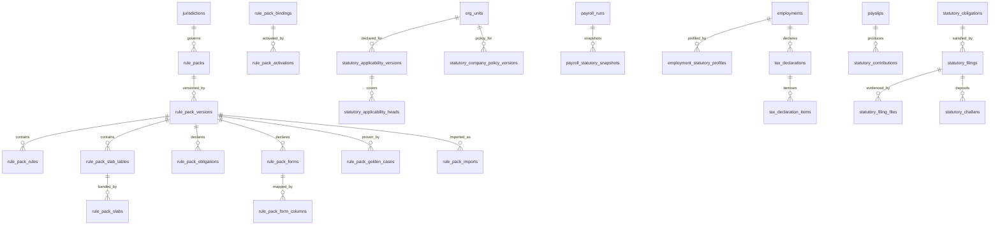

# PART XVII — INDIA STATUTORY ARCHITECTURE

Status: DRAFT FOR PRODUCT OWNER APPROVAL
Covers: brief Sections **39–49** (rule packs, jurisdiction, PF, ESI, PT, LWF,
TDS, minimum wages, gratuity, bonus, protected statutory leave), **90**
(statutory content publication), **108** (statutory baseline versus company
policy), to the **123** (data model) and **125** (module specification)
standards.
Conforms to: `SPINE.md` — S1 (all seven laws), S3 (org model and scope), S4
(effective dating, draft/publish), S5 (**SPX**), S6 (rule engine), S7 (formula
engine), S8 (workflow), S11 (payroll pipeline), **S12 (the India Statutory Rule
Pack — this part is its full specification)**, S14 (audit), S15
(explainability), S16 (data conventions), S18 (deployment parity and signed
distribution).
Extends, and does not fork: PART VI §VI.13 (statutory floor enforcement and
`compliance_exceptions`), PART VII (rule engine), PART VIII (formula engine and
money discipline), PART XXVIII §C8 (the eight statutory tables named there are
specified here to Section 123 grade, and this part adds the remainder).
Evidence base: `analysis/F-statutory-compliance.md` in full;
`analysis/A-payroll.md` §4 and §5.

---

> ## ⛔ ABSOLUTE RULE GOVERNING THIS PART — READ BEFORE ANY OTHER LINE
>
> **This part contains no statement of Indian law, and no value in it may be
> relied upon as legally correct.**
>
> Every rate, ceiling, slab, threshold, contribution percentage, eligibility
> limit, wage cap, divisor, periodicity and due date appearing anywhere in this
> document is one of exactly two things, and is always marked as such:
>
> **(a) A RECORDED SmartPRS 2 CODE VALUE.** Written in the form
> *"the value SmartPRS 2's code currently uses: `<value>` (source:
> `file.php:line`) — **NOT VERIFIED AS LEGALLY CORRECT**"*. This is a forensic
> record of what the existing product computes. It is evidence about a codebase,
> not evidence about a statute. Several of these values are known to be wrong
> even against the product's own intent (see §XVII.2.4). The source itself
> labels them *"Indicative defaults (verify against current state law before
> filing)"* (`AppDataController.php:1847-1848`).
>
> **(b) A PLACEHOLDER.** Written as `<from rule pack: CODE>`, naming the rule
> pack and rule that must supply the value at runtime. **No placeholder is
> filled in anywhere in this blueprint.** A placeholder is a hole in the
> architecture that content must fill, deliberately left open.
>
> **Nothing else is permitted.** A reviewer who finds a bare statutory number in
> this part that is neither labelled (a) nor written as (b) has found a defect in
> this document, and should raise it as such.
>
> ### The verification obligation
>
> **Every value that will ever populate a rule pack must be verified against the
> primary statutory source — the Act, the Rule, the Schedule, the state
> notification or the gazette — by Ametecs' named compliance owner, and that
> verification must be recorded (`source_reference`, `verified_by`,
> `verified_on`, `verification_evidence_document_id`) before the pack is signed,
> and therefore before it is published.** A pack version that cannot produce a
> verification record for every value it carries **cannot be signed** — this is
> enforced by the signing service in §XVII.4.7, not by a reviewer's diligence.
>
> Secondary sources — a consultant's summary, a payroll blog, another vendor's
> product, a prior SmartPRS release, or this blueprint — are **not** primary
> sources and may not be cited as `source_reference`.
>
> **The named compliance owner does not exist yet.** This is
> **D-XVII-01**, restating spine **D-03** and Part I **D-I-08**. Until the
> Product Owner names a person, **no rule pack can be signed, and therefore
> SmartPRS 3 cannot compute a single statutory deduction.** This is the hard
> dependency on the critical path of the whole programme, and it is a hiring or
> appointment decision, not an engineering one.

---

## XVII.1 Purpose

This part decides three things.

1. **That statutory content is a third artefact class.** Not application code,
   not tenant configuration: a separately authored, separately versioned,
   separately signed, separately delivered **rule pack**, published by Ametecs
   and activated by a customer. This is the architectural answer to the single
   most damaging operational fact established in the as-is analysis — that
   shipping a Professional Tax slab change today requires replacing the entire
   application and running database migrations on 200 production servers, each
   initiated by a different customer's own administrator, with no effective
   dating and no way for Ametecs to verify it landed
   (`F-statutory-compliance.md` §Q9).
2. **How Indian statutory obligation is modelled** — jurisdiction,
   establishment, registration, per-scheme applicability, wage base, calculation,
   period semantics, rounding, arrears, joining and exit, returns, and the file
   formats each statute demands — such that every one of those is *data resolved
   at runtime* rather than a branch in PHP.
3. **How Ametecs operates statutory content as a business process** — who
   authors a pack, who reviews it, what golden evidence it must pass, who signs
   it, how it is published, how customers are tracked, and what happens when a
   customer is behind. An architecture that has no operating process behind it
   produces unsigned packs and stale customers, which is materially worse than
   today's situation because the customer will believe they are current.

It does **not** decide: the shape of the payroll pipeline (spine S11, Part XIV),
the formula language (spine S5, Parts VII and VIII), the workflow engine (spine
S8, Part IX), the configuration publish machinery (Part VI), or the compliance
(DRA/PCC/BGV) credential-tracking module, which despite the shared word
"compliance" is a different subject and belongs to the regulatory-compliance
part.

---

## XVII.2 What SmartPRS 2 does today, and why it must change

This section is the justification for every design choice that follows. Each row
carries its citation from `F-statutory-compliance.md` (F-) and `A-payroll.md`
(A-). It is not a defect dump: each item is answered by a named section below.

### XVII.2.1 The nine structural findings

| # | Finding | Evidence | Consequence | Answered by |
|---|---|---|---|---|
| **1** | **The only per-employee statutory applicability control in the product does nothing.** `employees.pf_applicable` (bool) and `employees.esi_applicable` (enum `auto\|yes\|no`) are captured on the employee form, accepted by the CSV import template, written by self-onboarding, exported, and **printed on the payslip** — and have **zero readers**. Neither `statutory()`, `computeSlip()`, `computeSlipFromComponents()` nor `PayrollGenController` reads either column | writers `AppDataController.php:2940-2944`; display `:389-398`; payslip `payslip-pdf.blade.php:66,120`; grep across `app/` finds no reader. F- DEFECT-F-01 (CRITICAL), F- NEW-F-10 | An employer who marks an employee PF-exempt still has PF deducted. The product asks a question, prints the answer on a legal document, and ignores it | §XVII.5.4, §XVII.5.5 |
| **2** | **All the governance was built on the door nobody uses.** Effective dating, scope, insert-only history, the finalised-period guard and the audit trail all live on `statutory_configs`. The screen customers actually use writes `statutory_settings` — **one undated JSON blob per tenant**, `updateOrInsert` on a single row, with **no date, no version, no history, no audit and no period guard** — and that blob is what every consumer except `computeSlip*` reads | `SettingsController::save():135-204`, `:198-201`, `rates():91-102` vs `StatutoryConfigController::save():147-207`; F- §1.1, DEFECT-F-02 (CRITICAL), DEFECT-F-25 (HIGH), SEC-F-03 (HIGH); A- §5.3 Q5 | Change the PF rate today and **every past month you regenerate uses the new rate**, silently, with no record of who changed it. An admin can change the PF rate, run payroll, change it back, and leave no trace — the analysis calls this *"the single highest-value fraud vector in the payroll module"* | §XVII.4 (packs), §XVII.8, §XVII.9 |
| **3** | **Payslips store no rate snapshot of any kind.** The `payslips` table stores amounts only | migration `2026_01_01_000300:53-70`; F- DEFECT-F-03 (CRITICAL) | A payslip cannot be reproduced, explained or defended. In a PF/ESI inspection or an employee dispute there is no record of which rate, cap, slab or PT band produced the figure | §XVII.9 |
| **4** | **The 24Q filing history is fabricated.** Six quarters are emitted; total tax is `annual ÷ 4` per quarter; the current quarter is `Pending` and **every prior quarter is hard-coded `Filed`** with `deposited = perQ`, regardless of whether anything was filed or deposited | `tdsReturnsHistory():1785-1810`, `$status = $i === 0 ? 'Pending' : 'Filed'` `:1800`; F- DEFECT-F-07 (CRITICAL), SEC-F-05 | **The product tells a customer their TDS returns are filed. They are not.** A fabricated compliance record on a tax screen | §XVII.11.5 |
| **5** | **Payslip TDS and Form 24Q disagree by up to ₹62,400 for the same employee.** §87A relief is a hard cliff *inside* `newRegimeTax()`; marginal relief is applied *outside* it, by `salaryTdsMonthly()` only. `statutoryPdf('tds')` and `tdsReturnsHistory()` call `newRegimeTax()` directly | cliff `:1755`, relief `:1836-1840`, raw calls `:1732`, `:1779`; F- §4.6, DEFECT-F-06 (CRITICAL); A- DEF-P09 | At taxable ₹12,00,001 the payslip deducts **₹0.09/month** while the return declares **₹62,400**. The employer's return contradicts the employer's own payslip | §XVII.7.5, §XVII.10 |
| **6** | **PF/ESI challans and returns are recomputed from CTC, not from the payroll that ran.** `statutoryPdf()` recomputes every employee from `employees.ctc` with **no context** — no `pt_state`, no month, no scoped overrides, no LOP, no components, no salary run — over **all non-deleted employees** with no status filter (**resigned staff included**), no company filter and no period filter, then labels the output `now()->format('F Y')` | `:1639-1749`; `computeSlip((float)$e->ctc, $rates, $stage)` at `:1669`, `:1686`; F- DEFECT-F-04 (CRITICAL), BR-STAT-201 | **The PF ECR and ESIC challans a customer downloads and files do not equal the PF and ESI actually deducted.** ESI additionally rounds `ceil` in the engine and `round(…,2)` in the challan (DEFECT-F-05) | §XVII.11 |
| **7** | **PF and ESI wage bases come from component NAMES.** Basic is `str_contains(strtolower(code.' '.name),'basic')`; DA is `str_contains($name,'dearness') \|\| preg_match('/(^\|[^a-z])da([^a-z]\|$)/',$name)`; if nothing matches "basic", **the first earning in the map becomes the PF base**; the ESI half-year lock is `stripos($deductionKey,'esi')` over stored payslip JSON. A `salary_components.taxable` column exists and is **never read** | `:2173`, `:2269`, `:2260-2262`, `:2036`, `MasterController.php:242-247`; F- §Q6; A- §5.3 Q4 | A component named "Consolidated Pay" silently changes the PF base. Renaming "ESI" to "State Insurance" silently disables the statutory contribution-period lock. "Sunday-Allowance" matches the DA regex | §XVII.6 |
| **8** | **A Professional Tax slab change is a PHP `private const` requiring a full application release.** 16 state slab tables and 10 PT-free states are compiled into a controller. Shipping a change means: edit the const, edit the hand-maintained test copy `tests/manual/pt_extract.php`, build a release, then **each of 200 installs must be updated individually** — an admin presses "Check for updates" (**there is no scheduled auto-check**), the install must be online with a valid licence, and a separate updater process runs `artisan down` → back up the tree → replace directories → **`artisan migrate --force`** → `artisan up` | `PT_STATE_SLABS` `:1854-1871`; `PT_FREE_STATES` `:1852`; `UpdateClient.php`, `updater/updater.php:307`; `routes/web.php:244`; F- §Q9 | *"The slab change reaches customers over weeks or months, on 200 different dates, some never… and Ametecs has no telemetry showing which."* Worse, the const is **not effective-dated**, so once the release lands, regenerating any earlier month uses the new slab | §XVII.4 in full |
| **9** | **A lapsed AMC refuses statutory content outright.** `/update/check` refuses everything when AMC has lapsed, so a customer who has not paid support **cannot receive a Professional Tax correction at all** — though the statute applies to them regardless | `UpdateServerController::check():238-246`; `I-saas-licensing-deployment.md` §Q4; CONSOLIDATED-DECISIONS Q-10; CONSOLIDATED-REQUIREMENTS R-29 | A commercial gate sits in front of a legal obligation whose breach is the vendor's liability as much as the customer's | **D-XVII-02**, §XVII.4.9 |

### XVII.2.2 What SmartPRS 2 gets right, and which this part preserves

Spine S19 requires the rebuild not to lose these. Each is carried forward
explicitly:

| # | What is right | Where it is preserved here |
|---|---|---|
| 1 | **The effective-dated, scoped design of `statutory_configs`** — resolution on the *payroll period date*, newest-in-force per `(scope, kind)`, insert-only history, narrowest-scope-wins, and it is unit-tested (`StatutoryConfigTest.php:75-81`). Spine S19 item 6 calls it *"the right model, built and then bypassed"* | Generalised to every artefact by spine S4 and Part VI; the statutory application of it is §XVII.4.5 and §XVII.8 |
| 2 | **The ESI contribution-period lock is a genuinely valuable and correctly conceived rule.** A half-year determination carried forward to the period end is real statutory behaviour that most products omit | §XVII.7.2.5 generalises it into a first-class **eligibility lock** construct, driven by a structured flag, never a display label |
| 3 | **The finalised-period guard** (`EffectiveDated::guardFinalisedPeriod` → `PayrollLock`) — refusing a statutory change dated inside a closed month | §XVII.4.8 and §XVII.8.4, made **fail-closed** (it currently fails open on any exception, `EffectiveDated.php:118-120`) |
| 4 | **The rupee-impact preview before saving a scoped override** | §XVII.4.8 extends it from full-CTC to the real payroll basis (its own docblock admits *"only the delta is meaningful"*, `StatutoryConfig.php:557-558`) |
| 5 | **The insert-only save and payload whitelist** (`:394-405`, `:368-372`), and `cleanSlabs()`'s band validation — bands must climb, the open band must be last, a negative value rejects the whole save (`:422-458`) | §XVII.4.4 (pack validation), §XVII.7.3.3 |
| 6 | **Refusing to assert legal correctness in the UI.** `StatutoryController:109` and `statutory-pdf.blade.php:47` already print *"Indicative figures — verify against your registered statutory rates before filing."* The analysis calls this *"correct and worth preserving into SmartPRS 3"* | §XVII.4.10 makes provenance disclosure mandatory on every statutory output, not optional |
| 7 | **Depth of domain coverage attempted** — PF, ESI, PT, LWF, TDS, bonus, gratuity, 24Q, ECR, challans. The implementations are defective; the coverage is real and hard-won (spine S19 item 2) | §XVII.7 covers every one of them, plus minimum wages and protected statutory leave |

### XVII.2.3 Recorded SmartPRS 2 code values — the seed corpus for verification

> **Every value in this table is the value SmartPRS 2's code currently uses.
> NONE IS VERIFIED AS LEGALLY CORRECT.** The table exists for exactly one
> purpose: it is the **work list** the compliance owner must verify, value by
> value, against primary sources before the first rule pack is signed. It is
> reproduced from `F-statutory-compliance.md` §Q1 and `A-payroll.md` §4, which
> are themselves forensic records of PHP source.
>
> **Class legend:** **(a)** hard-coded in PHP · **(b)** stored in configuration
> and editable · **(c)** seeded as a compiled constant, effectively immutable.

| Head | Value SmartPRS 2's code currently uses | Meaning in that code | Source | Class |
|---|---|---|---|---|
| **PF** | `15000` | `pf_wage_cap` default | `SettingsController.php:32` | (b) |
| | `12` | `pf_rate` default, % each side | `:33` | (b) |
| | `15000` | EPS/EDLI wage ceiling | `AppDataController.php:2067` | **(a)** |
| | `8.33` | EPS % of EPS base | `:2071` | **(a)** |
| | `1250` | EPS monthly cap ₹ | `:2071` | **(a)** |
| | `0.5` | EDLI % | `:2073` | **(a)** |
| | `15000` | EDLI ceiling, duplicated on the payslip employer strip | `:1542` | **(a)** duplicate |
| | *(absent)* | EPF administrative charges (A/c 2), EDLI admin (A/c 22), VPF, the restrict-to-ceiling-vs-full-wages employer election, international-worker rules | — | **not implemented** |
| **ESI** | `21000` | `esi_threshold` default, gross ≤ | `SettingsController.php:34` | (b) |
| | `0.75` / `3.25` | `esi_employee_rate` / `esi_employer_rate` defaults, % | `:34` | (b) |
| | `ceil()` | rounding of **both** shares in the engine | `AppDataController.php:2077-2078` | **(a)** |
| | `round(…,2)` | rounding used by the ESIC **challan PDF** — conflicts with the line above | `:1688-1689` | **(a)** |
| | months `4` and `10` | contribution-period boundaries | `:2019-2025` | **(a)** |
| | `24` | payslip rows scanned by the period lock | `:2032` | **(a)** |
| **PT** | 16 state slab tables (telangana, andhra, maharashtra, karnataka, west bengal, tamil nadu, gujarat, madhya pradesh, kerala, bihar, odisha, assam, jharkhand, chhattisgarh, punjab, goa), full band values recorded at `F-…` §Q1 and `A-…` §4.7 | state-wise monthly slab on gross | `:1854-1871` | **(c)** |
| | 10 PT-free states (delhi, uttar pradesh, haryana, rajasthan, himachal, uttarakhand, chandigarh, jammu, ladakh, arunachal) | declared PT-free | `:1852` | **(c)** — a state may be **added**; a built-in **cannot be removed** |
| | `300` / trigger `200` / month `'02'` / state `'maharashtra'` | February uplift | `:1911-1913` | **(a)** |
| | `1` / `25000` | `pt_female_exempt` on, `pt_female_exempt_upto` ₹ | `SettingsController.php:36-37` | (b) |
| | `['female','f','woman','women']` + `'maharashtra'` | female-exemption gender tokens and state | `AppDataController.php:1936-1938` | **(a)** |
| | `15000→0 · 20000→150 · ∞→200` | **unknown-state fallback slab** — a Telangana-shaped table applied to every unmapped state | `:1988-1992` | **(a)**, and unsettable (`$r['pt_slabs']` is stripped by the whitelist) |
| | `200` | `pt_amount`, labelled "Professional Tax / month (₹)" in **both** rate screens | `SettingsController.php:35` | (b) **DEAD — no reader** |
| | `2500 = 200×11 + 300` | Maharashtra annual PT in the report; every other state is `monthly × 12` | `StatutoryController.php:97` | **(a)** |
| **TDS** | `75000` / `1200000` / `4` | `std_deduction` ₹ / `rebate_87a_limit` ₹ / `cess_rate` % | `SettingsController.php:38-40` | (b) |
| | `5` / `20` | `comm_tds_rate` (194H) % / `no_pan_tds_rate` % | `:41-42` | (b) |
| | `400000→0 · 800000→5 · 1200000→10 · 1600000→15 · 2000000→20 · 2400000→25 · above→30` | `tds_slabs` default (New Regime only) | `:64-72` | (b) **legacy screen only — cannot be dated or scoped** |
| | `30` | `comm_pct` fallback % for "Salary + Commission" | `AppDataController.php:1708`, `:1730` | **(a)** |
| | `12` | flat months divisor for monthly TDS; **no YTD true-up** | `:1842` | **(a)** |
| | `31 Jul` / `31 Oct` / `31 Jan` / `31 May` | 24Q Q1–Q4 due dates — **the only statutory due dates anywhere in the codebase** | `:1795-1798` | **(a)** |
| | *(absent)* | Old Regime, surcharge, Chapter VI-A, HRA exemption, LTA, perquisites, previous-employer income, per-employee override, Form 16, 12BA, 12BB | — | **not implemented** |
| **LWF** | `false` / `0` | `lwf_enabled` / `lwf_employee` — a flat rupee amount, monthly, no state, no periodicity, no employer share | `SettingsController.php:43-44` | (b) reachable **only** through the raw `/app/statutory-config/save` API; absent from the validated key list, so unsettable through any UI |
| **Gratuity** | `15 / 26` | provision divisor | `StatutoryController.php:57` | **(a)** |
| | `5` | eligibility years | `:56` | **(a)** |
| | `365.25` | days per year | `:55` | **(a)** |
| | `4.81` | a **second, unrelated** gratuity accrual % of Basic on the payslip | `AppDataController.php:1543` | **(a)** |
| | *(absent)* | any ceiling; the 15/30 non-covered variant; death/disability waiver | — | **not implemented** |
| **Bonus** | `21000` | eligibility ceiling on Basic ₹/month | `StatutoryController.php:138` | **(a)** |
| | `7000` | bonus wage cap ₹/month | `:139` | **(a)** |
| | `8.33` / `20` | clamp floor and ceiling % (`bonus_pct` default `8.33`) | `:120`; `SettingsController.php:55` | **(a)** / (b) |
| | `30.44` | days per month for joiner proration | `:146` | **(a)** |
| | `1 April` | financial-year start | `:125` | **(a)** |
| **Structure / other** | `0.5` / `0.4` | Basic = 50% of gross, HRA = 40% of Basic | `AppDataController.php:2103-2104` | **(a)** |
| | `50` | Code-on-Wages Basic+DA advisory % (never blocks) | `MasterController.php:883` | **(a)** |
| | `26` / `8` / `2` | OT divisor days, hours per day, default multiplier — in two copies | `MasterController.php:757-762`; `PayrollGenController.php:2165` | **(a)** |
| | `'probation'`, `'internship'` | the two employment-stage literals that suppress PF, PT and TDS while ESI, LWF and Conveyance are hard-coded as still applying | `:2114-2117`, `:2284-2287` | **(a)** |

**R-XVII-001** Not one of the values above enters SmartPRS 3 as a default, a
seed, a fallback or a constant. Each enters **only** as a candidate value on the
compliance owner's verification work list (§XVII.12.2), and reaches a customer
**only** inside a signed rule pack carrying its own `source_reference`,
`verified_by` and `verified_on`. *Test: a CI rule fails the build if any numeric
literal from this table appears in `Domain\Statutory` or in any seeder.*

**R-XVII-002** The migration tool MUST convert each tenant's `statutory_settings`
blob and `statutory_configs` rows into **tenant company-policy artefacts**, never
into rule-pack content, and MUST mark every converted value
`provenance = migrated_unverified` so it is visibly distinguishable from a
verified statutory value on every screen that shows it (§XVII.18.3).

### XVII.2.4 Values SmartPRS 2 computes that are wrong against its own intent

Recorded so that migration does not carry them forward as though they were
deliberate. These are **not** claims about law; they are claims about the code
contradicting itself.

| Observation | Evidence |
|---|---|
| `min(round(15000 × 8.33/100, 2), 1250.0)` — the declared cap **never binds**, because `round(…)` yields `1249.50`. The cap is dead code | `AppDataController.php:2071`; A- DEF-P08 |
| ESI is `ceil` in the engine and `round(…,2)` in the challan: two numbers for one contribution | `:2077-2078` vs `:1688-1689`; F- DEFECT-F-05 |
| Four gratuity implementations disagree on rounding (whole rupee vs 2 dp), on the year count (`diffInDays/365.25` then `floor` vs `diffInYears`) and on the Basic used | `StatutoryController:54-57`, `ReportController:264-275`, `:1543`; A- §4.13 |
| PT annualisation is `monthly × 12` for every state except Maharashtra, though the source's own comments say the Tamil Nadu, Kerala and Madhya Pradesh tables are half-yearly or annual bases *"shown as monthly equivalents"* | `StatutoryController.php:95-98`; slab comments `:1860`, `:1862`, `:1863`; F- DEFECT-F-29 |
| A malformed PT band such as `[[15000]]` silently yields **PT = ₹0** for a whole state — and `tests/manual/check_pt.php:80` **asserts this as correct** | `:1899-1910`; F- DEFECT-F-24 |
| The minimum-wage check compares `CTC/12` against `MAX(monthly_min)` across **every** `min_wages` row for the tenant — state, zone, category, `effective_from` and `status` all ignored | `ReportController.php:136-155`; F- DEFECT-F-17 |
| A mid-month effective date **silently defers a month**: `EffectiveDated::toDate(null)` returns *today*, and resolution is on `month-01`, so a row saved on 15 Sep gets `effective_from = 2026-09-15` and does not apply to September | `EffectiveDated.php:126-132`; `StatutoryConfig.php:129-131`; F- DEFECT-F-26 |
| The SPA carries a **second copy of every rate** and re-implements the tax slab walk in JavaScript, using `Math.round` for ESI, ignoring components, `pt_state` and probation; its TDS caption still reads *"₹50k std deduction, 87A ≤ ₹7L"* against actual defaults of ₹75,000 and ₹12,00,000 | `AppController.php:11161`, `:11167-11177`, `:12081-12086`, `:12113`; F- DEFECT-F-27 |
| Two **further** copies exist as hard-coded prose in the in-product help, which do not follow the configured rates | `KbController.php:211`; `CalcGuideController.php:88,126,136,161`; F- DEFECT-F-28 |
| `tests/manual/pt_extract.php` is a **hand-maintained copy of production PT code** with a comment instructing the developer to re-extract on every change | F- DEFECT-F-34 |

**R-XVII-003** None of the above is replicated. Where SmartPRS 3 must decide
something SmartPRS 2 decided wrongly, the decision is a declared rule-pack
attribute with a stated rounding mode, periodicity and source — never an emergent
property of where a `round()` happened to sit. *This is a direct application of
Part VIII's money discipline (R-VIII-004: exactly one implementation, and it is
an artefact).*

---

## XVII.3 The three-artefact model

Everything in this part rests on one separation. SmartPRS 2 has two artefact
classes (application code, tenant settings) and puts statutory content in both.
SmartPRS 3 has three.

| | **Application code** | **Statutory rule pack** | **Tenant configuration** |
|---|---|---|---|
| **What it is** | The platform: engines, persistence, UI, adapters | The law, as data: applicability, calculations, slabs, thresholds, due dates, form mappings | The customer's own choices: which schemes apply where, enhanced policies, component structures, cycles |
| **Who authors it** | Ametecs engineering | **Ametecs' named compliance owner** (D-XVII-01) | The tenant's administrator or an Ametecs consultant |
| **Signed?** | Yes (spine S18) | **Yes — asymmetric, private key never leaves Ametecs** | No; approved through maker-checker |
| **Versioned?** | Semantic release version | `pack_version`, effective-dated | `config_versions` (spine S4) |
| **Delivery** | Update package, maintenance window, migrations | **Content channel — no deployment, no downtime, no migration** | In-product, immediate on publish |
| **Editable by a tenant?** | Never | **Never.** A tenant accepts, schedules or declines a pack; it cannot alter one | Yes, within the statutory floor |
| **Gated on AMC?** | Yes (feature updates) | **D-XVII-02 — recommendation: no** | n/a |
| **Precedence** | — | **The floor.** Company policy may improve, never reduce | Above the floor |
| **SmartPRS 2 equivalent** | The whole product | *(none — statutory content is inside the application code, or inside an undated tenant blob)* | `statutory_settings`, `statutory_configs` |

**R-XVII-004** No statutory *value* may appear in application code, in a
migration, in a seeder, in a fixture used outside a test, in a Blade or SPA
template, in help text, or in a tenant configuration artefact. Statutory values
exist in exactly one place: a signed rule pack. *Test: the CI conformance sweep
of R-XVII-001 plus a template-scan rule that fails the build on a currency or
percentage literal in any view, help topic or SPA bundle. This directly closes
DEFECT-F-27 and DEFECT-F-28, where the rates exist in five places and disagree.*

**R-XVII-005** No statutory *semantics* may appear in tenant configuration. A
tenant may declare **applicability** ("this establishment is PF-covered from
this date") and **enhanced policy** ("we contribute on full wages"), and nothing
else. How PF is calculated, what its wage base means, how it rounds and what it
reports are rule-pack content. *Because SmartPRS 2's PT slab editor lets a
non-expert administrator hand-type statutory band tables at 200 sites, where a
typo of the form `[[15000]]` silently zeroes a state's PT (DEFECT-F-24).*

**R-XVII-006** Tenant configuration may nonetheless **override an applicability
determination or a policy value within the floor** without an Ametecs release,
and a rule pack may be **superseded by a corrective pack** without an application
release. Neither path requires the other. *Test: the twelve acceptance rows of
Part VI §127.13, of which 12a (a PT slab is amended) must be demonstrated with no
code deployed.*

---

## XVII.4 The Statutory Rule Pack *(brief Sections 39 and 90; spine S12)*

### XVII.4.1 Anatomy

A **rule pack** is an immutable, signed, effective-dated bundle of statutory
content for **one statute in one jurisdiction**. It is not "all of Indian
payroll law in one file", for four reasons that each come from the as-is
evidence:

1. **States amend independently.** A Telangana PT notification must not force a
   customer operating only in Karnataka to re-accept anything.
2. **Blast radius.** A defective pack must be withdrawable without withdrawing
   unrelated statutes.
3. **Verification granularity.** The compliance owner signs off a bounded body
   of content, not a monolith.
4. **Applicability.** A customer with no Maharashtra establishment should never
   have a Maharashtra pack bound at all — so "which packs must this tenant hold?"
   is answerable, which is what makes the coverage gate of §XVII.5.5 possible.

```
pack identity        (pack_key)         IN-TG-PT
  └── version        (pack_version)     2026.5          ← immutable once signed
        ├── manifest                     identity, dates, signature, verification
        ├── rules[]                      one per statutory calculation or determination
        │     ├── eligibility  (SPX)
        │     ├── calculation  (SPX)
        │     ├── wage base    (component-flag reference — never a name)
        │     ├── rounding, periodicity, lock semantics
        │     ├── floor direction + severity   → Part VI §VI.13 enforcement
        │     └── slab tables[] (banded, with modifiers and predicates)
        ├── obligations[]                due-date rules → the statutory calendar
        ├── forms[] + report_mappings[]  ECR / return / challan column bindings
        ├── value_sets[]                 e.g. reason codes a return demands
        └── golden_cases[]               executable evidence, signed with the pack
```

**R-XVII-007** A pack version is **immutable once signed**. Content is never
edited in place; a correction is a new `pack_version` that supersedes. *Test:
the pack store rejects any write to a signed version; the content hash is
re-verified on every read into the resolver's cache.*

**R-XVII-008** A pack carries **executable golden cases** (§XVII.4.7.3) inside
the signed envelope. A customer installation re-runs them locally on import,
before activation, against its own platform build. A pack whose golden cases fail
on the customer's build is **rejected, not warned about** — because that
divergence means the customer's engine does not compute what Ametecs verified.
*This has no SmartPRS 2 equivalent; the nearest thing, `tests/manual/pt_extract.php`,
is a hand-copied duplicate of production code that silently stops testing it
(DEFECT-F-34).*

### XVII.4.2 The pack manifest schema

The manifest is the signed header. It is canonicalised (§XVII.4.6) and the
signature covers it together with the content body.

```yaml
# ── rule pack manifest — normative schema ────────────────────────────────────
manifest_schema_version: 1                 # integer; the platform refuses unknown

pack:
  pack_key:            IN-TG-PT            # stable identity, §XVII.4.4
  jurisdiction_code:   IN-TG               # ISO 3166-2:IN, §XVII.4.4
  statute_code:        pt                  # epf|esi|pt|lwf|tds|bonus|gratuity|
                                           # minimum_wages|maternity|leave_statutory
  pack_version:        "2026.5"            # <fy_or_year>.<sequence>, §XVII.4.5
  supersedes_version:  "2026.4"            # null for the first version of a pack
  title:               "<human title>"
  publisher:           ametecs

validity:
  effective_from:      2026-10-01          # the STATUTORY effective date
  effective_to:        null                # null = open
  announced_at:        2026-09-12T11:04:00Z
  published_at:        2026-09-12T11:47:00Z
  activation_deadline: 2026-09-28          # after which non-activation is escalated

compatibility:
  min_platform_version: "3.2.0"
  max_platform_version: null
  requires_packs:                          # cross-pack dependency, resolved before activation
    - { pack_key: IN-EPF, min_version: "2026.1" }
  requires_component_flags:                # the wage-base flags the rules read (§XVII.6)
    - is_pt_gross
  requires_symbols:                        # SPX symbols the calculations use (spine S5.3)
    - statutory.pt_gross
    - org.state
    - period.end

verification:                              # ── mandatory; unsigned without it ──
  verified_by:        "<named compliance owner>"      # D-XVII-01
  verified_role:      "Head of Statutory Compliance"
  verified_on:        2026-09-11
  reviewed_by:        "<second reviewer>"             # four-eyes, §XVII.12.4
  reviewed_on:        2026-09-11
  evidence_document_sha256: "<hash of the filed gazette / notification PDF>"
  primary_sources:
    - authority:      "<issuing authority>"
      reference:      "<notification / gazette number>"
      dated:          "<date of the instrument>"
      url:            "<official URL, if any>"
      retrieved_on:   2026-09-10
      document_sha256: "<hash>"
  legal_opinion_ref:  null                 # set where external counsel was engaged

integrity:
  canonicalisation:   "JCS/RFC-8785"
  content_hash_alg:   "SHA-256"
  content_hash:       "<hex of the canonicalised content body>"
  signature_alg:      "Ed25519"
  signature:          "<base64 detached signature over manifest||content_hash>"
  public_key_id:      "ametecs-rulepack-2026"
  countersignature:   "<base64>"           # the second signer, §XVII.4.6
  countersign_key_id: "ametecs-rulepack-cs-2026"

content_summary:                           # rendered in the accept dialog; advisory only
  rules:        3
  slab_tables:  1
  obligations:  2
  forms:        1
  golden_cases: 41
  change_note:  "<one-paragraph plain-English statement of what changed and why>"
```

**Field rules.**

| Field | Rule | Why |
|---|---|---|
| `verification.*` | **Every subfield except `legal_opinion_ref` is mandatory.** The signing service refuses a manifest missing any of them | The verification obligation of the boxed rule is enforced mechanically, not editorially |
| `primary_sources[]` | At least one entry; each requires an authority, a reference, a date and a content hash of the retrieved instrument | So a value's authority survives the URL rotting. SmartPRS 2 carries **no source citation on any of its ~90 statutory values** (F- §12 item 1) |
| `effective_from` | The **statutory** date the content takes effect, not the publication date | A pack published on 12 September that takes effect on 1 October must not affect September payroll (spine S4 resolution semantics) |
| `activation_deadline` | Advisory to the customer, operative for Ametecs: a customer past it appears on the exposure register (§XVII.12.7) | Answers *"which of our 200 customers is running stale statutory content?"* — unanswerable today |
| `requires_component_flags` | The pack declares which component flags its wage bases read; import fails if the platform build does not know a flag | Closes the class of failure where a wage base silently resolves to nothing |
| `min_platform_version` | Import refuses a pack the build cannot evaluate | A pack using an SPX function a build lacks must not half-apply |
| `change_note` | Plain English, mandatory, shown verbatim in the accept dialog | The person accepting is a payroll administrator, not a lawyer |

**R-XVII-009** A pack whose manifest fails schema validation, whose
`content_hash` does not match the canonicalised body, whose signature or
countersignature does not verify, or whose `min_platform_version` exceeds the
installation's build, is **rejected outright**: not staged, not partially
applied, not warned about. An operator alert names the pack, the key id and the
failure mode. *(Part VI E12 states the same rule from the configuration side;
this part is its statutory implementation.)*

### XVII.4.3 The content schema

The content body is a list of typed objects. Each is specified below with the
SmartPRS 2 defect that requires it.

#### `rule` — a statutory calculation or determination

```yaml
- object:            rule
  rule_code:         PT.MONTHLY                  # unique within the pack version
  label:             "<human label>"
  head_code:         PT                          # the statutory head this contributes to
  leg:               employee                    # employee | employer | both | none
  applies_when:      "org.state = 'TG' AND statutory.applicable(PT)"   # SPX Boolean
  except:            null                                              # SPX Boolean
  wage_base:
    kind:            component_flag
    flag:            is_pt_gross                 # NEVER a component name (§XVII.6)
    include_arrears: <from rule pack: PT.ARREAR_TREATMENT>
    proration:       none | payable_days | calendar_days   # declared, never assumed
  calculation:       "SLAB(statutory.pt_gross, 'PT-TG-2026-5', period.end)"  # SPX → Money
  ceiling_amount:    <from rule pack: PT.CEILING>          # null where none applies
  floor_amount:      <from rule pack: PT.FLOOR>
  employee_rate:     <from rule pack: PT.EMPLOYEE_RATE>    # null for a slab-driven head
  employer_rate:     <from rule pack: PT.EMPLOYER_RATE>
  rounding:
    mode:            <from rule pack: PT.ROUNDING_MODE>    # up|down|half_up|half_even|none
    unit:            <from rule pack: PT.ROUNDING_UNIT>    # in minor units (paise)
    applied_at:      per_employee_per_period               # or per_line | at_challan
  periodicity:       <from rule pack: PT.PERIODICITY>      # monthly|half_yearly|annual|on_event
  period_anchor:     <from rule pack: PT.PERIOD_ANCHOR>    # e.g. financial_year | apr_oct
  eligibility_lock:  null                        # see the `lock` object below
  annual_cap:        <from rule pack: PT.ANNUAL_CAP>
  joining_treatment: <from rule pack: PT.JOINING_RULE>     # full|prorate|from_next_period|none
  exit_treatment:    <from rule pack: PT.EXIT_RULE>
  floor_direction:   lower_is_better | higher_is_better | must_equal | must_be_within
  floor_severity:    block | exception_required | warn     # drives Part VI §VI.13
  contributes_to_forms: [ PT-RETURN-TG ]
  source_reference:  "<notification reference>"            # per rule, not just per pack
  notes:             "<compliance owner's note>"
```

| Attribute | Exists because |
|---|---|
| `wage_base.flag` | PF/ESI bases come from component **names** today (`:2173`, `:2269`), and the fallback is *"the first earning in the map"* (`:2260-2262`) |
| `rounding.mode` + `unit` + `applied_at` | ESI rounds `ceil` in the engine and `round(…,2)` in the challan (DEFECT-F-05); EPS's declared ₹1,250 cap never binds because rounding happens first (DEF-P08) |
| `periodicity` + `period_anchor` + `annual_cap` | Half-yearly and annually-capped PT states are stored as *"monthly equivalents"* and annualised `× 12` (DEFECT-F-29) |
| `joining_treatment` / `exit_treatment` | Nothing in SmartPRS 2 reads a date of leaving for any statutory head (A- §5.2 item 18) |
| `floor_direction` + `floor_severity` | Part VI R-VI-120/121: severity is the pack's, never the tenant's |
| `source_reference` **per rule** | So a single amended slab is traceable without re-verifying an entire pack |

#### `slab_table` — banded values with modifiers and predicates

```yaml
- object:          slab_table
  table_code:      PT-TG-2026-5
  basis:           statutory.pt_gross          # what the bands are read against
  basis_period:    monthly                     # the period the BANDS are expressed in
  bands:
    - { band_no: 1, from: 0,
        to:      <from rule pack: PT-TG.BAND_1_TO>,
        amount:  <from rule pack: PT-TG.BAND_1_AMOUNT>,
        rate_pct: null }
    - { band_no: 2, from: <…>, to: <…>, amount: <…>, rate_pct: null }
    - { band_no: 3, from: <…>, to: null,  amount: <…>, rate_pct: null }   # null = open band, last
  modifiers:
    - { modifier_code: PERIODIC_UPLIFT,
        applies_when: "period.month = <from rule pack: PT-TG.UPLIFT_MONTH>",
        when_band_amount_at_least: <from rule pack: PT-TG.UPLIFT_TRIGGER>,
        set_amount: <from rule pack: PT-TG.UPLIFT_AMOUNT> }
  predicates:
    - { predicate_code: ATTRIBUTE_EXEMPTION,
        applies_when: "employee.gender IN <from rule pack: PT-TG.EXEMPT_GENDERS>
                       AND statutory.pt_gross <= <from rule pack: PT-TG.EXEMPT_CEILING>",
        result: exempt,
        evaluated: before_bands }
```

**R-XVII-010** Band validation at pack build time, carried forward from
SmartPRS 2's `cleanSlabs()` (`StatutoryConfig.php:422-458`), which got this
right: bands must be contiguous and ascending, exactly one open band and it must
be last, no negative amount, no overlap, no gap. **A malformed table is a build
failure, never a silent zero.** *Directly closing DEFECT-F-24, where
`[[15000]]` yields ₹0 for a whole state and a test asserts it as correct.*

**R-XVII-011** A slab table declares `basis_period`. Annualisation, half-yearly
settlement and annual caps are computed from the declared periodicity, never by
multiplying a monthly figure by twelve. *Closing DEFECT-F-29.*

**R-XVII-012** The February uplift and the female exemption become the general
constructs `modifiers[]` and `predicates[]`. There is no state name, no month
literal and no gender token list anywhere in application code. *Because
SmartPRS 2 hard-codes `if ($key === 'maharashtra' && $amt >= 200 && substr($month,5,2) === '02')`
(`:1911-1913`) and `['female','f','woman','women']` (`:1936-1938`).*

#### `lock` — period-locked eligibility

```yaml
- object:              lock
  lock_code:           ESI.CONTRIBUTION_PERIOD
  head_code:           ESI
  determination:       "statutory.esi_wage <= <from rule pack: ESI.WAGE_THRESHOLD>"
  period_anchor:       <from rule pack: ESI.PERIOD_ANCHOR>     # e.g. two half-years
  determined_at:       period_start                            # first period of the anchor
  carry_forward_when:  contributed                             # once true, hold to period end
  release_at:          period_end
  evidence:            structured_flag                         # NEVER a display label
  on_rejoin:           <from rule pack: ESI.REJOIN_RULE>
  on_establishment_change: <from rule pack: ESI.TRANSFER_RULE>
  on_retro_arrear:     <from rule pack: ESI.RETRO_RULE>
```

**R-XVII-013** A lock is evaluated against `employment_statutory_profiles.
period_lock_from/period_lock_to` and `statutory_contributions`, both structured.
**No statutory determination may inspect a payslip line's display name.** *Because
`esiPeriodLock():2036` does `stripos($deductionKey, 'esi')` over stored payslip
JSON, so a tenant who renames "ESI" to "State Insurance" silently loses the lock
(BR-STAT-005) — and the same query has no tenant filter (`:2029`, SEC-P08).*

#### `obligation` — a due date, and therefore the statutory calendar

```yaml
- object:            obligation
  obligation_code:   PT.PAYMENT.TG
  head_code:         PT
  jurisdiction_code: IN-TG
  label:             "<human label>"
  period_kind:       monthly | quarterly | half_yearly | annual
  due_rule:          "<from rule pack: PT-TG.PAYMENT_DUE_RULE>"   # SPX Date over period.*
  applies_when:      "statutory.applicable(PT) AND org.state = 'TG'"
  owner_role:        payroll.statutory.filer
  reminder_ladder:   <from rule pack: PT-TG.REMINDER_LADDER>      # e.g. [-7d, -3d, -1d, +1d]
  evidence_required: true                     # a filing cannot be marked filed without it
  form_code:         PT-RETURN-TG
  penalty_note:      "<informational; never computed as a liability>"
```

**R-XVII-014** Every statutory head in every bound jurisdiction MUST publish its
obligations. The statutory calendar is **generated from pack content**, never
authored in the application or typed by a customer. *Because today the only
statutory due dates in the entire codebase are four hard-coded 24Q dates
(`:1795-1798`), there is no PF ECR, ESI, PT, TDS-deposit, LWF or annual-return
date anywhere, and `tds_returns.due_date` is typed by hand and connected to
nothing (DEFECT-F-42).*

**R-XVII-015** SmartPRS 3 **never computes a statutory penalty, interest or
damages figure.** `penalty_note` is informational text shown to a human.
Computing a penalty would be an assertion about law with money attached, which
this architecture forbids. *Recorded as a deliberate exclusion so it is not
mistaken for an omission.*

#### `form` and `report_mapping` — returns and file formats

```yaml
- object:          form
  form_code:       ECR-EPF-V2
  head_code:       PF
  medium:          delimited_text            # delimited_text|fixed_width|xml|csv|xlsx|pdf
  file_naming:     "<from rule pack: ECR.FILE_NAME_PATTERN>"
  encoding:        UTF-8
  line_ending:     "\n"
  delimiter:       "#~#"                     # declared by the pack, never by code
  sections:
    - { section_code: header, cardinality: 1 }
    - { section_code: member, cardinality: many }
    - { section_code: trailer, cardinality: 1 }

- object:          report_mapping
  form_code:       ECR-EPF-V2
  section_code:    member
  columns:
    - { col_no: 1, name: "<field name>", source: employee.uan_number,
        type: text, length: 12, required: true,
        validation: "MATCHES('^[0-9]{12}$')" }
    - { col_no: 2, name: "<field name>", source: employee.full_name,
        type: text, length: 85, transform: UPPER, required: true }
    - { col_no: 3, name: "<field name>", source: contribution.wage_base_amount,
        type: money, rounding: <from rule pack: ECR.AMOUNT_ROUNDING>, required: true }
    # … every column of the file, declared
  reconciliation:
    - "SUM(member.employee_amount) = trailer.total_employee_amount"
    - "COUNT(member) = trailer.member_count"
```

**R-XVII-016** Every statutory return, challan and register is generated from a
pack-declared `form` + `report_mapping`, reading **stored payslip and
contribution rows**. There is no hard-coded column array anywhere. *Because
SmartPRS 2's PF ECR, ESIC challan, 24Q and 26Q layouts are hard-coded column
arrays (A- §5.2 item 58) recomputed live from CTC over all non-deleted employees
including resigned staff (DEFECT-F-04).*

**R-XVII-017** Every form declares `reconciliation` assertions, and a file that
fails one **is not produced**. The run aborts with the failing assertion named.
*Because nothing in SmartPRS 2 asserts that a challan equals the payroll it
claims to summarise, and the ESI challan is understated against the payslips by
up to ₹0.99 per employee per share by construction (DEFECT-F-05).*

#### `value_set`

Statutory code lists a return demands — reason-for-exit codes, ESIC dispensary
codes, PT circle codes, TDS deductee sections. These are **content**, published
and dated with the pack, and appear in the platform's ordinary value-set
machinery (spine S9) marked `owner = rule_pack` and therefore not tenant-editable.

### XVII.4.4 Jurisdiction identifiers

**R-XVII-018** Jurisdictions are identified by **structured codes**, never by
free-text names or substring matching.

```
IN                       the Union (central statutes: EPF, ESI, TDS, bonus, gratuity)
IN-<subdivision>         ISO 3166-2:IN codes for the 28 states and 8 union territories
IN-<subdivision>-<n>     an intra-state jurisdiction where a statute is levied at a
                         narrower level (a PT circle, a municipal cess, a zone for
                         minimum wages)
```

**R-XVII-019** The jurisdiction register is **platform reference data shipped
with the application** (identity only — codes, names, parent, type, effective
range), because the set of states and union territories is not a statutory value
in the sense this part protects; it is an identity list. **All 28 states and all
8 union territories are present from day one**, each in one of three coverage
states, and none of them silently inherits another jurisdiction's slab.

| Coverage state | Meaning | Behaviour when payroll resolves it |
|---|---|---|
| `covered` | A signed pack is bound and active for this jurisdiction and statute | Compute normally |
| `declared_not_applicable` | A signed pack asserts this statute is not levied here | Contribute nothing; the payslip trace says so and names the pack |
| `unmapped` | No pack is bound | **Payroll preview raises a blocking exception** (`unmapped_statutory`, spine S11). *See D-XVII-04* |

**R-XVII-020** An unmapped jurisdiction **never falls through to another
jurisdiction's values.** *This is the direct fix for the most quietly dangerous
behaviour in the as-is system: an employee in Manipur is charged Telangana's
Professional Tax, because an unmatched state falls through to a hard-coded
fallback slab that the configuration whitelist makes permanently unreachable
(`:1986-1999`; `StatutoryConfig.php:368-372`; F- §Q3). SmartPRS 2 names 26 of
~36 jurisdictions; the other ten are charged Telangana's rates.*

**R-XVII-021** State matching is by `jurisdiction_code` equality on a resolved
foreign key. `CONTAINS`, `str_contains` and bidirectional substring matching are
forbidden in every statutory path. *Because `looseMatch()` is
`a === b || contains(a,b) || contains(b,a)` (`StatutoryConfig.php:231-240`) and
PT keys are stored as `'andhra'` precisely so substring matching works — which
means any state name containing a shorter key matches it (F- §Q3).*

### XVII.4.5 Versioning and effective dating

```
pack_version := <year_or_fy>.<sequence>          e.g. 2026.1, 2026.2, 2026-27.3
```

| Property | Rule |
|---|---|
| Ordering | Versions are totally ordered within a `pack_key`. A version may only supersede a lower one |
| Immutability | A signed version is never edited. A correction is a new version |
| Effective dating | A version carries `effective_from` and optional `effective_to`. Publishing closes the predecessor's `effective_to` at the day before (spine S4) |
| Overlap | Two active versions of the same `pack_key` may not have overlapping effective ranges. Rejected at publish time |
| Gaps | A gap in a bound pack's effective coverage is a **blocking** validation finding, because a payroll period inside the gap has no statutory content |
| Retrospection | A pack may be published with an `effective_from` in the past (statutes are routinely notified retrospectively). See §XVII.4.8.4 |
| Withdrawal | A version may be **withdrawn** by Ametecs. Withdrawal never deletes: the version is marked `withdrawn` with a reason, installations are alerted, and payslips already produced from it retain their reference and remain explainable |

**R-XVII-022** Statutory resolution is always
`resolve(pack_key, jurisdiction, as_of = period_end)` — **the payroll period,
never "now"**, and for every consumer, not only the payslip. *This is the single
most important semantic in the part. SmartPRS 2's effective-dated layer resolves
correctly but reaches only two call sites; the challan PDFs, the 24Q, the money
gates, the incentive TDS, the scorecard, the letters and the entire SPA read the
undated blob (DEFECT-F-25), and `PayrollGenController::compute():1094` calls
`SettingsController::rates($tid)` with no date argument at all (A- §5.3 Q5).*

**R-XVII-023** `as_of` for a statutory resolution is **the payroll period's
declared statutory anchor date**, which the pack declares per head
(`period_anchor`), defaulting to `period.end`. It is never `today()`, never the
run date, and never the pay date. *Test: a payroll for August 2026 regenerated
in December 2029 resolves the same pack versions and produces the identical
figures, asserted by the golden replay harness (§XVII.20.6).*

**R-XVII-024** A pack version whose `effective_from` falls inside a **finalised**
payroll period may be activated, but **activation cannot alter a finalised
period**. Reopening a finalised period is a separate, workflow-approved,
audited act (Part XIV), and it produces a **new payroll run version**, never a
mutation of the old one. *SmartPRS 2's guard exists but protects only one save
path and **fails open on any exception** (`EffectiveDated.php:118-120`;
`PayrollLock.php:47-51`, `:69-71`; DEFECT-F-37).*

**R-XVII-025** A statutory guard that cannot evaluate **denies**. There is no
fail-open path in any statutory determination, applicability check, floor check
or period guard. *Enforced by the same static-analysis rule that forbids silent
catch in domain paths (spine S5.6); SmartPRS 2 destroys 50.5% of its caught
exceptions and `draValid()` returns `['ok' => true]` on any exception
(SEC-F-04).*

### XVII.4.6 The signature scheme

**Asymmetric. The private key never leaves Ametecs. Installations carry only
public verification keys.** This mirrors spine S18's application-update signing
and reuses its key-distribution machinery, but the key material is **separate**,
so a compromise of the release-signing key does not permit forging statutory
content, and vice versa.

| Element | Specification | Rationale |
|---|---|---|
| Algorithm | **Ed25519** detached signature over `SHA-256(canonical(manifest) ‖ content_hash)` | Small, fast, no parameter choices to get wrong, widely available in PHP via libsodium (already a core extension) |
| Canonicalisation | **RFC 8785 (JCS)** applied to the whole artefact before hashing | A signature over a pretty-printed document is a signature over a formatting choice. Key order, whitespace and number formatting must not change the hash |
| Two signatures | A **signature** by the compliance owner's signing identity and a **countersignature** by a second authorised signer. Both must verify | Four-eyes on statutory content is the same control as maker-checker on payroll (spine S8). One person must not be able to ship law |
| Key custody | Signing keys live in an **HSM or a cloud KMS** at Ametecs. The signing service holds no exportable private key material. Key operations are logged to the audit ledger (spine S14) | *"The private key never leaves Ametecs"* is only true if no human can carry it out |
| Key identity | `public_key_id` names the key. Installations hold a **key set**, not a single key, so rotation does not invalidate historical packs | A pack signed in 2026 must still verify in 2031 |
| Key rotation | New keys are distributed with an application update **and** through the content channel, signed by the **outgoing** key, with an overlap window of at least two release cycles. Rotation is announced before it is used | An install that has not updated in a year must not be locked out of statutory content |
| Key revocation | A revoked `public_key_id` is distributed as a signed revocation list. Packs signed by a revoked key **stop verifying for future activation**, but already-activated packs remain readable for explainability, marked `signing_key_revoked` | Revocation must not retroactively make three years of payslips unexplainable |
| Trust anchor | The **root verification key is compiled into the application build and pinned**. It is not fetched, not configurable, not overridable by an environment variable, and not present in any tenant setting | Otherwise the whole scheme is theatre: an attacker who can set a config value can sign their own statutory content |
| Transport | The channel is HTTPS with certificate validation, **but transport security is not the trust boundary** — the signature is. A pack transferred by USB stick verifies identically | On-premise installs are frequently behind restrictive networks; §XVII.4.9's offline path must be as safe as the online one |

**R-XVII-026** Signature verification happens at **import** and again at
**activation**, and the content hash is re-verified whenever the pack is loaded
into the resolver cache. A verification failure at any of the three points is an
operator alert and a refusal.

**R-XVII-027** No configuration, permission, licence state, environment variable
or support-mode flag may disable signature verification, in any edition, on any
deployment, for any customer. *There is no `--force` for statutory content.*

**R-XVII-028** The signing service refuses to sign a pack that (i) fails schema
validation, (ii) is missing any `verification.*` field, (iii) has a rule or slab
value with no `source_reference`, (iv) has any placeholder still unfilled, or
(v) whose golden cases do not pass against the reference build. *The signing
gate is where the boxed rule at the head of this part becomes mechanical.*

### XVII.4.7 The publication pipeline at Ametecs

Nine gates. A pack reaches a customer only by passing all nine, in order, with
every gate recorded.

```
  ┌── 1 TRIGGER ──────────────────────────────────────────────────────────────┐
  │  A statutory-change signal is registered: gazette/notification watch,      │
  │  budget or finance-act announcement, a customer or consultant report,      │
  │  a scheduled periodic re-verification, or a defect found in a live pack.   │
  │  Recorded in the CHANGE REGISTER with source, date and observer.           │
  └───────────────────────────────────────────────────────────────────────────┘
                 │
  ┌── 2 PRIMARY-SOURCE ACQUISITION ───────────────────────────────────────────┐
  │  The instrument itself is obtained, hashed, filed in the evidence store,   │
  │  and recorded with authority, reference, date and retrieval date.          │
  │  NO AUTHORING BEGINS WITHOUT A FILED PRIMARY SOURCE.                       │
  └───────────────────────────────────────────────────────────────────────────┘
                 │
  ┌── 3 AUTHORING ────────────────────────────────────────────────────────────┐
  │  The compliance owner authors the pack in the PACK STUDIO — the same       │
  │  configuration Studio, in an Ametecs-owned authoring tenant, so a pack     │
  │  cannot contain anything the platform could not have produced. Every       │
  │  value is entered against a cited source line. Placeholders cannot be      │
  │  left; the Studio will not export an incomplete rule.                      │
  └───────────────────────────────────────────────────────────────────────────┘
                 │
  ┌── 4 SELF-VALIDATION ──────────────────────────────────────────────────────┐
  │  Schema · band contiguity · SPX parse, type-check and symbol resolution ·  │
  │  dependency and gap/overlap checks · form-mapping column completeness ·    │
  │  reconciliation-assertion satisfiability. Blocking.                        │
  └───────────────────────────────────────────────────────────────────────────┘
                 │
  ┌── 5 GOLDEN-CASE EXECUTION ────────────────────────────────────────────────┐
  │  The pack's own cases plus the FULL REGRESSION CORPUS of every case ever   │
  │  written for this statute run against the candidate. Every expected value  │
  │  is exact. A changed expectation must be individually acknowledged with a  │
  │  reason — a silent expectation update is refused.                          │
  └───────────────────────────────────────────────────────────────────────────┘
                 │
  ┌── 6 INDEPENDENT REVIEW (four eyes) ───────────────────────────────────────┐
  │  A second named reviewer re-derives each value from the filed primary      │
  │  source WITHOUT seeing the author's entry, and records agreement or        │
  │  dissent per value. Dissent blocks. The reviewer may not be the author.    │
  └───────────────────────────────────────────────────────────────────────────┘
                 │
  ┌── 7 IMPACT ANALYSIS ACROSS THE INSTALLED BASE ────────────────────────────┐
  │  Against the anonymised telemetry of §XVII.12.7: how many tenants, how     │
  │  many establishments, how many employees, and the aggregate money delta.   │
  │  A material delta escalates to the Product Owner before signing.           │
  └───────────────────────────────────────────────────────────────────────────┘
                 │
  ┌── 8 SIGNING ──────────────────────────────────────────────────────────────┐
  │  The signing service re-runs gates 4–6, refuses on any failure             │
  │  (R-XVII-028), then produces signature + countersignature from the HSM.    │
  │  The signing event is written to the Ametecs audit ledger.                 │
  └───────────────────────────────────────────────────────────────────────────┘
                 │
  ┌── 9 PUBLICATION & ANNOUNCEMENT ───────────────────────────────────────────┐
  │  Published to the content channel. Announced to every tenant holding a     │
  │  binding for that jurisdiction+statute, with the change note, the          │
  │  effective date and the activation deadline. Tracking begins immediately.  │
  └───────────────────────────────────────────────────────────────────────────┘
```

**R-XVII-029** Gates 4, 5, 6 and 8 are **mechanical**. A human cannot skip,
approve past, or override them. Gates 1, 2, 3, 7 and 9 are **recorded**: the
register carries who did what and when, and it is auditable.

#### XVII.4.7.1 Emergency path

Statutes are sometimes notified with days of effect. There is a fast path and it
removes exactly two things: gate 7's escalation window and the announcement
lead time. **It removes nothing from gates 2, 4, 5, 6 or 8.** An emergency pack
is marked `release_channel = expedited`, and the reason is recorded and shown to
customers on the accept dialog. *A "hotfix" that skips verification is how a
vendor ships a wrong PF rate to two hundred employers simultaneously; the
architecture must make that impossible rather than discouraged.*

#### XVII.4.7.2 Corrective packs and withdrawal

If a published pack is found defective, the response is a **corrective pack**,
not an edit. The corrective pack:

1. supersedes the defective version and, where the defect affected computed
   money, carries `impact = retrospective` with the affected period range;
2. triggers, on each affected installation, a **recompute advisory** naming the
   runs whose figures would change, the employee counts and the money delta —
   it never silently recomputes;
3. produces, for any period already filed, a **revision task** on the statutory
   calendar rather than a rewritten return, because a filed return is an
   observed fact (§XVII.11.5).

#### XVII.4.7.3 Golden cases — the evidence a pack carries

```yaml
- object:        golden_case
  case_code:     PT-TG-2026-5-C07
  narrative:     "Telangana, monthly PT gross in band 3, male, ordinary month"
  as_of:         2026-10-31
  jurisdiction:  IN-TG
  given:
    employment:  { state: IN-TG, gender: M, stage: CONFIRMED }
    wage_base:   { statutory.pt_gross: 2500000 }        # integer paise (spine Law 7)
    applicability: { PT: applicable }
  expect:
    head:        PT
    employee_amount: <from rule pack: PT-TG.EXPECTED_C07>
    trace_contains: [ "slab_table=PT-TG-2026-5", "band_no=3" ]
```

**R-XVII-030** Every rule in a pack MUST be covered by golden cases for: each
band boundary and the value one minor unit either side of it; every modifier;
every predicate; the zero case; the below-first-band case; the open-band case;
each declared joining and exit treatment; and each rounding boundary. Coverage
is measured at build and a rule below it cannot be signed. *Because SmartPRS 2's
only behavioural PT test is a hand-copied duplicate of production code
(DEFECT-F-34), and one of its assertions blesses a silent-zero defect
(DEFECT-F-24).*

### XVII.4.8 The customer-side flow

```
 ANNOUNCE ─► DOWNLOAD ─► VERIFY ─► VALIDATE ─► GOLDEN ─► PREVIEW DIFF ─►
 ACCEPT ─► SCHEDULE ─► ACTIVATE ─► IN FORCE FROM effective_from
```

| Step | What happens | Failure behaviour |
|---|---|---|
| **Announce** | The installation is notified through the content channel and in-product that a pack version exists for a jurisdiction+statute it has bound | none |
| **Download** | The pack is fetched (or side-loaded, §XVII.4.9). Stored in `rule_pack_versions` with `import_state = downloaded` | Retry with backoff; a persistent failure raises an operations alert and appears on the health dashboard |
| **Verify** | Signature, countersignature, content hash, key validity, `min_platform_version` | **Reject outright** (R-XVII-009). Nothing is written beyond an audited rejection record |
| **Validate** | Schema, SPX parse and type-check against the local symbol table, `requires_component_flags` present, cross-pack `requires_packs` satisfied, gap/overlap against the currently bound version | Reject; the finding names the missing symbol or flag. A missing component flag is a **configuration** task the customer can complete, and the pack can then be re-validated |
| **Golden** | The pack's golden cases execute against **this installation's build** | Reject (R-XVII-008). This is the customer's proof that their engine computes what Ametecs verified |
| **Preview diff** | The mandatory impact preview, below | Cannot be skipped for a pack whose `impact` is anything but `none` |
| **Accept** | A human with `statutory.pack.accept` accepts, or an auto-accept policy applies (below) | Not accepted ⇒ not activated ⇒ the tenant appears on the Ametecs exposure register |
| **Schedule / Activate** | The pack becomes resolvable **from its `effective_from`**, not from the acceptance date | Activation inside a finalised period does not alter that period (R-XVII-024) |

#### XVII.4.8.1 The preview diff — mandatory, and on the real basis

```
┌──────────────────────────────────────────────────────────────────────────────┐
│  RULE PACK  IN-TG-PT  2026.4 → 2026.5            Effective 01-Oct-2026 →     │
│  Signed by Ametecs · verified <compliance owner> on <date> · countersigned    │
├──────────────────────────────────────────────────────────────────────────────┤
│  WHAT CHANGED  (Ametecs' change note, verbatim)                              │
│  "<one-paragraph plain-English statement>"                                    │
│  Authority  <notification reference>, dated <date>   [ view filed evidence ]   │
│                                                                              │
│  RULE-LEVEL DIFF                                                             │
│    PT.MONTHLY   slab_table   PT-TG-2026-4 → PT-TG-2026-5                     │
│      band 2     to      <old> → <new>     amount  <old> → <new>              │
│      band 3     amount  <old> → <new>                                        │
│    PT.PAYMENT.TG  due_rule  unchanged                                         │
│                                                                              │
│  IMPACT — recomputed on YOUR LAST CLOSED PERIOD (Sep-2026), on the real       │
│  payroll basis: actual components, actual LOP, actual applicability.          │
│    Establishments affected            2 of 5                                  │
│    Employees affected                 418 of 1,204                            │
│    Employee deduction  total          ₹—  →  ₹—        Δ ₹—                   │
│    Employer cost       total          ₹—  →  ₹—        Δ ₹—                   │
│    Largest single change              <employee code>   Δ ₹—                  │
│    Employees crossing a band boundary 63                                      │
│    [ Download the full per-employee diff (CSV) ]                             │
│                                                                              │
│  ⚠ 2 company policies are re-checked against the new floors — both pass.      │
│  ⚠ Nothing already paid changes. Sep-2026 is finalised and is not altered.    │
│                                                                              │
│  [ Accept and activate on 01-Oct-2026 ]  [ Schedule ]  [ Decline with reason ]│
└──────────────────────────────────────────────────────────────────────────────┘
```

**R-XVII-031** The impact preview is computed on the **real payroll basis** —
the resolved structure, actual components, actual attendance settlement, actual
applicability — replayed against the tenant's last closed period. It is never
computed from CTC. *Because SmartPRS 2's preview uses full CTC and its own
docblock admits `"the previewed net will not equal any real payslip; only the
delta is meaningful"` (`StatutoryConfig.php:557-558`).*

**R-XVII-032** The preview names the **authority** and offers the filed evidence
document. The person accepting a change to statutory content can see what the
change is claimed to implement.

**R-XVII-033** **Declining is a first-class outcome**, requires a reason, is
audited, and places the tenant on the exposure register with that reason
attached. A customer must be able to say "our counsel disagrees" without the
product forcing the change or silently hiding the disagreement.

#### XVII.4.8.2 Auto-acceptance policy

**PRODUCT OWNER DECISION REQUIRED — D-XVII-03: the default auto-acceptance
policy for statutory packs.**

| Option | For | Against | Verdict |
|---|---|---|---|
| **A. Auto-accept by default; opt out per statute** | Statutory content reaches every install on time without depending on an administrator noticing an email. Directly answers the failure in §XVII.2.1 item 8 | The customer's payroll changes without a human at the customer having looked at it | **Recommended for `impact: none` and `impact: prospective` packs**, with mandatory notification and a 7-day objection window before `effective_from` |
| B. Manual acceptance always | Every change is seen by a human | This is what fails today. Two hundred administrators do not act in unison, and there is no scheduled check at all (`routes/web.php:244`) | Rejected as a default; must remain available per tenant |
| C. Auto-accept everything including retrospective | Maximum currency | A retrospective pack can change already-computed figures; that must be a deliberate human act | Rejected |

**Recommendation.** Default `auto_accept = true` for packs marked
`impact: none | prospective`; **always** manual for `impact: retrospective`,
for any pack raising a `block`-severity floor finding against a live policy
(Part VI R-VI-125 stages such a pack), and for the first pack a tenant ever
binds for a jurisdiction. The policy is per tenant, per statute, and changing it
is an audited, permissioned act.

#### XVII.4.8.3 What a customer can and cannot do to a pack

| | Permitted |
|---|---|
| Accept, schedule or decline a version | ✔ |
| Set auto-acceptance policy per statute | ✔ |
| Bind or unbind a jurisdiction+statute | ✔ (unbinding is blocked while employees resolve to it) |
| Record a **compliance exception** departing from a floor, where the pack's severity permits it | ✔ (Part VI §VI.13.2) |
| Declare applicability and enhanced policy above the floor | ✔ |
| **Edit a rate, slab, threshold, formula, rounding rule or due date inside a pack** | **✘ — no role, no permission, no support mode** |
| **Author a local pack** | **✘** |
| **Disable signature verification** | **✘** (R-XVII-027) |

**R-XVII-034** There is no statutory-content edit screen in the product, at any
permission level, in any edition. *This is the deliberate reversal of
SmartPRS 2's design, where the mitigation for compiled slabs is that each of 200
customers' own administrators — none of them statutory experts — hand-types
band tables into a slab editor (F- §Q9 Path B).*

#### XVII.4.8.4 Retrospective packs

A pack with `effective_from` in the past is normal in Indian practice. The flow:

1. Import, verify, validate and golden-check as usual.
2. The preview additionally lists **every payroll run version whose period
   intersects the retrospective range**, with the money delta per run and the
   filings already made for those periods.
3. Acceptance activates the pack **for resolution purposes only**. No existing
   payslip changes.
4. The system raises, per affected period, an **arrears task** and, per affected
   filing, a **revision task**, both on the statutory calendar, both assigned,
   both tracked to completion.
5. Recomputation happens only through an ordinary payroll act — an arrears run
   or an approved reopen — with its own approvals and its own audit.

**R-XVII-035** A rule pack never mutates a stored payslip, contribution or
filing. Ever. It changes what a *future* computation resolves. *Because the
opposite behaviour is exactly what makes SmartPRS 2's blob dangerous: change the
rate today and every regenerated past month uses it, silently (A- §5.3 Q5).*

### XVII.4.9 Distribution, and the AMC question

#### XVII.4.9.1 The channel

**R-XVII-036** The statutory content channel is **separate from the application
update channel**: a different endpoint, a different key set, a different
schedule, and no maintenance window. Applying a pack never stops the
application, never runs a migration, and never replaces a file. *Spine S18 makes
this a platform property; this requirement makes it a statutory one.*

**R-XVII-037** Every installation, including on-premise, **polls the content
channel on a schedule** as a first-class scheduled job, and the installer refuses
to complete without a working scheduler (spine S2). A missed poll is visible on
the operations dashboard. *Because today there is no scheduled update check at
all — `routes/console.php` schedules `compliance:scan`, `backup:clean` and the
error digest, and nothing for updates; a human must press a button
(`routes/web.php:244`).*

**R-XVII-038** An installation that cannot reach the channel MUST support a
**side-load**: the pack file is transferred by any means and imported through the
UI or CLI. Verification is identical — the signature is the trust boundary, not
the transport (§XVII.4.6). *Because a meaningful number of on-premise payroll
servers are on restricted networks, and "we could not reach the internet" must
never be a reason a customer computes the wrong statutory deduction.*

**R-XVII-039** The channel is **pull-only from the customer's side** and carries
**no customer data outbound beyond an installation identifier, the platform
version, and the pack versions currently held**. Statutory content delivery must
not become a data-egress channel. Telemetry beyond that (§XVII.12.7) is opt-in
and aggregate.

#### XVII.4.9.2 D-XVII-02 — is rule-pack delivery gated on an active AMC?

> **PRODUCT OWNER DECISION REQUIRED — D-XVII-02: is statutory rule-pack delivery
> gated on an active AMC?**

**The position today.** It is, absolutely. `UpdateServerController::check()`
(`:238-246`) refuses everything when AMC has lapsed, and statutory content is
inside the application package, so **a customer whose AMC has lapsed cannot
receive a Professional Tax correction at all** — though the statute applies to
them regardless (`I-saas-licensing-deployment.md` §Q4;
CONSOLIDATED-REQUIREMENTS R-29; CONSOLIDATED-DECISIONS Q-10).

| Option | For | Against |
|---|---|---|
| **A. Gate statutory packs on AMC, as today** | Preserves AMC renewal pressure; the strongest commercial lever the product has | The vendor knowingly ships a product that computes a legally wrong deduction, and knowingly withholds the correction it has already produced. Commercial leverage built on a customer's statutory exposure. The customer's employees bear the consequence, and they are not party to the AMC |
| **B. Never gate statutory packs; gate features and support** | Statutory correctness is delivered to every install unconditionally. The vendor's own exposure drops sharply. Feature updates, new modules, support SLAs and priority response remain fully gated, which is what customers actually buy AMC for | Removes one lever. A lapsed customer keeps computing correct statutory deductions while receiving nothing else |
| C. Deliver but degrade — deliver the pack, disable payroll output until AMC is settled | Retains pressure while the content is technically present | Worse than A. Blocking payroll is a more severe harm than withholding a slab, and it punishes employees for a commercial dispute |
| D. Deliver free for a grace period, then gate | A compromise | Arbitrary, hard to communicate, and it fails precisely in the long-lapse case that matters most |

**Recommendation: Option B — statutory rule packs are delivered to every
licensed installation regardless of AMC status, and this is stated in the
contract as a vendor commitment.**

Three reasons, in order of weight:

1. **Liability.** A wrong Professional Tax deduction computed by SmartPRS is
   Ametecs' defect. Having produced the correction and then withheld it from a
   known-affected installation for commercial reasons is materially worse, in any
   forum, than not having produced it. The withholding is documented in the
   product's own audit trail.
2. **Reputation.** "The payroll vendor let our filings go wrong because we were
   late on a maintenance invoice" is a story that reaches an industry
   association, and Ametecs' installed base — collections agencies and BPOs — is
   a small, well-connected market.
3. **Commercial reality.** Statutory currency is a poor lever anyway. It is the
   part of AMC a customer feels least and disputes most, and a customer who
   discovers the gate at filing time does not renew; they leave angry. Features,
   support response, new modules and the compliance calendar are better levers
   and are unaffected by this option.

**Implementation of the recommendation.**

- **R-XVII-040** The content channel authorises on **licence validity**, not on
  AMC currency. A licensed installation — including one whose AMC has lapsed —
  receives every statutory pack for every jurisdiction it has bound.
- **R-XVII-041** AMC status continues to gate application updates, feature
  entitlements, support SLAs, and **the statutory calendar's advisory and
  reminder services** (which are a service, not a correction).
- **R-XVII-042** A lapsed-AMC installation receiving a pack sees a clear,
  non-blocking notice: statutory content is current; features and support are
  not.
- **R-XVII-043** If the Product Owner instead selects Option A, then
  `R-XVII-040` is replaced by a requirement that the refusal is **explicit,
  visible and audited on both sides**: the installation shows "statutory content
  is being withheld: AMC lapsed on `<date>`; the deductions this system computes
  may be out of date from `<pack effective date>`", and Ametecs' exposure
  register records every customer being withheld from and for how long. Silence
  is the one outcome that is not acceptable under either option.

### XVII.4.10 Provenance disclosure on every statutory output

**R-XVII-044** Every statutory figure the product displays, prints, exports or
files carries its provenance: the pack, the version, the effective date and the
authority reference. Payslips and returns additionally carry the standing
verification notice. *SmartPRS 2 already does the right thing here in two places
(`StatutoryController:109`; `statutory-pdf.blade.php:47`) and the analysis
records it as worth preserving; this requirement makes it universal rather than
incidental.*

---

## XVII.5 Jurisdiction and applicability *(brief Section 40)*

### XVII.5.1 The problem being solved

`F-statutory-compliance.md` §Q4 is unambiguous: **"No jurisdiction model exists.
There is one weak state dimension and one dead flag."** Specifically:

- `employees.pt_state` is **free text** and drives only the PT slab lookup.
- `statutory_configs.scope_value` is a **single string column** holding a state
  name, a branch **id** or a branch **city**, matched by substring.
- There is **no establishment entity, and no registration of any kind**: no PF
  code, no ESI code, no PT registration, no LWF registration, no
  shops-and-establishments registration anywhere in the schema.
- There is **no applicability determination**; `pf_applicable` and
  `esi_applicable` are inert.
- There is **no coverage-threshold logic** of any kind.
- The design intent is stated in-source — *"only PROFESSIONAL TAX genuinely
  varies by state in law. PF, ESI and TDS are central Acts and identical across
  India"* (`StatutoryConfig.php:24-28`) — and is contradicted by the same
  codebase, which keys `min_wages` by state/zone/category and annotates LWF as
  "state-specific".

### XVII.5.2 The model

Five layers. Each is a real entity with a real key, and every link is
effective-dated.

```
  JURISDICTION            IN · IN-TG · IN-MH · IN-DL · … (28 states + 8 UTs + IN)
        │                 platform reference identity (R-XVII-019)
        ▼
  RULE-PACK BINDING       tenant × jurisdiction × statute → the pack it resolves from
        │                 (rule_pack_bindings + rule_pack_activations)
        ▼
  ESTABLISHMENT           an org_unit of type `establishment` (spine S3), carrying
        │                 its jurisdiction, its address and its registrations
        ▼
  REGISTRATION            org_unit_registrations: PF code, ESI code, PT registration,
        │                 LWF registration, S&E, TAN, factory licence — each dated
        ▼
  APPLICABILITY           establishment-level: which statutes apply here, from when,
        │                 on what basis, with what evidence
        ▼
  EMPLOYMENT PROFILE      per employment, per scheme, per period: applicable or not,
                          with a recorded reason and any period lock
```

**R-XVII-045** An employee's statutory position is resolved from the
**establishment the employment is posted to on the date**, never from a
free-text field on the employee record and never from the tenant. *Test: an
employee transferred between establishments on 15 May resolves the source
establishment's registrations for 1–14 May and the destination's from 15 May, in
one service call.*

**R-XVII-046** `employees.pt_state` does not survive migration as a value that
drives anything. It becomes an input to a **mapping exercise** producing an
establishment posting and a jurisdiction code, and every distinct value must be
mapped or explicitly quarantined before cutover (§XVII.18.2).

### XVII.5.3 Establishment and its registrations

The establishment is an `org_units` node of type `establishment` (spine S3) — it
is not a new tree. Its statutory identity lives in `org_unit_registrations`
(Part XXVIII), specified further in §XVII.14.

| Attribute | Notes |
|---|---|
| `jurisdiction_code` | The state/UT whose statutes govern this establishment. Effective-dated, because a unit can be re-notified |
| `address`, `district`, `pin` | Some determinations are sub-state (implemented-area status, PT circle, minimum-wage zone) |
| `registration_type_code` | `pf` · `esi` · `pt` · `lwf` · `shops_establishments` · `factory_licence` · `tan` · `gst` |
| `registration_number` | Encrypted at rest, masked by role (spine S13), unique per `(tenant, type, number)` |
| `registered_from` / `valid_to` | Effective-dated. A registration obtained in November does not apply in October |
| `sub_code` | PF/ESI sub-codes for branches operating under a parent code |
| `evidence_document_id` | The registration certificate. Mandatory |
| `head_count_basis` | Which employee population counts toward a coverage threshold, declared per statute by the pack |

**R-XVII-047** A statutory contribution cannot be computed for a head whose
establishment holds no active registration for that head on the period date,
**unless** applicability declares a basis that does not require one (voluntary
coverage pending registration, or an exemption). The payroll preview raises the
`unmapped_statutory` exception (spine S11). *Because today a customer can run
PF for months with no PF code recorded anywhere, and then cannot file.*

### XVII.5.4 Applicability — the determination and its evidence

Applicability is a **declared, evidenced, effective-dated fact**, resolved at
three levels and never inferred silently.

```
LEVEL 1  STATUTE APPLIES IN THIS JURISDICTION      ← rule pack (content)
            "Is this statute levied here at all?"
LEVEL 2  ESTABLISHMENT IS COVERED                  ← tenant declaration + evidence
            "Is this establishment within coverage, from when, on what basis?"
LEVEL 3  THIS EMPLOYMENT IS COVERED THIS PERIOD    ← rule + declaration + lock
            "Is this person covered this month, and why?"
```

#### Level 2 — establishment coverage

```yaml
artefact_type: statutory_applicability          # tenant artefact, effective-dated (spine S4)
artefact_key:  APPLICABILITY-HYD-U1
version:
  effective_from: 2026-11-01
  scope: { establishment: IN [HYD-U1] }
  payload:
    - head: PF
      applicable: true
      basis: employee_count_threshold            # see the basis vocabulary below
      registration_id: <org_unit_registrations>
      covered_from: 2026-11-01
      evidence_document_id: <required for every basis except `statutory_default`>
      note: "<free text>"
    - head: ESI
      applicable: true
      basis: implemented_area
      …
    - head: PT
      applicable: true
      basis: state_levy
      jurisdiction_code: IN-TG
    - head: LWF
      applicable: true
      basis: state_levy
      periodicity: <from rule pack: LWF-TG.PERIODICITY>
```

**Basis vocabulary** (a platform value set, extended only by rule packs):

| Basis | Meaning |
|---|---|
| `statutory_default` | The statute applies by its own terms; no election or threshold involved |
| `employee_count_threshold` | Coverage arises from headcount. The threshold value is `<from rule pack>`; the count basis is pack-declared |
| `implemented_area` | Coverage depends on the area being notified for the scheme |
| `voluntary_coverage` | The employer has elected coverage |
| `exempted_establishment` | An exemption has been granted. **Evidence mandatory** |
| `outside_coverage` | Below threshold or outside area. **Evidence or a reasoned note mandatory** |
| `transitional` | A dated transitional arrangement. Bounded end date mandatory |

**R-XVII-048** Applicability is **declared, never guessed.** SmartPRS 3 does not
infer coverage from a headcount it happens to be able to count, because the
counting basis is a legal question and the platform's employee population is not
necessarily the statutory one. It **does** compute and display the count against
the pack's declared basis as a **prompt**: *"this establishment now has N
employees on the basis declared by pack `IN-EPF`; the threshold is
`<from rule pack: EPF.COVERAGE_THRESHOLD>`; you have not declared PF coverage
here."* The customer declares; the system reminds and records.

**R-XVII-049** Every applicability declaration of `outside_coverage`,
`exempted_establishment` or `transitional` produces a row on the **Compliance
Exceptions register** (Part VI §VI.17.13) where the pack's `floor_severity` is
`exception_required` — bounded in time, evidenced, authorised, and reviewed.

#### Level 3 — per-employment applicability

Per employment, per scheme, per period, with a **recorded reason**, held in
`employment_statutory_profiles` (Part XXVIII C8, specified in §XVII.14.4):

| `applicability_code` | Typical use |
|---|---|
| `applicable` | Ordinary coverage |
| `not_applicable` | Establishment not covered for this head |
| `voluntary` | Covered by election above a ceiling or outside a threshold |
| `exempt` | An individual exemption applies |
| `excluded_above_ceiling` | Excluded because wages exceed a pack-declared ceiling at the pack-declared determination point |
| `international_worker` | A distinct treatment declared by the pack |
| `apprentice` | A distinct treatment declared by the pack |
| `stage_suppressed` | Suppressed for this employment stage — **declared per head**, never assumed |

**R-XVII-050** Which heads an employment stage suppresses is **declared per head
in tenant policy against a tenant-owned stage value set**, and is subject to the
statutory floor check. *Because SmartPRS 2 hard-codes that probation and
internship suppress PF, PT and TDS while ESI, LWF and Conveyance still apply, and
keys it on the two literal strings `'probation'` and `'internship'`
(`:2114-2117`, `:2284-2287`; BR-STAT-003) — and calls a company policy choice a
statutory exemption.*

**R-XVII-051** Every per-employment applicability row carries
`reason_code` + `reason_text` and is effective-dated. "Why was PF not deducted
for this person in August?" is answerable by a single query, in the payslip
trace, without reading code.

### XVII.5.5 The resolution algorithm

```
RESOLVE_STATUTORY(employment E, head H, period P)

 1  anchor      ← the pack-declared statutory anchor date for H within P
                  (default period.end)                                   [R-XVII-023]
 2  posting     ← org assignment of E as at anchor  →  establishment EST  [spine S3]
                  if none                          → EXCEPTION missing_establishment
 3  jur         ← EST.jurisdiction_code as at anchor
 4  binding     ← rule_pack_bindings(tenant, jur, H)
                  if none                          → EXCEPTION unmapped_statutory
                                                     (never fall through)  [R-XVII-020]
 5  pack        ← active pack version for binding, effective at anchor
                  if none / gap                    → EXCEPTION statutory_gap
 6  if pack asserts H is not levied in jur         → RESULT not_levied (traced)
 7  appl_est    ← statutory_applicability(EST, H) as at anchor
                  if none                          → EXCEPTION applicability_undeclared
 8  if not appl_est.applicable                     → RESULT not_applicable (traced)
 9  reg         ← org_unit_registrations(EST, H) active at anchor
                  if none and pack requires one    → EXCEPTION missing_registration
10  prof        ← employment_statutory_profiles(E, H) as at anchor
                  if none                          → derive from pack eligibility SPX,
                                                     then PERSIST it with reason
                                                     `derived_from_pack`  [R-XVII-051]
11  lock        ← active eligibility lock for (E, H) covering P
                  if lock.carry_forward            → force applicable, reason `period_lock`
12  policy      ← statutory_company_policy(EST | company, H) as at anchor
                  validated ≥ pack floor at publish time                  [Part VI V19]
13  base        ← Σ components where component.<pack.wage_base.flag> = true,
                  after the declared proration and arrear treatment       [§XVII.6]
14  amount      ← evaluate pack.calculation in SPX with (base, policy, slab tables)
15  round       ← pack.rounding.mode/unit at pack.rounding.applied_at
16  RETURN      amount + StatutoryTrace(steps 1–15, every version id)     [spine Law 4]
```

**R-XVII-052** Every step of the algorithm that can fail produces a **named
payroll preview exception**, never a zero and never a silent skip. The spine S11
exception list is extended with: `missing_establishment`,
`unmapped_statutory`, `statutory_gap`, `applicability_undeclared`,
`missing_registration`, `pack_signature_invalid`, `wage_base_empty`,
`slab_out_of_range`.

**R-XVII-053** `wage_base_empty` — a wage base that resolves to zero because no
component carries the required flag — is an **exception, not a zero
contribution**. *Because SmartPRS 2's equivalent is `"if no component matched
'basic', the first earning in the map becomes the PF base"` (`:2260-2262`), which
silently produces a wrong number instead of a visible failure.*

### XVII.5.6 Multi-state employers

A single tenant with establishments in several states is the normal case in the
target market, not an edge case.

| Situation | Behaviour |
|---|---|
| Establishments in TG, MH and KA | Three PT bindings, three PT packs, one EPF binding, one ESI binding. Resolution is per employment via its establishment |
| One PF code covering several establishments | `org_unit_registrations.sub_code` on the child establishments; the ECR is grouped by the **registration**, not by the org unit |
| Separate PF codes per establishment | Separate ECRs, separate challans, separate obligations on the calendar — one per registration |
| An employee working across states in one month | See §XVII.5.7 |
| A state where the tenant operates but has bound no pack | `unmapped_statutory` on preview. Payroll cannot proceed for those employees until Ametecs publishes, or the customer declares the statute not applicable with evidence |
| Head office in one state, employees in another | Irrelevant to resolution: the **establishment the employment is posted to** decides, not the registered office |

**R-XVII-054** Statutory outputs are **grouped by registration**, not by company
or by tenant. One ECR per PF registration per period; one ESI challan per ESI
registration per period; one PT return per PT registration per period; one 24Q
per TAN per quarter. *Because SmartPRS 2's statutory PDFs run over all
non-deleted employees in the tenant with no company filter at all (DEFECT-F-04),
which cannot produce a filable return for a multi-establishment employer.*

**R-XVII-055** A tenant-level statutory report exists only as a **management
roll-up**, is labelled as such, and is not offered as a filing artefact.

### XVII.5.7 An employee who changes state mid-year

The hardest ordinary case, and one SmartPRS 2 cannot express at all.

| Question | SmartPRS 3 answer |
|---|---|
| Which PT applies for the month of the move? | Determined by the pack's `period_anchor` and its `on_transfer` rule. If PT anchors on `period.end`, the destination state's slab applies for the whole month; if the pack declares apportionment, the engine apportions by posting days. **Both are pack-declared; neither is coded** |
| Does the PF membership move? | PF membership follows the member, not the establishment. The employment's PF profile is continuous; the **contributing registration** changes, so the member appears in the source registration's ECR up to the move and the destination's after. The pack declares whether a mid-month move splits the contribution or attributes the whole month to one registration |
| Does the ESI half-year lock survive? | The lock is on the **employment and head**, not on the establishment. `on_establishment_change` in the lock object declares whether it carries, re-determines, or carries with a changed dispensary. Default is pack-declared, not assumed |
| Which LWF? | LWF is state-levied with pack-declared periodicity and deduction month. The rule resolves on the anchor date; if the anchor month falls after the move, the destination state's LWF applies and the source state's does not |
| Which minimum wage comparison? | The zone and category of the **establishment on the anchor date**, apportioned where the pack declares apportionment |
| What happens to TDS? | Nothing. TDS is central and follows the TAN of the deductor; a move between establishments under one TAN is invisible to it. A move that changes TAN is treated as a **previous-employer-within-group** case and produces the corresponding declaration task |
| What does the employee see? | The payslip trace names both establishments, both jurisdictions and both pack versions for the affected month |

**R-XVII-056** The engine holds **no rule about what happens on a mid-period
transfer**. Every transfer behaviour is a pack-declared attribute
(`on_transfer`, `on_establishment_change`, `apportionment_basis`). *This is
`F-statutory-compliance.md` open item 13 — "is the ESI lock's behaviour correct
for a transfer between establishments?" — made answerable by content rather than
by reading PHP.*

### XVII.5.8 How applicability is effective-dated

Everything in §XVII.5 uses the one shared A5 pattern (spine S4, Part XXVIII):
`effective_from`, nullable `effective_to`, generated `open_marker` giving exactly
one open row, no overlap, no in-place update.

| Artefact | Dated on | Consequence of the dating |
|---|---|---|
| `org_unit_registrations` | Registration validity | An August ECR uses the code registered in August |
| `statutory_applicability` | Coverage effect date | Coverage from November does not retro-charge October |
| `employment_statutory_profiles` | Per-employment determination | "Why did PF start in June?" has one dated row as its answer |
| `statutory_company_policy` | Policy effect date | A rate improvement in October does not re-price September |
| `rule_pack_activations` | Pack effective date | The statutory content itself |
| Jurisdiction of an org unit | Re-notification | Rare, but a district can be re-assigned |

**R-XVII-057** A back-dated applicability change whose range intersects a
finalised period is refused unless the period is reopened through the audited
workflow. The refusal names the periods and the runs. It **never fails open**
(R-XVII-025).

---

## XVII.6 The wage base — declared by component flag, never by name

This section is short because it is absolute, and it is placed before the
per-statute sections because every one of them depends on it.

### XVII.6.1 What SmartPRS 2 does

| Base | How it is derived today | Evidence |
|---|---|---|
| Basic | `str_contains(strtolower($code.' '.$name), 'basic')` | `:2173` |
| DA | `str_contains($name,'dearness') \|\| preg_match('/(^\|[^a-z])da([^a-z]\|$)/', $name)` | `:2269` |
| PF wage | `min(Basic + DA, pf_wage_cap)` using the two strings above | `:2273` → `:2066` |
| PF wage with no components at all | `basic = gross × 0.5` — a hard-coded split | `:2103`, `:2107` |
| Basic fallback | **if nothing matched "basic", the first earning in the map** | `:2260-2262` |
| ESI base | `wageGross` = gross − reimbursements | `:2220`, `:2273` |
| Reimbursement | `category === 'reimbursement'` **or** `str_contains($text,'reimburs')` | `:2181-2188` |
| ESI period lock | `stripos($deductionKey, 'esi')` over stored payslip JSON | `:2036` |

A `salary_components` table exists with `ctype`, `category`, `base`,
`calc_value`, `seq` **and a `taxable` boolean** — and `taxable` is **never
read** (`MasterController.php:242-247`). There is no `pf_applicable`,
`esi_applicable`, `pt_applicable`, `lwf_applicable` or `esi_base` flag on a
component anywhere.

Live consequences recorded in the analysis: "Basic Pay" matches, "BASIC SALARY"
matches, **"Consolidated Pay" does not** — and PF then silently uses the first
earning; "Sunday-Allowance" satisfies the DA regex; renaming the ESI deduction
line disables the statutory contribution-period lock; and a non-taxable
component cannot be excluded from the TDS base except by naming it
"reimbursement" (F- §Q6).

### XVII.6.2 The rule

**R-XVII-058** Every earning and deduction component declares its statutory
memberships as **explicit boolean flags** on the component definition. These are
the flags Part XXVIII already names on `salary_component_definitions`:

```
is_pf_wage            is_esi_wage           is_pt_gross           is_lwf_wage
is_bonus_wage         is_gratuity_wage      is_ot_wage            is_taxable
is_minimum_wage_comparable                  is_ctc_component      is_net_payable
```

**R-XVII-059** A rule pack declares its wage base **by flag name**
(`wage_base.flag`), and the engine assembles the base as the sum of components
carrying that flag, in integer paise. **No statutory code path may read a
component's code, name, label or description for any purpose other than
display.** *Test: a static-analysis rule fails the build on any string
comparison, `str_contains`, `stripos`, `preg_match` or `LIKE` against a component
name, code or label inside `Domain\Statutory`; and a runtime assertion that the
resolved base names the flag it summed.*

**R-XVII-060** A flag required by a bound pack (`requires_component_flags`) that
no component carries produces the `wage_base_empty` preview exception
(R-XVII-053), naming the flag, the head and the affected employees — not a zero
contribution.

**R-XVII-061** Flags are set on the **component definition version** and are
therefore effective-dated and versioned like everything else (spine S4). A
payslip's trace names the component-definition versions whose flags formed each
statutory base. Changing a flag does not re-price a closed period.

**R-XVII-062** Adding a new statutory flag is a **platform** change (a new
column on the component definition and a value in the flag registry), because
a pack cannot invent a flag the engine does not know. `requires_component_flags`
plus `min_platform_version` is how a pack states that dependency, and import
fails cleanly rather than computing a wrong base (R-XVII-009).

**R-XVII-063** Flag assignment is subject to the statutory floor check: where a
pack declares that a component of a given kind **must** be included in a base,
excluding it is a floor finding at the pack's declared severity (Part VI
§VI.13). *This is the mechanism by which "you cannot exclude dearness allowance
from the PF wage" becomes content rather than a code comment.*

### XVII.6.3 Arrears, retrospective components and the base

**R-XVII-064** Every pack rule declares `wage_base.include_arrears` and the
**attribution rule** for an arrear: to the period earned, or to the period paid.
The engine implements both; it chooses neither. *Because SmartPRS 2 pays arrears
as a commission row with `tds_rate` forced to 0 and outside every statutory base
(`IncrementController:366-376`, `:400`; A- DEF-P23), so a backdated increment
silently attracts no PF, no ESI, no PT and no TDS at all.*

**R-XVII-065** Where the attribution rule is "to the period earned", the engine
produces **per-period arrear contribution rows** referencing the original
period, so a return for that period can be revised and a challan reconciled.
Where it is "to the period paid", the whole arrear enters the current period's
base. Either way, the payslip trace states which rule applied and why.

### XVII.6.4 Proration of the base

**R-XVII-066** A pack rule declares `wage_base.proration`: `none`,
`payable_days` or `calendar_days`, and the engine applies exactly that. There is
no implicit proration and no default. *Because SmartPRS 2 runs five divisors
simultaneously — working days, calendar days, flat 30, flat 26 and 30.44 — of
which only the base-salary path honours the tenant's chosen basis, and its
statutory heads each pick one silently (A- §5.3 Q1).*

---

## XVII.7 Per-statute architecture

Each statute below follows the same eleven-part template, so the reader can
compare them and so a new statute can be added by following the pattern. Every
value is `<from rule pack: …>` or a labelled SmartPRS 2 code value.

> **Standing note for all of §XVII.7.** No formula, threshold, rate, ceiling,
> divisor, eligibility period or due date in this section is asserted to be
> legally correct. The **shapes** are specified; the **values** are holes that
> verified pack content fills.

### XVII.7.1 Provident Fund *(brief Section 41)* — heads `PF`, `EPS`, `EDLI`, `PF_ADMIN`

#### 7.1.1 What SmartPRS 2 does

`statutory()` (`:2059-2092`) computes employee PF, employer PF, the EPS/EPF
split and EDLI. Employer figures are not payslip deductions; they feed the
ECR/challan PDF and the payslip's employer-cost strip. Probation and internship
suppress PF entirely (`:2114-2117`). The recorded code values are
`pf_wage_cap = 15000` and `pf_rate = 12` (configurable, `SettingsController.php:32-33`)
and, **hard-coded**, an EPS wage ceiling of `15000`, an EPS rate of `8.33`, an
EPS cap of `1250` and an EDLI rate of `0.5` (`:2067`, `:2071`, `:2073`) —
**all recorded as the values the code uses, NOT VERIFIED AS LEGALLY CORRECT.**
Administrative charges, VPF, the employer's restrict-to-ceiling election and
international-worker rules **do not exist**. The declared EPS cap never binds,
because rounding produces a lower figure first (DEF-P08).

#### 7.1.2 Configuration model

| Layer | What it holds |
|---|---|
| **Rule pack `IN-EPF`** | The scheme structure: which sub-heads exist (`PF`, `EPS`, `EDLI`, admin accounts), each sub-head's wage base flag, ceiling, rate, rounding, the EPS/EPF derivation, admin-charge semantics, exclusion definitions, member-ID format validation, the ECR form and its column mapping, and the obligations |
| **Applicability** (tenant) | Establishment coverage, PF registration and sub-codes, basis and evidence |
| **Company policy** (tenant, floor-checked) | `restrict_to_wage_ceiling` (or contribute on full wages), employer rate if above the floor, whether admin charges are borne by employer, VPF permission and maximum, stage suppressions, whether the employer's share is shown on the payslip |
| **Per employee** | `employment_statutory_profiles` — applicability code, reason, UAN (encrypted, blind-indexed), voluntary/excluded status, VPF election with its own effective dating |

#### 7.1.3 Eligibility and applicability

```
eligibility (pack SPX, illustrative shape — every value is pack content):
  statutory.applicable(PF)
  AND NOT employee.excluded_category IN <from rule pack: EPF.EXCLUDED_CATEGORIES>
  AND ( statutory.pf_wage <= <from rule pack: EPF.MEMBERSHIP_WAGE_CEILING>
        OR profile.applicability_code IN [applicable, voluntary] )
```

Handled explicitly, each as pack content and each with a recorded reason on the
employment profile: the **excluded employee** (joining above a ceiling and never
previously a member), **continuing membership** (already a member, so the
ceiling does not exclude), **voluntary coverage above the ceiling**,
**international worker**, **apprentice**, and **exempted establishment**.

**R-XVII-067** Membership continuity is a **stored fact on the employment
profile**, not a re-derivation. Once a person is a member, a later wage increase
does not silently end membership. *SmartPRS 2 has no membership concept at all;
PF is deducted for everyone except probation and internship.*

#### 7.1.4 Wage base

`wage_base.flag = is_pf_wage`. **Not "Basic + anything called DA".** The pack
additionally declares, as content: whether the base is capped at a ceiling;
whether the cap is per component or on the total; and, where the employer elects
full wages, which cap applies to which leg.

#### 7.1.5 Calculation, as pack formulas

```yaml
rule PF.EMPLOYEE:
  wage_base: { flag: is_pf_wage,
               ceiling: <from rule pack: EPF.WAGE_CEILING>,
               ceiling_applies_when: "policy.restrict_to_wage_ceiling" }
  calculation: "MONEY(statutory.pf_wage) % <from rule pack: EPF.EMPLOYEE_RATE_PCT>"
  rounding: { mode: <from rule pack: EPF.ROUNDING_MODE>,
              unit: <from rule pack: EPF.ROUNDING_UNIT> }

rule PF.EMPLOYER_TOTAL:
  calculation: "MONEY(statutory.pf_wage) % <from rule pack: EPF.EMPLOYER_RATE_PCT>"

rule EPS:
  wage_base: { flag: is_pf_wage, ceiling: <from rule pack: EPS.WAGE_CEILING> }
  calculation: "MIN( MONEY(statutory.eps_wage) % <from rule pack: EPS.RATE_PCT>,
                     <from rule pack: EPS.MONTHLY_CAP> )"
  rounding: { mode: <from rule pack: EPS.ROUNDING_MODE>, applied_at: before_cap }
  eligibility: "<from rule pack: EPS.ELIGIBILITY>"     # age and membership conditions

rule PF.EMPLOYER_EPF:
  calculation: "head(PF.EMPLOYER_TOTAL) - head(EPS)"   # derived, never independently rounded

rule EDLI:
  wage_base: { flag: is_pf_wage, ceiling: <from rule pack: EDLI.WAGE_CEILING> }
  calculation: "MONEY(statutory.edli_wage) % <from rule pack: EDLI.RATE_PCT>"

rule PF.ADMIN:                                          # A/c-style administrative charges
  calculation: "MAX( MONEY(statutory.pf_wage) % <from rule pack: EPF.ADMIN_RATE_PCT>,
                     <from rule pack: EPF.ADMIN_MINIMUM> )"
  borne_by: employer
  applies_when: "<from rule pack: EPF.ADMIN_APPLIES_WHEN>"

rule VPF:                                               # voluntary, employee-elected
  calculation: "<employee election: pct of pf wage OR fixed amount, capped by policy>"
  floor_direction: higher_is_better
```

**R-XVII-068** `rounding.applied_at` is declared per rule, and the EPS cap is
applied at the declared point relative to rounding. *This exists solely because
SmartPRS 2's `min(round(15000 × 8.33/100, 2), 1250.0)` makes the cap dead code
by rounding first (DEF-P08) — an emergent behaviour nobody chose.*

**R-XVII-069** `PF.EMPLOYER_EPF` is a **derived difference**, never an
independently rounded percentage, so the three employer legs always sum exactly
to the employer total (spine Law 7; Part VIII `ALLOCATE` discipline).

**R-XVII-070** Administrative charges support **percentage-or-minimum**
semantics, are attributed to their own head, and are excluded from the employee's
deductions. *This shape is expressible nowhere in SmartPRS 2, which has no admin
charges at all (F- §5.2 item 2).*

**R-XVII-071** VPF is a first-class, employee-elected, effective-dated component
with its own maximum from company policy, its own floor direction and its own
payslip line. *SmartPRS 2 has none (NEW-F-02).*

#### 7.1.6 Period and lock semantics

Monthly. No contribution-period lock. The **membership** determination is
sticky (R-XVII-067); the contribution is not.

#### 7.1.7 Rounding

Per rule, per leg, declared, at a declared point. The engine has **no default
rounding** anywhere (spine S5.4: `ROUND` requires an explicit mode).

#### 7.1.8 Arrears

Pack-declared per R-XVII-064. Where arrears attribute to the period earned, the
engine emits per-period PF contribution rows and raises an **ECR revision task**
for each affected period rather than folding the arrear invisibly into the
current month.

#### 7.1.9 Joining and exit

| Event | Behaviour |
|---|---|
| Joining mid-month | `joining_treatment` from the pack: full month, prorated on the declared basis, or from the next period. Never assumed |
| First-ever membership | The employment profile records membership start, the declaring establishment and the basis. UAN capture is a preview exception if the pack requires it for the ECR |
| Exit mid-month | `exit_treatment` from the pack. The exit month's contribution is computed on the actual base for the served days per the declared proration |
| Exit reason and date | Written into the ECR's exit fields from the **employment record**, using a pack-declared value set — never a free-text guess |
| Rejoining | A new employment; membership continuity is declared, not inferred |

**R-XVII-072** No statutory head may be silently skipped in an exit month.
Exit-month statutory treatment is computed and traced like any other month, and
the F&F settlement consumes it. *SmartPRS 2 reads no date of leaving anywhere in
the payroll path (A- §5.2 item 18).*

#### 7.1.10 Outputs and returns

`statutory_contributions` rows per payslip per head (`PF`, `EPS`, `EDLI`,
`PF_ADMIN`, `VPF`) carrying the wage base, both legs, the sub-split, the rounding
mode and the pack version; the **ECR** file; the **challan** reconciliation; the
member-wise annual statement; the employer-cost strip on the payslip; and the
obligations on the statutory calendar.

#### 7.1.11 File formats

The ECR is a pack-declared `form` (`medium: delimited_text`, delimiter and
column set declared, §XVII.4.3). **Generated from stored contribution rows, per
PF registration, for the period, with reconciliation assertions that must pass
before the file is produced** (R-XVII-016, R-XVII-017). Resigned employees appear
if and only if they have contribution rows for the period — never because a
query forgot a status filter (DEFECT-F-04).

### XVII.7.2 Employees' State Insurance *(brief Section 42)* — head `ESI`

#### 7.2.1 What SmartPRS 2 does

Threshold test on gross; **both shares rounded up to the next rupee** in the
engine (`ceil`, `:2077-2078`) and **`round(…,2)` in the challan PDF**
(`:1688-1689`). Recorded code values: `esi_threshold = 21000`,
`esi_employee_rate = 0.75`, `esi_employer_rate = 3.25`
(`SettingsController.php:34`) — **NOT VERIFIED AS LEGALLY CORRECT.** The base is
`gross` in `computeSlip` and `wageGross` (gross minus reimbursements) in
`computeSlipFromComponents` (`:2273`). A half-year contribution-period lock
exists (`esiPeriodLock():2011-2046`), is genuinely valuable, and is implemented
by a **substring search for `esi` in stored payslip deduction keys** with **no
tenant filter** on the query, scanning at most 24 rows.

#### 7.2.2 Configuration model

Pack `IN-ESI` holds the threshold, both rates, the rounding mode, the
contribution-period anchor, the lock semantics, exclusions, the return form and
the obligations. Applicability holds establishment coverage (including
implemented-area basis), the ESI registration and sub-codes, and the dispensary
where the return requires it. Company policy holds only what may improve on the
floor. Per employment: applicability code, IP number, the active lock window.

#### 7.2.3 Eligibility

```
eligibility (shape only):
  statutory.applicable(ESI)
  AND ( statutory.esi_wage <= <from rule pack: ESI.WAGE_THRESHOLD>
        OR lock.active(ESI) )
  AND NOT employee.category IN <from rule pack: ESI.EXCLUDED_CATEGORIES>
```

**R-XVII-073** The threshold comparison is on the **declared ESI wage**
(`is_esi_wage` flag), evaluated at the pack-declared determination point, and
what happens **at** the threshold (inclusive or exclusive) is pack content, not a
code operator. *Because SmartPRS 2's rule creates a hard cliff — gross 21,000 is
eligible and 21,001 is not, a ₹158 step on ₹1 of gross (A- §4.6) — as an
emergent property of `<=` in PHP.*

#### 7.2.4 Wage base

`wage_base.flag = is_esi_wage`. Which earnings enter it — overtime, incentives,
arrears, reimbursements — is declared by flag per component and validated against
the pack's floor rules. *SmartPRS 2 decides this by subtracting anything whose
category is `reimbursement` or whose name contains `reimburs` (`:2181-2188`), and
charges ESI on neither overtime nor commission nor arrears (A- §5.2 item 29).*

#### 7.2.5 The contribution-period lock — generalised

This is the construct SmartPRS 2 conceived correctly and implemented fragilely.

```yaml
lock ESI.CONTRIBUTION_PERIOD:
  period_anchor:        <from rule pack: ESI.PERIOD_ANCHOR>   # the half-year definition
  determined_at:        period_start
  determination:        "statutory.esi_wage <= <from rule pack: ESI.WAGE_THRESHOLD>"
  carry_forward_when:   contributed
  release_at:           period_end
  evidence:             structured_flag
  on_rejoin:                 <from rule pack: ESI.REJOIN_RULE>
  on_establishment_change:   <from rule pack: ESI.TRANSFER_RULE>
  on_retro_arrear:           <from rule pack: ESI.RETRO_RULE>
```

**R-XVII-074** A lock is stored as a **dated window on the employment statutory
profile** (`period_lock_from`, `period_lock_to`) and is evidenced by
`statutory_contributions` rows, which are structured, tenant-scoped and
indexed. **No statutory determination reads a payslip's display labels.**
*Because the current lock is `stripos($deductionKey,'esi')` over a JSON blob
(`:2036`), on a query with no tenant filter (`:2029`), limited to 24 rows
(`:2032`), so renaming the deduction line silently disables a statutory rule and
a long gap silently defeats it.*

**R-XVII-075** The lock is a **general engine construct**, not an ESI feature.
Any head may declare one. *This is `F-statutory-compliance.md` requirement 14.*

**R-XVII-076** The lock is evaluated in the payroll pipeline for **every**
consumer — payslip, register, simulator, live-salary view, preview and challan —
not only in the main generate path. *Because `liveSalaryAll()` hard-codes
`'esi_lock' => false` (`:2027`) and `simulate()` omits the key entirely
(`:2130-2138`), so three surfaces of the same product disagree about a statutory
determination.*

**R-XVII-077** Lock behaviour on rejoin, on establishment transfer and on a
retrospective arrear that pushes an earlier month across the threshold is
**pack-declared**. Where the pack does not declare a rule, the engine raises a
preview exception rather than choosing. *This is open item 13 of the as-is
analysis, answered by refusing to guess.*

#### 7.2.6 Rounding

`<from rule pack: ESI.ROUNDING_MODE>` and `ESI.ROUNDING_UNIT`, applied at the
declared point, **once**, and used identically by the payslip, the register, the
return and the challan.

**R-XVII-078** There is exactly one rounded ESI figure per employee per period
per leg, stored in `statutory_contributions`, and every downstream artefact reads
that stored value. *Directly closing DEFECT-F-05, where the engine's `ceil` and
the challan's `round(…,2)` produce two different numbers for one contribution and
the ESIC totals cannot reconcile.*

#### 7.2.7 Arrears, joining, exit

As R-XVII-064/065. Exit inside a contribution period interacts with the lock:
the lock's `release_at` and the exit both close the window, and the trace states
which. Joining mid-period is determined at the pack's declared determination
point, not silently at the first payslip.

#### 7.2.8 Outputs, returns and file formats

`statutory_contributions` rows; the **ESI contribution return** and the
**challan**, both pack-declared forms generated per ESI registration from stored
rows with reconciliation assertions; IP-wise contribution history; the
half-yearly return where the pack declares one; and the obligations on the
calendar.

### XVII.7.3 Professional Tax *(brief Section 43)* — head `PT`

#### 7.3.1 What SmartPRS 2 does

A state-aware monthly slab on gross, from **16 built-in state tables and 10
PT-free states compiled as PHP `private const`** (`:1852-1871`), with a
Maharashtra February uplift and a Maharashtra female exemption special-cased in
code, bidirectional substring state matching, an asymmetric override model, and
a **Telangana-shaped fallback applied to every unmapped state** whose intended
override is permanently unreachable. Annual PT is `monthly × 12` for every state
except Maharashtra. All recorded values are in §XVII.2.3 — **NOT VERIFIED AS
LEGALLY CORRECT.**

#### 7.3.2 Configuration model

One pack per PT jurisdiction (`IN-TG-PT`, `IN-MH-PT`, …), each holding its slab
table(s), modifiers, predicates, periodicity, annual cap, rounding, the return
form and the obligations. There is **no built-in slab table in the application**,
and **no tenant slab editor** (R-XVII-034). The tenant holds applicability, the
PT registration (and circle where required), and the enrolment/registration
distinction where the pack declares one.

#### 7.3.3 Calculation

```yaml
rule PT.MONTHLY:
  wage_base:    { flag: is_pt_gross, proration: <from rule pack: PT.PRORATION> }
  calculation:  "SLAB(statutory.pt_gross, '<slab table code>', period.end)"
  periodicity:  <from rule pack: PT.PERIODICITY>       # monthly | half_yearly | annual
  period_anchor:<from rule pack: PT.PERIOD_ANCHOR>
  annual_cap:   <from rule pack: PT.ANNUAL_CAP>
  rounding:     { mode: <…>, unit: <…> }
```

Modifiers express periodic uplifts; predicates express attribute-based
exemptions (§XVII.4.3). Both are content.

**R-XVII-079** A half-yearly or annually-settled PT jurisdiction is modelled by
its **declared periodicity**, with the monthly deduction (where the pack declares
one) reconciled against the period settlement and any residue collected at the
declared settlement point. Annualisation is never `monthly × 12`. *Closing
DEFECT-F-29, where four states' annual PT is misstated.*

**R-XVII-080** An `annual_cap` is enforced against **year-to-date PT already
deducted for the employment in that jurisdiction**, from stored contribution
rows.

**R-XVII-081** All 28 states and 8 UTs are addressable from day one, each
`covered`, `declared_not_applicable` or `unmapped` (R-XVII-019). A PT-free
jurisdiction is a **pack assertion** with a `source_reference`, not an entry in a
compiled list, and it is therefore removable by a later pack. *Closing the
asymmetry where a built-in PT-free state cannot be removed and a built-in slab
state cannot be made free (F- §Q3).*

**R-XVII-082** Gender-, age- or disability-based exemptions are `predicates` with
declared attribute sources, evaluation order and ceilings. There is no gender
token list and no state name in code. *Closing BR-STAT-009.*

#### 7.3.4 Period, rounding, arrears, joining, exit

Period and anchor: pack-declared. Rounding: pack-declared. Arrears: per
R-XVII-064, and where PT is banded, an arrear attributed to the period earned may
change **that period's band**, which raises a PT revision task rather than
adjusting the current month invisibly. Joining and exit: pack-declared, with
apportionment on transfer per §XVII.5.7.

#### 7.3.5 Outputs, returns and file formats

Per PT registration: the monthly or periodic **PT return**, the **payment
challan**, an employee-wise PT register, and the obligations
(`PT.PAYMENT.<jur>`, `PT.RETURN.<jur>`) on the calendar. All pack-declared forms
generated from stored contribution rows.

### XVII.7.4 Labour Welfare Fund *(brief Section 44)* — head `LWF`

#### 7.4.1 What SmartPRS 2 does

*"A flat rupee amount deducted every month when enabled. **No state variation, no
periodicity, no employer share, and no UI to switch it on.**"* (F- §1.6). The two
keys `lwf_enabled` and `lwf_employee` are in `defaults()` but absent from the
settings screen's validated key list, so they are reachable only through the raw
`/app/statutory-config/save` API (`SettingsController.php:43-44`; DEFECT-F-36).
It is never rounded (A- §4.16).

#### 7.4.2 The SmartPRS 3 model

LWF is the clearest demonstration that the architecture generalises, because it
is the head SmartPRS 2 understood least.

| Dimension | Model |
|---|---|
| Jurisdiction | One pack per LWF state (`IN-<state>-LWF`); many states levy none, asserted by pack |
| Periodicity | `<from rule pack: LWF.PERIODICITY>` — monthly, half-yearly, annual, or specific named months |
| Deduction month | `<from rule pack: LWF.DEDUCTION_MONTHS>` — the months in which the deduction is actually taken |
| Employee leg | `<from rule pack: LWF.EMPLOYEE_AMOUNT>` or a rate on `is_lwf_wage` |
| **Employer leg** | `<from rule pack: LWF.EMPLOYER_AMOUNT>` — a first-class employer contribution, absent entirely today |
| Eligibility | `<from rule pack: LWF.ELIGIBILITY>` — commonly wage- and category-dependent; expressed in SPX |
| Rounding | Declared |
| Joining / exit | Declared: whether a person who joins after the deduction month contributes, and whether an exit before it does |
| Registration | `lwf` registration on the establishment |
| Output | Contribution rows, the state's return form, the remittance challan, and `LWF.REMITTANCE.<jur>` on the calendar |

**R-XVII-083** LWF is configured through the same statutory screens as every
other head, with no special-case UI. Its absence of a UI today is not a design
choice to preserve.

### XVII.7.5 TDS and income tax *(brief Section 45)* — head `TDS`

> **This is the largest single build item in this part, and the section is blunt
> about it because the analysis is.** `F-statutory-compliance.md` §Q5 states:
> ***"This is not a TDS engine; it is a slab calculator."*** It then lists
> fifteen gaps and records that items 1, 2, 3, 4, 7, 9 and 11 are *"each
> independently disqualifying"* for an Indian payroll product. Everything below
> has to be built. None of it can be ported.

#### 7.5.1 The gap, stated at full size

| # | What is missing today | Evidence | Consequence |
|---|---|---|---|
| 1 | **No Old Regime.** New Regime only, tenant-wide, no per-employee election, no default rule, no switch-date logic. The slab table is a single tenant array that **cannot be effective-dated or scoped** | `newRegimeTax():1752-1766`; `tds_slabs` legacy screen only (F- §5.1) | Employees better off under the old regime cannot be paid correctly |
| 2 | **No investment declarations.** No 80C, 80D, 80CCD(1B), 80E, 80G, 24(b) — no screen, no table, no field | F- §Q5 item 2 | The single most common employee interaction with payroll does not exist |
| 3 | **No proof submission or verification.** No declaration window, no proof window, no lock date, no rejection path | item 3 | |
| 4 | **No HRA exemption.** Rent paid, metro status and Basic+DA are nowhere in the tax path — although HRA is computed on the payslip | item 4 | |
| 5 | **No LTA, no perquisites, no Form 12BA** | item 5 | |
| 6 | **No other income, no house-property loss, no previous-employer income or TDS** | item 6 | A mid-year joiner is taxed as though the year began with this employer |
| 7 | **No year-to-date true-up.** TDS is `annual ÷ 12` in every month | `:1842` | A mid-year joiner, an increment, a bonus, an arrear or an exit produces a wrong monthly deduction that is **never corrected** |
| 8 | **The base is CTC, not taxable salary.** `salaryTdsMonthly($ctc)` (`:2111`); the component path uses `wageGross × 12` (`:2281`) | | Employer PF and gratuity accrual are taxed; taxable perquisites are not |
| 9 | **No surcharge**, no surcharge bands, no surcharge marginal relief | item 9 | Every high earner's TDS is understated |
| 10 | **§87A is a hard cliff inside the tax function; relief is applied by one of two callers** | `:1755` vs `:1836-1840` | Payslip and 24Q disagree by up to ₹62,400 (DEFECT-F-06) |
| 11 | **No Form 16 Part A or Part B, no Form 12BB, no Annexure II** | item 11 | |
| 12 | **No challan, BSR code, deposit date or deductee-wise deposit mapping** | item 12 | |
| 13 | **The quarterly filing history is fabricated** | `:1785-1810` (DEFECT-F-07) | The product asserts returns are filed |
| 14 | **No lower/nil deduction certificate, no higher-rate-for-non-filers, no other TDS section** | item 14 | |
| 15 | **No admin override of a computed TDS figure**, despite the engine's own docblock promising one | `:1821-1822` | |

#### 7.5.2 Configuration model

| Layer | Content |
|---|---|
| **Pack `IN-TDS-<fy>`** | Both regimes' slab tables, standard deduction, rebate rules **including marginal relief inside the tax function**, cess, **surcharge bands and their marginal relief**, Chapter VI-A section limits and their interaction rules, HRA exemption formula and its metro classification source, perquisite valuation rules, the 24Q/Form 16/12BA/12BB form definitions, deductee sections for non-salary TDS, and every obligation |
| **Tenant** | TAN registrations per deductor; declaration and proof windows; the lock date; whether a default regime applies to a non-electing employee (subject to the pack's rule); the responsible person for Form 16 signing |
| **Per employment per FY** | `tax_declarations`: regime election and its date, declaration items, proofs and their verification state, previous-employer income and TDS, other income, house-property, perquisites, and any per-employee override |

**R-XVII-084** The regime election is **per employment per financial year**, with
a recorded election date and a pack-declared switch rule. A default applies only
where the pack declares one, and the default's application is recorded as an
election with reason `default_applied`, never left implicit.

#### 7.5.3 The taxable-salary build-up

The engine computes **taxable salary**, not CTC.

```
  gross salary                Σ components where is_taxable = true      (by flag)
  + perquisites               valued by pack rules, per 12BA head
  + profits in lieu
  − exemptions §10            HRA (pack formula), LTA, others — each pack-declared
  = salary chargeable
  − standard deduction        <from rule pack: TDS.STANDARD_DEDUCTION>  (regime-dependent)
  − professional tax paid     where the regime permits, from STORED PT contribution rows
  = income from salary
  + previous employer salary  from the declaration, with its own TDS credit
  + other income declared     interest, house property (loss capped per pack), etc.
  − Chapter VI-A              per section, per pack limits and interactions
  = total income
  → tax per regime slabs      + surcharge (banded, with marginal relief)
                              + rebate (with marginal relief INSIDE the function)
                              + cess
  − relief                    §89 where declared and supported
  = annual tax liability
  − TDS already deducted YTD  from stored contribution rows
  − previous employer TDS     from the declaration
  = residual, spread over the remaining months of the FY   → THIS MONTH'S TDS
```

**R-XVII-085** Marginal relief — for both the rebate and each surcharge band —
is computed **inside the single tax function**, so every caller gets the same
answer. *This is the direct fix for DEFECT-F-06, the ₹62,400 disagreement between
the payslip and Form 24Q, which exists purely because the relief sits in one
caller and not the other.*

**R-XVII-086** Monthly TDS is a **year-to-date true-up**, not `annual ÷ 12`. The
month's deduction is the residual liability spread over the remaining months of
the financial year, recomputed every month from stored YTD contribution rows. A
mid-year increment, a bonus, an arrear, a declaration change, a proof rejection
or an exit self-corrects in the next payroll. *Closing item 7 above, which the
analysis calls independently disqualifying.*

**R-XVII-087** The **exit month** triggers a full-year finalisation: the
remaining-months divisor becomes one, so the residual is recovered in the final
payroll, and the F&F consumes it. Where the residual exceeds the net payable, the
shortfall is reported as an exception with the amount, never silently dropped.

**R-XVII-088** A **per-employee TDS override** exists, is permissioned, requires
a reason, is effective-dated, is audited, and appears in the trace and on Form 16
working papers as an override. *The current engine's docblock promises this and
no column is read (`:1821-1822`).*

#### 7.5.4 Declarations, proofs and their lifecycle

```
 OPEN ─► DECLARED ─► PROOFS_SUBMITTED ─► UNDER_VERIFICATION ─►
      VERIFIED (per item) ─► LOCKED (FY close)
                    └► REJECTED (per item, with reason) ─► RESUBMIT within the window
```

| Element | Rule |
|---|---|
| Declaration window | Tenant-configured dates; outside it, the employee cannot edit |
| Proof window | Tenant-configured; typically later in the FY |
| Lock date | After it, only a permissioned override changes anything, and the change is audited |
| Per-item state | Each declared item carries `declared_amount`, `proof_amount`, `verified_amount` and a verification state. **Tax is computed on `verified_amount` after the proof window, and on `declared_amount` before it** — a pack- and policy-declared rule, not an assumption |
| Evidence | Proof documents are private, served through authorised expiring URLs (spine S13), never on a public disk. *Because SmartPRS 2 writes KYC documents including PCC certificates to the **public** disk with `'visibility' => 'public'` (SEC-F-02)* |
| Section limits | Per-section caps, group caps and interactions are **pack content**, evaluated at declaration entry and again at computation |
| Workflow | Verification is a workflow (spine S8), with maker-checker where the tenant requires it |
| Employee self-service | The employee declares for themselves only; the subject is resolved from the session (spine S13) |

**R-XVII-089** A declaration item's tax effect is always traceable to its
verification state, and a rejected proof visibly re-prices the next payroll with
a notification to the employee. Nothing changes an employee's tax silently.

#### 7.5.5 Non-salary TDS

The same engine, different sections: commission and brokerage, contractor
payments, professional fees, and the higher-rate treatments for a missing PAN or
a non-filer. Each is a pack-declared rule with its own rate, threshold, section
code and deductee treatment.

**R-XVII-090** Non-salary TDS applies to **every** payee the platform pays,
including off-roll agents and vendors. *Because SmartPRS 2 deducts 194H on the
on-roll commission path and **nothing at all** on the off-roll agent earnings
path, which has no tax column (DEFECT-F-44), and its "Salary + Commission"
fallback assumes 30% commission from a hard-coded literal (`:1708`).*

#### 7.5.6 Outputs, returns and file formats

| Output | Notes |
|---|---|
| Monthly TDS line + trace | The YTD working is visible to the employee in ESS |
| **Form 24Q** | Per TAN, per quarter, generated from **stored deductions and observed deposits**, with Annexure I and Annexure II. Pack-declared form and column mapping |
| **Form 16 Part A / Part B** | Part A reconciles to observed challans; Part B to the stored annual computation. Digitally signed by the declared responsible person |
| **Form 12BA** | Perquisite statement, from valued perquisite rows |
| **Form 12BB** | Employee declaration statement, from the declaration record |
| **26Q and other non-salary returns** | Deductee-wise, per section, with challan mapping |
| **Challan register** | Challan number, BSR code, deposit date, amount, and the deductions each challan covers |

**R-XVII-091** A filing's status is **observed, never assumed.** `due`,
`prepared`, `filed`, `acknowledged`, `revised` are set by a recorded human act or
an integration response, each with evidence. *This is the direct answer to
DEFECT-F-07 / SEC-F-05: the product currently prints six quarters as `Filed`
from a literal, and this architecture makes that state unreachable.*

**R-XVII-092** A challan is a **stored fact** with its own reference, BSR code
and deposit date, mapped to the deductions it covers, and Form 16 Part A is
generated from those facts. No return is produced from a computation that was
never deducted.

### XVII.7.6 Minimum wages *(brief Section 46)* — head `MIN_WAGE` (a comparison, not a deduction)

#### 7.6.1 What SmartPRS 2 does

A `min_wages` master exists at runtime with exactly the right columns — `state`,
`zone`, `category`, `monthly_min`, `effective_from`, `status`
(`MasterController.php:327-332`) — and **its single consumer ignores every one
of them**: `ReportController.php:136-155` takes `MAX(monthly_min)` across all
tenant rows and compares it to **CTC/12** for every employee. A tenant holding a
Delhi skilled rate and a Bihar unskilled rate compares everyone to the highest.
There is **no payroll enforcement** of any kind — nothing blocks or warns when a
payslip falls below the minimum. Separately, a Code-on-Wages advisory computes a
50% Basic+DA threshold against a **hard-coded ₹12,00,000 sample CTC** and never
blocks (`MasterController.php:865-886`, `:883`).

#### 7.6.2 The SmartPRS 3 model

Minimum wages are **rule-pack content**, not a tenant master, because the rates
are notified by government and change on notification.

```yaml
- object:      minimum_wage_schedule
  schedule_code: MW-TG-2026-H2
  jurisdiction:  IN-TG
  effective_from: <statutory date>
  dimensions:  [ zone, scheduled_employment, skill_category ]
  basis:       <from rule pack: MW.BASIS>        # which flag the comparison is against
  rows:
    - { zone: <…>, scheduled_employment: <…>, skill_category: <…>,
        basic: <from rule pack>, vda: <from rule pack>,
        period: monthly, source_reference: "<notification>" }
  vda_rule:    "<from rule pack: MW.VDA_RULE>"   # how the variable component revises
```

**R-XVII-093** The minimum-wage match is on the **full declared dimension set**
— jurisdiction, zone, scheduled employment, skill category, effective date and
active status — resolved from the employee's establishment and classification on
the period date. It is never a tenant-wide maximum. *Directly closing
DEFECT-F-17.*

**R-XVII-094** The comparison basis is **pack-declared by component flag**
(`is_minimum_wage_comparable`), not CTC ÷ 12 and not gross. *The analysis states
the compliance basis should be Basic+DA rather than gross; the architecture
refuses to hard-code either and makes it content.*

**R-XVII-095** A minimum-wage breach is a **payroll preview exception** with a
tenant-configured severity (`warn` or `block`) subject to the pack's floor
severity, listing employee, establishment, matched schedule row, computed
comparable wage, minimum and shortfall. It is not a report nobody opens.

**R-XVII-096** Where a pack declares a statutory linkage — for example a bonus
wage floor that references the matched minimum wage — the linkage is **pack
content evaluated from the matched schedule row**. *Because SmartPRS 2's own UI
text says "use the state minimum wage if higher" and the code caps at a literal
₹7,000 and never reads the table (`StatutoryController.php:139`, `:164`).*

**R-XVII-097** The Code-on-Wages-style structural check (a minimum proportion of
wage gross that must be Basic+DA-equivalent) is a pack rule with a pack-declared
percentage, evaluated against **each employee's real structure**, with a declared
severity. *Because today it is a hard-coded 50 against a hard-coded ₹12,00,000
sample CTC, and it never blocks (NEW-F-08).*

#### 7.6.3 Outputs

The wage register (Form B-style, pack-declared form), the breach exception list,
and the minimum-wage comparison line in the payslip trace where a component was
topped up to a floor.

### XVII.7.7 Gratuity *(brief Section 47)* — head `GRATUITY`

#### 7.7.1 What SmartPRS 2 does

**Four implementations that disagree**, none of which ever pays anything:

| # | Where | Formula as coded | Rounding |
|---|---|---|---|
| a | `StatutoryController:54-57` (provision report) | `(15/26) × Basic × floor(years)`, eligible at `years >= 5`, where `years = diffInDays(doj, now)/365.25` | whole rupees |
| b | `ReportController:264-275` (F&F) | `15/26 × Basic × diffInYears(doj, last_day)`, eligible at `>= 5` | 2 dp |
| c | `AppDataController:1543` (payslip employer strip) | `Basic × 4.81%` monthly accrual | 2 dp |
| d | — | *(no payment path exists at all)* | — |

Basic is re-derived as 50% of gross in both (a) and (b), **ignoring
`salary_components` entirely**, so a company with any other structure gets a
wrong Basic. There is **no ceiling**, no non-covered variant, and no
death/disability treatment. On Basic ₹25,000 and 7.4 years, (a) yields
₹1,00,962 and (b) yields ₹1,00,961.54 — and they disagree on eligibility at the
five-year boundary because one floors a fractional year and the other counts
whole years. **All values recorded are SmartPRS 2 code values, NOT VERIFIED AS
LEGALLY CORRECT.**

#### 7.7.2 The SmartPRS 3 model

| Element | Model |
|---|---|
| **One implementation** | `GRATUITY.ENTITLEMENT`, a single pack rule, called by the provision report, the F&F settlement, the employer-cost strip and the simulator. R-XVII-099 below |
| Wage base | `is_gratuity_wage` flag. Never "50% of gross" |
| Divisor | `<from rule pack: GRATUITY.DIVISOR>` — the covered and non-covered variants are **two pack rules selected by establishment applicability**, not a code branch |
| Service computation | `<from rule pack: GRATUITY.SERVICE_RULE>` — how part-years count, expressed in SPX over `service.*` |
| Eligibility | `<from rule pack: GRATUITY.MIN_SERVICE>` with pack-declared waivers (death, disability) |
| Ceiling | `<from rule pack: GRATUITY.CEILING>` — absent entirely today |
| Accrual | `GRATUITY.ACCRUAL`, a **separate, declared** rule for the employer-cost provision, which must reconcile to the entitlement rule at the reconciliation points the pack declares |
| Payment | A first-class payable head, flowing to F&F, with approval workflow, ledger posting and its own tax treatment |
| Nominee | Recorded on the employment; required for a death case |

**R-XVII-098** The provision accrual and the entitlement calculation are two
declared rules with a **declared reconciliation**, not two unrelated formulas
that nobody compares. Where they cannot reconcile exactly (an accrual is an
estimate), the pack declares the tolerance and the reconciliation report shows
the variance. *Because today's 15/26 report and 4.81% payslip accrual are, in the
analysis's words, "two unrelated gratuity formulas" that "never reconcile".*

**R-XVII-099** There is exactly **one** gratuity implementation, and the F&F
settlement, the provision report, the employer-cost strip, the simulator and any
export all call it. *Closing DEF-P25 / F- §Q7.*

**R-XVII-100** Gratuity becomes **payable**, subject to **D-XVII-05** below. Its
tax treatment (exemption limits and their interaction with prior exempt gratuity)
is pack content, not code.

### XVII.7.8 Statutory bonus *(brief Section 48)* — head `BONUS`

#### 7.8.1 What SmartPRS 2 does

A Payment-of-Bonus-Act **register report only** (`StatutoryController:119-152`).
Recorded code values — **NOT VERIFIED AS LEGALLY CORRECT** — eligibility on Basic
`<= 21000` (`:138`), bonus wage `min(Basic, 7000)` (`:139`), rate clamped
`8.33`–`20` (`:120`), joiner proration by `ceil(diffInDays / 30.44)` clamped 0–12
(`:146`), FY start `1 April` (`:125`). Basic is computed from full CTC with **no
LOP and no proration** (`:1092`). **Nothing pays it** (BR-STAT-015) — the report
tells the user to go and create Bonus & Encashment entries by hand. No set-on /
set-off, no allocable or available surplus, no minimum-versus-maximum
determination, no Form C/D register, and no link to minimum wages despite the
UI text promising one.

#### 7.8.2 The SmartPRS 3 model

| Element | Model |
|---|---|
| Eligibility | `<from rule pack: BONUS.ELIGIBILITY>` over `is_bonus_wage` and service |
| Bonus wage | `is_bonus_wage` flag, capped at `<from rule pack: BONUS.WAGE_CAP>`, with the **minimum-wage linkage** of R-XVII-096 where the pack declares it |
| Rate | Bounded by `<from rule pack: BONUS.MIN_PCT>` and `BONUS.MAX_PCT`; the tenant's declared rate is floor-checked |
| Accounting year | `<from rule pack: BONUS.ACCOUNTING_YEAR>` — not a hard-coded 1 April |
| Proration | Pack-declared basis; not a 30.44-day month literal |
| Days worked | From the **attendance settlement**, per the pack's qualifying-days rule — not from full CTC |
| Set-on / set-off | A first-class, multi-year **ledger** per establishment: allocable surplus, available surplus, amount payable, set-on carried forward, set-off applied. Effective-dated, auditable, and the input to the statutory register |
| Payment | A payable head with approval workflow, ledger posting, payslip line, its own statutory treatment (it enters the bases the pack declares) and F&F participation |
| Registers | Forms A, B, C and D as pack-declared form definitions |

**R-XVII-101** The bonus wage is computed on the employee's **actual qualifying
wage for the accounting year**, from stored payroll facts, never from CTC.

**R-XVII-102** The set-on/set-off ledger is per establishment per accounting
year, is append-only, and every register cell traces to its ledger entries.
*This capability does not exist in SmartPRS 2 in any form.*

**R-XVII-103** Bonus becomes **payable**, subject to **D-XVII-05**. A register
that never pays is not a bonus module.

### XVII.7.9 Protected statutory leave *(brief Section 49)* — head `LEAVE_STATUTORY`

#### 7.9.1 The evidence

The as-is analysis records **no implementation of any protected statutory
leave**. `F-statutory-compliance.md` §1 inventories the statutory heads that
exist — PF, ESI, PT, TDS, LWF, bonus, gratuity — and §5.2 item 28 states
plainly: *"Any statutory head beyond the seven built in requires code."*
Maternity, adoption, commissioning, paternity where levied, miscarriage,
tubectomy, creche obligations, and the annual-leave-with-wages and
national/festival-holiday entitlements under state Shops & Establishments and
Factories legislation appear nowhere in the statutory engine. Leave in
SmartPRS 2 is entirely a tenant policy artefact with a `paid` boolean per type,
and its unknown-type default is **paid** (`:1065`), with every leave day counted
as 1.0 (`:1077`).

This part therefore does **not** describe how SmartPRS 2 handles protected leave.
It does not handle it.

#### 7.9.2 The model — a statutory floor beneath the leave engine

Protected statutory leave is not a second leave engine. It is a **statutory floor
that the leave engine's entitlement resolution must satisfy**, expressed as
pack content in exactly the same shape as every other head.

```yaml
- object:            protected_leave
  leave_code:        <pack-declared statutory leave code>
  jurisdiction_code: IN | IN-<state>
  applies_when:      "<from rule pack: PL.APPLICABILITY>"   # establishment coverage,
                                                            # employee eligibility, service
  entitlement:
    quantum:         <from rule pack: PL.QUANTUM>           # days/weeks, by circumstance
    quantum_variants:                                       # e.g. by number of prior events
      - { condition: "<from rule pack>", quantum: <from rule pack> }
    unit:            <from rule pack: PL.UNIT>
  qualifying_service: <from rule pack: PL.QUALIFYING_SERVICE>
  wage_treatment:
    paid:            true
    wage_basis:      <from rule pack: PL.WAGE_BASIS>        # by component flag
    payer:           employer | scheme | split
    scheme_head:     ESI                                     # where a scheme pays instead
  ancillary_benefits:
    - { code: <from rule pack>, amount: <from rule pack> }   # e.g. a statutory medical benefit
  facility_obligations:
    - { code: <from rule pack: PL.FACILITY_OBLIGATION>,
        threshold_basis: <from rule pack>, evidence_required: true }   # e.g. creche
  protections:
    - dismissal_protection_window: <from rule pack>
    - no_arduous_work_window:      <from rule pack>
  notice_and_evidence:
    - { document_type: <from rule pack>, required_at: <from rule pack> }
  interaction:
    with_leave_types: <from rule pack: PL.INTERACTION>       # combine, precede, follow, exclude
    with_statutory_scheme: <from rule pack>                  # where a scheme benefit substitutes
  floor_direction:   higher_is_better
  floor_severity:    <from rule pack: PL.SEVERITY>
```

**R-XVII-104** A tenant leave type may be **mapped to a protected statutory leave
code**, and the leave engine's resolved entitlement for a covered employee is
then floor-checked against the pack quantum at publish time and at each
application. A tenant policy that grants **more** is compliant; one that grants
less is a floor finding at the pack's severity (Part VI §VI.13). *This is the
single mechanism that makes brief Section 49 work without a separate engine.*

**R-XVII-105** Where a statutory scheme pays the benefit rather than the employer
(the `payer: scheme` case), the payroll produces the correct **employer-side**
treatment — typically no wage payment but continued statutory reporting — and
the head's `wage_treatment` declares it. The engine never assumes the employer
pays.

**R-XVII-106** Protection windows (for example a period during which certain
employment actions are restricted) are **declared** and surface as a warning or
a block on the relevant workflow — exit, transfer, roster assignment — at the
pack's declared severity. They are not modelled as leave balance.

**R-XVII-107** Facility obligations that arise from headcount (a creche
threshold, for example) are **prompts on the compliance dashboard with declared
evidence**, computed from the establishment's headcount against a pack-declared
basis. SmartPRS 3 records the obligation and its evidence; it does not assert
that the customer has complied.

**R-XVII-108** A protected statutory leave day carries its own statutory
treatment for every other head — whether it counts as a payable day for PF, ESI,
PT, gratuity service and bonus qualifying days — and each of those is
**pack-declared**, not inherited from the tenant's "is this leave paid?" flag.
*Because SmartPRS 2's only statutory-adjacent leave attribute is that boolean,
and its unknown-type default is paid.*

#### 7.9.3 Outputs

Entitlement and balance in the leave engine (traced to the statutory floor that
produced it), the leave register the applicable statute requires as a
pack-declared form, the payroll treatment of the leave period, and the
obligations and evidence prompts on the compliance dashboard.

### XVII.7.10 The template, and adding a statute

**R-XVII-109** Adding a statutory head is a **content** exercise: a new pack with
rules, slabs, obligations and forms, plus (only if it needs a wage base the
platform does not know) one platform release adding a flag. No head-specific
screen, controller, formula or report is written. *Because today "any statutory
head beyond the seven built in requires code" (F- §5.2 item 28), and each of the
seven has its own bespoke code path.*

| Contract point | Every head must declare |
|---|---|
| Applicability | Level 1 (levied here), level 2 (establishment), level 3 (employment) |
| Wage base | A component flag, a ceiling, a proration, an arrear rule |
| Calculation | SPX, typed to `Money`, with slab tables where banded |
| Legs | Employee, employer, admin, sub-splits |
| Period | Periodicity, anchor, any lock, any annual cap |
| Rounding | Mode, unit, application point |
| Joining / exit / transfer | Explicit treatments |
| Registration | Whether one is required, and its type |
| Outputs | Contribution rows, forms, challans |
| Obligations | Due-date rules, owner role, reminder ladder, evidence |
| Floor | Direction and severity |
| Evidence | Golden cases meeting R-XVII-030's coverage floor |

---

## XVII.8 Statutory baseline versus company policy *(brief Section 108)*

Part VI §VI.13 fixes the enforcement model and owns the
`compliance_exceptions` table. This section fixes the **statutory** side of that
boundary and does not restate it.

### XVII.8.1 The layering, restated for statutory heads

```
  1  CENTRAL STATUTORY BASELINE        rule pack  IN-<statute>
  2  STATE / UT RULE                   rule pack  IN-<subdivision>-<statute>
  3  ESTABLISHMENT APPLICABILITY       tenant declaration + evidence   (§XVII.5.4)
  4  COMPANY ENHANCED POLICY           tenant artefact, floor-checked  (Part VI §VI.13)
```

**R-XVII-110** Where a state rule and a central rule both address the same
`rule_code`, the **state pack's rule supersedes** for employments resolving to
that jurisdiction, and the supersession is explicit in the state pack
(`supersedes_rule: IN-<statute>/<rule_code>`), never implied by ordering. A
state pack that silently shadows a central rule is a validation failure.

**R-XVII-111** A company policy value is validated against the floor **at
publish time** and **again on every pack activation** (Part VI R-VI-124), as at
the pack's effective date, with the affected employee count and money
consequence shown before the pack takes effect.

### XVII.8.2 Severity, and who owns it

Severity is `block`, `exception_required` or `warn`, declared **per rule by the
pack**, i.e. by Ametecs' compliance owner. A tenant cannot downgrade it (Part VI
R-VI-121).

**R-XVII-112** Where a customer believes a `block` is wrong for their
circumstances, the resolution path is **applicability**, not severity: an
establishment genuinely outside coverage declares itself outside coverage, with
a basis and evidence, and that path is auditable. Softening a floor is not
available at any permission level. *Part VI's V19 dialogue already says this to
the administrator in words; this requirement fixes it as behaviour.*

### XVII.8.3 The recorded compliance exception

Where severity is `exception_required`, publication proceeds only with a
recorded exception carrying: the legal basis (minimum length enforced), the
statutory reference, mandatory evidence, an authorising officer holding
`compliance.exception.authorise`, a **bounded** effective range, a review date,
and maker-checker approval (Part VI §VI.17.13, R-VI-122, R-VI-123).

**R-XVII-113** Statutory compliance exceptions appear on the **statutory audit
pack** as a first-class section, so an auditor asking *"where have you departed
from the statutory baseline, on what basis, authorised by whom, until when?"*
receives one document. An expired exception re-raises its finding and blocks the
next publication of the artefact it attaches to.

**R-XVII-114** An applicability declaration of `outside_coverage`,
`exempted_establishment` or `transitional` (§XVII.5.4) creates a compliance
exception where the pack's severity requires one, so "we are not covered" is
evidenced rather than asserted by a checkbox. *SmartPRS 2 has no equivalent: its
nearest analogue is `esi_applicable = 'no'`, a free choice with no reason, no
evidence and — being inert — no effect either.*

### XVII.8.4 The finalised-period interaction

**R-XVII-115** A company-policy version, an applicability version or a pack
activation whose effective range intersects a **finalised** payroll period does
not alter that period. Changing a finalised period is a reopen: workflow
approved, reason recorded, producing a **new run version**. The guard **fails
closed** (R-XVII-025). *SmartPRS 2's guard protects one save path, is bypassable
by `super_admin` with no additional record, and fails open on any exception
(`EffectiveDated.php:118-120`; `PayrollLock.php:69-71`).*

---

## XVII.9 Statutory snapshotting — the payslip that is still defensible in 2031

### XVII.9.1 The problem

`payslips` stores amounts only (migration `2026_01_01_000300:53-70`;
DEFECT-F-03). Neither the rate, the cap, the slab, the PT band, the applicability
decision nor the configuration version that produced a figure is recorded
anywhere. Combined with an undated rate blob that is overwritten in place, the
result stated in the analysis is that **a payslip cannot be reproduced or
defended**: in a PF/ESI inspection or an employee dispute there is no record of
what produced the number.

### XVII.9.2 The snapshot

**R-XVII-116** Every payroll run records a **statutory input snapshot**: for
each bound jurisdiction and head, the pack, the pack version, the version's
`effective_from`, its `content_hash`, its `public_key_id`, the applicability
version, the company-policy version, and the component-definition versions whose
flags formed each wage base. The snapshot is written **before** computation and
is immutable for the life of the run version (spine S11's input snapshot; this
is its statutory slice).

**R-XVII-117** Every **payslip** carries, per statutory head, a
`statutory_contributions` row recording: the wage base amount, the base's
composition (which component versions and flags summed to it), the resolved
values actually used (rate, ceiling, slab table code and band number, cap,
modifier and predicate applied), the rounding mode, unit and application point,
the applicability code and reason, any active lock window, the pack version id,
the rule code, and the trace id.

**R-XVII-118** A statutory figure without a complete snapshot reference is a
**programming error that throws** (spine Law 4). No engine may emit a statutory
amount without it, and the payroll run's reconciliation assertion fails if any
payslip line lacks one.

**R-XVII-119** The snapshot is sufficient to **reproduce the figure offline**:
given the snapshot and the pack version, an auditor can re-derive the number
without the database. The golden replay harness (§XVII.20.6) asserts exactly
this on every release.

**R-XVII-120** A withdrawn or superseded pack version, and a revoked signing
key, **never** make a historical payslip unexplainable. Historical pack versions
are retained permanently (`R-PERM`) and remain readable for explanation, marked
with their withdrawal or revocation status.

### XVII.9.3 What the employee and the inspector see

```
PROFESSIONAL TAX                                                     ₹—
─────────────────────────────────────────────────────────────────────────
How was this calculated?

  Head              PT              Leg: employee
  Establishment     Hyderabad Unit-1      Jurisdiction  IN-TG
  Registration      <PT registration, masked by role>
  Applicability     applicable · basis: state_levy
                    declared 01-Apr-2026 by <user> · evidence attached
  Statutory source  Rule pack IN-TG-PT  v2026.5
                    signed by Ametecs · countersigned
                    effective 01-Oct-2026 →
                    verified by <compliance owner> on <date>
                    authority: <notification reference>   [ view evidence ]
  Rule              PT.MONTHLY
  Wage base         is_pt_gross  =  ₹—
                      Basic          v7   ₹—   (is_pt_gross ✓)
                      HRA            v7   ₹—   (is_pt_gross ✓)
                      Reimbursement  v3   ₹—   (is_pt_gross ✗ — excluded)
                    proration: none
  Slab              table PT-TG-2026-5 · band 3 of 3 (open band)
                    modifier applied: none
                    predicate applied: none
  Rounding          <mode> to <unit>, applied per employee per period
  Result            ₹—
  Period lock       none
  Company policy    none above the floor for this head
  Computed          <timestamp> · run <id> v<n> · trace <id>
```

**R-XVII-121** The same trace is available through `/api/v3` and is exportable,
so a customer can hand an inspector a machine-readable explanation of a period's
statutory computation without Ametecs' involvement.

---

## XVII.10 The single-implementation rule

### XVII.10.1 The evidence

`F-statutory-compliance.md` §10 item 19 states it exactly: *"Exactly one
implementation of each formula. Today PT/PF/ESI/TDS each have 3–5
implementations (PHP engine, PHP challan, JavaScript SPA, hard-coded help prose,
extracted test copy) that disagree."* `A-payroll.md` §5.3 Q8 enumerates
**thirty** locations where a payroll or statutory calculation lives outside the
engine. Concretely:

| Duplicate | Where | How it disagrees |
|---|---|---|
| PF and ESI, in browser JavaScript | `AppController.php:12081-12085` | `gross = ctc/12`, `basic = gross*0.5`, `Math.round` for ESI instead of `ceil`; ignores components, probation, the ESI lock and LOP. **The register screen disagrees with the payslips** |
| TDS, in browser JavaScript | `:12093-12110` | Re-implements the slab walk with no marginal relief; a hard-coded 30% commission split |
| The entire rate table, in JavaScript | `:11161` | A second copy of `defaults()`, drifting silently |
| Salary TDS, in the 24Q generator | `:1727-1739`, `:1775-1783` | Calls `newRegimeTax()` directly: no marginal relief, no ÷12 |
| Employer PF/ESI/EDLI/gratuity | `payslipEmployerCost():1532-1550` | ESI back-derived as `esi × erRate / eeRate`; EDLI re-derived; gratuity at 4.81% |
| PT, gratuity, bonus | `StatutoryController` | Separate implementations, different rounding |
| Gratuity | `ReportController:264-275` | A fourth implementation, re-deriving Basic inline |
| PT engine | `tests/manual/pt_extract.php` | A hand-maintained copy of production code |
| Statutory rates, as prose | `KbController.php:211`; `CalcGuideController.php:88,126,136,161` | Fixed text that does not follow configured rates |

### XVII.10.2 The rule

**R-XVII-122** There is **exactly one implementation of each statutory
calculation**, and it is the rule-pack rule evaluated by the formula engine. The
payslip, the register, the payslip PDF, the challan, the return, the ECR, the
simulator, the preview, the impact analysis, ESS, the mobile app, every export
and every report call the same evaluation and render what it returns. *(Part VIII
R-VIII-004 states this for formulas generally; this is its statutory
instantiation and it is an acceptance criterion.)*

**R-XVII-123 — NO BROWSER-SIDE STATUTORY ARITHMETIC.** No statutory value may
be computed, re-computed, approximated, previewed or "estimated" in JavaScript,
in the SPA, in the mobile client, in a spreadsheet export formula, or in any
client-side template. The client **displays server-computed values and their
traces, and performs no statutory arithmetic of any kind**. There is no
"good-enough client-side estimate" exemption, for any screen, including live
salary, the simulator and register previews.

*Test (three, all in CI):*
1. *A build-time scan of the SPA bundle fails on any arithmetic operator applied
   to a value from a statutory field, on any statutory rate identifier, and on
   any currency or percentage literal in a statutory component.*
2. *A contract test asserts that every statutory figure rendered by the SPA is
   present verbatim in the API response that produced the screen.*
3. *A cross-surface equality test asserts that the payslip, the register, the
   challan, the return and the simulator return byte-identical statutory figures
   for the same employee, period and pack version.*

**R-XVII-124** The in-product calculation guide and help topics are **generated
from the resolved pack and configuration**, never authored as prose containing
values. A customer reading "how is my PF calculated?" sees their own resolved
values, their pack version and its authority. *Because two independent copies of
the rates exist as hard-coded help prose today, and one of them still describes
defaults that changed (DEFECT-F-27, DEFECT-F-28).*

**R-XVII-125** No test may duplicate production statutory logic. Golden cases
assert **values**, not implementations, and run against the real engine. *Because
`tests/manual/pt_extract.php` is a hand-maintained copy of production code with
an instruction to re-extract on every change, so the only behavioural PT test
silently stops testing production the first time someone forgets (DEFECT-F-34).*

---

## XVII.11 The statutory calendar, returns and filings

### XVII.11.1 The problem

*"A payroll product for Indian employers has no PF/ESI/PT/TDS remittance
calendar."* (DEFECT-F-42.) The only statutory due dates in the entire codebase
are four hard-coded 24Q dates (`:1795-1798`). `tds_returns.due_date` is typed by
hand into a runtime-created table and is connected to nothing. Twelve scheduled
tasks exist and **not one** concerns a filing due date
(CONSOLIDATED-REQUIREMENTS §34).

### XVII.11.2 The calendar is generated, not authored

**R-XVII-126** The statutory obligation calendar is **materialised from pack
`obligation` objects** crossed with the tenant's bindings, registrations and
applicability, for every period. Nothing is typed by a customer, and nothing is
compiled into the application.

```
FOR each (establishment, head) where applicability = applicable
  FOR each obligation in the active pack for (jurisdiction, head)
    FOR each period generated by obligation.period_kind
      MATERIALISE statutory_obligations row:
        obligation_code · registration · period · due_on (evaluated due_rule)
        owner (role → resolved assignee) · state = due
        reminder ladder scheduled · evidence requirement
```

**R-XVII-127** A due date is **recomputed, not frozen**, until the obligation
enters `prepared`; a pack that changes a due rule updates future undue
obligations and leaves past ones with the rule that applied then, recorded on the
row.

**R-XVII-128** Every obligation names an **owner**, resolved from a role to a
person, and an unassigned obligation is itself an exception on the dashboard.
*Because SmartPRS 2's nearest equivalent, the daily compliance digest, resolves
recipients through role pivots, sends to nobody when they resolve to nothing —
correctly failing closed — and never tells anyone that it sent to nobody
(BR-CMP-009).*

### XVII.11.3 States

```
  due ──► prepared ──► filed ──► acknowledged
   │         │           │            │
   │         │           └──► revised ──► filed(revision n) ──► acknowledged
   │         └──► prepared_failed (reconciliation assertion failed)
   └──► overdue (time-driven)      └──► waived (with reason + authorisation)
```

**R-XVII-129** `filed` and `acknowledged` are reachable **only** by a recorded
human act or an integration response, each carrying evidence (an acknowledgement
number, a receipt document, a challan reference). There is no computed, inferred
or default `filed`. *This makes DEFECT-F-07's fabricated "six quarters Filed"
structurally unreachable.*

**R-XVII-130** `waived` requires a reason and an authorising officer and appears
on the compliance exceptions register.

### XVII.11.4 Returns and file generation

**R-XVII-131** A return, challan or register is generated by:

```
 1  resolve the registration and the period
 2  select STORED statutory_contributions + payslip rows for that registration/period
        — never a recomputation, never from CTC, never over an unfiltered employee set
 3  bind them to the pack's form + report_mapping columns
 4  apply the mapping's declared transforms, lengths and validations per column
 5  evaluate every reconciliation assertion
 6  IF any assertion fails → DO NOT PRODUCE THE FILE.  Raise `prepared_failed`
        naming the assertion, the expected and actual values, and the rows involved
 7  produce the file, hash it, store it as evidence, link it to the obligation
```

**R-XVII-132** Every produced file is **stored with its hash** and linked to the
obligation and to the run versions it covers, so "what exactly did we file?" is
answerable years later, and a re-generation that differs is detectable.

**R-XVII-133** The employee population in a return is **exactly the population
with stored contribution rows for that registration and period** — which
naturally includes a leaver who was paid in the period and naturally excludes one
who was not. *Because SmartPRS 2 selects all non-deleted employees with no
status, company or period filter and labels the output with today's month
(DEFECT-F-04).*

**R-XVII-134** Statutory file outputs are **role-guarded** with an explicit
policy binding, and generating one is audited. *Because the statutory PDF
registers today have no role guard at all (SEC-P02), and generating a regulatory
audit PDF leaves no trace anywhere (DEFECT-F-10).*

### XVII.11.5 Filing status, evidence and the prohibition on assertion

**R-XVII-135** **SmartPRS 3 never asserts a statutory fact it has not observed.**
This applies to filing status, deposit status, acknowledgement, registration
validity, and any figure printed on a document presented to a regulator. Where a
fact is unknown, the product says it is unknown. *This single requirement closes
DEFECT-F-07 (six quarters hard-coded `Filed`), DEFECT-F-09 (a literal `'0'`
printed as a verified finding), DEFECT-F-10 (a "tamper-evident hash" that is
deterministic from three public values and covers none of the content), and
DEFECT-F-11 (employees without an email reported as having acknowledged a code of
conduct) — all four of which the analysis groups as SEC-F-05, "fabricated
compliance assertions in exported documents".*

**R-XVII-136** Where a document carries an integrity marker, the marker is a
hash **of the document's content**, chained into the audit ledger (spine S14),
and verifiable. If that cannot be provided, **no integrity claim is printed at
all**.

**R-XVII-137** The manual filing tracker survives as the **evidence-capture
surface** for filings made outside the product (through a government portal or
by a consultant): the user records what was filed, when, with which challan and
acknowledgement, and attaches the receipt. It is the same `statutory_filings`
record, reached a different way — not a second, disconnected table. *Because
`tds_returns` today is a runtime-created manual tracker unconnected to the
synthetic 24Q history that the product shows on the same screen.*

### XVII.11.6 The file-format register

| Head | Artefacts, each a pack-declared `form` |
|---|---|
| PF | ECR (delimited), contribution challan, member annual statement, exit reporting fields |
| ESI | Contribution return, challan, IP-wise register, half-yearly return where declared |
| PT | Per-jurisdiction return, payment challan, employee-wise register |
| LWF | Per-jurisdiction return and remittance challan |
| TDS | 24Q (Annexure I, Annexure II), 26Q, Form 16 Part A and Part B, Form 12BA, Form 12BB, challan register |
| Bonus | Forms A, B, C, D |
| Gratuity | Provision report, entitlement/payment working, nomination register |
| Minimum wages | Wage register (Form B-style), breach register |
| Leave (statutory) | The leave register the applicable statute requires |
| Cross-head | The statutory audit pack (§XVII.11.7) |

**R-XVII-138** Adding or amending a file format is a **content release**. No
column name, delimiter, encoding, field length or file-naming pattern appears in
application code. *Because every statutory register layout in SmartPRS 2 is a
hard-coded column array (A- §5.2 item 58).*

### XVII.11.7 The statutory audit pack

One export, per establishment, per period range, containing: the applicable
registrations and their evidence; the applicability declarations and their
bases; the pack versions in force and their authorities; the contributions by
head, reconciled to the payslips; the returns filed with their evidence and
acknowledgements; the challans; the compliance exceptions register; the
open obligations; and the change log of every statutory configuration change in
the range with actor, time and before/after values.

**R-XVII-139** The audit pack is generated **entirely from stored, observed
facts**, is itself audited, and carries no computed assurance claim.

---

## XVII.12 Statutory content operations at Ametecs *(brief Section 90)*

This section specifies a **business process**, because the architecture in
§XVII.4 is inert without one. An unsigned pack does not ship; an unstaffed
verification queue means the packs that do ship are unverified; and an untracked
installed base means Ametecs cannot answer the only question that matters after
a statutory change: *which of our customers is now computing the wrong number?*

### XVII.12.1 Roles

| Role | Responsibility | Constraints |
|---|---|---|
| **Compliance Owner** *(D-XVII-01)* | Owns statutory correctness. Authors or commissions pack content, verifies each value against primary sources, signs packs, owns the change register and the periodic re-verification cycle | A **named individual**, not a team mailbox. Must hold the signing identity. **Cannot also be the independent reviewer for the same pack** |
| **Statutory Reviewer** | Independently re-derives every value from the filed primary source without seeing the author's entry; records agreement or dissent per value; countersigns | Must not be the author. At least two people must be able to act in this role, or a single absence halts publication |
| **Statutory Content Engineer** | Maintains the Pack Studio, the golden corpus, the validation catalogue and the publication pipeline. Does **not** decide statutory values | Cannot sign |
| **Release Manager (content)** | Runs gates 7 and 9: impact analysis, announcement, tracking, exposure register | Cannot sign |
| **Product Owner** | Approves material-impact packs at gate 7; owns D-XVII-02 (AMC), D-XVII-03 (auto-accept) and the exposure escalation policy | — |
| **External counsel / consultant** | Optional. Engaged where an instrument is ambiguous. Their opinion is filed as evidence and referenced by `legal_opinion_ref` | Advisory. Does not replace the compliance owner's verification |

**R-XVII-140** The compliance owner and the reviewer are **named in every pack
manifest** and their names appear on the customer's accept dialog and in every
payslip trace that resolves the pack. Accountability for a statutory value is
attributable to a person, permanently.

**R-XVII-141** A **deputy** compliance owner is designated and holds an
independent signing identity. A single person's absence must not stop statutory
content, and a single person's departure must not orphan the signing key.

### XVII.12.2 The verification work list

**R-XVII-142** Before the first pack is signed, the compliance owner works the
**seed corpus of §XVII.2.3** — every value SmartPRS 2's code currently uses —
value by value, recording for each: the primary source, the correct value as at
each relevant effective date, the historical series where the platform must
compute past periods, and a verdict of `confirmed`, `corrected`, `not_applicable`
or `never_existed`. The output of that exercise is the initial pack set. **It is
a project with an owner, a schedule and a budget, and it is on the critical path
of the entire programme.**

**R-XVII-143** Where a value is **corrected**, the correction is recorded against
the SmartPRS 2 value, because migration must know that historical figures in the
legacy system were computed on a different basis (§XVII.18.4).

**R-XVII-144** The historical series matters: SmartPRS 3 must compute periods
that pre-date its own installation (an arrears run, a reopened period, a
migrated year). Packs therefore carry **historical versions with historical
effective ranges**, not just the current position. How far back is
**D-XVII-06**.

### XVII.12.3 The change register

**R-XVII-145** A single register records every statutory-change signal, whatever
its source: a monitored gazette or notification feed, a finance-act or budget
announcement, a customer or consultant report, a scheduled periodic
re-verification, or a defect found in a live pack. Each entry carries the source,
the date observed, the observer, the jurisdictions and heads affected, an
assessed urgency, and its disposition (pack published / not applicable /
deferred with reason). **A signal is never closed without a disposition.**

**R-XVII-146** Statutory monitoring coverage is declared and reviewed: which
jurisdictions and which statutes Ametecs commits to monitoring, and how. A
jurisdiction the customer has bound but Ametecs does not monitor is a **stated
gap**, disclosed to the customer, not an implicit promise.

### XVII.12.4 Review and four-eyes

**R-XVII-147** Independent review is **per value**, not per pack. The reviewer
records agreement or dissent against each rate, threshold, band boundary, band
amount, due-date rule and eligibility condition. A dissent blocks signing until
resolved, and the resolution is recorded.

**R-XVII-148** A pack that changes an existing value carries a **value-level
diff** with, per change, the old value, the new value, the effective date and the
authority. This diff is what the reviewer reviews and what the customer sees.

### XVII.12.5 Golden payroll cases — testing before signing

**R-XVII-149** Ametecs maintains a **permanent golden corpus** per statute and
jurisdiction: named employees with full structures, attendance settlements,
applicability positions and expected exact statutory outcomes, at every band
boundary, every modifier, every predicate, every joining and exit shape, and
every rounding boundary (R-XVII-030). The corpus only grows; a case is never
deleted, only superseded with a recorded reason.

**R-XVII-150** Every candidate pack runs the **entire corpus for its statute**,
not only its own new cases. A changed expectation must be individually
acknowledged with a reason. A silent expectation update is refused by the
pipeline. *This is the control that would have caught the 2026 SmartPRS 2
situation in which the payslip and the 24Q disagree by ₹62,400 for the same
employee, because a single corpus case asserting both figures would have failed.*

**R-XVII-151** The corpus includes **real anonymised customer scenarios**
contributed with consent, because synthetic cases systematically miss the shapes
customers actually have — the multi-state employee, the mid-year transfer, the
retrospective arrear, the leaver in the exit month.

**R-XVII-152** Golden cases are executed against the **reference build** at
signing and against **each customer's own build** at import (R-XVII-008), and the
two results must agree.

### XVII.12.6 Publication and announcement

**R-XVII-153** Publication announces to every tenant holding a binding for the
pack's jurisdiction and statute, through the in-product notification centre, the
content channel and email, carrying: the change note verbatim, the effective
date, the activation deadline, the impact classification
(`none | prospective | retrospective`), and a link to the preview.

**R-XVII-154** The announcement is **not** the delivery mechanism. Delivery is
the scheduled poll (R-XVII-037). An unread email must never be the reason a
customer's statutory content is stale — which is precisely the situation today
(F- §Q9).

### XVII.12.7 Tracking the installed base, and the exposure register

**R-XVII-155** Ametecs maintains an **exposure register**: for every licensed
installation, per jurisdiction and statute — the pack version held, the pack
version current, the gap in versions and in days, the acceptance state
(`auto_accepted | accepted | scheduled | declined | never_seen`), and where
declined, the reason. *This answers the question the as-is analysis says Ametecs
cannot answer today: "a statutory change with a fixed statutory effective date
will be applied late — or not at all — on an unknown subset of installs, and
Ametecs has no telemetry showing which."*

**R-XVII-156** The exposure register is fed by the **installation's own poll**
(R-XVII-039: installation identifier, platform version, pack versions held — and
nothing else). No customer payroll data leaves the installation for this purpose.

**R-XVII-157** An escalation ladder operates on the register: at the activation
deadline, an in-product notice to the customer's statutory owner; at deadline
plus a declared interval, an email to the account contact; beyond that, an
Ametecs account-management task. Escalation is **support**, never a functional
degradation of the customer's system.

**R-XVII-158** The register is reportable to the Product Owner as a standing
metric — *"what proportion of the installed base is current on statutory content,
by statute?"* — and a sustained decline in it is an operational incident, not a
sales problem.

### XVII.12.8 Periodic re-verification and pack hygiene

**R-XVII-159** Every pack is **re-verified on a declared cycle** even if nothing
changed, and the re-verification is recorded (a pack version may gain a
`reverified_on` attestation without a version bump only where content is
byte-identical; any content change is a new version). *Because statutory values
drift silently: a state revises a slab and nobody is told.*

**R-XVII-160** A pack approaching the end of its declared coverage — a scheduled
revision date, an announced amendment, an expiring transitional provision —
raises an internal task before the coverage gap opens, so no customer ever hits
`statutory_gap` in a live payroll run.

### XVII.12.9 Incident response for a defective pack

```
 T+0   Defect confirmed (internal test, customer report, or reconciliation failure)
 T+0   Impact assessed from the exposure register: which installs, which periods,
       which employees, how much money, which filings already made
 T+0   Customers holding the defective version are NOTIFIED — before a fix exists —
       with the nature of the defect and the interim guidance
 T+n   Corrective pack authored, verified, reviewed, golden-checked, signed (§XVII.4.7.2)
 T+n   Published with impact = retrospective where money was affected
 T+n   Each affected install receives recompute advisories and revision tasks
 T+n   Post-incident review: which gate should have caught this, and what changes
```

**R-XVII-161** Customers are notified of a defective pack **before** the fix is
ready. A vendor that waits for a fix before disclosing has decided on the
customer's behalf that they should keep filing wrong numbers.

**R-XVII-162** Every pack defect produces a **new golden case** that would have
caught it, added permanently to the corpus, before the incident is closed.

### XVII.12.10 What this costs, stated plainly

The Product Owner is funding a function, not only a feature. The minimum viable
statutory content operation is:

| Element | Minimum |
|---|---|
| Compliance owner | One named person, with a named deputy |
| Independent reviewers | At least two people able to act |
| Monitoring | A declared, resourced watch over the jurisdictions Ametecs commits to |
| Golden corpus | Built once (substantial), maintained continuously |
| Signing infrastructure | HSM/KMS custody, key rotation, revocation distribution |
| Pipeline | The Pack Studio, validation, golden execution, signing service, content channel |
| Tracking | The exposure register and its escalation ladder |

**R-XVII-163** If this function is not funded and staffed, the rule-pack
architecture must not be built, because an unsigned or unverified pack channel is
more dangerous than compiled constants: it delivers wrong statutory values faster
and with the appearance of authority. *This is stated as a requirement so that
the dependency is visible at approval time rather than discovered at
implementation time.*

---

## XVII.13 Configuration surface

Tested against the brief's Section 127 standard: if a customer could reasonably
want it different, it must be changeable without code. The statutory analogue of
*"3 late arrivals over 10 minutes = half day"* is *"a state amends its PT slab"*
and *"this establishment becomes PF-covered from November"* — Part VI §127.13
rows 12a, 12b and 12c, all of which must require **no code change**.

### XVII.13.1 What a tenant administrator can change, and where

| # | Item | Where | Effective-dated | Scoped | Approval | Audited |
|---|---|---|---|---|---|---|
| 1 | Bind or unbind a jurisdiction + statute | S7 Statutory → Rule Packs | yes | tenant / establishment | permissioned | yes |
| 2 | Accept, schedule or decline a pack version | S7 → Rule Packs | pack's own dates | tenant | permissioned | yes |
| 3 | Auto-acceptance policy per statute | S7 → Rule Packs | — | tenant | permissioned | yes |
| 4 | Establishment statutory applicability per head, with basis and evidence | S7 → Applicability | **yes** | establishment | maker-checker | yes |
| 5 | Registration numbers, sub-codes, validity, certificates | Org → Establishment → Registrations | **yes** | establishment | maker-checker | yes |
| 6 | Company enhanced policy per head (rates above the floor, full-wages election, VPF permission and cap, admin-charge bearer, stage suppressions, employer-share display) | S7 → Company Policy | **yes** | establishment / company | maker-checker + floor check | yes |
| 7 | Per-employment applicability and reason (voluntary, excluded, exempt, international worker, apprentice) | Employee → Statutory | **yes** | employee | maker-checker | yes |
| 8 | Member identifiers (UAN, IP number, PAN, TAN mapping) | Employee → Statutory / Org | yes | employee / establishment | permissioned | yes |
| 9 | VPF election and its amount or percentage | ESS or Employee → Statutory | **yes** | employee | workflow | yes |
| 10 | Regime election per employment per FY | ESS → Tax | per FY | employee | recorded election | yes |
| 11 | Investment declarations and proofs | ESS → Tax | per FY | employee | verification workflow | yes |
| 12 | Declaration window, proof window, lock date | S7 → Tax Settings | per FY | tenant / company | permissioned | yes |
| 13 | Component statutory flags (`is_pf_wage`, `is_esi_wage`, `is_pt_gross`, `is_lwf_wage`, `is_bonus_wage`, `is_gratuity_wage`, `is_ot_wage`, `is_minimum_wage_comparable`, `is_taxable`) | S8 Compensation → Components | **yes** (component version) | structure scope | maker-checker + floor check | yes |
| 14 | Which employment stages suppress which heads | S7 → Company Policy | **yes** | establishment | floor check | yes |
| 15 | Minimum-wage breach severity (`warn` / `block`), within the pack's floor | S7 → Statutory Settings | yes | establishment | permissioned | yes |
| 16 | Obligation owners, reminder ladders (within the pack's declared ladder), escalation targets | S7 → Statutory Calendar | — | establishment | permissioned | yes |
| 17 | Filing evidence, acknowledgement numbers, challan details | S7 → Filings | — | registration | permissioned | yes |
| 18 | Compliance exceptions where severity permits | S7 → Compliance Exceptions | **bounded dates mandatory** | scoped | maker-checker | yes |
| 19 | Per-employee TDS override | Payroll → Employee → Tax | **yes** | employee | maker-checker + reason | yes |
| 20 | Which statutory lines appear on the payslip template | S10 Templates | version | template scope | permissioned | yes |
| 21 | Protected-leave mapping: tenant leave type → statutory leave code | S5 Leave → Types | **yes** | tenant | floor check | yes |

### XVII.13.2 What a tenant administrator explicitly cannot change

| Item | Why | Where it lives instead |
|---|---|---|
| Any rate, ceiling, slab band, threshold, divisor, due date or eligibility limit | It is law, not preference | Signed rule pack |
| A calculation, its rounding mode, its periodicity or its lock semantics | Same | Signed rule pack |
| A floor severity | Part VI R-VI-121 — a statutory floor is not the tenant's to soften | Signed rule pack |
| A form's columns, delimiter, encoding or file name | It is a government-specified format | Signed rule pack |
| Signature verification | R-XVII-027 | Nowhere. It cannot be disabled |
| A filing status | R-XVII-135 — it is observed, never set for convenience | Evidence |
| The jurisdiction list | Identity, not preference | Platform reference data |

**R-XVII-164** Every item in §XVII.13.1 is reachable through `/api/v3/statutory`
with the same permissions as the UI, so a consultant can configure a tenant
programmatically and an implementation can be scripted and diffed. *Because
today six settings keys are unreachable through any UI at all — including a
statutory deduction (LWF) and a money gate — merely because they are absent from
one controller's validated key list (DEFECT-F-36).*

**R-XVII-165** No configuration key exists that no screen and no API can set,
and no key exists that nothing reads. *A CI check enumerates statutory
configuration keys and asserts every one has at least one writer and at least
one reader. SmartPRS 2 fails both directions: `pt_amount` is prominently
editable in two screens and read by nothing (DEFECT-F-22); `pt_slabs` can never
be set (DEFECT-F-23); `lwf_enabled` can be set only through a raw API.*

---

## XVII.14 Data model

Specified to the Section 123 standard, using Part XXVIII's conventions:
`snake_case`; `BIGINT UNSIGNED` PKs; `BINARY(16)` UUIDv7 public ids;
`DECIMAL(18,4)` money at rest with integer paise in memory; **no database
`ENUM`** (status vocabularies are reference tables); `tenant_id` first in every
tenant-scoped unique index; `ON DELETE RESTRICT` by default; `row_version` on
every mutable row; archetypes **A1** (aggregate root), **A2** (reference),
**A3** (child line), **A4** (append-only evidence), **A5** (effective-dated).

Column notation: `PK` · `FK→` · `U` (participates in a unique constraint) ·
`IX` (indexed) · `NN` (not null). PII classes per Part XXVIII R-XXVIII-054:
`none` · `internal` · `personal` · `sensitive`.

**Relationship to Part XXVIII.** That part's §C8 names eight statutory tables in
outline. This part specifies them fully and adds fourteen more. The C8 count in
XXVIII's catalogue therefore rises from 8 to 22; nothing already named there is
renamed, re-keyed or contradicted.



### XVII.14.1 `jurisdictions` — A2, **platform-owned**

Purpose: the identity register of every jurisdiction a statute can attach to.
All 28 states and 8 union territories, plus `IN`, present from installation.

| Column | Type | N | Default | Notes |
|---|---|---|---|---|
| `id` | BIGINT UNSIGNED | N | auto | PK |
| `jurisdiction_code` | VARCHAR(12) | N | — | U. `IN`, `IN-TG`, `IN-TG-01` |
| `parent_code` | VARCHAR(12) | Y | NULL | FK→ self RESTRICT |
| `name` | VARCHAR(120) | N | — | |
| `level_code` | VARCHAR(20) | N | — | `union｜state｜union_territory｜sub_state` |
| `iso_code` | VARCHAR(10) | Y | NULL | ISO 3166-2:IN where one exists |
| `effective_from` / `effective_to` | DATE | N/Y | — | A5 — jurisdictions are created, merged and renamed |
| `sort_order` | SMALLINT UNSIGNED | N | 0 | |

**Keys.** PK `id` · U `(jurisdiction_code, effective_from)` · IX `(parent_code)`.
**Policy.** Platform-owned; **not tenant-editable** · delete: never · audit
`full` · PII `none` · retention `R-PERM`.
*Why platform, not pack:* the list is identity, not a statutory value. Whether a
statute is levied in a jurisdiction is pack content (R-XVII-019).

### XVII.14.2 `rule_packs` — A1, platform-owned

Extends Part XXVIII C8 with the fields this part requires.

| Column | Type | N | Notes |
|---|---|---|---|
| `id`, `uuid` | | N | U on `uuid` |
| `pack_key` | VARCHAR(60) | N | U. `IN-TG-PT` |
| `jurisdiction_code` | VARCHAR(12) | N | FK→ `jurisdictions` RESTRICT |
| `statute_code` | VARCHAR(40) | N | FK→ `status_values` domain `statute` |
| `title` | VARCHAR(200) | N | |
| `publisher` | VARCHAR(60) | N | `ametecs` |
| `monitoring_state_code` | VARCHAR(20) | N | `monitored｜best_effort｜not_monitored` — R-XVII-146 |
| `lifecycle_state_code` | VARCHAR(40) | N | `active｜deprecated｜retired` |

**Keys.** U `(pack_key)` · IX `(jurisdiction_code, statute_code)`.
**Policy.** Platform-owned · no tenant column · delete: never · audit `full` ·
PII `none` · retention `R-PERM`.

### XVII.14.3 `rule_pack_versions` — A5, platform-owned, signed

The immutable signed artefact. **The only table in the platform whose rows carry
statutory values.**

| Column | Type | N | Default | Notes |
|---|---|---|---|---|
| `id`, `uuid` | | N | | U on `uuid` |
| `rule_pack_id` | BIGINT UNSIGNED | N | — | FK RESTRICT |
| `pack_version` | VARCHAR(20) | N | — | U with pack |
| `supersedes_version_id` | BIGINT UNSIGNED | Y | NULL | FK→ self RESTRICT |
| `manifest_schema_version` | SMALLINT UNSIGNED | N | — | |
| `manifest_json` | JSON | N | — | the canonicalised manifest as signed |
| `content_json` | JSON | N | — | the canonicalised content body as signed |
| `content_hash` | BINARY(32) | N | — | SHA-256 of the canonicalised body |
| `signature` | VARBINARY(1024) | N | — | Ed25519 |
| `public_key_id` | VARCHAR(60) | N | — | FK→ `rule_pack_signing_keys` RESTRICT |
| `countersignature` | VARBINARY(1024) | N | — | four-eyes (§XVII.4.6) |
| `countersign_key_id` | VARCHAR(60) | N | — | FK→ `rule_pack_signing_keys` RESTRICT |
| `verified_by` | VARCHAR(200) | N | — | the named compliance owner (D-XVII-01) |
| `verified_role` | VARCHAR(120) | N | — | |
| `verified_on` | DATE | N | — | |
| `reviewed_by` | VARCHAR(200) | N | — | must differ from `verified_by` (CHECK) |
| `reviewed_on` | DATE | N | — | |
| `evidence_document_sha256` | BINARY(32) | N | — | the filed primary instrument |
| `primary_sources_json` | JSON | N | — | authority, reference, date, URL, hash |
| `legal_opinion_ref` | VARCHAR(300) | Y | NULL | |
| `min_platform_version` | VARCHAR(20) | N | — | |
| `max_platform_version` | VARCHAR(20) | Y | NULL | |
| `requires_packs_json` | JSON | N | `[]` | cross-pack dependencies |
| `requires_component_flags_json` | JSON | N | `[]` | R-XVII-062 |
| `requires_symbols_json` | JSON | N | `[]` | SPX symbols used |
| `impact_class_code` | VARCHAR(20) | N | — | `none｜prospective｜retrospective` |
| `release_channel_code` | VARCHAR(20) | N | `standard` | `standard｜expedited` |
| `change_note` | TEXT | N | — | plain English, shown verbatim |
| `announced_at` / `published_at` | DATETIME(3) | N | — | |
| `activation_deadline` | DATE | Y | NULL | |
| `effective_from`, `effective_to`, `open_marker` | A5 | | | |
| `withdrawn_at`, `withdrawn_by`, `withdrawal_reason` | | Y | NULL | R-XVII-120 |
| `reverified_on` | DATE | Y | NULL | R-XVII-159 |

**Keys.** PK `id` · U `(uuid)`, `(rule_pack_id, pack_version)`,
`(rule_pack_id, effective_from)` · IX
`(rule_pack_id, effective_from, effective_to)`, `(public_key_id)`.
**Constraints.** `CHECK (verified_by <> reviewed_by)`;
`CHECK (effective_to IS NULL OR effective_to >= effective_from)`; the application
database user holds no `UPDATE` on `content_json`, `manifest_json`,
`content_hash`, `signature` or `countersignature`.
**Policy.** Platform-owned · **immutable once published** · delete: never ·
audit `full` · PII `none` · retention `R-PERM` — *a payslip from 2026 must still
be explainable in 2034*.

### XVII.14.4 Pack content children — all A3, platform-owned, `FK … ON DELETE CASCADE` within a version

| Table | Columns (beyond the A3 standard) |
|---|---|
| `rule_pack_rules` | `rule_pack_version_id`, `rule_code` U, `label`, `head_code`, `leg_code`, `applies_when_spx`, `except_spx`, `wage_base_flag_code`, `wage_base_ceiling_amount`, `wage_base_ceiling_condition_spx`, `wage_base_proration_code`, `include_arrears_code`, `arrear_attribution_code`, `calculation_spx`, `calculation_ast_json`, `employee_rate`, `employer_rate`, `floor_amount`, `annual_cap_amount`, `rounding_mode_code`, `rounding_unit_minor`, `rounding_applied_at_code`, `periodicity_code`, `period_anchor_code`, `lock_code`, `joining_treatment_code`, `exit_treatment_code`, `transfer_treatment_code`, `floor_direction_code`, `floor_severity_code`, `supersedes_rule_ref`, `source_reference` NN, `notes` |
| `rule_pack_slab_tables` | `rule_pack_version_id`, `table_code` U, `basis_symbol`, `basis_period_code`, `source_reference` NN |
| `rule_pack_slabs` | `rule_pack_slab_table_id`, `band_no` U, `from_amount`, `to_amount` (NULL = open), `flat_amount`, `rate_percent`, `source_reference` |
| `rule_pack_slab_modifiers` | `rule_pack_slab_table_id`, `modifier_code`, `applies_when_spx`, `trigger_amount`, `set_amount`, `set_rate_percent`, `evaluation_order` |
| `rule_pack_slab_predicates` | `rule_pack_slab_table_id`, `predicate_code`, `applies_when_spx`, `result_code` (`exempt｜band｜amount`), `result_value`, `evaluated_code` (`before_bands｜after_bands`), `evaluation_order` |
| `rule_pack_locks` | `rule_pack_version_id`, `lock_code` U, `head_code`, `determination_spx`, `period_anchor_code`, `determined_at_code`, `carry_forward_when_code`, `release_at_code`, `on_rejoin_code`, `on_transfer_code`, `on_retro_arrear_code` |
| `rule_pack_obligations` | `rule_pack_version_id`, `obligation_code` U, `head_code`, `jurisdiction_code`, `label`, `period_kind_code`, `due_rule_spx`, `applies_when_spx`, `owner_role_key`, `reminder_ladder_json`, `evidence_required`, `form_code`, `penalty_note` |
| `rule_pack_forms` | `rule_pack_version_id`, `form_code` U, `head_code`, `medium_code`, `file_name_pattern`, `encoding`, `line_ending`, `delimiter`, `sections_json`, `reconciliation_json` |
| `rule_pack_form_columns` | `rule_pack_form_id`, `section_code`, `col_no` U, `column_name`, `source_expression`, `data_type_code`, `max_length`, `transform_code`, `rounding_mode_code`, `is_required`, `validation_spx` |
| `rule_pack_value_sets` | `rule_pack_version_id`, `set_key`, `code`, `label`, `sort_order`, `effective_from`, `effective_to` |
| `rule_pack_protected_leave` | `rule_pack_version_id`, `leave_code` U, `applies_when_spx`, `quantum_amount`, `quantum_unit_code`, `quantum_variants_json`, `qualifying_service_json`, `wage_basis_flag_code`, `payer_code`, `scheme_head_code`, `ancillary_benefits_json`, `facility_obligations_json`, `protections_json`, `notice_evidence_json`, `interaction_json`, `floor_direction_code`, `floor_severity_code`, `source_reference` NN |
| `rule_pack_minimum_wage_rows` | `rule_pack_version_id`, `schedule_code`, `zone_code`, `scheduled_employment_code`, `skill_category_code`, `basic_amount`, `vda_amount`, `period_code`, `vda_rule_spx`, `source_reference` NN |
| `rule_pack_golden_cases` | `rule_pack_version_id`, `case_code` U, `narrative`, `as_of` DATE, `given_json`, `expect_json`, `covers_rule_code`, `coverage_kind_code` (`band_boundary｜modifier｜predicate｜zero｜open_band｜joining｜exit｜rounding｜transfer｜arrear`) |

**Policy for all of the above.** Platform-owned · immutable within a signed
version · delete: never independently (composition only) · audit `full` ·
PII `none` · retention `R-PERM`.

> **Legal-values discipline, restated at the schema level.** `source_reference`
> is `NOT NULL` on `rule_pack_rules`, `rule_pack_slab_tables`,
> `rule_pack_protected_leave` and `rule_pack_minimum_wage_rows`. **A statutory
> value physically cannot be stored without its authority.**

### XVII.14.5 `rule_pack_signing_keys` — A5, platform-owned

`public_key_id` U, `algorithm`, `public_key` VARBINARY(256) NN, `purpose_code`
(`sign｜countersign`), `issued_on`, `not_before`, `not_after`,
`revoked_at`, `revocation_reason`, `superseded_by_key_id` FK→ self, plus A5
dating.
**Keys.** U `(public_key_id)` · IX `(not_before, not_after)`,
`(revoked_at)`.
**Policy.** Platform-owned · distributed with the build **and** through the
content channel signed by the outgoing key · **the root anchor is compiled in and
is not a row** (§XVII.4.6) · audit `full` · retention `R-PERM`.

### XVII.14.6 `rule_pack_imports` — A4, tenant-owned (append-only)

Every import attempt, successful or not. This is the forensic record when a
customer says "we never received it".

`rule_pack_id`, `pack_version` (string — the pack may not exist locally),
`source_code` (`channel｜side_load｜support`), `received_at`, `verified_at`,
`outcome_code` (`accepted｜rejected_signature｜rejected_hash｜rejected_key｜
rejected_schema｜rejected_platform_version｜rejected_golden｜rejected_dependency`),
`failure_detail` TEXT, `golden_pass_count`, `golden_fail_count`,
`rule_pack_version_id` FK→ RESTRICT (null when the import never materialised),
`actor_user_id`, `installation_id`.
**Keys.** IX `(tenant_id, received_at)`, `(tenant_id, rule_pack_id, outcome_code)`.
**Policy.** Append-only (no `UPDATE`/`DELETE` grant) · audit `event-only` ·
PII `none` · retention `R-STAT-8Y`.

### XVII.14.7 `rule_pack_bindings` — A5, tenant-owned

Which jurisdiction+statute this tenant operates under, and from when.

`jurisdiction_code` FK RESTRICT, `statute_code`, `rule_pack_id` FK RESTRICT,
`auto_accept_code` (`auto｜manual`), `binding_reason`, `bound_by_user_id`,
plus A5 dating.
**Keys.** U `(tenant_id, jurisdiction_code, statute_code, effective_from)`,
`(tenant_id, jurisdiction_code, statute_code, open_marker)` ·
IX `(tenant_id, rule_pack_id)`.
**Policy.** Tenant-owned · delete: never (unbind closes the row) · audit `full` ·
PII `none` · retention `R-PERM`.
*Constraint:* unbinding is refused while any employment resolves to that
jurisdiction+statute in an unfinalised period.

### XVII.14.8 `rule_pack_activations` — A5, tenant-owned

Which signed version this tenant activated, and from when. Separates Ametecs'
publication from a customer's activation.

`rule_pack_binding_id` FK RESTRICT, `rule_pack_version_id` FK RESTRICT,
`rule_pack_id` (denormalised for the open-marker constraint),
`activation_mode_code` (`auto｜manual｜scheduled`), `accepted_by_user_id`,
`accepted_at`, `scheduled_for` DATE, `decision_code`
(`accepted｜declined｜superseded`), `decline_reason` TEXT,
`impact_preview_json`, `golden_run_id`, plus A5 dating.
**Keys.** U `(tenant_id, rule_pack_version_id)`,
`(tenant_id, rule_pack_id, open_marker)` ·
IX `(tenant_id, effective_from, effective_to)`, `(tenant_id, decision_code)`.
**Policy.** Tenant-owned · delete: never · audit `full` · PII `none` ·
retention `R-PERM`.

### XVII.14.9 `statutory_applicability_versions` — A5, tenant-owned (+ `statutory_applicability_heads` A3)

The establishment-level declaration of §XVII.5.4.

**Parent:** `org_unit_id` FK RESTRICT (an `establishment` node),
`change_reason` NN, `workflow_instance_id` FK RESTRICT (maker-checker),
`version_no`, plus A5 dating.
**Child (`_heads`):** `head_code` NN, `is_applicable` TINYINT NN,
`basis_code` NN (the vocabulary of §XVII.5.4), `jurisdiction_code`,
`org_unit_registration_id` FK RESTRICT, `covered_from` DATE,
`periodicity_code`, `evidence_document_id` FK RESTRICT,
`compliance_exception_id` FK→ `compliance_exceptions` RESTRICT,
`headcount_at_declaration` INT UNSIGNED, `note` TEXT.
**Keys.** parent U `(tenant_id, org_unit_id, effective_from)`,
`(tenant_id, org_unit_id, open_marker)`; child U
`(tenant_id, statutory_applicability_version_id, head_code)` ·
IX `(tenant_id, head_code, is_applicable)`.
**Constraints.** `evidence_document_id` NN where
`basis_code IN (exempted_establishment, outside_coverage, transitional)`;
`effective_to` NN where `basis_code = transitional`.
**Policy.** Tenant-owned · history A5 · delete: never · audit `full` ·
PII `none` · retention `R-STAT-8Y`.

### XVII.14.10 `statutory_company_policy_versions` — A5, tenant-owned (+ `_heads` A3)

The tenant's enhanced policy, floor-checked at publish and on every pack
activation.

**Child columns:** `head_code`, `employee_rate_pct`, `employer_rate_pct`,
`restrict_to_wage_ceiling` TINYINT, `vpf_permitted` TINYINT, `vpf_max_pct`,
`admin_charges_borne_by_code`, `exclude_on_stage_codes_json`,
`exclude_on_category_codes_json`, `wage_base_override_flag_code`,
`show_employer_share_on_payslip` TINYINT, `minimum_wage_breach_severity_code`,
`floor_check_result_json`, `floor_check_pack_version_id` FK RESTRICT.
**Keys.** as §XVII.14.9, scoped to `org_unit_id` (establishment or company).
**Policy.** Tenant-owned · audit `full` · PII `none` · retention `R-STAT-8Y`.

### XVII.14.11 `employment_statutory_profiles` — A5, tenant-owned

Per employment, per scheme, dated, with a recorded reason. (Part XXVIII C8;
specified here.)

| Column | Type | N | Notes |
|---|---|---|---|
| `id` | | N | PK |
| `tenant_id` | BIGINT UNSIGNED | N | FK RESTRICT |
| `employment_id` | BIGINT UNSIGNED | N | FK RESTRICT |
| `head_code` | VARCHAR(40) | N | `PF｜EPS｜EDLI｜VPF｜ESI｜PT｜LWF｜TDS｜BONUS｜GRATUITY｜MIN_WAGE` |
| `applicability_code` | VARCHAR(40) | N | the vocabulary of §XVII.5.4 level 3 |
| `reason_code` | VARCHAR(40) | N | FK→ `status_values` |
| `reason_text` | VARCHAR(500) | Y | mandatory for `exempt`, `voluntary`, `not_applicable` |
| `registration_org_unit_id` | BIGINT UNSIGNED | Y | FK RESTRICT — the covering establishment |
| `org_unit_registration_id` | BIGINT UNSIGNED | Y | FK RESTRICT — the covering registration |
| `member_id_ciphertext` | VARBINARY(512) | Y | UAN, IP number — encrypted (spine S13) |
| `member_id_blind_index` | BINARY(32) | Y | for exact-match lookup without decryption |
| `membership_started_on` | DATE | Y | R-XVII-067 — membership continuity |
| `period_lock_code` | VARCHAR(40) | Y | which lock is active |
| `period_lock_from` / `period_lock_to` | DATE | Y | the determination carried forward |
| `tax_regime_code` | VARCHAR(20) | Y | for `head_code = TDS` |
| `vpf_election_json` | JSON | Y | amount or percentage, with its own dates |
| `derived_from_pack_version_id` | BIGINT UNSIGNED | Y | FK RESTRICT — set when derived, not declared |
| `workflow_instance_id` | BIGINT UNSIGNED | Y | FK RESTRICT |
| `effective_from`, `effective_to`, `open_marker` | A5 | | |

**Keys.** U `(tenant_id, employment_id, head_code, effective_from)`,
`(tenant_id, employment_id, head_code, open_marker)` ·
IX `(tenant_id, head_code, applicability_code)`,
`(tenant_id, registration_org_unit_id, head_code)`,
`(tenant_id, member_id_blind_index)`.
**Policy.** Tenant-owned · history A5 · delete: never · audit `full` ·
PII **`sensitive`** (statutory identifiers) · retention `R-STAT-8Y`.
*Why:* SmartPRS 2's `pf_applicable` / `esi_applicable` are two inert columns on
the employee row with no dating, no reason and no reader (DEFECT-F-01).

### XVII.14.12 `payroll_statutory_snapshots` — A3 of `payroll_runs`, tenant-owned

The run-level statutory slice of spine S11's input snapshot (R-XVII-116).

`payroll_run_id` FK RESTRICT, `payroll_run_version_no`, `head_code`,
`jurisdiction_code`, `org_unit_registration_id` FK RESTRICT,
`rule_pack_version_id` FK RESTRICT, `pack_effective_from` DATE,
`pack_content_hash` BINARY(32), `pack_public_key_id`,
`applicability_version_id` FK RESTRICT, `company_policy_version_id` FK RESTRICT,
`component_flag_versions_json`, `resolved_at` DATETIME(3).
**Keys.** U `(tenant_id, payroll_run_id, payroll_run_version_no, head_code,
org_unit_registration_id)` · IX `(tenant_id, rule_pack_version_id)`.
**Policy.** Tenant-owned · **immutable with the run version** · delete: never ·
audit `event-only` · PII `none` · retention `R-PAY-8Y`.

### XVII.14.13 `statutory_contributions` — A3 of `payslips`, tenant-owned

The per-payslip statutory fact, and the **sole source** for every register,
return and challan.

| Column | Type | N | Notes |
|---|---|---|---|
| `payslip_id` | BIGINT UNSIGNED | N | FK RESTRICT |
| `head_code` | VARCHAR(40) | N | |
| `rule_code` | VARCHAR(60) | N | the pack rule that produced it |
| `rule_pack_version_id` | BIGINT UNSIGNED | N | FK RESTRICT |
| `org_unit_registration_id` | BIGINT UNSIGNED | Y | FK RESTRICT — **the return grouping key** |
| `jurisdiction_code` | VARCHAR(12) | N | |
| `wage_base_amount` | DECIMAL(18,4) | N | |
| `wage_base_composition_json` | JSON | N | component version ids + flags that summed to it |
| `wage_base_flag_code` | VARCHAR(40) | N | |
| `employee_amount` | DECIMAL(18,4) | N | |
| `employer_amount` | DECIMAL(18,4) | N | |
| `admin_charge_amount` | DECIMAL(18,4) | N | default 0 |
| `sub_split_json` | JSON | Y | EPS/EPF/EDLI and similar |
| `resolved_values_json` | JSON | N | rate, ceiling, slab table, band no, cap, modifier, predicate |
| `rounding_mode_code`, `rounding_unit_minor`, `rounding_applied_at_code` | | N | |
| `applicability_code`, `applicability_reason_code` | VARCHAR(40) | N | why it applied, or why zero |
| `lock_code`, `lock_from`, `lock_to` | | Y | the active determination |
| `attributed_period_code` | VARCHAR(10) | N | the period the amount belongs to (arrears) |
| `is_arrear` | TINYINT(1) | N | default 0 |
| `trace_id` | BIGINT UNSIGNED | N | FK RESTRICT — spine Law 4 |

**Keys.** U `(tenant_id, payslip_id, head_code, attributed_period_code)` ·
IX `(tenant_id, head_code, org_unit_registration_id, attributed_period_code)`
— *this index is what makes a statutory return a SQL operation* ·
IX `(tenant_id, rule_pack_version_id)`.
**Policy.** Tenant-owned · immutable with the payslip; superseded with its run
version · delete: never · audit `event-only` · PII `sensitive` ·
retention `R-STAT-8Y`.
*Why the composition and resolved-value columns exist:* DEFECT-F-03 — today a
payslip stores amounts only and cannot be defended.

### XVII.14.14 `statutory_obligations` — A1, tenant-owned

The materialised calendar (R-XVII-126).

`obligation_code`, `rule_pack_version_id` FK RESTRICT, `head_code`,
`jurisdiction_code`, `org_unit_registration_id` FK RESTRICT, `period_code`,
`period_start`, `period_end`, `due_on` DATE NN, `due_rule_snapshot`,
`owner_user_id` FK RESTRICT, `owner_role_key`, `evidence_required` TINYINT,
`reminder_ladder_json`, `lifecycle_state_code`
(`due｜prepared｜prepared_failed｜filed｜acknowledged｜revised｜overdue｜waived`),
`waiver_reason`, `waived_by_user_id`, `compliance_exception_id` FK.
**Keys.** U `(tenant_id, obligation_code, org_unit_registration_id, period_code)` ·
IX `(tenant_id, due_on, lifecycle_state_code)`,
`(tenant_id, owner_user_id, lifecycle_state_code)`.
**Policy.** Tenant-owned · delete: never · audit `full` · PII `none` ·
retention `R-STAT-8Y`.

### XVII.14.15 `statutory_filings` — A1, tenant-owned (+ `statutory_filing_files` A3, `statutory_challans` A3)

**Parent.** `statutory_obligation_id` FK RESTRICT, `statute_code`,
`jurisdiction_code`, `org_unit_registration_id` FK RESTRICT, `period_code`,
`revision_no` (0 = original), `filing_state_code`, `prepared_at`,
`prepared_by_user_id`, `filed_on`, `filed_by_user_id`,
`acknowledgement_number`, `acknowledged_on`, `total_employee_amount`,
`total_employer_amount`, `covered_run_version_ids_json`,
`reconciliation_result_json`, `external_reference`.
**`_files`.** `file_kind_code` (`return｜challan｜acknowledgement｜working`),
`document_id` FK RESTRICT, `content_sha256` BINARY(32) NN, `byte_size`,
`generated_at`, `form_code`, `rule_pack_version_id` FK RESTRICT.
**`_challans`.** `challan_reference` NN, `bsr_code`, `deposit_on` DATE NN,
`amount` DECIMAL(18,4) NN, `mode_code`, `document_id` FK RESTRICT,
`covers_head_codes_json`.
**Keys.** parent U `(tenant_id, statute_code, org_unit_registration_id,
period_code, revision_no)` · IX `(tenant_id, filing_state_code, filed_on)`.
**Constraints.** `filed_on` NN and at least one `_files` row with
`file_kind_code = 'acknowledgement'` or a recorded external reference before
`filing_state_code` may become `filed` — **R-XVII-135 enforced in the schema, not
only in the service.**
**Policy.** Tenant-owned · state transitions historied · delete: never ·
audit `full` · PII `none` · retention `R-STAT-8Y`.

### XVII.14.16 `tax_declarations` — A1 (+ `tax_declaration_items` A3), tenant-owned

**Parent.** `employment_id` FK RESTRICT, `financial_year_code`, `regime_code`,
`regime_elected_on`, `regime_election_source_code`
(`employee｜default_applied｜admin_override`), `declaration_window_from/to`,
`proof_window_from/to`, `locked_on`, `lifecycle_state_code`,
`previous_employer_income`, `previous_employer_tds`,
`previous_employer_evidence_document_id` FK, `other_income_json`,
`house_property_json`, `perquisites_json`, `override_amount`,
`override_reason`, `override_by_user_id`, `override_workflow_instance_id`.
**Items.** `section_code`, `line_no`, `declared_amount`, `proof_amount`,
`verified_amount`, `proof_document_id` FK RESTRICT,
`verification_state_code` (`pending｜verified｜rejected｜not_required`),
`verified_by_user_id`, `verified_on`, `rejection_reason`,
`limit_applied_amount`, `rule_pack_version_id` FK RESTRICT.
**Keys.** parent U `(tenant_id, employment_id, financial_year_code)` ·
items U `(tenant_id, tax_declaration_id, section_code, line_no)` ·
IX `(tenant_id, lifecycle_state_code)`, `(tenant_id, financial_year_code)`.
**Policy.** Tenant-owned · audit `full` · PII **`sensitive`** ·
retention `R-STAT-8Y` · proof documents private, served only through authorised
expiring URLs.

### XVII.14.17 `statutory_exposure_snapshots` — A4, **platform-side (Ametecs), not customer-tenant data**

The exposure register of R-XVII-155. Stored in Ametecs' own operations tenant,
fed by installation polls.

`installation_id`, `licence_id`, `platform_version`, `rule_pack_id`,
`pack_version_held`, `pack_version_current`, `version_gap`, `days_behind`,
`acceptance_state_code`, `decline_reason`, `observed_at`.
**Keys.** IX `(installation_id, rule_pack_id, observed_at)`,
`(rule_pack_id, days_behind)`.
**Policy.** Append-only · **contains no customer payroll data** (R-XVII-039) ·
audit `event-only` · PII `none` · retention: operational.

### XVII.14.18 Reference vocabularies

Per spine S16, no database `ENUM`. These join `status_values` domains:
`statute`, `statutory_head`, `statutory_leg`, `applicability_basis`,
`applicability_code`, `statutory_reason`, `rounding_mode`,
`rounding_application_point`, `periodicity`, `period_anchor`,
`joining_treatment`, `exit_treatment`, `transfer_treatment`, `floor_direction`,
`floor_severity`, `impact_class`, `filing_state`, `obligation_state`,
`form_medium`, `column_data_type`, `column_transform`, `tax_section`,
`verification_state`, `registration_type`, `coverage_state`.

**R-XVII-166** Adding a value to any of these vocabularies is **data**, and the
subset a rule pack may introduce (`tax_section`, `statutory_reason`,
`registration_type` and pack-declared value sets) is introduced by the pack, not
by a release. *Because SmartPRS 2 has twelve live cases where code writes a value
its column's `ENUM` forbids (spine S16).*

---

## XVII.15 API surface

All endpoints are `/api/v3`, OpenAPI-generated, cursor-paginated, with
idempotency keys on every unsafe method and the platform's standard error
envelope (spine S17). Every route carries an **explicit policy binding**; there
is no default-allow.

### XVII.15.1 Rule packs and activation

| Method | Path | Permission | Notes |
|---|---|---|---|
| GET | `/statutory/packs` | `statutory.pack.view` | Bound packs, held versions, current versions, gap |
| GET | `/statutory/packs/{pack_key}/versions` | `statutory.pack.view` | Including withdrawn, with reasons |
| GET | `/statutory/packs/{pack_key}/versions/{v}` | `statutory.pack.view` | Manifest, verification block, change note, authorities |
| GET | `/statutory/packs/{pack_key}/versions/{v}/content` | `statutory.pack.view` | The signed content, read-only, for audit |
| POST | `/statutory/packs/import` | `statutory.pack.import` | Side-load (§XVII.4.9.1). Multipart. Idempotent on `content_hash` |
| GET | `/statutory/packs/{pack_key}/versions/{v}/preview` | `statutory.pack.view` | The impact diff on the real basis (R-XVII-031) |
| GET | `/statutory/packs/{pack_key}/versions/{v}/preview/employees` | `statutory.pack.view` | Per-employee diff, paginated and exportable |
| POST | `/statutory/packs/{pack_key}/versions/{v}/accept` | `statutory.pack.accept` | Body: `activation_mode`, optional `scheduled_for` |
| POST | `/statutory/packs/{pack_key}/versions/{v}/decline` | `statutory.pack.accept` | Body: `reason` (mandatory) |
| GET | `/statutory/packs/imports` | `statutory.pack.view` | The append-only import log, including rejections |
| PUT | `/statutory/bindings/{jurisdiction}/{statute}` | `statutory.binding.manage` | Bind, with `effective_from` |
| DELETE | `/statutory/bindings/{jurisdiction}/{statute}` | `statutory.binding.manage` | Closes the binding; refused while employments resolve to it |
| PUT | `/statutory/bindings/{jurisdiction}/{statute}/auto-accept` | `statutory.binding.manage` | D-XVII-03 policy |

**There is no `PUT /statutory/packs/…/content` and no pack-authoring endpoint in
the product API.** Pack authoring is an Ametecs-internal surface (R-XVII-034).

### XVII.15.2 Applicability, policy and registrations

| Method | Path | Permission |
|---|---|---|
| GET / POST | `/statutory/applicability` | `statutory.applicability.view` / `.manage` (maker-checker) |
| GET | `/statutory/applicability/resolve?establishment=&head=&as_of=` | `statutory.applicability.view` |
| GET / POST | `/statutory/company-policy` | `statutory.policy.view` / `.manage` |
| POST | `/statutory/company-policy/{id}/validate` | `statutory.policy.manage` — runs the floor check without publishing |
| GET / PUT | `/org/units/{uuid}/registrations` | `org.registration.view` / `.manage` (numbers masked by role) |
| GET / PUT | `/employments/{uuid}/statutory-profile` | `statutory.profile.view` / `.manage` |
| GET | `/employments/{uuid}/statutory-profile/history?head=` | `statutory.profile.view` |
| GET | `/statutory/coverage-gaps` | `statutory.applicability.view` — unmapped jurisdictions, undeclared heads, missing registrations |

### XVII.15.3 Computation, contributions and traces

| Method | Path | Permission |
|---|---|---|
| GET | `/payslips/{uuid}/statutory` | `payslip.view` (self or scoped) — contributions with resolved values |
| GET | `/payslips/{uuid}/statutory/{head}/explain` | `payslip.view` — the full trace of §XVII.9.3 |
| GET | `/payroll/runs/{uuid}/statutory-snapshot` | `payroll.view` |
| POST | `/statutory/simulate` | `statutory.simulate` — head, employee, period, optional pack version override for what-if |
| GET | `/statutory/contributions?head=&registration=&period=` | `statutory.report.view` — the return's own data, as JSON |

**R-XVII-167** `/statutory/simulate` evaluates the **same** engine and pack as
payroll and returns the identical trace shape. It is a read-only projection, not
a second implementation (R-XVII-122).

### XVII.15.4 Calendar, filings and returns

| Method | Path | Permission |
|---|---|---|
| GET | `/statutory/obligations?from=&to=&state=&owner=` | `statutory.calendar.view` |
| PUT | `/statutory/obligations/{uuid}/owner` | `statutory.calendar.manage` |
| POST | `/statutory/obligations/{uuid}/prepare` | `statutory.filing.prepare` — generates the return; runs reconciliation |
| GET | `/statutory/filings/{uuid}` | `statutory.filing.view` |
| GET | `/statutory/filings/{uuid}/files/{file_uuid}` | `statutory.filing.view` — signed, expiring URL |
| POST | `/statutory/filings/{uuid}/record-filed` | `statutory.filing.record` — evidence mandatory (R-XVII-135) |
| POST | `/statutory/filings/{uuid}/record-acknowledgement` | `statutory.filing.record` |
| POST | `/statutory/filings/{uuid}/challans` | `statutory.filing.record` |
| POST | `/statutory/filings/{uuid}/revise` | `statutory.filing.record` — creates revision n+1 |
| GET | `/statutory/audit-pack?establishment=&from=&to=` | `statutory.auditpack.generate` — async job, audited |

### XVII.15.5 Tax declarations

| Method | Path | Permission |
|---|---|---|
| GET / PUT | `/me/tax/declaration/{fy}` | `tax.declaration.self` — subject from the session, never the request |
| POST | `/me/tax/declaration/{fy}/regime` | `tax.declaration.self` |
| POST | `/me/tax/declaration/{fy}/items/{id}/proof` | `tax.declaration.self` — private upload |
| GET | `/me/tax/projection/{fy}` | `tax.declaration.self` — the YTD true-up working |
| GET | `/tax/declarations?state=&fy=` | `tax.declaration.verify` |
| POST | `/tax/declarations/{uuid}/items/{id}/verify` | `tax.declaration.verify` |
| PUT | `/tax/settings/{fy}` | `tax.settings.manage` — windows and lock date |
| POST | `/employments/{uuid}/tax/override` | `tax.override` — maker-checker, reason mandatory |
| GET | `/tax/forms/16/{employment}/{fy}` | `tax.form16.issue` |

**R-XVII-168** Every self-service tax endpoint resolves the subject from the
session. There is no employee selector on any self-service statutory
transaction (spine S13).

---

## XVII.16 Events

### XVII.16.1 Emitted

| Event | Payload | Consumed by |
|---|---|---|
| `rule_pack.available` | pack, version, jurisdiction, statute, effective_from, impact_class, deadline | Notification, statutory UI |
| `rule_pack.import_failed` | pack, version, outcome, detail | Operations dashboard, alerting |
| `rule_pack.activated` | pack, version, jurisdiction, statute, effective_from | Payroll, configuration floor re-check (Part VI R-VI-124), calendar materialisation, compliance dashboard |
| `rule_pack.declined` | pack, version, reason, actor | Exposure register, compliance dashboard |
| `rule_pack.withdrawn` | pack, version, reason | Notification, compliance dashboard |
| `statutory.applicability_changed` | establishment, head, from, to, basis, effective_from, affected employee count | Payroll, calendar, notification, audit |
| `statutory.registration_changed` | establishment, type, validity | Calendar, returns |
| `statutory.profile_changed` | employment, head, applicability, reason, effective_from | Payroll, employee notification |
| `statutory.floor_breach_detected` | artefact, rule, severity, employee count, money delta | Configuration publish gate, compliance dashboard |
| `statutory.coverage_gap_detected` | jurisdiction, statute, employee count | Operations, account management |
| `statutory.contribution_computed` | payslip, head, amounts, pack version | Registers, returns, analytics |
| `statutory.lock_engaged` / `.released` | employment, head, lock, window | Payroll, explainability |
| `obligation.due` / `.overdue` / `.escalated` | obligation, period, due_on, owner | Notification, escalation |
| `filing.prepared` / `.failed` | filing, form, reconciliation result | Notification |
| `filing.recorded` / `.acknowledged` / `.revised` | filing, evidence | Compliance dashboard, audit pack |
| `tax_declaration.submitted` / `.verified` / `.rejected` / `.locked` | employment, FY, items | Payroll (re-projection), notification |
| `statutory.recompute_advised` | run versions, periods, money delta, cause pack | Payroll, notification |

### XVII.16.2 Consumed

| Event | From | Effect |
|---|---|---|
| `employment.org_assignment_changed` | People | Re-resolve applicability from the new establishment; evaluate lock transfer rules |
| `employment.stage_changed` | People | Re-evaluate stage suppressions per head |
| `employment.exited` | People | Exit-month statutory treatment; TDS finalisation; gratuity entitlement; ECR exit fields |
| `component_definition.published` | Compensation | Re-run the wage-base floor check (R-XVII-063); flag missing required flags |
| `payroll_run.finalised` | Payroll | Materialise contributions into the return-ready set; advance obligations |
| `payroll_run.superseded` | Payroll | Supersede the contribution rows with the run version; flag affected filings |
| `org_unit.created` / `.jurisdiction_changed` | Org | Coverage-gap detection; binding prompt |
| `config.version_published` | Configuration | Floor re-check where the artefact is statutory-adjacent |

**R-XVII-169** `rule_pack.activated` **never** triggers an automatic
recomputation of any period. It triggers advisories, floor re-checks and calendar
materialisation only (R-XVII-035).

---

## XVII.17 Explainability

Spine S15 requires `Explain(entity, field)` for every derived value. The
statutory rendering is specified in §XVII.9.3 and is not repeated. Three
statutory-specific additions:

**R-XVII-170** A **zero** is explained as fully as a non-zero. "PT ₹0" states
whether it is band 1, a predicate exemption, a not-applicable establishment, a
suppressed stage, or an unmapped jurisdiction that was caught in preview. *A
zero with no explanation is how DEFECT-F-24's silent slab failure survived into
a test that asserted it as correct.*

**R-XVII-171** An **absent line** is explained. If a head produced no line at
all, the payslip's statutory section still shows the head with its applicability
code and reason. *Because SmartPRS 2's payslip prints "ESI: Applicable" from an
inert column while the engine decides by threshold — the document and the
computation are unrelated (DEFECT-F-01).*

**R-XVII-172** The trace names the **authority** and offers the filed evidence
document, so an employee, an auditor or an inspector can follow a number to a
notification without asking Ametecs.

---

## XVII.18 Migration implication

### XVII.18.1 What comes across, transformed how

| SmartPRS 2 artefact | Verdict | Transformation |
|---|---|---|
| `statutory_settings` blob (per tenant) | **REPLACE** | Each key becomes a **company-policy** value or is discarded. Dated from the tenant's earliest payroll run. Every value marked `provenance = migrated_unverified` (R-XVII-002). Nothing becomes pack content |
| `statutory_configs` rows | **MIGRATE** | Scope + kind + effective_from + payload map to company-policy versions and applicability declarations. The **model** is sound; only its reach was wrong (spine S19 item 6) |
| `SettingsController::defaults()` | **REPLACE** | Becomes the compliance owner's verification work list (§XVII.12.2), not a seed |
| `PT_STATE_SLABS`, `PT_FREE_STATES` | **REPLACE** | Candidate values on the same work list. **They do not become pack content until verified**, and a verified pack may differ |
| `pt_state_slabs` / `pt_free_states` tenant overrides | **QUARANTINE** | Each is a customer's hand-typed statutory table. It is **not** trusted as content; it is reported to the customer with the corresponding verified pack value, and every difference is surfaced (§XVII.18.4) |
| `employees.pf_applicable`, `esi_applicable` | **REDESIGN + RECONCILE** | Become `employment_statutory_profiles` rows. **See D-XVII-07 — this changes payroll outcomes** |
| `employees.pt_state` (free text) | **MAP** | Every distinct value mapped to a jurisdiction and an establishment posting; unmappable values quarantined |
| `employees.uan`, `pan` | **MIGRATE** | Encrypted, blind-indexed, validated against the pack's format rules; failures reported, never silently dropped |
| `min_wages` rows | **RETAIN as evidence, REPLACE as content** | The rows are retained for reference; the operative schedules are pack content |
| `tds_returns` (manual tracker) | **MIGRATE** | Becomes `statutory_filings` rows in whatever state the evidence supports — commonly `filed` with an external reference, or `unknown` |
| Synthetic 24Q history | **DISCARD** | It is fabricated (DEFECT-F-07). Nothing derived from it is carried forward |
| `payslips.earnings` / `.deductions` JSON | **PARSE, then FREEZE** | Historical statutory amounts are extracted into read-only historical contribution rows, marked `provenance = legacy_no_snapshot` |
| Statutory PDFs already issued | **RETAIN as documents** | Retained as issued documents. Not re-derivable, and marked so |
| Establishments and registrations | **NEW — nothing to migrate** | Must be created and back-populated per company/branch before any statutory computation can run |
| Statutory calendar | **NEW** | Materialised from packs and bindings on cutover |
| Tax declarations and proofs | **NEW — nothing exists** | No declaration or proof data exists in SmartPRS 2 |

### XVII.18.2 Mandatory pre-cutover artefacts

**R-XVII-173** Cutover is **blocked** until all of the following exist and are
signed off by the customer:

1. **The establishment register**, with every employee posted to one, dated.
2. **The registration register**, with every required registration recorded and
   evidenced for every head declared applicable.
3. **The jurisdiction mapping report** — every distinct `pt_state` value mapped,
   or explicitly quarantined with a decision.
4. **The applicability declaration**, per establishment, per head, with basis and
   evidence.
5. **The component flag matrix**, showing every component and its statutory
   flags, signed off by the customer — because this replaces the name-matching
   that produced their historical figures.
6. **The applicability reconciliation report** of §XVII.18.3.
7. **The parallel-run reconciliation** of §XVII.18.4.

### XVII.18.3 The applicability reconciliation — the one that changes money

**R-XVII-174** Before cutover, a report lists **every employee whose statutory
outcome changes because `pf_applicable` / `esi_applicable` will now be honoured**,
with the current SmartPRS 2 deduction, the SmartPRS 3 deduction, the difference,
and the reason. *The as-is analysis is explicit: the data is already there, is
being ignored, and migrating it will change payroll outcomes — a reconciliation
report before cutover is mandatory (F- §9, requirement 9).*

**PRODUCT OWNER DECISION REQUIRED — D-XVII-07** (below) chooses what happens to
those employees.

### XVII.18.4 Parallel run and the difference register

**R-XVII-175** Migration requires **at least one full parallel period** in which
SmartPRS 2 and SmartPRS 3 compute the same payroll, and **every statutory
difference is explained individually** — not tolerated in aggregate. Each
difference is classified:

| Class | Meaning | Disposition |
|---|---|---|
| `legacy_defect` | SmartPRS 2 was wrong (a name-matched wage base, `ceil` vs `round`, the missing marginal relief, a fallback slab) | Expected. Recorded, with the defect cited |
| `verified_value_differs` | The verified statutory value differs from the SmartPRS 2 constant | Expected. Recorded, with the authority |
| `applicability_now_honoured` | The inert flag now drives the engine | Expected. Governed by D-XVII-07 |
| `configuration_difference` | A flag, policy or applicability was set differently at migration | **Investigate. Usually a migration error** |
| `unexplained` | Anything else | **Blocks cutover** |

**R-XVII-176** The difference register is retained permanently and referenced by
the historical contribution rows, so a question about a pre-cutover figure has an
answer that names both systems.

### XVII.18.5 What does not come across

- The synthetic 24Q filing history (fabricated).
- The hard-coded 24Q due dates (they become pack obligations, verified).
- The `4.81%` payslip gratuity accrual and the `15/26` provision, as formulas.
- The JavaScript rate table, the JavaScript tax walk and the hard-coded help
  prose (three duplicate implementations, all deleted).
- `tests/manual/pt_extract.php` (a hand-copied production duplicate).
- `pt_amount`, `pt_slabs` and every other key that is dead or unsettable.
- The `statutory_settings` table itself, which has no migration and is created by
  application code (DEFECT-F-35).

---

## XVII.19 Edge cases and failure states

| # | Case | Behaviour |
|---|---|---|
| E1 | A pack's signature fails verification | Rejected outright. Nothing written but an `rule_pack_imports` rejection row and an operator alert naming the pack, key id and failure mode |
| E2 | A pack requires a component flag the build does not have | Import fails with the flag named. This is a **platform version** problem, and the message says so |
| E3 | A pack requires a flag the build has but no component carries | Validation passes; the first payroll preview raises `wage_base_empty` naming the flag, head and employees (R-XVII-060) |
| E4 | A pack's golden cases fail on the customer's build | Rejected. The customer's engine does not compute what Ametecs verified (R-XVII-008) |
| E5 | Two packs for the same jurisdiction+statute have overlapping effective ranges | Publication is blocked at Ametecs; if it somehow reaches an install, activation is refused with both versions named |
| E6 | A coverage **gap** — no active pack version for a period being computed | `statutory_gap` preview exception. Payroll cannot proceed for the affected employees. Ametecs' pack-hygiene task (R-XVII-160) exists to prevent this reaching a customer |
| E7 | An employee resolves to an **unmapped** jurisdiction | `unmapped_statutory` preview exception. **Never a fallback slab** (R-XVII-020) |
| E8 | An establishment has applicability declared but no registration | `missing_registration` preview exception, unless the declared basis does not require one |
| E9 | An employee has no establishment posting on the anchor date | `missing_establishment` preview exception |
| E10 | A pack activates while a payroll run is in progress | The run holds its snapshot and is unaffected. A run still in `preview` must recompute; the operator is told why |
| E11 | A retrospective pack covers periods already filed | Arrears tasks and filing-revision tasks are raised. Nothing recomputes automatically (R-XVII-035) |
| E12 | A pack is withdrawn after payslips were produced from it | Payslips keep their reference and remain explainable. The install is alerted; a corrective pack follows (§XVII.4.7.2) |
| E13 | A signing key is revoked | Future activations signed by it are refused. Already-activated packs remain readable, marked `signing_key_revoked` (R-XVII-120) |
| E14 | The content channel is unreachable for a long period | Health dashboard alert; the exposure register shows the install as stale; the side-load path remains (R-XVII-038) |
| E15 | An installation is offline permanently (air-gapped) | Side-load is the supported path. Verification is unchanged |
| E16 | An employee transfers establishment mid-period | Resolution follows §XVII.5.7; the pack's `transfer_treatment` decides; the trace names both establishments and both packs |
| E17 | An employee transfers to a jurisdiction with no bound pack | `unmapped_statutory` at preview — caught before the payroll, not after |
| E18 | An employee crosses an ESI threshold mid contribution period | The lock decides, from its stored window and structured evidence, not from a label (R-XVII-074) |
| E19 | A retrospective arrear pushes an earlier month across a threshold | The lock's `on_retro_arrear` decides. If undeclared, a preview exception rather than a guess (R-XVII-077) |
| E20 | An employee rejoins within the same contribution period | The lock's `on_rejoin` decides. Same rule |
| E21 | A component's statutory flag changes mid-year | Effective-dated on the component version; closed periods are unaffected; the change appears in the trace of subsequent periods (R-XVII-061) |
| E22 | A company policy falls below a newly activated floor | Part VI R-VI-125: the pack is **staged**, findings shown, activation deferred until resolved or scheduled |
| E23 | An applicability change is back-dated into a finalised period | Refused, naming the periods and runs. Reopen is a separate audited act (R-XVII-057, R-XVII-115) |
| E24 | A slab band boundary falls exactly on the wage | The pack's band definition decides inclusivity; the engine does not assume. Golden cases cover the boundary and both adjacent minor units (R-XVII-030) |
| E25 | A rounding boundary produces a residue in a split (EPS/EPF) | `PF.EMPLOYER_EPF` is a derived difference, so the legs sum exactly (R-XVII-069); any multi-way split uses `ALLOCATE` (Part VIII) |
| E26 | A statutory deduction exceeds net pay | Preview exception with the shortfall named and the pack's declared carry-forward or recovery treatment applied. **Never silently truncated** |
| E27 | An employee has no PAN where a return requires it | The pack's no-PAN treatment applies **and** a data-quality exception is raised. Both, not either |
| E28 | A UAN or IP number fails the pack's format validation | Preview exception before the return is generated, not a rejected government upload weeks later |
| E29 | A reconciliation assertion fails during return generation | **The file is not produced.** `prepared_failed` with the assertion, the expected and actual values, and the rows involved (R-XVII-131) |
| E30 | A filing is attempted twice | Idempotency on the obligation+period+revision; the second attempt returns the first result |
| E31 | A return must be revised after acknowledgement | `revise` creates revision n+1 preserving the original and its evidence. The original is never overwritten |
| E32 | A tax declaration proof is rejected after payroll has run on the declared amount | The next payroll's YTD true-up self-corrects (R-XVII-086); the employee is notified with the reason |
| E33 | An employee elects a regime after payroll has run under the default | The true-up corrects; the election and its date are recorded with source `employee` |
| E34 | An employee exits mid-year with a TDS shortfall exceeding final net | Reported as an exception with the amount; the pack's declared treatment applies; never silently dropped (R-XVII-087) |
| E35 | Previous-employer income is declared after the fact | Re-projection at the next true-up; if the FY is over, a Form 16 note and an advisory, never a silent change |
| E36 | A protected statutory leave overlaps a scheme-paid benefit | The pack's `interaction` and `payer` declarations decide; the trace states which applied (R-XVII-105) |
| E37 | A tenant leave policy grants less than the protected-leave floor | Floor finding at the pack's severity at publish time (R-XVII-104) — not discovered when an employee applies |
| E38 | Two heads claim the same component in mutually exclusive bases | Flags are independent booleans; no exclusivity is assumed. Where a pack declares mutual exclusivity, it is a validation rule with a named finding |
| E39 | A statutory value must be computed for a period before the earliest pack version | `statutory_gap`. See **D-XVII-06** on how far back packs must reach |
| E40 | An installation's clock is wrong | Effective dating uses the **period**, not the clock (R-XVII-022, R-XVII-023), so statutory resolution is unaffected. Obligation due-date alerting is not, and clock skew is surfaced on the health dashboard |
| E41 | A customer declines a pack and later wants it | The version remains available; accepting it later activates from its `effective_from`, which may be retrospective, and the retrospective flow applies |
| E42 | An audit asks "who changed the PF rate on 12 March?" | `statutory_company_policy_versions` plus the audit ledger answer with actor, time, IP, before and after. *SmartPRS 2 cannot answer this at all: the write is `updateOrInsert` on one row with no audit call anywhere in the file (SEC-F-03)* |

---

## XVII.20 Tests

Every scenario below is an **exact-value regression test**. "Approximately"
does not appear.

### XVII.20.1 Pack integrity

| # | Test |
|---|---|
| T-01 | A pack with a valid signature and hash imports; a single flipped byte in the content body causes rejection with `rejected_hash` |
| T-02 | A pack signed by an unknown, expired or revoked key is rejected; no content is written |
| T-03 | A pack with a valid signature but **no countersignature** is rejected |
| T-04 | A manifest missing any `verification.*` field cannot be signed by the signing service |
| T-05 | A rule or slab table with a null `source_reference` cannot be inserted (schema constraint) |
| T-06 | A pack whose `min_platform_version` exceeds the build is rejected with the versions named |
| T-07 | A pack requiring an unknown component flag is rejected naming the flag |
| T-08 | A pack whose golden cases fail on this build is rejected; nothing is activated |
| T-09 | Canonicalisation: two byte-different but JCS-identical serialisations produce the same hash and the same signature verdict |
| T-10 | Signature verification cannot be disabled by any configuration, permission, licence state or environment variable |
| T-11 | A withdrawn pack version still renders a historical payslip's trace in full |
| T-12 | Overlapping effective ranges for one `pack_key` are rejected at publish and at activation |

### XVII.20.2 Resolution and effective dating

| # | Test |
|---|---|
| T-13 | August payroll run in December resolves the pack version effective in August, not the current one |
| T-14 | Regenerating August after a September pack activation reproduces August's original figures **exactly**, asserted line by line |
| T-15 | A pack effective 01-Oct does not affect a September period, on any surface — payslip, register, challan, simulator, live salary, ESS |
| T-16 | A mid-month `effective_from` applies from the date the pack declares, and the UI states the first affected period. *(Regression for DEFECT-F-26, where a save on 15 Sep silently defers to October)* |
| T-17 | An unmapped jurisdiction raises `unmapped_statutory` and **never** produces a figure. *(Regression for the Telangana-fallback behaviour)* |
| T-18 | A coverage gap raises `statutory_gap` for the affected employees only, and the rest of the run proceeds to preview |
| T-19 | A statutory guard that throws internally **denies**; a fault-injection test asserts no fail-open path exists. *(Regression for `EffectiveDated.php:118-120` and `PayrollLock.php:69-71`)* |

### XVII.20.3 Wage base and flags

| # | Test |
|---|---|
| T-20 | A component named "Consolidated Pay" carrying `is_pf_wage` is included in the PF base; a component named "Basic Bonus" **not** carrying the flag is excluded. *(Regression for `str_contains(...,'basic')`)* |
| T-21 | A component named "Sunday-Allowance" is not treated as dearness allowance. *(Regression for the DA regex)* |
| T-22 | Renaming every component changes no statutory figure anywhere |
| T-23 | Renaming the ESI deduction line does not disable the contribution-period lock. *(Regression for `stripos($k,'esi')`)* |
| T-24 | A required flag carried by no component raises `wage_base_empty`, not a zero contribution and not "the first earning in the map" |
| T-25 | Changing a flag mid-year does not re-price a closed period |

### XVII.20.4 Per-statute exact values

Each of the following runs against a **verified pack fixture**, and asserts exact
amounts. The expected values are the pack's, never this document's.

| # | Test |
|---|---|
| T-26 | PF: employee, employer, EPS, EPF-employer and EDLI for a wage below, at and above the pack ceiling; the three employer legs sum exactly to the employer total |
| T-27 | PF: the EPS cap binds at the declared point relative to rounding. *(Regression for DEF-P08, where the cap is dead code)* |
| T-28 | PF: admin charges with percentage-or-minimum semantics, at the crossover point and one minor unit either side |
| T-29 | PF: VPF at a percentage and at a fixed amount, capped by policy, with the floor check |
| T-30 | PF: an employee excluded on joining above a ceiling; a continuing member above the same ceiling. Different outcomes, both traced |
| T-31 | ESI: both legs at the threshold, one minor unit below and one above; the rounding mode applied once |
| T-32 | ESI: the payslip figure, the register figure, the return figure and the challan figure are **byte-identical**. *(Regression for DEFECT-F-05)* |
| T-33 | ESI: the contribution-period lock engages, carries to the declared period end, and releases — asserted from structured evidence with the deduction line renamed |
| T-34 | ESI: the lock is honoured identically by payroll, live salary, the simulator and the preview. *(Regression for `'esi_lock' => false`)* |
| T-35 | ESI: rejoin, transfer and retrospective-arrear lock behaviours follow the pack; an undeclared case raises an exception rather than guessing |
| T-36 | PT: each band, each boundary and one minor unit either side, for every bound jurisdiction |
| T-37 | PT: a periodic uplift modifier applies only in its declared month, only above its trigger, and only where declared |
| T-38 | PT: an attribute predicate exempts before the bands, and does not leak to another jurisdiction |
| T-39 | PT: a half-yearly jurisdiction settles on its declared period; annualisation is never `monthly × 12`. *(Regression for DEFECT-F-29)* |
| T-40 | PT: an annual cap stops further deduction once the YTD total reaches it |
| T-41 | PT: a malformed band in a candidate pack **fails the build**; it never yields ₹0. *(Regression for DEFECT-F-24)* |
| T-42 | LWF: periodicity, deduction month, employee leg, employer leg, joining and exit — each asserted |
| T-43 | TDS: the same taxable income produces the **same** figure on the payslip, in Form 24Q, in the projection and in Form 16 Part B. *(Regression for DEFECT-F-06 — the ₹62,400 disagreement)* |
| T-44 | TDS: rebate marginal relief is applied inside the tax function; a taxable income one rupee above the rebate limit produces the relieved figure everywhere |
| T-45 | TDS: surcharge bands and surcharge marginal relief, at each band boundary |
| T-46 | TDS: both regimes computed for the same employee; the election drives which is deducted; the switch rule is honoured |
| T-47 | TDS: YTD true-up after a mid-year increment, a bonus, an arrear, a declaration change and a proof rejection — each self-corrects in the next month, exactly |
| T-48 | TDS: mid-year joiner with previous-employer income and TDS |
| T-49 | TDS: exit month recovers the residual; a shortfall exceeding net is reported, never dropped |
| T-50 | TDS: a per-employee override changes the deduction, is audited, and appears in the trace and on the Form 16 working |
| T-51 | Minimum wages: matched on jurisdiction, zone, scheduled employment, skill category, effective date and status — **never** a tenant-wide maximum. *(Regression for DEFECT-F-17)* |
| T-52 | Minimum wages: a breach raises the declared severity with the shortfall named |
| T-53 | Gratuity: one implementation; the provision report, F&F, employer-cost strip and simulator return identical values for the same employee. *(Regression for the four divergent implementations)* |
| T-54 | Gratuity: eligibility at the boundary, the ceiling binding, and the covered/non-covered variants selected by applicability |
| T-55 | Bonus: eligibility, wage cap, minimum-wage linkage, proration for a joiner, and the set-on/set-off ledger across three accounting years |
| T-56 | Protected leave: a tenant policy below the pack floor is blocked at publish; one above it publishes; the statutory treatment of the leave day for every other head follows the pack |

### XVII.20.5 Returns, filings and reconciliation

| # | Test |
|---|---|
| T-57 | An ECR, an ESI return, a PT return and a 24Q are generated from stored contributions and reconcile **line for line** to the payslips they summarise |
| T-58 | A deliberately broken reconciliation assertion prevents the file being produced and raises `prepared_failed`. *(Regression for DEFECT-F-04)* |
| T-59 | A return contains exactly the employees with contribution rows for that registration and period — a leaver paid in the period is included; one not paid is excluded |
| T-60 | Returns are grouped per registration; a two-establishment tenant produces two ECRs, not one |
| T-61 | `filing_state = filed` is unreachable without recorded evidence. *(Regression for DEFECT-F-07 — the fabricated six quarters)* |
| T-62 | No statutory report prints a literal as a finding; a fabricated-value scan over report generators passes. *(Regression for DEFECT-F-09)* |
| T-63 | A generated file's stored hash matches on re-download years later |
| T-64 | Generating any statutory output writes an audit row |

### XVII.20.6 Snapshot, replay and single implementation

| # | Test |
|---|---|
| T-65 | **Golden replay:** a corpus of sealed historical payslips re-computes identically from its snapshot on every release, forever. A change to any engine that alters a sealed figure fails the build |
| T-66 | A statutory amount emitted without a complete snapshot reference throws |
| T-67 | Offline reproduction: given a snapshot and a pack version, an independent harness re-derives the figure without the database |
| T-68 | **Cross-surface equality:** payslip, register, PDF, challan, return, simulator, preview, ESS and mobile return identical statutory figures for the same employee, period and pack version |
| T-69 | **No browser-side statutory arithmetic:** the SPA bundle scan finds no arithmetic on a statutory value and no rate literal; a contract test asserts every rendered statutory figure appears verbatim in the API response |
| T-70 | The in-product calculation guide renders the tenant's resolved values and pack version, and contains no authored numeric literal |
| T-71 | No test duplicates production statutory logic; a scan asserts golden cases assert values, not implementations |

### XVII.20.7 Security, tenancy and authorisation

| # | Test |
|---|---|
| T-72 | Cross-tenant isolation on every statutory endpoint and every statutory query, generated per aggregate |
| T-73 | Every statutory route has an explicit policy binding (CI sweep) |
| T-74 | Statutory identifiers and registration numbers are masked by role and their access is audited |
| T-75 | Tax proof documents are private; a direct URL without authorisation fails. *(Regression for SEC-F-02, where KYC and PCC documents are written to the public disk)* |
| T-76 | Statutory config changes write a field-level audit row with before and after values. *(Regression for SEC-F-03)* |
| T-77 | No statutory endpoint returns a raw exception message. *(Regression for SEC-F-10)* |
| T-78 | A self-service tax endpoint resolves the subject from the session; a supplied employee identifier is ignored and the attempt is audited |

---

## XVII.21 Open items — PRODUCT OWNER DECISION REQUIRED

### D-XVII-01 — Who is the named compliance owner? **(BLOCKING)**

*Restates spine D-03 and Part I D-I-08.*

**The question.** Which named individual at Ametecs verifies every statutory
value against its primary source, holds the signing identity, and is accountable
for statutory correctness?

**Why it blocks everything.** A rule pack cannot be signed without
`verification.verified_by`, `verified_on` and a filed primary source
(R-XVII-028). An unsigned pack cannot be activated (R-XVII-026). Without an
activated pack, SmartPRS 3 computes **no statutory deduction at all**. This is
not a soft dependency: it is on the critical path of the whole programme, ahead
of the first line of statutory code.

**Options.**

| Option | For | Against | Verdict |
|---|---|---|---|
| **A. Appoint or hire an internal Head of Statutory Compliance** | Accountability is inside Ametecs, where the liability is. Institutional knowledge accumulates. Fast turnaround on an expedited pack | A salaried specialist role, plus a deputy | **Recommended** |
| B. Retain an external firm as compliance owner | Professional indemnity sits with the firm; deep coverage across states | Turnaround is contractual, not operational; expedited packs suffer; the signing identity sits outside Ametecs, which the architecture forbids | Rejected as the owner; **strongly recommended as the reviewer** (gate 6) or for opinions on ambiguous instruments |
| C. Product Owner personally owns it | Zero incremental cost | It is a specialist, continuous, time-consuming function, and it cannot be a part-time responsibility of the person who also decides everything else | Rejected |
| D. Distribute across the engineering team | Uses existing staff | This is exactly the situation that produced ~90 uncited statutory values in PHP constants and four places of hard-coded prose | Rejected |

**Recommendation.** **Option A, with Option B as the independent reviewer.** One
named internal owner plus a named deputy (R-XVII-141), with an external firm
contracted for gate-6 review and for opinions where an instrument is ambiguous.
Name the person before the first sprint. Until the name exists, §XVII.12.2's
verification work list cannot start, and it is the longest-lead item in this
part.

### D-XVII-02 — Is rule-pack delivery gated on an active AMC?

Stated in full at §XVII.4.9.2 with the four options and the evidence.

**Recommendation: no — deliver statutory packs to every licensed installation
regardless of AMC status, and gate features, application updates, support SLAs
and the calendar's advisory services instead.** A wrong statutory deduction
computed by SmartPRS is Ametecs' defect; having produced the correction and
withheld it for commercial reasons is materially worse than not having produced
it, and the withholding is documented in the product's own audit trail. If the
Product Owner selects the opposite, R-XVII-043 applies: the refusal must be
explicit, visible to the customer and audited on both sides. **Silence is the
one outcome unacceptable under either choice.**

### D-XVII-03 — The default auto-acceptance policy

Stated at §XVII.4.8.2. **Recommendation:** auto-accept by default for packs whose
impact is `none` or `prospective`, with notification and a seven-day objection
window; always manual for `retrospective` packs, for packs raising `block`
findings against live policy, and for a jurisdiction's first pack. Per tenant,
per statute, audited.

### D-XVII-04 — What happens when a jurisdiction is unmapped?

**The question.** An employee resolves to a jurisdiction for which no pack is
bound. Refuse to run payroll, contribute zero, or require an explicit
declaration?

| Option | For | Against |
|---|---|---|
| **A. Blocking preview exception (recommended)** | The customer finds out **before** the payroll, not at filing. Consistent with every other unresolvable input in the pipeline | Payroll cannot run for those employees until resolved |
| B. Contribute zero, warn | Payroll always runs | A silent under-deduction is exactly the harm the product exists to prevent, and the warning will be scrolled past |
| C. Fall through to a nearby jurisdiction | Payroll always runs | This **is** SmartPRS 2's behaviour, and it charges Manipur employees Telangana's PT |

**Recommendation: Option A**, with two mitigations that make it tolerable: the
coverage-gap report (`/statutory/coverage-gaps`) surfaces the problem at
configuration time rather than at payroll time; and a customer may resolve it
immediately by declaring the statute not applicable in that jurisdiction with a
basis and evidence, which is an auditable act they own.

### D-XVII-05 — Do gratuity and bonus become payable, or stay as registers?

**The evidence.** Both are complete calculators with no payment path
(BR-STAT-015). The bonus register's own note tells the user to go and create
entries by hand. Gratuity is never calculated at exit, stored, approved or paid,
and has no link to full-and-final settlement.

| Option | For | Against |
|---|---|---|
| **A. Both become payable (recommended)** | A register that never pays is not a module. Both interact with F&F, ledgers, statutory bases and their own tax treatment; leaving them as reports pushes that work onto spreadsheets, where it is unauditable | Adds approval workflow, ledger posting, F&F integration, tax treatment and the set-on/set-off ledger to the v3.0 scope |
| B. Registers only, as today | Smaller scope | Preserves the defect. The customer still computes payments by hand and the product cannot reconcile them |
| C. Gratuity payable (it is exit-driven and F&F needs it); bonus a register in v3.0, payable in v3.1 | Sequences the work by urgency | The bonus set-on/set-off ledger is multi-year: starting it late means the early years are missing |

**Recommendation: Option A**, with the set-on/set-off ledger built from day one
even if bonus payment ships slightly later, because a ledger that starts in year
two cannot reconstruct year one.

### D-XVII-06 — How far back must rule packs reach?

**The question.** SmartPRS 3 must compute periods before its own installation:
an arrears run, a reopened period, a migrated year, a retrospective statutory
change. Packs must therefore carry historical versions with historical effective
ranges. How many years?

| Option | For | Against |
|---|---|---|
| A. Current effective version only | Minimal verification effort | Any reopen, arrear or migrated recomputation fails with `statutory_gap` |
| **B. Back to the start of the migrated data the customer brings (recommended)** | Every period the system can be asked about is computable | Verification effort scales with the depth of history |
| C. A fixed statutory retention horizon | Predictable | Over-verifies where a customer has less history, under-verifies where they have more |

**Recommendation: Option B, bounded by the statutory record-retention floor.**
The compliance owner verifies the historical series only for jurisdictions and
statutes the customer's migrated data actually spans, determined per customer at
migration and recorded. Where a period predates verified content, the system
says `statutory_gap` and refuses — it does not guess.

### D-XVII-07 — `pf_applicable` / `esi_applicable`: what happens to the populated values?

**The evidence.** Customers have populated these columns for years. They are
printed on payslips. **They drive nothing** (DEFECT-F-01). Honouring them will
change payroll outcomes.

| Option | For | Against |
|---|---|---|
| **A. Honour from a cutover date, after a mandatory reconciliation report (recommended)** | Correct behaviour begins at a clean, agreed boundary. The customer sees exactly who changes and by how much before it happens | Historical figures remain on the old basis (which is unavoidable — they were computed that way) |
| B. Migrate everything to `auto` and re-collect | No surprise changes | Discards genuine customer data and forces re-entry for thousands of employees; the intent behind each value is lost |
| C. Honour them and reprocess historical periods | Internally consistent | Reprocesses periods already paid and already filed. Unacceptable |

**Recommendation: Option A.** The reconciliation report of R-XVII-174 is a
mandatory, customer-signed pre-cutover artefact (R-XVII-173 item 6), and the
customer decides per employee where a value looks like data-entry error rather
than intent. **This decision must be made before the migration is designed**, as
the as-is analysis states.

### D-XVII-08 — Does SmartPRS 3 commit to the Old Regime and full declaration/proof TDS?

**The evidence.** §XVII.7.5.1 lists fifteen gaps; the analysis records that items
1, 2, 3, 4, 7, 9 and 11 are each independently disqualifying, and concludes:
*"This is not a TDS engine; it is a slab calculator."*

| Option | For | Against |
|---|---|---|
| **A. Yes — build it fully (recommended)** | Without it the product cannot honestly be sold as an Indian payroll system. Declarations and Form 16 are the two things every employee touches | The largest single build item in this part |
| B. New Regime only, declarations deferred | Smaller v3.0 | Employees better off under the old regime are paid wrong; there is no Form 16; the product is not sellable to an employer with any senior staff |
| C. Integrate a third-party tax engine | Buys the domain | Adds a hard dependency in the most compliance-sensitive path, and its values are outside the pack/verification discipline this part depends on |

**Recommendation: Option A**, sequenced: the taxable-salary build-up, both
regimes, surcharge and the YTD true-up first (they are the money); then
declarations, proofs and HRA; then Form 16, 12BA and 12BB; then non-salary
sections. **The YTD true-up is not deferrable** — without it every monthly
deduction is wrong for anyone whose pay changes during the year.

### D-XVII-09 — Which jurisdictions must v3.0 ship verified content for?

**The evidence.** SmartPRS 2 names 26 of ~36 jurisdictions and silently charges
the other ten Telangana's Professional Tax.

**Recommendation.** All 28 states and 8 union territories are **addressable** from
day one (R-XVII-019), but **verified content** ships for the jurisdictions where
the installed base and the near-term pipeline actually operate, published in that
order, with the rest in `unmapped` and therefore visibly blocked rather than
silently wrong. The Product Owner supplies the jurisdiction list from the
customer base; the compliance owner sizes the verification effort against it.
**Ametecs' monitoring commitment (R-XVII-146) must match that list and must be
disclosed to customers.**

### D-XVII-10 — Does Ametecs remediate SmartPRS 2's fabricated assertions now?

**The evidence.** These are live in production today: six quarters of TDS
returns reported as `Filed` from a literal (DEFECT-F-07); "Disciplinary actions:
0 · Compliant" printed on a regulatory audit document from a literal
(DEFECT-F-09); a "tamper-evident hash" that is deterministic from three public
values and covers none of the report's content, printed beside a claim of a
"hash-chained audit log" the report never touches (DEFECT-F-10); and employees
without an email address reported as having acknowledged the code of conduct
(DEFECT-F-11). The analysis groups these as SEC-F-05: *"A customer files or
presents documents whose assertions the system did not verify. Regulatory and
reputational exposure for Ametecs."*

| Option | For | Against |
|---|---|---|
| **A. Remediate in SmartPRS 2 now — remove the assertions (recommended)** | The fix is subtractive and small: print "not recorded" instead of "Filed", remove the literal finding, remove the integrity claim, fix the code-of-conduct lookup. Days of work, not months | A patch release to the installed base |
| B. Accept the exposure until SmartPRS 3 | No work now | SmartPRS 3 is not months away, the exposure is Ametecs' as much as the customer's, and the defects are now **documented** — which materially changes the position if one is ever raised |
| C. Remediate only the 24Q status | Cheapest | The audit-pack assertions are on a document presented to a regulator, which is the more exposed of the two |

**Recommendation: Option A, promptly, independently of the SmartPRS 3
programme.** Removing an unverified assertion is always safe: the product loses a
claim it was never entitled to make. This is the one item in this part that
should not wait for the rebuild.

---

## XVII.22 Conformance

### XVII.22.1 The seven laws

| Law | How this part complies |
|---|---|
| **1 — No business literal in code** | Every statutory value is pack content with a mandatory `source_reference` (schema-enforced, §XVII.14.4). No rate, slab, threshold, due date, divisor, gender token, state name or month literal exists in code, in a view, in help text or in the SPA (R-XVII-004, R-XVII-012, R-XVII-124). CI enforces it (R-XVII-001, R-XVII-059, R-XVII-123) |
| **2 — No schema change at runtime** | Every table in §XVII.14 is migration-owned. A new statutory head, jurisdiction, slab table, form or value set is **content**, creating no column (R-XVII-109, R-XVII-166). *Seven tables and ~60 columns in this area are created by controllers today (F- §2.2)* |
| **3 — Nothing overwritten; everything versioned and dated** | Pack versions are immutable and signed; applicability, policy, profiles, registrations and bindings are all A5; contributions are immutable with the payslip; filings revise rather than overwrite. "What applied to employee E on date D?" is one service call (R-XVII-022, R-XVII-057) |
| **4 — Every number explains itself** | Every statutory amount carries a `trace_id` and a complete snapshot; an amount without one **throws** (R-XVII-118). Zeros and absent lines are explained too (R-XVII-170, R-XVII-171) |
| **5 — Authorisation server-side, declarative, fails closed** | Every endpoint in §XVII.15 has an explicit policy binding; statutory guards deny on error (R-XVII-025); self-service resolves the subject from the session (R-XVII-168). *SmartPRS 2's money gates and period guards fail open by construction (SEC-F-04)* |
| **6 — Tenancy is structural** | `tenant_id` is `NOT NULL` on every tenant-owned table here and participates in every unique index. Platform-owned pack tables carry **no** tenant column and are read-only to tenants. *The ESI lock query has no tenant filter today (`:2029`)* |
| **7 — Money is exact** | Wage bases, rates and results are integer paise through Part VIII's money value object; rounding mode, unit and application point are declared per rule; splits are derived differences or `ALLOCATE`, so legs sum exactly (R-XVII-068, R-XVII-069) |

### XVII.22.2 Requirement index

| Range | Theme | Section |
|---|---|---|
| R-XVII-001 … 003 | Legal-values discipline; the seed corpus is a work list, not a default | XVII.2 |
| R-XVII-004 … 006 | The three-artefact separation | XVII.3 |
| R-XVII-007 … 017 | Pack anatomy, manifest, content schema, slabs, locks, obligations, forms | XVII.4.1–4.3 |
| R-XVII-018 … 021 | Jurisdiction identifiers; no fall-through; no substring matching | XVII.4.4 |
| R-XVII-022 … 025 | Versioning, period-date resolution, finalised periods, fail-closed | XVII.4.5 |
| R-XVII-026 … 028 | Signature scheme, verification points, the signing gate | XVII.4.6 |
| R-XVII-029 … 030 | The publication pipeline and golden-case coverage | XVII.4.7 |
| R-XVII-031 … 035 | Customer flow, preview on the real basis, no tenant edit, retrospection | XVII.4.8 |
| R-XVII-036 … 043 | Channel separation, scheduled poll, side-load, and the AMC decision | XVII.4.9 |
| R-XVII-044 | Provenance on every statutory output | XVII.4.10 |
| R-XVII-045 … 057 | Establishment resolution, registrations, applicability, the resolution algorithm, multi-state, mid-year state change, effective dating | XVII.5 |
| R-XVII-058 … 066 | Wage base by flag; arrears; proration | XVII.6 |
| R-XVII-067 … 072 | Provident Fund | XVII.7.1 |
| R-XVII-073 … 078 | ESI and the generalised eligibility lock | XVII.7.2 |
| R-XVII-079 … 082 | Professional Tax | XVII.7.3 |
| R-XVII-083 | Labour Welfare Fund | XVII.7.4 |
| R-XVII-084 … 092 | TDS: regime, taxable build-up, marginal relief, YTD true-up, exit, override, declarations, non-salary, returns | XVII.7.5 |
| R-XVII-093 … 097 | Minimum wages | XVII.7.6 |
| R-XVII-098 … 100 | Gratuity | XVII.7.7 |
| R-XVII-101 … 103 | Bonus | XVII.7.8 |
| R-XVII-104 … 108 | Protected statutory leave | XVII.7.9 |
| R-XVII-109 | Adding a statute is a content exercise | XVII.7.10 |
| R-XVII-110 … 115 | Statutory baseline versus company policy | XVII.8 |
| R-XVII-116 … 121 | Snapshotting and reproducibility | XVII.9 |
| R-XVII-122 … 125 | Single implementation; **no browser-side statutory arithmetic** | XVII.10 |
| R-XVII-126 … 139 | Calendar, returns, filings, evidence, file formats, audit pack | XVII.11 |
| R-XVII-140 … 163 | Statutory content operations at Ametecs | XVII.12 |
| R-XVII-164 … 166 | Configuration surface completeness; vocabularies as data | XVII.13–14 |
| R-XVII-167 … 169 | API and events | XVII.15–16 |
| R-XVII-170 … 172 | Explainability of zeros, absences and authorities | XVII.17 |
| R-XVII-173 … 176 | Migration gates, reconciliation, parallel run | XVII.18 |

**Acceptance-critical subset.** These twelve are pass/fail for v3.0 and each is
an automated end-to-end test: R-XVII-004 (no statutory value in code),
R-XVII-020 (no jurisdiction fall-through), R-XVII-022 (period-date resolution
everywhere), R-XVII-026 (signature verified, never disableable), R-XVII-034 (no
tenant statutory edit), R-XVII-053/060 (empty wage base is an exception, not a
zero), R-XVII-078 (one rounded figure per contribution, everywhere),
R-XVII-085/086 (marginal relief inside the function; YTD true-up),
R-XVII-118 (no statutory amount without a snapshot), R-XVII-122 (one
implementation), R-XVII-123 (no browser-side statutory arithmetic),
R-XVII-135 (never assert an unobserved statutory fact).

### XVII.22.3 What this part delivers

| | Count |
|---|---|
| Numbered, testable requirements | **176** (`R-XVII-001` … `R-XVII-176`) |
| Data-model tables specified to Section 123 grade | **22** (8 named in Part XXVIII §C8, specified here; **14 new**) |
| Statutes specified end to end | **9** (PF/EPS/EDLI, ESI, PT, LWF, TDS, minimum wages, gratuity, bonus, protected statutory leave) |
| Exact-value regression tests named | **78** (`T-01` … `T-78`) |
| Edge cases and failure states | **42** (`E1` … `E42`) |
| API endpoints | **45** |
| Domain events emitted / consumed | **19 / 8** |
| Product Owner decisions | **10** (`D-XVII-01` … `D-XVII-10`), one of them blocking |

---

> ### Closing note on discipline
>
> This part contains no statement of Indian law. Every value in it is either a
> forensic record of what SmartPRS 2's code currently computes — explicitly
> **not verified as legally correct** — or a `<from rule pack: CODE>` hole for
> verified content to fill.
>
> The architecture is designed so that this remains true of the running product:
> a statutory value cannot be stored without its authority (schema constraint),
> cannot be signed without a named verifier and a filed primary source (signing
> gate), cannot be activated without a valid signature (import gate), cannot be
> edited by a customer (no such screen exists), and cannot produce a figure that
> is not fully reproducible years later (snapshot, or the engine throws).
>
> **None of it operates without D-XVII-01.** Name the compliance owner.
