# PART XXVIII — DATABASE ARCHITECTURE AND ERD

Status: DRAFT FOR PRODUCT OWNER APPROVAL
Conforms to: `SPINE.md` — S1 (the seven laws), S2 (platform), S3 (organisation and
scope), S4 (effective dating), S9 (entity schema engine), S10 (attendance layers),
S11 (payroll), S12 (rule packs), S13 (security), S14 (audit), S16 (data conventions).
Realises: **Part V — Domain Model**. Every table below belongs to exactly one bounded
context of Part V; every aggregate of Part V has a table here.
Standard: this is a **Section 123 deliverable**. Tables are specified to DDL grade —
table, purpose, columns, types, nullability, defaults, primary key, foreign keys with
`ON DELETE` behaviour, unique constraints, indexes, tenant scope, history strategy,
soft-delete policy, audit coverage, PII classification and retention class.

---

## XXVIII.0 Purpose, and what is specified here versus derived

This part fixes the physical schema: its conventions as enforceable rules, the complete
specification of the tables that carry business meaning, the pattern by which the
remainder are derived, the indexing that makes the product usable at 10,000 employees per
tenant, the partitioning that keeps the high-volume tables serviceable, the mechanism that
makes tenancy structural rather than clerical, and the migration-readiness verdict for
every SmartPRS 2 table.

**Scope statement, stated plainly as the brief requires.**

| | Count | Treatment |
|---|---|---|
| **Core tables specified in full** | the catalogue in XXVIII.5 | Every column, type, nullability, default, key, index, tenant scope, history, delete policy, audit coverage, PII class, retention class |
| **Derivable tables** | the register in XXVIII.6 | Named, assigned an owning context, a key and one of the five **archetypes** of XXVIII.3, whose column set, keys, indexes and policies are fully determined by the archetype. A derivable table's DDL is generated, not invented |
| **Not specified here** | **the tables the other parts specify** — 372 of them, to the same Section 123 standard | Owned by the module part that declares them. Indexed, not duplicated: see §XXVIII.6.1 and `docs/registers/REGISTER-TABLES.md` |
| **Not specified anywhere** | module-local reporting projections, materialised summaries, and queue/cache infrastructure tables | Owned by their module parts and by the framework; they carry no business meaning and no PII |

A table is "derivable" only if the archetype determines it completely. Any table whose
columns are a business decision is in the core catalogue, however small it is.

**What this part is not.** It is not an enumeration of the SmartPRS 3 schema, and any
earlier statement in it that read that way is corrected. It is the **conventions, the
archetypes, the integrity, tenancy, indexing and partitioning contract, and the fifteen
bounded-context clusters with their roots**. The enumeration lives in
`docs/registers/REGISTER-TABLES.md`, generated from every part by
`tools/generate-registers.py`. See §XXVIII.6.1.

---

## XXVIII.1 What SmartPRS 2's schema is, and why none of it survives unchanged

The evidence base is `J-database.md`, which read all 49 migrations, all 7 seeders and every
runtime schema-mutation site in the application. Its findings are the reason each rule in
XXVIII.2 exists.

| # | Finding | Evidence | Rule it forces |
|---|---|---|---|
| 1 | **Two schema authorities.** 102 tables from migrations, **49 tables that exist only because a controller created them at request time**, 52 defined in both places | `J-database.md` §2.1, §2.1.1 | R-XXVIII-001 (one authority) |
| 2 | `migrate:fresh` **cannot reproduce production.** Missing at minimum: `statutory_settings` (the entire PF/ESI/PT/TDS rate blob), `pay_cycles`, `roster`, `overtime`, `salary_payments`, `loan_recoveries`, `min_wages`, `dra_certs`, `posh_complaints`, `user_password_resets` | `J-database.md` §Q3 | R-XXVIII-002 (fingerprint + CI diff) |
| 3 | **Six raw `ALTER TABLE` on HTTP request paths**, plus `SHOW COLUMNS` on every approval request; the web database user therefore needs `ALTER` in production | `J-database.md` §6.5, SEC-DB-02 | R-XXVIII-003 (no DDL at runtime; DML-only grant) |
| 4 | **Zero foreign keys on business tables**; ~180 unconstrained `*_id` columns; an admin endpoint exists whose only job is sweeping the orphans | `J-database.md` §Q4, SEC-DB-01 | R-XXVIII-010 (FK on every relationship) |
| 5 | **Four different names for tenancy** (`tenant_id`, `company_id`, `company_name`, `company`); `tenant_id` nullable on every table created after June 2026; one unique key omits it entirely | `J-database.md` §Q7, §6.4 | R-XXVIII-020…023 |
| 6 | **35 database `ENUM` columns**; six already emergency-widened after production failures; **twelve still live**, on a connection running `strict = true` | `J-database.md` §6.6 | R-XXVIII-030 (no ENUM) |
| 7 | **Non-deterministic column types.** `dra_expiry`, `pcc_expiry`, `pcc_deadline`, `dob`, `doj` are `DATE` or `VARCHAR(255)` depending on which code path ran first; `salary_components.calc_value` is `VARCHAR` on one install and `DECIMAL(12,2)` on another, so a formula string becomes the number `0.40` | `J-database.md` §6.7, §6.1.10 | R-XXVIII-007 (declared types), R-XXVIII-001 (one authority) |
| 8 | **Money and time in the wrong types.** Payslip line items are a **JSON blob**; an overtime multiplier is a string; `shifts.start_time` is `VARCHAR` with a cross-midnight rule encoded in string comparison; `employee_ids` is a CSV column | `J-database.md` §Q9 M1–M9, D6–D9 | R-XXVIII-007, R-XXVIII-008 |
| 9 | **Business invariants enforced by `SELECT`-then-`INSERT`.** No unique key on `payroll_runs (tenant, company, period)` or `payslips (run, employee)`; eight employee uniqueness rules are PHP-only and the migration states the indexes are *deliberately* not unique | `J-database.md` §6.9, §Q5 | R-XXVIII-011, R-XXVIII-012 |
| 10 | **Soft delete on 8 tables of 152, archive on 1, retention on none.** A `data_retention_months` setting exists that nothing reads. 30 hard-delete sites destroy attendance evidence, wage registers, statutory trackers and regulated registers | `J-database.md` §Q8; `M-…` §6.5, §6.6 | R-XXVIII-050…054 |
| 11 | **Missing indexes on the hottest shapes.** None of the eight `deleted_at` columns is indexed; no index on any approval `status`; `loan_recoveries` has no index on any column; `payslips.month` is unindexed | `J-database.md` §Q5 | XXVIII.8 |
| 12 | **Migrations that delete production rows.** Two `up()` methods delete duplicate `attendance_logs` before creating a unique index, with no snapshot, on **every deploy** | `J-database.md` §6.8; `M-…` D-1 | R-XXVIII-005 |
| 13 | **Zero locks and four transactions** in the entire application | `M-…` §6.2 | R-XXVIII-013 |
| 14 | The connection **defaults to SQLite**; a deploy with a missing `DB_CONNECTION` silently rebuilds ~150 tables in an empty file | `J-database.md` SEC-DB-07 | R-XXVIII-004 |

None of this is repeated. Where a rule below looks strict, the row above that it answers
is named.

---

## XXVIII.2 Schema conventions, as enforceable rules

Each rule states its CI or runtime enforcement. A rule without an enforcement is an
aspiration, and this blueprint does not contain any.

### Authority and change control

**R-XXVIII-001** The schema has exactly one authority: `database/migrations`. No
application code — request, job, command or service — may execute DDL. `Schema::create`,
`Schema::table`, `Schema::hasColumn`-guarded creation, `ALTER TABLE`, `CREATE TABLE`,
`DROP` and `SHOW COLUMNS` are forbidden outside migrations.
*Enforcement:* a CI grep fails the build on any of those tokens outside
`database/migrations`; the production database user holds `SELECT, INSERT, UPDATE, DELETE`
only. (SmartPRS 2 has 72 `Schema::create` and 6 raw `ALTER TABLE` on request paths.)

**R-XXVIII-002** `migrate:fresh` on an empty database must produce a schema **byte-identical**
to the reference structure for the deployed version. A **schema fingerprint** — a
canonical hash over `information_schema` for the application's tables — is computed at
boot and compared with the fingerprint recorded for the deployed release; a mismatch is
surfaced on the operations dashboard and fails the health check.
*Enforcement:* a CI job diffs `migrate:fresh` against the reference dump and fails on any
difference; `schema_fingerprints` records every observed value per install.

**R-XXVIII-003** Every migration is idempotent, re-runnable and **transactional where the
engine permits**. MySQL DDL is not transactional, so each migration is written to be
resumable: it checks its own completion marker, performs one logical change, and records
it. 13 of SmartPRS 2's 49 migrations throw `1050` on a second attempt.

**R-XXVIII-004** There is no default database connection. A missing `DB_CONNECTION` fails
the boot.

**R-XXVIII-005** No migration `up()` may delete business rows. Data repair is a separate,
named, dry-runnable, audited command that writes a snapshot table first.

### Naming and typing

**R-XXVIII-006** `snake_case`; plural table names; `_id` foreign keys; `_at` for instants;
`_on` for dates; `is_` / `has_` for booleans; `_code` for a value-set code; `_no` for a
human-facing sequence. One tenancy column name — `tenant_id` — everywhere.

**R-XXVIII-007** Every column's type is declared by its semantic, never by a generic type
map. `MasterController`'s map turned a latitude into `DECIMAL(12,2)` and truncated real
geofences to ±557 m (`J-database.md` §4.1).

| Semantic | Type | Note |
|---|---|---|
| Internal identifier | `BIGINT UNSIGNED` | PK and every FK |
| Public identifier | `BINARY(16)` (UUIDv7) | rendered canonically at the edge |
| Money | `DECIMAL(18,4)` + a `*_currency` `CHAR(3)` | integer paise in memory (spine S16, S1 Law 7) |
| Rate / percentage | `DECIMAL(9,6)` | never a float, never a string |
| Day count / fraction | `DECIMAL(9,4)` | `DayFraction` |
| Minutes | `INT` (signed) | `Duration`; never "minutes since midnight" |
| Date | `DATE` | never `VARCHAR` |
| Instant | `DATETIME(3)` in **UTC**, always accompanied by `*_timezone` `VARCHAR(64)` and a derived business date column where the business date matters | spine S16 |
| Time of day | `TIME` | shift start/end; SmartPRS 2 has exactly one correct `TIME` column and six wrong ones (`J-database.md` §Q9 D6–D10) |
| Status / vocabulary | `VARCHAR(40)` FK to `status_values` | never `ENUM` (R-XXVIII-030) |
| Geographic coordinate | `DECIMAL(11,7)` | ≈1.1 cm |
| Free text | `VARCHAR(n)` with a declared n, or `TEXT` where genuinely unbounded | |
| Structured payload | `JSON` **only** where the payload is genuinely free-form (a raw device body, a diff, an expression AST) | never for money, never for anything queried or summed |

**R-XXVIII-008** No column stores a list. No CSV column, no comma-separated ids. A
many-to-many is a table. (`incentive_schemes.employee_ids` is a CSV `TEXT` column in
SmartPRS 2.)

**R-XXVIII-009** Character set `utf8mb4`, collation `utf8mb4_0900_ai_ci` for display text;
`utf8mb4_0900_as_cs` (case- and accent-sensitive) for codes, so `A101` and `a101` are
distinct and cannot be conflated as they are in SmartPRS 2's de-duplicator
(`J-database.md` §4.3).

### Integrity

**R-XXVIII-010** Every relationship is a declared foreign key with an explicit
`ON DELETE` behaviour. The permitted behaviours and their meanings:

| Behaviour | Used for | Meaning |
|---|---|---|
| `RESTRICT` | **the default**; every reference to configuration, to an employment, to a run, to a version | The parent cannot be removed while a child exists. This is what makes a payslip permanently explainable |
| `CASCADE` | only from an aggregate root to its own members, and only where the member has no independent evidentiary value | Deleting is still not a business operation; this exists for genuine composition (e.g. a draft configuration version's scope predicate rows) |
| `SET NULL` | only for optional denormalised references that are display-only | Requires the column to be nullable and the application to tolerate the null |

`ON UPDATE` is always `RESTRICT`: primary keys are never updated.

**R-XXVIII-011** Every business-unique combination is a database unique constraint, and
`tenant_id` participates in it. The list of business-unique combinations is in the
catalogue; there is no invariant enforced only by a PHP `SELECT`.

**R-XXVIII-012** Uniqueness declared in field metadata (spine S9) is materialised as a
real unique index at provisioning time, on a **blind index column** where the value is
encrypted. A uniqueness rule that cannot be materialised cannot be declared.

**R-XXVIII-013** Every check-then-write on a countable resource (licence seats, sequence
numbers, ledger balances, run creation) takes a row lock (`SELECT … FOR UPDATE`) on the
governing row inside the same transaction. Application-level uniqueness pre-checks are a
convenience for error messages only; the constraint is the guarantee.

**R-XXVIII-014** Every mutable business row carries `row_version INT UNSIGNED NOT NULL
DEFAULT 1`, incremented on write, and every update carries the expected version. A
mismatch is a `409 Conflict` with a diff, never a silent last-writer-wins. SmartPRS 2's
`app_state` blob is a full-document last-writer-wins save with no version, no ETag and no
role check, and it silently discards other users' work (`M-…` §6.2 C-4).

### Tenancy

**R-XXVIII-020** `tenant_id BIGINT UNSIGNED NOT NULL` on every tenant-owned table, with a
foreign key to `tenants(id) ON DELETE RESTRICT`.

**R-XXVIII-021** `tenant_id` is the **first column of every unique index** and of every
composite index whose query shape is tenant-scoped.

**R-XXVIII-022** There is no null-tenant state and no `0` sentinel. Platform-owned tables
have no `tenant_id` column at all; the absence of the column is what makes them platform
tables. Twelve tables in the catalogue are platform-owned and are marked as such.

**R-XXVIII-023** No table holding tenant data may lack a tenant column, including child
tables reachable only through a parent. SmartPRS 2 has four such tables, three of them
holding PII — referee names, PAN, Aadhaar, OTP hashes and uploaded identity documents
(`J-database.md` SEC-TEN-02).

### Vocabularies

**R-XXVIII-030** There are **no database `ENUM` types**. See XXVIII.4.

### History, deletion, audit, PII

**R-XXVIII-050** Nothing is overwritten. Configuration is versioned (XXVIII.5, C14).
Derived business records are **superseded**, never deleted. Evidentiary records are
append-only.

**R-XXVIII-051** There is no general soft delete. `deleted_at` exists on exactly one
archetype (A2, reference/master rows that a tenant may retire before use) and nowhere
else; every other table expresses removal as a **lifecycle state** with an effective date.
SmartPRS 2 decides soft versus hard delete by whether the table happens to have a
`deleted_at` column — the same button soft-deletes some masters and hard-deletes others
(`M-…` D-7).

**R-XXVIII-052** Every table declares a **retention class** (a row in
`cfg_retention_classes`) naming: the retention period, the archive trigger, the fields to
anonymise, whether purge is permitted, and the statutory floor beneath which the period
may not be configured. Nothing is purged without one.

**R-XXVIII-053** Every table declares its **audit coverage**: `full` (field-level
before/after on every change), `transitional` (state changes and money-affecting fields),
or `event-only` (append-only tables, where the row *is* the audit). Field-level audit is
mandatory for employee, salary, bank, role, statutory and rule changes (spine S14).

**R-XXVIII-054** Every column carries a **PII class**: `none`, `identifying`,
`sensitive` (statutory identifiers, bank, biometric template references, health),
`restricted` (credentials, keys). `sensitive` and `restricted` columns are encrypted at
the application layer, masked by role, and their access is audited. A `sensitive` column
that must be searched carries a paired blind-index column.

**R-XXVIII-055** No table serves two features. Each table has exactly one owning context
and one purpose, recorded in the generated manifest that the dependency-rule test consumes.
(`attendance_pending` in SmartPRS 2 is two unrelated features sharing a name, and whichever
creator runs first permanently breaks the other.)

---

## XXVIII.3 Table archetypes

Five archetypes. Every table in the catalogue declares one. The archetype fixes the
standard columns, so the catalogue lists only what is specific to the table.

### A1 — Aggregate root

```
id                  BIGINT UNSIGNED  NOT NULL AUTO_INCREMENT   PK
uuid                BINARY(16)       NOT NULL                  public id (UUIDv7)
tenant_id           BIGINT UNSIGNED  NOT NULL                  FK tenants(id) RESTRICT
…aggregate-specific columns…
lifecycle_state_code VARCHAR(40)     NOT NULL                  FK status_values (domain declared per table)
row_version         INT UNSIGNED     NOT NULL DEFAULT 1
created_at          DATETIME(3)      NOT NULL
created_by_user_id  BIGINT UNSIGNED  NULL                      FK users(id) RESTRICT
updated_at          DATETIME(3)      NOT NULL
updated_by_user_id  BIGINT UNSIGNED  NULL                      FK users(id) RESTRICT
```
Always: `UNIQUE (tenant_id, uuid)`, `INDEX (tenant_id, lifecycle_state_code)`.
Audit: `full`. Delete: never; lifecycle only.

### A2 — Reference / master row (tenant-configurable, low volume)

A1 plus `code VARCHAR(40) NOT NULL`, `name VARCHAR(160) NOT NULL`,
`sort_order SMALLINT UNSIGNED NOT NULL DEFAULT 0`,
`deleted_at DATETIME(3) NULL` (**the only archetype permitted a soft-delete column**, and
only for rows never referenced by an evidentiary record).
Always: `UNIQUE (tenant_id, code)`, `INDEX (tenant_id, deleted_at)`.

### A3 — Child / line table

```
id            BIGINT UNSIGNED NOT NULL AUTO_INCREMENT PK
tenant_id     BIGINT UNSIGNED NOT NULL                 (R-XXVIII-023: present even though reachable via parent)
<parent>_id   BIGINT UNSIGNED NOT NULL                 FK parent(id) — RESTRICT, or CASCADE only for draft-only composition
line_no       SMALLINT UNSIGNED NOT NULL
…line-specific columns…
created_at    DATETIME(3) NOT NULL
```
Always: `UNIQUE (tenant_id, <parent>_id, line_no)`, `INDEX (tenant_id, <parent>_id)`.
No `uuid` unless the line is externally addressable. Audit: inherits the parent's.

### A4 — Append-only evidence / ledger / log

```
id            BIGINT UNSIGNED NOT NULL AUTO_INCREMENT PK
tenant_id     BIGINT UNSIGNED NOT NULL
occurred_at   DATETIME(3) NOT NULL          -- business instant, UTC
recorded_at   DATETIME(3) NOT NULL          -- system instant, UTC
…event-specific columns…
```
No `updated_at`, no `row_version`, no lifecycle column. The application database user
holds `INSERT` and `SELECT` on these tables and **not** `UPDATE` or `DELETE`. Corrections
are compensating rows. Audit: `event-only`. Partitioned by `RANGE` on the business instant
where volume requires it (XXVIII.9).

### A5 — Effective-dated assignment / version row

A1 or A3 plus:
```
effective_from  DATE NOT NULL
effective_to    DATE NULL                                   -- NULL = in force
open_marker     TINYINT UNSIGNED GENERATED ALWAYS AS
                (CASE WHEN effective_to IS NULL THEN 1 ELSE NULL END) STORED
CHECK (effective_to IS NULL OR effective_to >= effective_from)
```
Always: `UNIQUE (tenant_id, <owner>_id, open_marker)` — MySQL unique indexes ignore NULLs,
so this permits any number of closed rows and **exactly one** open row;
`UNIQUE (tenant_id, <owner>_id, effective_from)`;
`INDEX (tenant_id, <owner>_id, effective_from, effective_to)`.
This is the mechanism referenced throughout Part V §V.6.4. It is the physical reason
"what was this employee's branch on 15 May?" returns exactly one row.

---

## XXVIII.4 Why there are no database ENUM types, and how vocabularies work

### The evidence

SmartPRS 2 declares 35 `ENUM` columns. **Six have already been emergency-widened by
migrations written after a live production failure**, each recorded in its own migration
header: the late-policy wizard writing free text into `enum('half','full')`; the two-step
approval writing `hr_approved` into `enum('draft','locked','approved','paid')`; the
Active/Inactive toggle writing `inactive` into `enum('active','notice','exited')`; the UI
posting `low/medium/high/urgent` into `enum('normal','emergency')`; the import template
offering Pending/Submitted/Verified for DRA and PCC; and the approval workflow writing
`pending`/`approved` into `enum('provisional','confirmed','reversed')` — the last repaired
by a raw `ALTER TABLE` **on a request path**.

**Twelve remain live and unfixed** (`J-database.md` §6.6.2 E1–E12) on a connection running
`strict = true`, including `salary_components.ctype`, `devices.status`,
`deductions.type`, `point_rules.category` and — the one visible to customers —
`employees.geo_outside`, where the employee form offers `+1 km` and `+2 km`, values the
column forbids, so **the per-employee geofence relaxation cannot be saved at all** and
silently becomes NULL.

The pattern is not that these particular enums were chosen badly. It is that the write
paths — master screens, import templates, the SPA, the API — evolve independently of the
column definition, and nothing checks them against each other.

### The design

**R-XXVIII-030** No `ENUM` type exists in the schema. Every status vocabulary is
reference data:

##### `status_domains` — platform-owned catalogue of vocabularies
| Column | Type | N | Default | Notes |
|---|---|---|---|---|
| `id` | BIGINT UNSIGNED AI | N | — | PK |
| `domain_key` | VARCHAR(60) | N | — | e.g. `employment_status`, `payroll_run_status` |
| `label` | VARCHAR(120) | N | — | |
| `is_extensible` | TINYINT(1) | N | 1 | 0 = platform-fixed (engine branches on these codes) |
| `owning_context` | VARCHAR(40) | N | — | C1…C15 |

`UNIQUE (domain_key)` · platform-owned (no `tenant_id`) · audit `full` · PII `none` ·
retention: permanent.

##### `status_values` — the values, tenant-extensible where permitted
| Column | Type | N | Default | Notes |
|---|---|---|---|---|
| `id` | BIGINT UNSIGNED AI | N | — | PK |
| `tenant_id` | BIGINT UNSIGNED | Y | NULL | **NULL = platform-supplied value**; the one deliberate nullable tenant column in the schema, and it is on a reference table with no business data |
| `status_domain_id` | BIGINT UNSIGNED | N | — | FK `status_domains(id)` RESTRICT |
| `code` | VARCHAR(40) | N | — | stored value; case-sensitive collation |
| `label` | VARCHAR(120) | N | — | display |
| `sort_order` | SMALLINT UNSIGNED | N | 0 | |
| `is_active` | TINYINT(1) | N | 1 | retiring a value never rewrites history |
| `semantics_json` | JSON | Y | NULL | engine-relevant flags, e.g. `{"is_terminal":true,"consumes_seat":false}` |
| `effective_from` / `effective_to` | DATE / DATE | N / Y | — | A5 dating on the *availability* of a value |

`UNIQUE (status_domain_id, tenant_id, code)` · `INDEX (status_domain_id, is_active)` ·
audit `full` · PII `none` · retention: permanent.

**How a business table uses it.** A status column is `VARCHAR(40) NOT NULL` carrying the
**code**, with a composite foreign key to `status_values (status_domain_id, code)` via a
generated `status_domain_id` column fixed per table. The FK guarantees the code exists;
the domain guarantees it belongs to the right vocabulary; the reference row guarantees
every surface renders the same label.

**R-XXVIII-031** Every surface that offers a vocabulary — form, import template, export
header, API schema, self-service portal, report filter — reads it from `status_values`.
SmartPRS 2's own field-registry header documents five hand-maintained copies and the bugs
they produced (`J-database.md` req. 10).

**R-XXVIII-032** Engine code may branch on a **code** only where the domain is declared
`is_extensible = 0`, and the permitted codes are listed in the module's constants
allow-list (spine S1 Law 1). Everything else is data.

**R-XXVIII-033** Adding a value is an insert. Retiring one sets `is_active = 0` or closes
its effective range; it never rewrites stored history.

**R-XXVIII-034** Lifecycle **transitions** are data too:

##### `status_transitions`
| Column | Type | N | Default | Notes |
|---|---|---|---|---|
| `id` | BIGINT UNSIGNED AI | N | — | PK |
| `tenant_id` | BIGINT UNSIGNED | Y | NULL | NULL = platform default transition set |
| `status_domain_id` | BIGINT UNSIGNED | N | — | FK RESTRICT |
| `from_code` | VARCHAR(40) | N | — | `*` permitted for "any" |
| `to_code` | VARCHAR(40) | N | — | |
| `required_permission` | VARCHAR(80) | Y | NULL | `verb.resource` |
| `requires_reason` | TINYINT(1) | N | 0 | |
| `requires_effective_date` | TINYINT(1) | N | 0 | |
| `guard_expression` | TEXT | Y | NULL | SPX Boolean; blocks the transition when false |
| `workflow_artefact_key` | VARCHAR(80) | Y | NULL | when the transition requires approval |

`UNIQUE (tenant_id, status_domain_id, from_code, to_code)` · audit `full`.

A transition not present in this table is impossible. That is what makes "an approved
request can be re-approved indefinitely, re-firing transfer orders and increment letters"
(`E-…` req. 17) structurally impossible rather than discouraged.

---

## XXVIII.5 The core table catalogue

Format for every table: purpose · column table (Column / Type / N = nullable / Default /
Notes) · a **Keys** line (PK, FK with `ON DELETE`, UQ, IX) · a **Policy** line (tenant
scope · history · delete · audit · PII · retention class). Archetype is stated in the
heading. Money columns are `DECIMAL(18,4)` with a paired currency column unless the
tenant's single currency is declared, in which case the currency column is on the parent.

Retention class codes referenced below are rows in `cfg_retention_classes`:
`R-PERM` (permanent) · `R-STAT-8Y` (statutory floor, configurable upward) ·
`R-PAY-8Y` (payroll and wage register) · `R-ATT-3Y+` (attendance evidence) ·
`R-PII-CONSENT` (consent-bounded PII) · `R-LOG-13M` (operational logs) ·
`R-SEC-2Y` (security events). The durations themselves are **D-XXVIII-05**.

**Cluster arithmetic.** Every heading below states the number of tables the cluster
actually specifies. The figures are the generator's, from
`docs/registers/REGISTER-TABLES.md`; three of them (C2, C8, C14) were wrong before this
pass and are corrected here.

| Cluster | Core, specified in full | Derivable (§XXVIII.6) carrying this cluster tag |
|---|---:|---:|
| C1 Platform | 5 | 5 |
| C2 Identity & Access | 8 | 2 |
| C3 Organisation | 6 | 1 |
| C4 People | 10 | 2 |
| C5 Time & Attendance | 10 | 0 |
| C6 Absence | 6 | 0 |
| C7 Compensation & Payroll | 12 | 4 |
| C8 Statutory | 9 | 2 |
| C9 Money Movement | 8 | 2 |
| C10 Talent | 6 | 4 |
| C11 Compliance | 6 | 1 |
| C12 Communication | 4 | 1 |
| C13 Integration | 9 | 3 |
| C14 Configuration & Rules | 15 | 7 |
| C15 Audit & Observability | 4 | 2 |
| **Total** | **118** | **36** |
| §XXVIII.4 vocabularies (`status_domains`, `status_values`, `status_transitions`) | 3 | — |
| **Specified in this part** | **121** | |

C2 previously declared 7 (`api_client_scopes` is separately marked derivable but
`api_clients` and its seven siblings are specified in full); C8 previously declared 8
(`tax_declaration_items` is separately marked derivable); C14 previously declared 16 and
specifies 15. The derivable register at §XXVIII.6 names **48** distinct tables in total —
36 of them carry a single cluster tag, the remainder are tagged `various` or span two
contexts.

---

### C1 — Platform (5 tables)

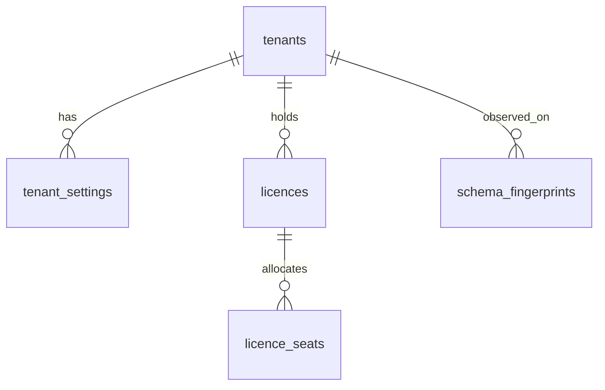

##### `tenants` — A1, **platform-owned (no tenant_id)**
The customer installation boundary. The only table whose id is the tenancy key.

| Column | Type | N | Default | Notes |
|---|---|---|---|---|
| `id` | BIGINT UNSIGNED AI | N | — | PK; the value every `tenant_id` points at |
| `uuid` | BINARY(16) | N | — | public id |
| `code` | VARCHAR(40) | N | — | immutable short code |
| `name` | VARCHAR(200) | N | — | legal display name |
| `subdomain` | VARCHAR(63) | N | — | routing only; **no behaviour keys on its value** |
| `deployment_code` | VARCHAR(40) | N | `saas` | `status_values`; `saas | private_cloud | on_prem` |
| `home_timezone` | VARCHAR(64) | N | — | IANA name; every business-date derivation uses it |
| `default_currency` | CHAR(3) | N | `INR` | ISO 4217 |
| `financial_year_start_month` | TINYINT UNSIGNED | N | 4 | configuration, not a literal |
| `lifecycle_state_code` | VARCHAR(40) | N | `provisioning` | domain `tenant_status` |
| `activated_at` / `suspended_at` / `closed_at` | DATETIME(3) | Y | NULL | |
| `row_version`, `created_at`, `created_by_user_id`, `updated_at`, `updated_by_user_id` | A1 | | | |

**Keys.** PK `id` · UQ `(uuid)`, `(code)`, `(subdomain)` · IX `(lifecycle_state_code)`.
**Policy.** Platform-owned · history: `audit_events` · delete: never (`closed` then
`purged` under an explicit, approved operation) · audit `full` · PII `none` ·
retention `R-PERM`.
*Why:* SmartPRS 2 keys a product lockdown on `subdomain='demo'` and makes that tenant the
target of a 23-table hard-delete seeder (`J-database.md` BR-TEN-002, SEC-SEED-02).

##### `tenant_settings` — A5 (typed, dated), tenant-owned
Typed per-tenant settings that are **not** business configuration. Business configuration
is a Configuration Artefact; this table holds installation-level values only (branding,
locale, contact addresses, feature toggles granted by entitlement).

| Column | Type | N | Default | Notes |
|---|---|---|---|---|
| `id` | BIGINT UNSIGNED AI | N | — | PK |
| `tenant_id` | BIGINT UNSIGNED | N | — | FK `tenants(id)` RESTRICT |
| `setting_key` | VARCHAR(80) | N | — | from a platform-owned key registry |
| `value_type_code` | VARCHAR(40) | N | — | `text|number|bool|date|json|money` |
| `v_text` | VARCHAR(1000) | Y | NULL | exactly one `v_*` populated |
| `v_number` | DECIMAL(18,6) | Y | NULL | |
| `v_bool` | TINYINT(1) | Y | NULL | |
| `v_date` | DATE | Y | NULL | |
| `v_json` | JSON | Y | NULL | free-form only |
| `effective_from` / `effective_to` / `open_marker` | A5 | | | |

**Keys.** PK `id` · FK `tenant_id` RESTRICT · UQ `(tenant_id, setting_key, open_marker)`,
`(tenant_id, setting_key, effective_from)` · IX `(tenant_id, setting_key)`.
**Policy.** Tenant-owned · history: A5 versioning · delete: never · audit `full` ·
PII `none` · retention `R-PERM`.
*Why:* SmartPRS 2's `settings` table exists in two shapes (`json` vs `longText`, unique key
present vs absent) and uses two platform sentinels, so a value saved on one install throws
`3140 Invalid JSON` on another and duplicate rows are read arbitrarily (`J-database.md`
§6.1.3).

##### `licences` — A1, platform-owned
| Column | Type | N | Default | Notes |
|---|---|---|---|---|
| `id`, `uuid` | | N | | PK / public |
| `tenant_id` | BIGINT UNSIGNED | N | — | FK RESTRICT — a licence always belongs to a tenant |
| `edition_code` | VARCHAR(40) | N | — | `status_values` |
| `seats_licensed` | INT UNSIGNED | N | 0 | |
| `key_hash` | BINARY(32) | N | — | comparison only |
| `key_ciphertext` | VARBINARY(512) | N | — | re-displayable to the issuing panel; **restricted** |
| `key_last4` | CHAR(4) | N | — | display |
| `valid_from` / `valid_to` | DATE | N / Y | — | |
| `lifecycle_state_code` | VARCHAR(40) | N | `issued` | |

**Keys.** PK `id` · UQ `(uuid)`, `(key_hash)` · FK `tenant_id` RESTRICT ·
IX `(tenant_id, lifecycle_state_code)`, `(valid_to)`.
**Policy.** Platform-owned · history: `licence_events` (A4, derivable) · delete: never ·
audit `full` · PII `restricted` (key material) · retention `R-PERM`.

##### `licence_seats` — A4 append-only allocation ledger
Seat allocation is a **ledger**, not a counter, so the count is derivable and the
allocation is serialisable.

| Column | Type | N | Default | Notes |
|---|---|---|---|---|
| `id` | BIGINT UNSIGNED AI | N | — | PK |
| `tenant_id` | BIGINT UNSIGNED | N | — | FK RESTRICT |
| `licence_id` | BIGINT UNSIGNED | N | — | FK `licences(id)` RESTRICT |
| `employment_id` | BIGINT UNSIGNED | Y | NULL | FK RESTRICT; NULL for a device/server seat |
| `device_uid` | VARCHAR(120) | Y | NULL | server fingerprint |
| `delta` | SMALLINT | N | — | `+1` allocate, `-1` release |
| `reason_code` | VARCHAR(40) | N | — | `hire | exit | status_change | manual` |
| `occurred_at`, `recorded_at` | DATETIME(3) | N | — | A4 |

**Keys.** PK `id` · UQ `(tenant_id, licence_id, device_uid)` where `device_uid IS NOT NULL`
(via a generated marker column) · IX `(tenant_id, licence_id, occurred_at)`,
`(tenant_id, employment_id)`.
**Policy.** Platform-owned data about a tenant · history: is the history · delete: never ·
audit `event-only` · PII `none` · retention `R-PERM`.
*Why:* SmartPRS 2 counts seats with `COUNT(*)` then inserts, with no lock and no unique
index on `(licence_id, device_uid)`, so 76 employees exist on a 75-seat licence and a
transient database error grants unlimited seats (`M-…` §6.2 C-5).

##### `schema_fingerprints` — A4, platform-owned
| Column | Type | N | Default | Notes |
|---|---|---|---|---|
| `id`, `occurred_at`, `recorded_at` | A4 | | | |
| `release_version` | VARCHAR(40) | N | — | |
| `fingerprint` | BINARY(32) | N | — | canonical hash over `information_schema` |
| `expected_fingerprint` | BINARY(32) | N | — | shipped with the release |
| `is_match` | TINYINT(1) | N | — | |
| `diff_json` | JSON | Y | NULL | first 200 differing objects |

**Keys.** PK `id` · IX `(recorded_at)`, `(is_match)`.
**Policy.** Platform-owned · audit `event-only` · PII `none` · retention `R-LOG-13M`.
*Why:* R-XXVIII-002; SmartPRS 2 has no two installations guaranteed to share a schema.

---

### C14 — Configuration & Rules (15 tables)

This is the context that makes the product configurable. Everything in it is an instance
of the spine S4 pattern.

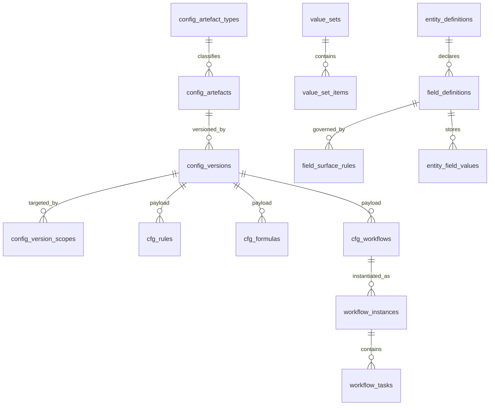

##### `config_artefact_types` — A2, platform-owned registry
Declares every configurable concept. Adding a concept is a migration that inserts a row
here plus a typed payload table (R-V-050).

| Column | Type | N | Default | Notes |
|---|---|---|---|---|
| `id` | BIGINT UNSIGNED AI | N | — | PK |
| `type_key` | VARCHAR(60) | N | — | `rule`, `formula`, `leave_type`, `pay_cycle`, … |
| `label` | VARCHAR(160) | N | — | |
| `owning_context` | VARCHAR(40) | N | — | C1…C15 |
| `payload_table` | VARCHAR(64) | N | — | the `cfg_*` table holding the typed payload |
| `is_high_risk` | TINYINT(1) | N | 0 | requires diff + approval before publish |
| `is_continuous` | TINYINT(1) | N | 0 | gaps rejected at publish |
| `is_scoped` | TINYINT(1) | N | 1 | 0 = tenant-wide only |
| `max_versions_in_flight` | SMALLINT UNSIGNED | N | 1 | drafts permitted concurrently |

**Keys.** PK `id` · UQ `(type_key)`, `(payload_table)` · IX `(owning_context)`.
**Policy.** Platform-owned · audit `full` · PII `none` · retention `R-PERM`.

##### `config_artefacts` — A1
The stable identity of a configurable thing across all its versions.

| Column | Type | N | Default | Notes |
|---|---|---|---|---|
| `id`, `uuid`, `tenant_id` | A1 | | | |
| `config_artefact_type_id` | BIGINT UNSIGNED | N | — | FK RESTRICT |
| `artefact_key` | VARCHAR(80) | N | — | stable business key, e.g. `LATE-3X-HALFDAY` |
| `name` | VARCHAR(200) | N | — | |
| `description` | VARCHAR(1000) | Y | NULL | business description, shown in the rule list |
| `owner_user_id` | BIGINT UNSIGNED | Y | NULL | FK RESTRICT |
| `lifecycle_state_code` | VARCHAR(40) | N | `active` | `active | retired` |

**Keys.** PK `id` · UQ `(tenant_id, uuid)`, `(tenant_id, config_artefact_type_id,
artefact_key)` · FK `tenant_id`, `config_artefact_type_id` RESTRICT ·
IX `(tenant_id, config_artefact_type_id, lifecycle_state_code)`.
**Policy.** Tenant-owned · history: versions · delete: never (retire) · audit `full` ·
PII `none` · retention `R-PERM`.

##### `config_versions` — A5, the unit of publication
| Column | Type | N | Default | Notes |
|---|---|---|---|---|
| `id`, `uuid`, `tenant_id` | | N | | |
| `config_artefact_id` | BIGINT UNSIGNED | N | — | FK RESTRICT |
| `version_no` | INT UNSIGNED | N | — | monotonic per artefact |
| `status_code` | VARCHAR(40) | N | `draft` | `draft|testing|pending_approval|published|superseded|archived` |
| `scope_json` | JSON | N | — | canonical Scope for display and diff |
| `scope_hash` | BINARY(32) | N | — | overlap detection key |
| `specificity` | INT UNSIGNED | N | 0 | derived from the weight table (spine S3.2) |
| `priority` | INT | N | 0 | explicit tie-break |
| `effective_from` | DATE | N | — | A5 |
| `effective_to` | DATE | Y | NULL | A5 |
| `open_marker` | generated | Y | — | A5 |
| `payload_checksum` | BINARY(32) | N | — | over the typed payload rows |
| `superseded_by_version_id` | BIGINT UNSIGNED | Y | NULL | FK self RESTRICT |
| `reason` | VARCHAR(400) | N | — | why this change exists — mandatory |
| `change_note` | TEXT | Y | NULL | |
| `submitted_by_user_id`, `submitted_at` | | Y | NULL | |
| `approved_by_user_id`, `approved_at` | | Y | NULL | |
| `published_by_user_id`, `published_at` | | Y | NULL | |
| `workflow_instance_id` | BIGINT UNSIGNED | Y | NULL | FK RESTRICT; the approval that authorised publication |

**Keys.** PK `id` · UQ `(tenant_id, uuid)`, `(tenant_id, config_artefact_id, version_no)`,
`(tenant_id, config_artefact_id, scope_hash, effective_from)`,
`(tenant_id, config_artefact_id, scope_hash, open_marker)` — the last two together forbid
overlapping published ranges for one artefact and scope ·
IX `(tenant_id, config_artefact_id, status_code, effective_from, effective_to)`,
`(tenant_id, status_code)`.
**Policy.** Tenant-owned · history: **is** the history; a published row is immutable ·
delete: never; `ON DELETE RESTRICT` from every derived record that names it ·
audit `full` · PII `none` · retention `R-PERM`.
*Why:* SmartPRS 2 edits configuration in place and hard-deletes it from the master screen,
so a past payslip cannot be re-explained (`J-database.md` §Q8 row 1, §4.4).

##### `config_version_scopes` — A3, the resolution index
Normalised scope predicates. `scope_json` is for humans; this table is for the resolver.

| Column | Type | N | Default | Notes |
|---|---|---|---|---|
| `id`, `tenant_id` | | N | | |
| `config_version_id` | BIGINT UNSIGNED | N | — | FK **CASCADE** (composition; a version's predicates have no independent meaning) |
| `dimension_code` | VARCHAR(40) | N | — | one of the 21 dimensions of spine S3.1 |
| `operator_code` | VARCHAR(10) | N | `IN` | `IN` or `ALL` |
| `value_id` | BIGINT UNSIGNED | Y | NULL | org unit / designation / grade id, when the dimension is an entity |
| `value_code` | VARCHAR(60) | Y | NULL | when the dimension is a vocabulary |
| `dimension_weight` | SMALLINT UNSIGNED | N | — | copied from the platform weight table at publish |

**Keys.** PK `id` · FK `config_version_id` CASCADE ·
UQ `(config_version_id, dimension_code, value_id, value_code)` ·
IX `(tenant_id, dimension_code, value_id)`, `(tenant_id, dimension_code, value_code)` —
these two are the resolver's access path.
**Policy.** Tenant-owned · audit: inherits parent · PII `none` · retention `R-PERM`.

##### `cfg_rules` — A4-flavoured typed payload (one row per published version)
| Column | Type | N | Default | Notes |
|---|---|---|---|---|
| `id`, `tenant_id` | | N | | |
| `config_version_id` | BIGINT UNSIGNED | N | — | FK RESTRICT; UQ |
| `module_code` | VARCHAR(40) | N | — | which action catalogue applies |
| `when_source` | TEXT | N | — | SPX source text |
| `when_ast` | JSON | N | — | compiled immutable AST (spine S5) |
| `except_source` / `except_ast` | TEXT / JSON | Y | NULL | |
| `on_conflict_code` | VARCHAR(40) | N | `first_match` | `first_match|all_match|highest_priority_only` |
| `node_count` | INT UNSIGNED | N | — | budget check at publish |
| `requires_approval` | TINYINT(1) | N | 0 | |

**Keys.** PK `id` · UQ `(config_version_id)` · FK RESTRICT · IX `(tenant_id, module_code)`.
**Policy.** Tenant-owned · immutable once its version is published · audit `full` ·
PII `none` · retention `R-PERM`.
Actions live in `cfg_rule_actions` (A3, derivable): `line_no`, `action_code`,
`params_json`, typed against the module's closed action catalogue.

##### `cfg_formulas` — typed payload
| Column | Type | N | Default | Notes |
|---|---|---|---|---|
| `id`, `tenant_id`, `config_version_id` | | N | | UQ on version |
| `result_type_code` | VARCHAR(40) | N | — | `Money|Days|Hours|Number|Boolean` |
| `expression_source` | TEXT | N | — | |
| `expression_ast` | JSON | N | — | |
| `rounding_mode_code` | VARCHAR(40) | N | — | **mandatory**; there is no default rounding |
| `rounding_unit` | DECIMAL(18,4) | N | 0.0100 | |
| `depends_on_json` | JSON | N | — | resolved dependency list, acyclic at publish |

**Keys.** PK `id` · UQ `(config_version_id)` · IX `(tenant_id, result_type_code)`.
**Policy.** as `cfg_rules`.

##### `cfg_workflows` — typed payload
| Column | Type | N | Default | Notes |
|---|---|---|---|---|
| `id`, `tenant_id`, `config_version_id` | | N | | UQ on version |
| `subject_entity_key` | VARCHAR(60) | N | — | what it approves |
| `start_node_key` | VARCHAR(60) | N | — | |
| `allows_self_approval` | TINYINT(1) | N | 0 | |
| `segregation_rule_code` | VARCHAR(40) | Y | NULL | e.g. `actor_of_step2 <> actor_of_step1` |

Nodes and transitions live in `cfg_workflow_nodes` / `cfg_workflow_transitions` (A3,
derivable), carrying node type, approver resolution strategy, SLA minutes, reminder
schedule, escalation target, required comment/attachment, amount-band routing and the SPX
branch condition.
**Keys.** PK `id` · UQ `(config_version_id)`.
**Policy.** as `cfg_rules`.

##### `workflow_instances` — A1
| Column | Type | N | Default | Notes |
|---|---|---|---|---|
| `id`, `uuid`, `tenant_id` | | N | | |
| `config_version_id` | BIGINT UNSIGNED | N | — | FK RESTRICT — the version it started on; an in-flight instance **completes on it** |
| `subject_entity_key` | VARCHAR(60) | N | — | |
| `subject_id` | BIGINT UNSIGNED | N | — | polymorphic by design; the pair is validated by the owning context |
| `subject_uuid` | BINARY(16) | N | — | so an instance is addressable without the internal id |
| `initiated_by_user_id` | BIGINT UNSIGNED | N | — | FK RESTRICT |
| `current_node_key` | VARCHAR(60) | Y | NULL | |
| `lifecycle_state_code` | VARCHAR(40) | N | `running` | `running|completed|rejected|cancelled|expired` |
| `entity_snapshot_hash` | BINARY(32) | N | — | what was approved, hashed |
| `due_at` | DATETIME(3) | Y | NULL | SLA |
| `completed_at` | DATETIME(3) | Y | NULL | |

**Keys.** PK `id` · UQ `(tenant_id, uuid)` · FK `config_version_id` RESTRICT ·
IX `(tenant_id, subject_entity_key, subject_id)`,
`(tenant_id, lifecycle_state_code, due_at)`.
**Policy.** Tenant-owned · history: `workflow_transitions` (A4, derivable) ·
delete: never · audit `full` · PII `none` · retention `R-PERM`.

##### `workflow_tasks` — A3 + A1 hybrid (individually addressable)
| Column | Type | N | Default | Notes |
|---|---|---|---|---|
| `id`, `uuid`, `tenant_id` | | N | | |
| `workflow_instance_id` | BIGINT UNSIGNED | N | — | FK RESTRICT |
| `node_key` | VARCHAR(60) | N | — | |
| `assignee_user_id` | BIGINT UNSIGNED | Y | NULL | FK RESTRICT |
| `assignee_role_id` | BIGINT UNSIGNED | Y | NULL | FK RESTRICT — pool assignment |
| `delegated_from_user_id` | BIGINT UNSIGNED | Y | NULL | FK RESTRICT |
| `status_code` | VARCHAR(40) | N | `pending` | `pending|approved|rejected|returned|reassigned|expired` |
| `decided_by_user_id` | BIGINT UNSIGNED | Y | NULL | FK RESTRICT — **a user id, never a name string** |
| `decided_at` | DATETIME(3) | Y | NULL | |
| `decision_comment` | VARCHAR(2000) | Y | NULL | append-only per transition |
| `due_at`, `reminded_at`, `escalated_at` | DATETIME(3) | Y | NULL | |

**Keys.** PK `id` · UQ `(tenant_id, uuid)`, `(tenant_id, workflow_instance_id, node_key,
assignee_user_id)` · IX `(tenant_id, assignee_user_id, status_code)` — the approval inbox;
`(tenant_id, status_code, due_at)` — the SLA sweep.
**Policy.** Tenant-owned · history: transitions · delete: never · audit `full` ·
PII `none` · retention `R-PERM`.
*Why the inbox index:* SmartPRS 2 has no index on `status` on any of its approval tables
(`J-database.md` §Q5). *Why `decided_by_user_id`:* SmartPRS 2 stores the actor as a name
string across eleven columns, producing an unjoinable, non-repudiable trail (SEC-DB-04).

##### `value_sets` — A2, and `value_set_items` — A3
Tenant-editable option lists that are **not** lifecycle vocabularies (those are
`status_domains`). `value_sets`: `set_key`, `label`, `is_system`, `allows_tenant_items`.
`value_set_items`: `item_code`, `label`, `sort_order`, `is_active`, `effective_from`,
`effective_to`, `attributes_json`.
**Keys.** `value_sets` UQ `(tenant_id, set_key)`; `value_set_items` UQ
`(tenant_id, value_set_id, item_code)`, IX `(tenant_id, value_set_id, is_active,
sort_order)`.
**Policy.** Tenant-owned · versioned through the artefact when the set is high-risk ·
delete: `deleted_at` on the set only, never on an item in use · audit `full` ·
PII `none` · retention `R-PERM`.

##### `entity_definitions` — A2, platform-seeded, tenant-extensible
`entity_key` (`employee`, `candidate`, `document`, `asset`, `request`, …), `label`,
`is_system`, `owning_context`, `custom_fields_allowed`.
**Keys.** UQ `(tenant_id, entity_key)`.
**Policy.** Tenant-owned · audit `full` · PII `none` · retention `R-PERM`.

##### `field_definitions` — A5 (dated), the spine S9 engine
| Column | Type | N | Default | Notes |
|---|---|---|---|---|
| `id`, `uuid`, `tenant_id` | | N | | |
| `entity_definition_id` | BIGINT UNSIGNED | N | — | FK RESTRICT |
| `field_key` | VARCHAR(60) | N | — | stable; referenced by SPX and templates |
| `storage_kind_code` | VARCHAR(40) | N | `attribute` | `column` (migration-owned) / `attribute` (`entity_field_values`) / `generated` (promoted) |
| `storage_column` | VARCHAR(64) | Y | NULL | when `column` or `generated` |
| `data_type_code` | VARCHAR(40) | N | — | `text|number|decimal|money|date|datetime|time|bool|code|reference|json` |
| `decimal_precision` / `decimal_scale` | TINYINT UNSIGNED | Y | NULL | when `decimal`/`money` |
| `label`, `help_text`, `group_key`, `display_order` | | | | presentation |
| `default_expression` | TEXT | Y | NULL | SPX |
| `validation_expression` | TEXT | Y | NULL | SPX Boolean |
| `value_set_id` | BIGINT UNSIGNED | Y | NULL | FK RESTRICT, when `code` |
| `reference_entity_key` | VARCHAR(60) | Y | NULL | when `reference` |
| `uniqueness_scope_code` | VARCHAR(40) | N | `none` | `none|tenant|legal_entity|global` — **materialised as a real index** (R-XXVIII-012) |
| `is_system` | TINYINT(1) | N | 0 | system fields cannot be deleted, only hidden |
| `pii_class_code` | VARCHAR(40) | N | `none` | `none|identifying|sensitive|restricted` |
| `is_encrypted` | TINYINT(1) | N | 0 | |
| `masking_rule_code` | VARCHAR(40) | Y | NULL | e.g. `last4`, `full`, `none` |
| `retention_class_code` | VARCHAR(40) | Y | NULL | overrides the entity default |
| `effective_from`, `effective_to`, `open_marker` | A5 | | | |

**Keys.** PK `id` · UQ `(tenant_id, uuid)`,
`(tenant_id, entity_definition_id, field_key, effective_from)`,
`(tenant_id, entity_definition_id, field_key, open_marker)` ·
IX `(tenant_id, entity_definition_id, display_order)`, `(tenant_id, pii_class_code)`.
**Policy.** Tenant-owned · history: A5 · delete: never (retire by closing the range) ·
audit `full` · PII `none` (the definition; the *values* carry the class) ·
retention `R-PERM`.
*Why:* SmartPRS 2 holds its 56-field registry as a PHP constant, and adding one field costs
6–16 edits across 8 files (`D-employee-master.md` Q2).

##### `field_surface_rules` — A3
`field_definition_id` (FK CASCADE), `surface_code` (`directory|edit|self_onboarding|
import|export|ess|mss|mobile|api|recruitment_conversion|template|report|payslip`),
`role_id` (FK RESTRICT, NULL = all roles), `visibility_code` (`hidden|read|write`),
`required_code` (`never|create|always|conditional`), `required_expression` (SPX).
**Keys.** UQ `(tenant_id, field_definition_id, surface_code, role_id)` ·
IX `(tenant_id, surface_code)`.
**Policy.** Tenant-owned · audit `full` · PII `none` · retention `R-PERM`.

##### `entity_field_values` — the typed custom-field store (spine S9)
| Column | Type | N | Default | Notes |
|---|---|---|---|---|
| `id` | BIGINT UNSIGNED AI | N | — | PK |
| `tenant_id` | BIGINT UNSIGNED | N | — | FK RESTRICT |
| `entity_definition_id` | BIGINT UNSIGNED | N | — | FK RESTRICT |
| `entity_row_id` | BIGINT UNSIGNED | N | — | the owning row's internal id |
| `field_definition_id` | BIGINT UNSIGNED | N | — | FK RESTRICT |
| `v_text` | VARCHAR(1024) | Y | NULL | exactly one `v_*` non-null, enforced by CHECK |
| `v_number` | BIGINT | Y | NULL | integers, counts |
| `v_decimal` | DECIMAL(18,4) | Y | NULL | money and rates |
| `v_date` | DATE | Y | NULL | |
| `v_datetime` | DATETIME(3) | Y | NULL | |
| `v_bool` | TINYINT(1) | Y | NULL | |
| `v_code` | VARCHAR(60) | Y | NULL | value-set code |
| `v_json` | JSON | Y | NULL | genuinely free-form only |
| `v_blind_index` | BINARY(32) | Y | NULL | for encrypted, unique or searchable values |
| `row_version`, `created_at`, `updated_at`, `updated_by_user_id` | | | | |

**Keys.** PK `id` ·
UQ `(tenant_id, entity_definition_id, entity_row_id, field_definition_id)` — one value per
field per row ·
UQ `(tenant_id, field_definition_id, v_blind_index)` for fields declared unique at tenant
scope (created at provisioning when the declaration is made) ·
IX `(tenant_id, field_definition_id, v_code)`,
`(tenant_id, field_definition_id, v_date)`,
`(tenant_id, field_definition_id, v_decimal)`,
`(tenant_id, field_definition_id, v_text(64))` — prefix index for filter and sort.
**Policy.** Tenant-owned · history: field-level rows in `audit_field_changes` ·
delete: value rows are removed only when the field definition is purged under retention ·
audit `full` · PII: **per field**, from `field_definitions.pii_class_code` ·
retention: per field.
See XXVIII.7 for the indexing and promotion path.

---

### C2 — Identity & Access (8 tables)

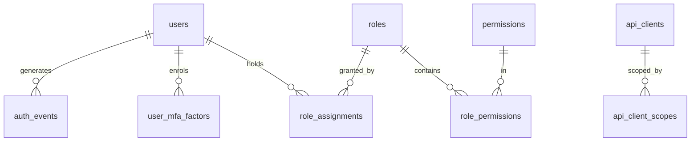

##### `users` — A1
| Column | Type | N | Default | Notes |
|---|---|---|---|---|
| `id`, `uuid` | | N | | |
| `tenant_id` | BIGINT UNSIGNED | Y | NULL | **NULL only for a platform operator**, and such a user holds a platform role that is an explicit, audited capability — never the absence of a filter |
| `employment_id` | BIGINT UNSIGNED | Y | NULL | FK `employments(id)` RESTRICT — the **only** link between a login and a person |
| `email` | VARCHAR(254) | N | — | |
| `email_blind_index` | BINARY(32) | N | — | uniqueness and lookup |
| `email_verified_at` | DATETIME(3) | Y | NULL | |
| `password_hash` | VARCHAR(255) | Y | NULL | NULL for SSO-only users |
| `must_change_password` | TINYINT(1) | N | 0 | |
| `mfa_required` | TINYINT(1) | N | 0 | derived from the roles held; stored for fast gate |
| `locale`, `timezone` | VARCHAR(64) | Y | NULL | |
| `last_login_at`, `locked_until` | DATETIME(3) | Y | NULL | |
| `failed_login_count` | SMALLINT UNSIGNED | N | 0 | |
| `lifecycle_state_code` | VARCHAR(40) | N | `invited` | `invited|active|locked|disabled` |

**Keys.** PK `id` · UQ `(tenant_id, uuid)`, `(tenant_id, email_blind_index)` — email is
unique **per tenant**, so one person may hold accounts in two tenants ·
FK `tenant_id`, `employment_id` RESTRICT ·
IX `(tenant_id, lifecycle_state_code)`, `(employment_id)`.
**Policy.** Tenant-owned (platform users excepted) · history: `audit_events` ·
delete: never; `disabled` then anonymised under retention · audit `full` ·
PII `identifying` (email), `restricted` (password hash) · retention `R-STAT-8Y`.
*Why:* SmartPRS 2's `users.email` is globally unique, so a consultant cannot hold accounts
in two tenants (`J-database.md` SEC-TEN-05); and its "own employee" resolver matches on
`email OR name` in 16 places, letting a user see another employee's payslips
(`D-employee-master.md` Q6 #1).

##### `roles` — A2 · `permissions` — A2, platform-owned · `role_permissions` — A3
`roles`: `code`, `name`, `is_system`, `is_privileged` (forces MFA).
`permissions`: `code` (`verb.resource`), `label`, `owning_context`, `is_privileged` —
platform-owned, because the catalogue is the application's own surface.
`role_permissions`: `(role_id, permission_id)`.
**Keys.** `roles` UQ `(tenant_id, code)`; `permissions` UQ `(code)`;
`role_permissions` UQ `(tenant_id, role_id, permission_id)`.
**Policy.** Tenant-owned (roles) / platform (permissions) · audit `full` · PII `none` ·
retention `R-PERM`.

##### `role_assignments` — A5 (dated), the `(user, role, data_scope)` triple
| Column | Type | N | Default | Notes |
|---|---|---|---|---|
| `id`, `uuid`, `tenant_id` | | N | | |
| `user_id` | BIGINT UNSIGNED | N | — | FK RESTRICT |
| `role_id` | BIGINT UNSIGNED | N | — | FK RESTRICT |
| `data_scope_code` | VARCHAR(40) | N | — | `self|direct_reports|team|department|branch|company|legal_entity|tenant|platform|explicit_units` |
| `scope_org_unit_ids_json` | JSON | Y | NULL | when `explicit_units`; also normalised into `role_assignment_units` (A3, derivable) for indexed evaluation |
| `granted_by_user_id` | BIGINT UNSIGNED | N | — | FK RESTRICT |
| `reason` | VARCHAR(400) | Y | NULL | |
| `effective_from`, `effective_to`, `open_marker` | A5 | | | |

**Keys.** PK `id` · UQ `(tenant_id, uuid)`,
`(tenant_id, user_id, role_id, data_scope_code, effective_from)` ·
IX `(tenant_id, user_id, effective_from, effective_to)`, `(tenant_id, role_id)`.
**Policy.** Tenant-owned · history: A5, so "what could this user see in May?" is
answerable · delete: never · audit `full` · PII `none` · retention `R-STAT-8Y`.

##### `api_clients` — A1 (+ `api_client_scopes` A3, derivable)
`client_id` (public), `secret_hash`, `secret_rotated_at`, `name`, `contact_email`,
`ip_allowlist_json`, `lifecycle_state_code`, `last_used_at`.
**Keys.** UQ `(tenant_id, uuid)`, `(client_id)` · IX `(tenant_id, lifecycle_state_code)`.
**Policy.** Tenant-owned · audit `full` · PII `restricted` · retention `R-SEC-2Y` after
revocation.

##### `user_mfa_factors` — A1
`user_id` FK RESTRICT, `factor_type_code` (`totp|webauthn|sms`), `secret_ciphertext`,
`confirmed_at`, `last_used_at`, `lifecycle_state_code`.
**Keys.** UQ `(tenant_id, user_id, factor_type_code)` · IX `(user_id)`.
**Policy.** Tenant-owned · audit `transitional` · PII `restricted` · retention: with the
user.

##### `auth_events` — A4
`user_id` (nullable — a failed login may not resolve a user), `email_blind_index`,
`event_code` (`login_success|login_failed|locked|mfa_challenged|mfa_failed|
password_changed|token_issued|token_revoked`), `ip_address` `VARBINARY(16)`,
`user_agent_hash`, `api_client_id`, `detail_json`.
**Keys.** PK `id` · IX `(tenant_id, occurred_at)`, `(tenant_id, user_id, occurred_at)`,
`(email_blind_index, occurred_at)`.
**Policy.** Tenant-owned · append-only · audit `event-only` · PII `identifying` (IP) ·
retention `R-SEC-2Y` · **partitioned monthly** (XXVIII.9).

---

### C3 — Organisation (6 tables)

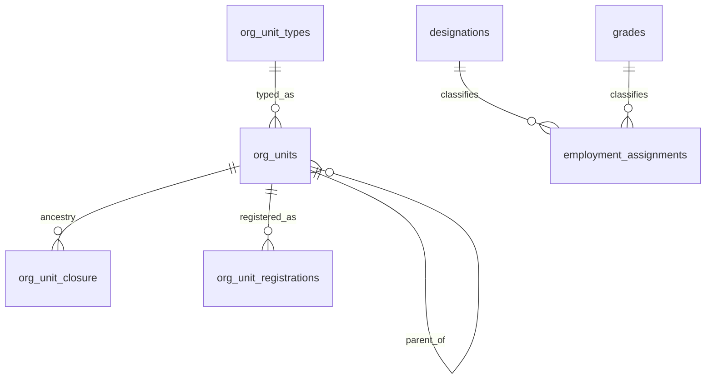

##### `org_unit_types` — A2 (platform-seeded, tenant-extensible)
`type_key` (`legal_entity|company|establishment|state|zone|branch|department|
sub_department|team|cost_centre|business_unit|client_process`), `label`, `level_hint`,
`allowed_parent_types_json`, `is_scope_dimension`, `scope_weight` (copied from the
platform weight table), `attaches_anywhere` (true for cost centre, business unit, client
process — spine S3).
**Keys.** UQ `(tenant_id, type_key)`.
**Policy.** Tenant-owned · audit `full` · PII `none` · retention `R-PERM`.

##### `org_units` — A5 (dated) + A2 (coded)
| Column | Type | N | Default | Notes |
|---|---|---|---|---|
| `id`, `uuid`, `tenant_id` | | N | | |
| `org_unit_type_id` | BIGINT UNSIGNED | N | — | FK RESTRICT |
| `parent_org_unit_id` | BIGINT UNSIGNED | Y | NULL | FK self RESTRICT; NULL only for the tenant root |
| `code` | VARCHAR(40) | N | — | |
| `name` | VARCHAR(200) | N | — | current name |
| `short_name` | VARCHAR(60) | Y | NULL | |
| `depth` | TINYINT UNSIGNED | N | — | maintained with the closure |
| `path_cache` | VARCHAR(500) | N | — | `/1/14/88/` materialised path for prefix queries |
| `timezone` | VARCHAR(64) | Y | NULL | inherited when NULL |
| `address_json` | JSON | Y | NULL | |
| `lifecycle_state_code` | VARCHAR(40) | N | `active` | `draft|active|closed|archived` |
| `effective_from`, `effective_to`, `open_marker` | A5 | | | the unit's own existence window |

**Keys.** PK `id` · UQ `(tenant_id, uuid)`, `(tenant_id, parent_org_unit_id, code)` ·
FK `org_unit_type_id`, `parent_org_unit_id` RESTRICT ·
IX `(tenant_id, org_unit_type_id, lifecycle_state_code)`, `(tenant_id, path_cache(120))`,
`(tenant_id, parent_org_unit_id)`.
**Policy.** Tenant-owned · history: A5 plus `org_unit_name_history` (A5, derivable) so a
past report renders the past name · delete: never; `closed` with an effective date ·
audit `full` · PII `none` · retention `R-PERM`.

##### `org_unit_closure` — A3, the ancestry table
`ancestor_id`, `descendant_id`, `distance`.
**Keys.** PK `(tenant_id, ancestor_id, descendant_id)` ·
IX `(tenant_id, descendant_id, distance)`.
**Policy.** Derived, rebuilt inside the same transaction as any tree change; a nightly job
re-verifies. Cycles are impossible because a self-ancestor insert is rejected.

##### `org_unit_registrations` — A5
The statutory identity of an establishment. Required by C8.

`org_unit_id` FK RESTRICT, `registration_type_code` (`pf|esi|pt|lwf|shops_establishments|
gst|tan|factory_licence`), `registration_number`, `jurisdiction_code` (`IN`, `IN-TG`, …),
`issuing_authority`, `issued_on`, `valid_to`, `document_id` (FK RESTRICT), plus A5 dating.
**Keys.** UQ `(tenant_id, org_unit_id, registration_type_code, effective_from)`,
`(tenant_id, org_unit_id, registration_type_code, open_marker)`,
`(tenant_id, registration_type_code, registration_number)` ·
IX `(tenant_id, jurisdiction_code)`.
**Policy.** Tenant-owned · history A5 · delete never · audit `full` ·
PII `sensitive` (a registration number identifies the employer, not a person, but it is
credential-adjacent) · retention `R-PERM`.

##### `designations` — A2
`code`, `name`, `grade_id` (FK RESTRICT, nullable), `job_family_code`, `is_billable`,
`reports_to_designation_id` (FK RESTRICT, nullable), `deleted_at`.
**Keys.** UQ `(tenant_id, code)` · IX `(tenant_id, grade_id)`.
**Policy.** Tenant-owned · audit `full` · PII `none` · retention `R-PERM`.

##### `grades` — A2
`code`, `name`, `level_no`, `min_ctc`, `max_ctc` (`DECIMAL(18,4)`), `currency_code`,
`deleted_at`. Bands may not overlap within a grade — validated at publish.
**Keys.** UQ `(tenant_id, code)` · IX `(tenant_id, level_no)`.
**Policy.** Tenant-owned · audit `full` · PII `none` · retention `R-PERM`.

---

### C4 — People (10 tables)

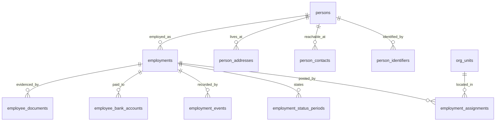

##### `persons` — A1
The natural person, independent of any job. Distinct from `employments` so that a re-hire,
a group transfer and a second concurrent employment are all expressible.

| Column | Type | N | Default | Notes |
|---|---|---|---|---|
| `id`, `uuid`, `tenant_id` | | N | | |
| `full_name` | VARCHAR(200) | N | — | display only; **never an identity key** |
| `given_name`, `family_name` | VARCHAR(100) | Y | NULL | |
| `date_of_birth` | DATE | Y | NULL | **DATE, never VARCHAR** |
| `gender_code` | VARCHAR(40) | Y | NULL | value set |
| `nationality_code` | CHAR(2) | Y | NULL | ISO 3166-1 |
| `marital_status_code` | VARCHAR(40) | Y | NULL | value set |
| `blood_group_code` | VARCHAR(40) | Y | NULL | value set |
| `photo_document_id` | BIGINT UNSIGNED | Y | NULL | FK `employee_documents(id)` RESTRICT |
| `lifecycle_state_code` | VARCHAR(40) | N | `active` | `active|dormant|anonymised|purged` |
| `anonymised_at` | DATETIME(3) | Y | NULL | set by the erasure operation |
| `merged_into_person_id` | BIGINT UNSIGNED | Y | NULL | FK self RESTRICT; a merge is explicit, permissioned and audited |

**Keys.** PK `id` · UQ `(tenant_id, uuid)` · IX `(tenant_id, lifecycle_state_code)`,
`(tenant_id, family_name, given_name)` (search only).
**Policy.** Tenant-owned · history: `audit_field_changes` · delete: never; anonymise ·
audit `full` · PII `identifying`; `date_of_birth` is `sensitive` · retention `R-STAT-8Y`
from the last employment's exit.

##### `person_identifiers` — A5 (dated), encrypted
Statutory and government identifiers. Dated because a person's PAN can be corrected and
the historical value must remain attached to the returns filed under it.

| Column | Type | N | Default | Notes |
|---|---|---|---|---|
| `id`, `tenant_id` | | N | | |
| `person_id` | BIGINT UNSIGNED | N | — | FK RESTRICT |
| `identifier_type_code` | VARCHAR(40) | N | — | `pan|aadhaar|uan|esic|passport|driving_licence|voter_id` |
| `value_ciphertext` | VARBINARY(512) | N | — | application-layer encryption |
| `value_blind_index` | BINARY(32) | N | — | uniqueness and lookup |
| `value_last4` | VARCHAR(8) | Y | NULL | masked display |
| `issued_on`, `valid_to` | DATE | Y | NULL | |
| `verification_state_code` | VARCHAR(40) | N | `unverified` | `unverified|verified|rejected` |
| `verified_by_user_id`, `verified_at` | | Y | NULL | |
| `effective_from`, `effective_to`, `open_marker` | A5 | | | |

**Keys.** PK `id` · FK `person_id` RESTRICT ·
UQ `(tenant_id, person_id, identifier_type_code, effective_from)`,
`(tenant_id, person_id, identifier_type_code, open_marker)`,
**and, per identifier type whose field definition declares tenant uniqueness,**
`(tenant_id, identifier_type_code, value_blind_index, open_marker)` — created at
provisioning from the declaration (R-XXVIII-012) ·
IX `(tenant_id, identifier_type_code, value_blind_index)`.
**Policy.** Tenant-owned · history A5 · delete: never; crypto-shredded on erasure ·
audit `full` · PII `sensitive`, encrypted, masked by role, access audited ·
retention `R-STAT-8Y`.
*Why:* SmartPRS 2 enforces eight identifier uniqueness rules in PHP with `LOWER(TRIM(col))`
against plain indexes that cannot serve them, ignores soft-deleted rows, and the migration
explicitly refuses to create the unique indexes — so duplicates are **guaranteed** to exist
today (`J-database.md` §6.9, §Q5).

##### `person_contacts` — A5 · `person_addresses` — A5
Both A5-dated child tables (archetype-derived): contact carries `contact_type_code`
(`mobile|whatsapp|email|emergency`), `value`, `value_blind_index`, `country_code`,
`is_primary`, `verified_at`; address carries `address_type_code`
(`current|permanent|onboarding`), the address lines, `city`, `state_code`, `postal_code`,
`country_code`, `geo_lat`/`geo_lng` `DECIMAL(11,7)`.
**Keys.** UQ `(tenant_id, person_id, contact_type_code, open_marker)` /
`(tenant_id, person_id, address_type_code, open_marker)`; IX on
`(tenant_id, contact_type_code, value_blind_index)`.
**Policy.** PII `identifying` (contacts), `identifying` (addresses); encryption on
`sensitive`-classed contacts; retention with the person.
*Why dated:* SmartPRS 2 overwrites contact details in place, and payslips and decision
emails are delivered to a field that is editable instantly with no verification
(`E-…` req. 54).

##### `employments` — A1, the central business row
| Column | Type | N | Default | Notes |
|---|---|---|---|---|
| `id`, `uuid`, `tenant_id` | | N | | |
| `person_id` | BIGINT UNSIGNED | N | — | FK RESTRICT |
| `legal_entity_org_unit_id` | BIGINT UNSIGNED | N | — | FK `org_units(id)` RESTRICT |
| `employee_code` | VARCHAR(40) | N | — | from `cfg_code_sequences`; case-sensitive collation |
| `joined_on` | DATE | N | — | |
| `probation_end_on` | DATE | Y | NULL | derived, stored, recomputed on change |
| `confirmed_on` | DATE | Y | NULL | |
| `notice_started_on` | DATE | Y | NULL | |
| `exited_on` | DATE | Y | NULL | `CHECK (exited_on IS NULL OR exited_on >= joined_on)` |
| `exit_reason_code` | VARCHAR(40) | Y | NULL | value set |
| `is_rehire_eligible` | TINYINT(1) | Y | NULL | |
| `employment_open_marker` | generated | Y | — | 1 while `exited_on IS NULL` |
| `lifecycle_state_code` | VARCHAR(40) | N | `pre_hire` | domain `employment_status`; transitions from `status_transitions` |
| `row_version`, audit columns | A1 | | | |

**Keys.** PK `id` · UQ `(tenant_id, uuid)`,
`(tenant_id, employee_code)` **or** `(tenant_id, legal_entity_org_unit_id, employee_code)`
— created according to the configured uniqueness scope (D-V-03),
`(tenant_id, person_id, legal_entity_org_unit_id, employment_open_marker)` — at most one
open employment per person per legal entity ·
FK `person_id`, `legal_entity_org_unit_id` RESTRICT ·
IX `(tenant_id, lifecycle_state_code, joined_on)`, `(tenant_id, exited_on)`,
`(tenant_id, person_id)`.
**Policy.** Tenant-owned · history: assignments, status periods, events ·
delete: never · audit `full` · PII `identifying` (the code identifies a person) ·
retention `R-STAT-8Y` from `exited_on`.

##### `employment_assignments` — A5, **the table that answers "as at"**
One row carries every scopeable dimension (Part V §V.6.2, decision D-V-01).

| Column | Type | N | Default | Notes |
|---|---|---|---|---|
| `id`, `uuid`, `tenant_id` | | N | | |
| `employment_id` | BIGINT UNSIGNED | N | — | FK RESTRICT |
| `company_org_unit_id` | BIGINT UNSIGNED | N | — | FK RESTRICT |
| `establishment_org_unit_id` | BIGINT UNSIGNED | N | — | FK RESTRICT — drives statutory applicability |
| `branch_org_unit_id` | BIGINT UNSIGNED | Y | NULL | FK RESTRICT |
| `zone_org_unit_id`, `state_org_unit_id` | BIGINT UNSIGNED | Y | NULL | FK RESTRICT |
| `department_org_unit_id`, `sub_department_org_unit_id`, `team_org_unit_id` | BIGINT UNSIGNED | Y | NULL | FK RESTRICT |
| `cost_centre_org_unit_id`, `business_unit_org_unit_id`, `client_process_org_unit_id` | BIGINT UNSIGNED | Y | NULL | FK RESTRICT |
| `designation_id`, `grade_id` | BIGINT UNSIGNED | Y | NULL | FK RESTRICT |
| `employee_category_code`, `employment_type_code`, `employment_stage_code`, `pay_group_code`, `union_group_code`, `work_location_code` | VARCHAR(40) | Y | NULL | value sets |
| `shift_config_version_id` | BIGINT UNSIGNED | Y | NULL | FK `config_versions(id)` RESTRICT — the shift or shift group in force |
| `reporting_manager_employment_id` | BIGINT UNSIGNED | Y | NULL | FK `employments(id)` RESTRICT — **an id, never a name** |
| `functional_manager_employment_id`, `team_leader_employment_id` | BIGINT UNSIGNED | Y | NULL | FK RESTRICT |
| `reason_code` | VARCHAR(40) | N | — | `hire|transfer|promotion|restructure|correction|import|migration_baseline` |
| `source_code` | VARCHAR(40) | N | — | which surface wrote it |
| `workflow_instance_id` | BIGINT UNSIGNED | Y | NULL | FK RESTRICT |
| `effective_from`, `effective_to`, `open_marker` | A5 | | | |

**Keys.** PK `id` · UQ `(tenant_id, uuid)`,
`(tenant_id, employment_id, effective_from)`,
`(tenant_id, employment_id, open_marker)` ← **exactly one row in force** ·
FK all `*_org_unit_id`, `designation_id`, `grade_id`, manager ids RESTRICT ·
IX `(tenant_id, employment_id, effective_from, effective_to)` — the as-at access path;
`(tenant_id, branch_org_unit_id, effective_from, effective_to)`,
`(tenant_id, department_org_unit_id, effective_from, effective_to)`,
`(tenant_id, establishment_org_unit_id, effective_from, effective_to)`,
`(tenant_id, pay_group_code, effective_from, effective_to)` — scope resolution and payroll
population; `(tenant_id, reporting_manager_employment_id, effective_from, effective_to)` —
the MSS tree as at a date.
**Policy.** Tenant-owned · history: **is** the history · delete: never · audit `full` ·
PII `none` directly · retention `R-STAT-8Y` with the employment.
*Why:* this single table is the reason SmartPRS 3 can answer "what was this employee's
branch on 15 May?" and SmartPRS 2 cannot (`D-employee-master.md` Q5). The manager columns
are ids because SmartPRS 2 stores the manager as a name string and consequently never
notifies the actual manager — `ProbationService` reads `reporting_manager_id`, a column no
write path populates (`D-employee-master.md` Q6 #16).

##### `employment_status_periods` — A5
The dated record of employment status, kept separate from the assignment so that a status
change (notice, suspension, exit) is not conflated with a posting change (Part V §V.6.5).

`employment_id` FK RESTRICT, `status_code` (domain `employment_status`), `reason_code`,
`reason_text`, `workflow_instance_id`, `consumes_seat` (denormalised from
`status_values.semantics_json` at write time for the seat ledger), plus A5 dating.
**Keys.** UQ `(tenant_id, employment_id, effective_from)`,
`(tenant_id, employment_id, open_marker)` ·
IX `(tenant_id, status_code, effective_from, effective_to)`.
**Policy.** as `employment_assignments`.

##### `employment_events` — A4
The narrative record: every transition, correction and administrative action on an
employment, including those that produce no assignment change.

`employment_id`, `event_code`, `effective_on` DATE, `payload_json`, `actor_user_id`,
`workflow_instance_id`, `audit_event_id` (FK RESTRICT), `occurred_at`, `recorded_at`.
**Keys.** PK `id` · IX `(tenant_id, employment_id, effective_on)`,
`(tenant_id, event_code, occurred_at)`.
**Policy.** Append-only · audit `event-only` · PII `none` · retention `R-STAT-8Y`.

##### `employee_bank_accounts` — A5, encrypted
`employment_id` FK RESTRICT, `account_holder_name`, `account_number_ciphertext`,
`account_number_blind_index`, `account_last4`, `ifsc`, `bank_name`, `branch_name`,
`account_type_code`, `payment_share_percent` `DECIMAL(9,6)` (split payments),
`verification_state_code`, `verified_by_user_id`, `verified_at`, `penny_drop_reference`,
plus A5 dating.
**Keys.** UQ `(tenant_id, employment_id, effective_from)`,
`(tenant_id, employment_id, account_number_blind_index, open_marker)` ·
IX `(tenant_id, employment_id, effective_from, effective_to)`.
**Policy.** Tenant-owned · history A5 · delete never · audit `full` **and** a
maker-checker workflow on change (spine S8) · PII `sensitive`, encrypted ·
retention `R-PAY-8Y`.
*Why dated:* a payout batch line must name the account **that was in force when it was
released**, so a later account change cannot rewrite what was paid where.

##### `employee_documents` — A1
| Column | Type | N | Default | Notes |
|---|---|---|---|---|
| `id`, `uuid`, `tenant_id` | | N | | |
| `employment_id` | BIGINT UNSIGNED | Y | NULL | FK RESTRICT |
| `person_id` | BIGINT UNSIGNED | Y | NULL | FK RESTRICT — one of the two is non-null (CHECK) |
| `document_type_config_version_id` | BIGINT UNSIGNED | N | — | FK RESTRICT — the type **as configured**, never a free-text kind |
| `title` | VARCHAR(200) | N | — | |
| `storage_key` | VARCHAR(400) | N | — | private object key; **never a public path** |
| `content_hash` | BINARY(32) | N | — | de-duplication and tamper detection |
| `mime_type` | VARCHAR(120) | N | — | |
| `byte_size` | BIGINT UNSIGNED | N | — | |
| `issued_on`, `expires_on` | DATE | Y | NULL | `expires_on` derived by the type's rule when it declares one |
| `verification_state_code` | VARCHAR(40) | N | `pending` | `pending|verified|rejected|expired` |
| `verified_by_user_id`, `verified_at`, `rejection_reason` | | Y | NULL | |
| `uploaded_by_user_id` | BIGINT UNSIGNED | N | — | FK RESTRICT |
| `lifecycle_state_code` | VARCHAR(40) | N | `active` | `active|superseded|archived|purged` |
| `superseded_by_document_id` | BIGINT UNSIGNED | Y | NULL | FK self RESTRICT |

**Keys.** PK `id` · UQ `(tenant_id, uuid)` ·
IX `(tenant_id, employment_id, document_type_config_version_id)`,
`(tenant_id, expires_on)` ← the compliance-alert access path,
`(tenant_id, verification_state_code)`, `(tenant_id, content_hash)`.
**Policy.** Tenant-owned · history: supersession · delete: never; the object and the row
are removed together only under a retention purge, in one transaction with the storage
delete confirmed · audit `full` · PII `sensitive` · retention `R-PII-CONSENT` or
`R-STAT-8Y` per document type.
*Why:* SmartPRS 2 writes onboarding identity documents to
`storage/app/public/employee-docs/<sequential id>/<basename>` — a predictable path on an
unauthenticated public disk — and its delete path wraps the file unlink in an empty catch,
so a failed unlink leaves PII live on the web with no record it exists (`M-…` D-4).
`documents.expiry` is captured and alerted on by nothing (`D-…` DEF-18); the index above
and C11 exist to fix that.

---

### C5 — Time & Attendance (10 tables)

The four layers of spine S10 are four tables, and the dependency runs strictly upward.

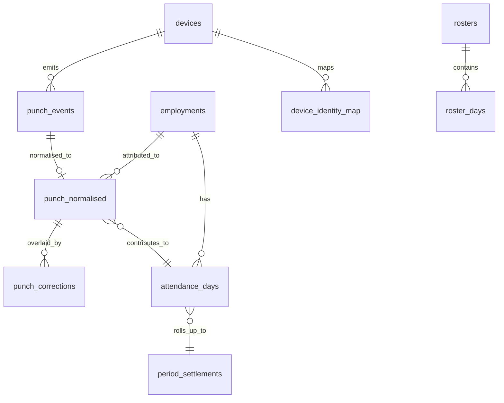

##### `punch_events` — A4, **layer 1, raw, append-only, partitioned**
| Column | Type | N | Default | Notes |
|---|---|---|---|---|
| `id` | BIGINT UNSIGNED AI | N | — | part of the PK |
| `tenant_id` | BIGINT UNSIGNED | N | — | FK RESTRICT |
| `received_on` | DATE | N | — | **partition key**, derived from `recorded_at` in UTC |
| `device_id` | BIGINT UNSIGNED | Y | NULL | FK RESTRICT; NULL when the device is unknown (quarantine) |
| `device_serial_raw` | VARCHAR(120) | Y | NULL | as supplied; **never used to resolve the tenant** |
| `inbound_batch_id` | BIGINT UNSIGNED | Y | NULL | FK RESTRICT |
| `adapter_code` | VARCHAR(60) | N | — | |
| `adapter_version` | VARCHAR(20) | N | — | |
| `payload_raw` | JSON | N | — | exactly as received |
| `payload_hash` | BINARY(32) | N | — | duplicate detection at layer 1 |
| `timezone_assumption` | VARCHAR(64) | N | — | what was assumed, recorded so it can be re-derived |
| `ingest_verdict_code` | VARCHAR(40) | N | — | `accepted|duplicate|quarantined_unknown_device|quarantined_unmapped_identity|rejected_schema` |
| `verdict_detail` | VARCHAR(400) | Y | NULL | |
| `occurred_at`, `recorded_at` | DATETIME(3) | N | — | A4 |

**Keys.** PK `(id, received_on)` (partitioned tables must carry the partition key in every
unique key) · UQ `(tenant_id, payload_hash, received_on)` ·
IX `(tenant_id, received_on, ingest_verdict_code)`, `(tenant_id, device_id, received_on)`,
`(inbound_batch_id)`.
**Policy.** Tenant-owned · append-only; the application user has no `UPDATE`/`DELETE` ·
audit `event-only` · PII `identifying` (a punch locates a person in time) ·
retention `R-ATT-3Y+` · **partitioned by `RANGE (TO_DAYS(received_on))`, monthly**.
*Why:* SmartPRS 2 has no layer 1 at all. Its single `attendance_logs` table is written by
nine paths, has three different schemas depending on install history, and is **deleted
from inside two migrations' `up()` on every deploy** with no snapshot (`J-database.md`
§6.1.1, §6.8; `M-…` D-1).

##### `punch_normalised` — A4-flavoured, **layer 2**
The canonical punch. A correction never edits this row.

| Column | Type | N | Default | Notes |
|---|---|---|---|---|
| `id`, `tenant_id` | | N | | |
| `punch_on` | DATE | N | — | **partition key** = the business date of `punch_at_utc` in the punch timezone |
| `punch_event_id` | BIGINT UNSIGNED | N | — | FK RESTRICT — the evidence it came from |
| `employment_id` | BIGINT UNSIGNED | N | — | FK RESTRICT — resolved identity, never a code string |
| `punch_at_utc` | DATETIME(3) | N | — | the absolute instant |
| `punch_local_time` | TIME | N | — | derived, for display and shift maths |
| `punch_timezone` | VARCHAR(64) | N | — | |
| `direction_code` | VARCHAR(40) | N | — | `in|out|unknown` — a value set, not an `ENUM` |
| `verification_method_code` | VARCHAR(40) | Y | NULL | `finger|face|card|mobile_geo|manual|web` |
| `source_code` | VARCHAR(40) | N | — | `sbb|smartept|device_pull|mobile|web|import|correction` |
| `device_id` | BIGINT UNSIGNED | Y | NULL | FK RESTRICT |
| `external_event_id` | VARCHAR(96) | Y | NULL | sender idempotency key |
| `geo_lat`, `geo_lng` | DECIMAL(11,7) | Y | NULL | ≈1.1 cm, never `DECIMAL(12,2)` |
| `geo_verdict_code` | VARCHAR(40) | Y | NULL | `inside|outside|unknown` |
| `is_quarantined` | TINYINT(1) | N | 0 | de-duplication **quarantines**, never deletes |
| `occurred_at`, `recorded_at` | | N | | |

**Keys.** PK `(id, punch_on)` · UQ `(tenant_id, external_event_id, punch_on)`,
`(tenant_id, employment_id, punch_at_utc, source_code, punch_on)` ·
IX `(tenant_id, employment_id, punch_on)` ← the per-employee day query,
`(tenant_id, punch_on)` ← the tenant-wide day query,
`(tenant_id, device_id, punch_on)`, `(tenant_id, is_quarantined, punch_on)`.
**Policy.** Tenant-owned · append-only · audit `event-only` · PII `identifying` ·
retention `R-ATT-3Y+` · partitioned monthly on `punch_on`.
*Why the composite indexes:* SmartPRS 2's punch ledger lacks
`(tenant_id, log_date)` — "the hottest query shape in the product" — and on installs
created by one of its three creators lacks `(emp_code, log_date)` entirely, so payroll
full-scans the punch ledger once per employee per run (`M-…` §2; `J-database.md` §6.1.1).

##### `punch_corrections` — A5 overlay
A correction is an **overlay** with its own validity and approval, so raw evidence and the
corrected view coexist and either can be displayed (spine S10).

`punch_normalised_id` (FK RESTRICT, nullable — an insertion correction has no original),
`employment_id`, `correction_type_code` (`insert|amend_time|amend_direction|void`),
`corrected_punch_at_utc`, `corrected_direction_code`, `reason_code`, `reason_text`,
`requested_by_user_id`, `workflow_instance_id` (FK RESTRICT), `status_code`, plus A5
dating on when the overlay applies.
**Keys.** UQ `(tenant_id, punch_normalised_id, open_marker)` ·
IX `(tenant_id, employment_id, effective_from)`, `(tenant_id, status_code)`.
**Policy.** Tenant-owned · history A5 · delete never · audit `full` ·
PII `identifying` · retention `R-ATT-3Y+`.
*Why:* SmartPRS 2's correction service **deletes** prior correction punches before writing
new ones (`J-database.md` §Q8 #9).

##### `attendance_days` — **layer 3**, derived and supersedable
| Column | Type | N | Default | Notes |
|---|---|---|---|---|
| `id`, `tenant_id` | | N | | |
| `work_on` | DATE | N | — | **the attendance day**, derived by the configured rule — not the punch's calendar date |
| `employment_id` | BIGINT UNSIGNED | N | — | FK RESTRICT |
| `generation` | INT UNSIGNED | N | 1 | monotonic; a recalculation writes `generation + 1` |
| `is_current` | TINYINT(1) | N | 1 | exactly one current row per (employment, day) |
| `shift_config_version_id` | BIGINT UNSIGNED | Y | NULL | FK RESTRICT — the shift resolved, and its version |
| `shift_source_code` | VARCHAR(40) | Y | NULL | `roster|shift_group|assignment|default` |
| `scheduled_start_at_utc`, `scheduled_end_at_utc` | DATETIME(3) | Y | NULL | absolute instants |
| `first_in_at_utc`, `last_out_at_utc` | DATETIME(3) | Y | NULL | |
| `punch_count` | SMALLINT UNSIGNED | N | 0 | |
| `worked_minutes`, `break_minutes`, `late_minutes`, `early_exit_minutes`, `ot_minutes` | INT | N | 0 | `Duration`; computed from instants |
| `status_code` | VARCHAR(40) | N | — | value set `attendance_status` — tenant-extensible |
| `payable_day_fraction` | DECIMAL(9,4) | N | 0 | `DayFraction` |
| `lop_day_fraction` | DECIMAL(9,4) | N | 0 | |
| `leave_day_fraction` | DECIMAL(9,4) | N | 0 | |
| `is_weekly_off`, `is_holiday` | TINYINT(1) | N | 0 | |
| `holiday_calendar_day_id` | BIGINT UNSIGNED | Y | NULL | FK RESTRICT |
| `applied_rule_versions_json` | JSON | N | — | every rule and formula version that produced this row |
| `trace_id` | BIGINT UNSIGNED | Y | NULL | FK `calculation_traces(id)` RESTRICT |
| `derived_at` | DATETIME(3) | N | — | |
| `superseded_at`, `superseded_by_id` | | Y | NULL | FK self RESTRICT |

**Keys.** PK `(id, work_on)` · UQ `(tenant_id, employment_id, work_on, generation)`,
`(tenant_id, employment_id, work_on, is_current_marker)` where `is_current_marker` is a
generated column that is 1 only when `is_current = 1` — **exactly one current row** ·
IX `(tenant_id, work_on, status_code)`,
`(tenant_id, employment_id, work_on, is_current)`,
`(tenant_id, status_code, work_on)` (exception reporting).
**Policy.** Tenant-owned · history: supersession by generation · delete: never ·
audit `transitional` (a manual override is `full`) · PII `identifying` ·
retention `R-ATT-3Y+` · **partitioned by `RANGE` on `work_on`, yearly**.

##### `period_settlements` — **layer 4**, the payroll-facing frozen view
| Column | Type | N | Default | Notes |
|---|---|---|---|---|
| `id`, `uuid`, `tenant_id` | | N | | |
| `payroll_period_id` | BIGINT UNSIGNED | N | — | FK RESTRICT |
| `employment_id` | BIGINT UNSIGNED | N | — | FK RESTRICT |
| `payable_days`, `lop_days`, `leave_days`, `weekly_off_days`, `holiday_days`, `present_days` | DECIMAL(9,4) | N | 0 | |
| `ot_minutes`, `late_minutes_total` | INT | N | 0 | |
| `compoff_earned_days`, `compoff_availed_days` | DECIMAL(9,4) | N | 0 | |
| `attendance_generation_max` | INT UNSIGNED | N | — | the highest layer-3 generation included |
| `frozen_at`, `frozen_by_user_id` | | Y | NULL | |
| `reopened_at`, `reopen_workflow_instance_id` | | Y | NULL | FK RESTRICT |
| `lifecycle_state_code` | VARCHAR(40) | N | `open` | `open|settled|frozen|reopened` |
| `trace_id` | BIGINT UNSIGNED | Y | NULL | FK RESTRICT |

**Keys.** PK `id` · UQ `(tenant_id, uuid)`,
`(tenant_id, payroll_period_id, employment_id)` ·
IX `(tenant_id, payroll_period_id, lifecycle_state_code)`.
**Policy.** Tenant-owned · history: superseded on reopen, never updated in place ·
delete: never · audit `full` · PII `none` · retention `R-PAY-8Y`.

##### `rosters` — A1 · `roster_days` — A3
`rosters`: `name`, `org_unit_id` (FK RESTRICT), `period_from`, `period_to`,
`config_version_id` (the pattern it was generated from), `lifecycle_state_code`
(`draft|published|superseded`).
`roster_days`: `employment_id` (FK RESTRICT), `work_on`, `shift_config_version_id`
(FK RESTRICT), `is_weekly_off`, `source_code`.
**Keys.** `roster_days` UQ `(tenant_id, employment_id, work_on)` — one shift per person per
day, enforced by the database ·
IX `(tenant_id, roster_id)`, `(tenant_id, work_on)`.
**Policy.** Tenant-owned · history: roster versions · delete: never · audit `full` ·
PII `none` · retention `R-ATT-3Y+`.
*Why:* SmartPRS 2's `roster` table has **no migration at all**, is keyed by employee
**display name**, and has no uniqueness (`B-attendance.md` §2.3).

##### `devices` — A1
`device_serial`, `make_code`, `model_code`, `adapter_code`, `org_unit_id` (FK RESTRICT),
`direction_mode_code` (`single|dual_in_out`), `in_machine_ref`, `out_machine_ref`,
`timezone`, `connection_config_json`, `credential_ciphertext`, `last_seen_at`,
`health_state_code`, `lifecycle_state_code`.
**Keys.** UQ `(tenant_id, uuid)`, `(tenant_id, device_serial)` — **per tenant**, so two
tenants may register readers with the same manufacturer serial (SmartPRS 2 makes it
globally unique: `J-database.md` §6.4) · IX `(tenant_id, health_state_code, last_seen_at)`.
**Policy.** Tenant-owned · audit `full` · PII `restricted` (credential) ·
retention `R-PERM`.

##### `device_identity_map` — A5
Maps a device-side identity to an employment, **dated**, so a re-issued device PIN does not
silently rebind history.

`device_id` (FK RESTRICT, nullable = any device of the tenant), `device_user_id`
(VARCHAR(64)), `employment_id` (FK RESTRICT), `enrolled_at`, `enrolled_by_user_id`, plus
A5 dating.
**Keys.** UQ `(tenant_id, device_id, device_user_id, open_marker)`,
`(tenant_id, device_id, device_user_id, effective_from)` ·
IX `(tenant_id, employment_id)`.
**Policy.** Tenant-owned · history A5 · audit `full` · PII `identifying` ·
retention `R-ATT-3Y+`.

##### `attendance_recalc_runs` — A1
`scope_json`, `date_from`, `date_to`, `requested_by_user_id`, `preview_only`,
`rows_examined`, `rows_changed`, `diff_summary_json`, `lifecycle_state_code`,
`started_at`, `finished_at`, `error_detail`.
**Keys.** UQ `(tenant_id, uuid)` · IX `(tenant_id, lifecycle_state_code, started_at)`.
**Policy.** Tenant-owned · audit `full` · PII `none` · retention `R-LOG-13M`.

---

### C6 — Absence (6 tables)

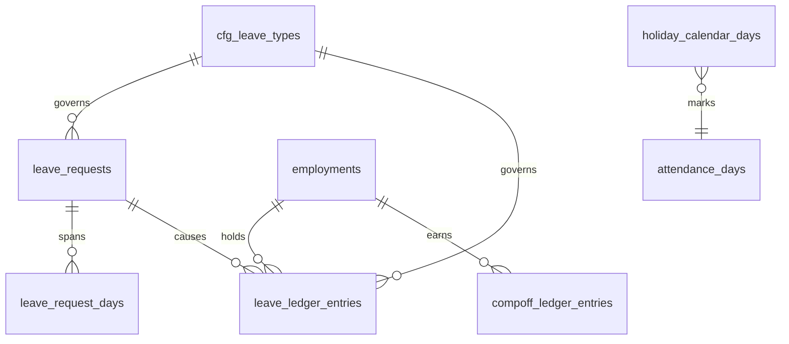

##### `cfg_leave_types` — typed configuration payload
One row per published version of a leave type. The dating and scoping are on
`config_versions`; this table holds the leave-specific payload.

| Column | Type | N | Default | Notes |
|---|---|---|---|---|
| `id`, `tenant_id`, `config_version_id` | | N | | UQ on version |
| `leave_type_code` | VARCHAR(40) | N | — | stable across versions |
| `is_paid` | TINYINT(1) | N | 1 | **the flag payroll reads**; SmartPRS 2 never writes `leaves.type_id`, so its paid test is always true and unpaid leave is paid (`E-…` req. 44, CRITICAL) |
| `unit_code` | VARCHAR(40) | N | `day` | `day|half_day|hour` — the minimum unit |
| `day_count_basis_code` | VARCHAR(40) | N | — | `calendar|working|working_excl_holidays` |
| `accrual_frequency_code` | VARCHAR(40) | N | `annual` | `none|monthly|quarterly|annual|on_service_completion` |
| `accrual_amount_expression` | TEXT | Y | NULL | SPX → Days |
| `accrual_on_day` | TINYINT UNSIGNED | Y | NULL | |
| `accrues_during_unpaid` | TINYINT(1) | N | 0 | |
| `accrues_during_probation` | TINYINT(1) | N | 0 | |
| `carry_forward_cap_days` | DECIMAL(9,4) | Y | NULL | |
| `carry_forward_expiry_months` | SMALLINT UNSIGNED | Y | NULL | |
| `lapse_action_code` | VARCHAR(40) | Y | NULL | `lapse|encash|carry` |
| `encashment_basis_code` | VARCHAR(40) | Y | NULL | `basic|gross|ctc|fixed_day_rate` |
| `encashment_max_days` | DECIMAL(9,4) | Y | NULL | |
| `eligibility_expression` | TEXT | Y | NULL | SPX Boolean |
| `entitlement_expression` | TEXT | N | — | SPX → Days; varies by grade or service band |
| `min_notice_days`, `max_consecutive_days`, `max_applications_per_period` | SMALLINT UNSIGNED | Y | NULL | |
| `allows_backdating_days` | SMALLINT UNSIGNED | Y | NULL | |
| `allows_negative_balance_days` | DECIMAL(9,4) | N | 0 | |
| `requires_attachment_over_days` | DECIMAL(9,4) | Y | NULL | |
| `sandwich_rule_code` | VARCHAR(40) | Y | NULL | balance-side clubbing, independent of the attendance-side rule |
| `leave_year_basis_code` | VARCHAR(40) | N | `financial` | `calendar|financial|anniversary` |
| `prorate_on_join`, `prorate_on_exit` | TINYINT(1) | N | 1 | |
| `blackout_scope_json` | JSON | Y | NULL | |
| `min_staffing_expression` | TEXT | Y | NULL | SPX Boolean evaluated at approval |

**Keys.** PK `id` · UQ `(config_version_id)`, `(tenant_id, leave_type_code,
config_version_id)` · IX `(tenant_id, leave_type_code)`.
**Policy.** Tenant-owned · versioned by the artefact · delete never · audit `full` ·
PII `none` · retention `R-PERM`.
*Why this many columns:* every one of them is a documented SmartPRS 2 gap
(`E-leave-requests-notifications.md` §10.3 requirements 26–50). None of them is code.

##### `leave_ledger_entries` — A4, **the balance**
| Column | Type | N | Default | Notes |
|---|---|---|---|---|
| `id`, `tenant_id` | | N | | |
| `employment_id` | BIGINT UNSIGNED | N | — | FK RESTRICT |
| `leave_type_code` | VARCHAR(40) | N | — | with `config_version_id` for the version in force |
| `config_version_id` | BIGINT UNSIGNED | N | — | FK RESTRICT |
| `leave_year_code` | VARCHAR(20) | N | — | e.g. `FY2026-27` |
| `entry_type_code` | VARCHAR(40) | N | — | `opening|accrual|consumption|reservation|adjustment|encashment|lapse|reversal` |
| `days_delta` | DECIMAL(9,4) | N | — | signed |
| `effective_on` | DATE | N | — | the date the movement belongs to |
| `leave_request_id` | BIGINT UNSIGNED | Y | NULL | FK RESTRICT |
| `payroll_run_id` | BIGINT UNSIGNED | Y | NULL | FK RESTRICT (encashment) |
| `reversal_of_entry_id` | BIGINT UNSIGNED | Y | NULL | FK self RESTRICT |
| `reason_code`, `reason_text` | | Y | NULL | |
| `actor_user_id` | BIGINT UNSIGNED | Y | NULL | FK RESTRICT |
| `trace_id` | BIGINT UNSIGNED | Y | NULL | FK RESTRICT |
| `occurred_at`, `recorded_at` | | N | | |

**Keys.** PK `id` · IX `(tenant_id, employment_id, leave_type_code, leave_year_code,
effective_on)` ← the balance query, `(tenant_id, leave_request_id)`,
`(tenant_id, entry_type_code, effective_on)`.
**Policy.** Tenant-owned · append-only; a correction is a reversal entry ·
audit `event-only` · PII `none` · retention `R-STAT-8Y`.
*Why a ledger:* SmartPRS 2 recomputes balances on demand from `leaves` rows with no
reservation and no locking, publishes three different balance figures in three places, and
lets two simultaneous applications both pass a check performed only at submission
(`E-…` req. 26, 48, 49).

##### `leave_requests` — A1 · `leave_request_days` — A3
`leave_requests`: `employment_id` (FK RESTRICT), `leave_type_code` +
`config_version_id` (FK RESTRICT), `from_on`, `to_on` (`DATE`, `CHECK to_on >= from_on`),
`total_days` `DECIMAL(9,4)`, `reason_text`, `contact_during_leave`,
`attachment_document_id` (FK RESTRICT), `workflow_instance_id` (FK RESTRICT),
`status_code`, `cancelled_at`, `cancellation_reason`.
`leave_request_days`: `on_date`, `day_fraction` `DECIMAL(9,4)`, `half_code`
(`first|second|null`), `is_holiday`, `is_weekly_off`, `counts_toward_balance`.
**Keys.** `leave_requests` UQ `(tenant_id, uuid)`; IX `(tenant_id, employment_id, from_on,
to_on)`, `(tenant_id, status_code)`, `(tenant_id, leave_type_code, from_on)`.
`leave_request_days` UQ `(tenant_id, leave_request_id, on_date)`;
IX `(tenant_id, employment_id, on_date)` ← the team calendar and overlap check.
**Policy.** Tenant-owned · history: status transitions in the workflow instance ·
delete: never · audit `full` · PII `identifying` (a reason may be health-related; the field
is classed `sensitive` where the type declares it) · retention `R-STAT-8Y`.

##### `compoff_ledger_entries` — A4
Same shape as `leave_ledger_entries`, keyed by `employment_id` with `entry_type_code`
`earned|availed|expired|encashed|reversal`, `earned_from_attendance_day_id` (FK RESTRICT),
`expires_on`.
**Keys.** IX `(tenant_id, employment_id, effective_on)`, `(tenant_id, expires_on)`.
**Policy.** As the leave ledger.
*Why:* comp-off appears in SmartPRS 2 exactly once, as a dead `ENUM` value on a dead
table, with no earning mechanism anywhere (`B-attendance.md` §2.4).

##### `holiday_calendar_days` — A3 (parent `cfg_holiday_calendars`, a config payload)
`holiday_calendar_config_version_id` (FK RESTRICT), `on_date`, `name`,
`holiday_type_code` (`national|state|festival|restricted|company`), `is_optional`,
`applies_scope_json`.
**Keys.** UQ `(tenant_id, holiday_calendar_config_version_id, on_date)` — a duplicate
holiday double-counts in the LOP denominator (`J-database.md` §Q5) ·
IX `(tenant_id, on_date)`.
**Policy.** Tenant-owned · versioned by the artefact · audit `full` · PII `none` ·
retention `R-PERM`.

---

### C7 — Compensation & Payroll (12 tables)

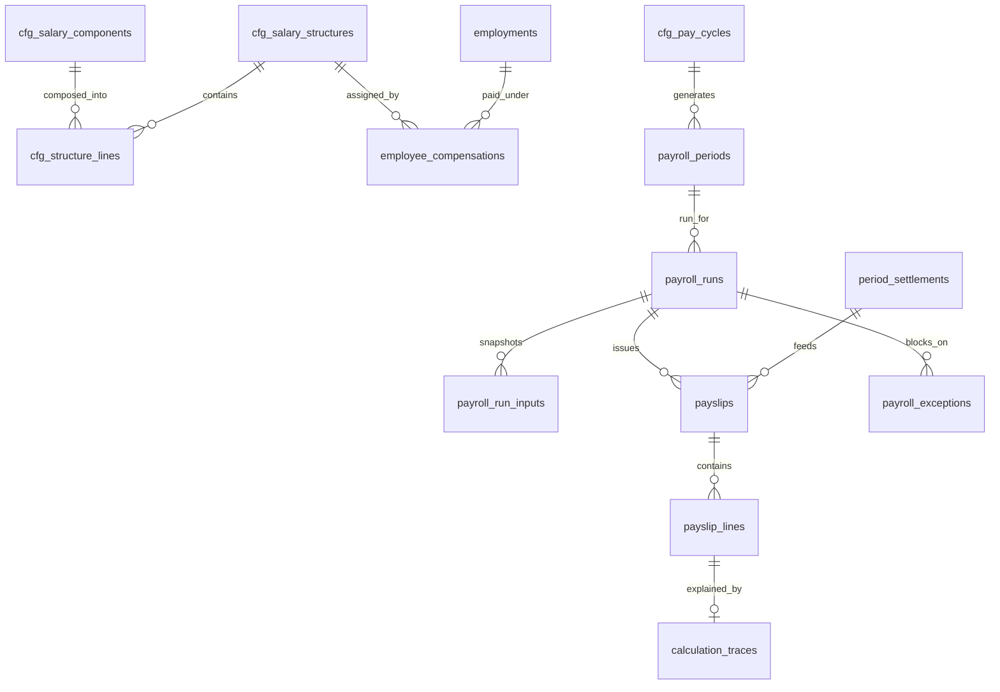

##### `cfg_salary_components` — typed configuration payload
| Column | Type | N | Default | Notes |
|---|---|---|---|---|
| `id`, `tenant_id`, `config_version_id` | | N | | UQ on version |
| `component_code` | VARCHAR(40) | N | — | **the identity**; no logic anywhere branches on the name |
| `name` | VARCHAR(120) | N | — | display; renameable without consequence |
| `component_kind_code` | VARCHAR(40) | N | — | `earning|deduction|employer_contribution|reimbursement|information` |
| `category_code` | VARCHAR(40) | N | — | `fixed|variable|reimbursement|statutory|arrear` |
| `calculation_kind_code` | VARCHAR(40) | N | — | `fixed|percent_of|formula|balance|slab|input` |
| `formula_config_version_id` | BIGINT UNSIGNED | Y | NULL | FK RESTRICT when `formula` |
| `basis_component_code` | VARCHAR(40) | Y | NULL | when `percent_of` |
| `fixed_amount` | DECIMAL(18,4) | Y | NULL | when `fixed` |
| `percent_value` | DECIMAL(9,6) | Y | NULL | when `percent_of` |
| `currency_code` | CHAR(3) | N | `INR` | |
| `sequence_no` | SMALLINT UNSIGNED | N | — | evaluation order within the structure |
| `rounding_mode_code` | VARCHAR(40) | N | — | **mandatory** |
| `rounding_unit` | DECIMAL(18,4) | N | 0.0100 | |
| `prorate_basis_code` | VARCHAR(40) | N | — | `none|payable_days|calendar_days|working_days` |
| `is_pf_base`, `is_esi_base`, `is_pt_base`, `is_lwf_base`, `is_bonus_wage`, `is_gratuity_wage`, `is_ot_wage`, `is_minimum_wage_component`, `is_encashment_base`, `is_taxable`, `in_gross`, `in_ctc`, `in_net`, `is_employer_cost`, `prorates`, `lop_affected`, `arrear_eligible`, `is_perquisite`, `counts_toward_epf_admin_charges` | TINYINT(1) | N | 0 | **the statutory and grouping bases, declared per component by flag** (spine S12). The complete set of nineteen is owned by **Part XV R-XV-007**, which is authoritative for both the membership and the spelling of this list; earlier drafts of this row named ten flags, of which `is_pf_wage`, `is_esi_wage`, `is_pt_gross`, `is_minimum_wage_comparable`, `is_ctc_component` and `is_net_payable` are the superseded spellings of `is_pf_base`, `is_esi_base`, `is_pt_base`, `is_minimum_wage_component`, `in_ctc` and `in_net`. No statutory logic inspects a component's name |
| `show_on_payslip`, `payslip_group_code`, `payslip_sequence` | | | | presentation |
| `arrear_component_code` | VARCHAR(40) | Y | NULL | where arrears post |

**Keys.** PK `id` · UQ `(config_version_id)`,
`(tenant_id, component_code, config_version_id)` ·
IX `(tenant_id, component_code)`, `(tenant_id, category_code)`.
**Policy.** Tenant-owned · versioned by the artefact; **`ON DELETE RESTRICT` from every
payslip line**, so a component version referenced by an issued payslip can never be removed
· audit `full` · PII `none` · retention `R-PERM`.
*Why:* SmartPRS 2's master screen **hard-deletes** salary components, which destroys the
ability to re-explain every payslip computed from them (`J-database.md` §Q8 row 1); its
`calc_value` column is `VARCHAR` on one install and `DECIMAL(12,2)` on another, so the
formula string `"0.4 * BASIC"` becomes the number `0.40` (`J-database.md` §6.1.10); and its
statutory code finds dearness allowance by `str_contains($name,'dearness')`
(`F-…` req. 12).

##### `cfg_salary_structures` — typed payload · `cfg_structure_lines` — A3
`cfg_salary_structures`: `structure_code`, `name`, `currency_code`,
`ctc_definition_code` (which flags sum to CTC), `gross_definition_code`,
`balance_component_code` (the residue absorber), `min_wage_check_enabled`.
`cfg_structure_lines`: `line_no`, `component_code` + `component_config_version_id`
(FK RESTRICT), `override_calculation_kind_code`, `override_value`, `is_mandatory`,
`applies_expression` (SPX Boolean).
**Keys.** structures UQ `(config_version_id)`, `(tenant_id, structure_code,
config_version_id)`; lines UQ `(tenant_id, config_version_id, line_no)`,
`(tenant_id, config_version_id, component_code)`.
**Policy.** As `cfg_salary_components`.

##### `employee_compensations` — A5
What one employment is paid, dated. This is the row that makes an increment a historical
fact rather than an overwrite.

| Column | Type | N | Default | Notes |
|---|---|---|---|---|
| `id`, `uuid`, `tenant_id` | | N | | |
| `employment_id` | BIGINT UNSIGNED | N | — | FK RESTRICT |
| `structure_config_version_id` | BIGINT UNSIGNED | N | — | FK RESTRICT |
| `annual_ctc` | DECIMAL(18,4) | N | — | |
| `monthly_gross` | DECIMAL(18,4) | Y | NULL | derived and stored for reporting; recomputed on version change |
| `currency_code` | CHAR(3) | N | `INR` | |
| `pay_group_code` | VARCHAR(40) | N | — | which cycle pays this person |
| `revision_reason_code` | VARCHAR(40) | N | — | `hire|increment|promotion|correction|structure_change|migration_baseline` |
| `revision_percent` | DECIMAL(9,6) | Y | NULL | |
| `previous_annual_ctc` | DECIMAL(18,4) | Y | NULL | denormalised for the increment letter |
| `arrears_policy_code` | VARCHAR(40) | Y | NULL | how a back-dated revision is settled |
| `workflow_instance_id` | BIGINT UNSIGNED | Y | NULL | FK RESTRICT — maker-checker on salary change |
| `effective_from`, `effective_to`, `open_marker` | A5 | | | |

**Keys.** PK `id` · UQ `(tenant_id, uuid)`,
`(tenant_id, employment_id, effective_from)`,
`(tenant_id, employment_id, open_marker)` ·
IX `(tenant_id, employment_id, effective_from, effective_to)`,
`(tenant_id, pay_group_code, effective_from, effective_to)`.
**Policy.** Tenant-owned · history A5 · delete never · audit `full` (a maker-checker
workflow is mandatory) · PII `sensitive` (salary), masked by role ·
retention `R-PAY-8Y`.
Per-employee component overrides live in `employee_compensation_lines` (A3, derivable),
keyed `(tenant_id, employee_compensation_id, component_code)`.

##### `cfg_pay_cycles` — typed payload
`pay_cycle_code`, `name`, `period_kind_code` (`calendar_month|custom_window|weekly|
fortnightly`), `period_end_day` TINYINT (any day 1–31, not a two-item dropdown),
`period_start_day`, `pay_day_rule_code` (`fixed_day|n_days_after_period_end|
last_working_day`), `pay_day_value`, `pay_day_holiday_shift_code`
(`before|after|none`), `cutoff_day`, `attendance_cutoff_day`, `is_continuous` (always
true; gaps rejected at publish).
**Keys.** UQ `(config_version_id)`, `(tenant_id, pay_cycle_code, config_version_id)`.
**Policy.** Tenant-owned · versioned · audit `full` · PII `none` · retention `R-PERM`.
*Why:* SmartPRS 2's pay cycle is a **two-item dropdown** (`''` or `20`) despite its own
`PeriodResolver` supporting any end day, and the table that holds it has no migration —
so on an install where nobody opened that master screen, the migration that adds its
columns is a silent no-op and the whole feature reverts to hard-coded calendar month with
no error anywhere (`J-database.md` §2.1.1 #31, B17).

##### `payroll_periods` — A1
`pay_cycle_config_version_id` (FK RESTRICT), `pay_group_code`, `period_code` (e.g.
`2026-08`), `period_start_on`, `period_end_on`, `pay_on`, `attendance_cutoff_on`,
`lifecycle_state_code` (`open|in_run|locked|reopened`), `locked_at`, `locked_by_user_id`,
`reopen_workflow_instance_id`.
**Keys.** UQ `(tenant_id, uuid)`, `(tenant_id, pay_group_code, period_code)`,
`(tenant_id, pay_group_code, period_start_on)` ·
IX `(tenant_id, lifecycle_state_code, period_start_on)`.
**Policy.** Tenant-owned · history: state transitions audited · delete: never ·
audit `full` · PII `none` · retention `R-PAY-8Y`.
*Why a first-class period:* SmartPRS 2 identifies a payroll month by `VARCHAR(7)` plus a
free-text `cycle_label` that is also its idempotency key (`J-database.md` §Q9 D3, D5).

##### `payroll_runs` — A1
| Column | Type | N | Default | Notes |
|---|---|---|---|---|
| `id`, `uuid`, `tenant_id` | | N | | |
| `payroll_period_id` | BIGINT UNSIGNED | N | — | FK RESTRICT |
| `pay_group_code` | VARCHAR(40) | N | — | |
| `run_type_code` | VARCHAR(40) | N | `regular` | `regular|off_cycle|supplementary|arrears_only|final_settlement|bonus` |
| `lot_no` | SMALLINT UNSIGNED | N | 1 | multiple lots per company-period are first-class |
| `run_version` | INT UNSIGNED | N | 1 | a re-run creates a new version |
| `supersedes_run_id` | BIGINT UNSIGNED | Y | NULL | FK self RESTRICT |
| `employee_count` | INT UNSIGNED | N | 0 | |
| `total_earnings`, `total_deductions`, `total_employer_cost`, `total_net` | DECIMAL(18,4) | N | 0 | |
| `currency_code` | CHAR(3) | N | `INR` | |
| `reconciliation_state_code` | VARCHAR(40) | N | `pending` | `pending|passed|failed` |
| `lifecycle_state_code` | VARCHAR(40) | N | `draft` | configured transitions |
| `workflow_instance_id` | BIGINT UNSIGNED | Y | NULL | FK RESTRICT |
| `started_at`, `completed_at`, `approved_at`, `locked_at`, `paid_at` | DATETIME(3) | Y | NULL | |
| `requested_by_user_id` | BIGINT UNSIGNED | N | — | FK RESTRICT |

**Keys.** PK `id` · UQ `(tenant_id, uuid)`,
**`(tenant_id, payroll_period_id, pay_group_code, run_type_code, lot_no, run_version)`** ·
IX `(tenant_id, payroll_period_id, lifecycle_state_code)`,
`(tenant_id, lifecycle_state_code, started_at)`.
**Policy.** Tenant-owned · history: versions; a run is **never deleted** ·
delete: never · audit `full` · PII `none` · retention `R-PAY-8Y`.
*Why the composite unique:* SmartPRS 2 has **no unique index** on
`(tenant, company, cycle_label)`, prevents duplicates only with a PHP `SELECT`, and its
generation takes minutes, so a second click produces two runs and two payslips per employee
for the same month — and the bank pack pays twice (`M-…` §6.2 C-1).
*Why versions:* regenerating in SmartPRS 2 hard-deletes the prior run and every payslip in
it, outside any transaction, before the replacement exists (`M-…` D-2).

##### `payroll_run_inputs` — A4, **the snapshot** (spine S11's critical step)
One row per resolved input per run. This is what makes a re-run reproducible and a
changed input visible.

| Column | Type | N | Default | Notes |
|---|---|---|---|---|
| `id`, `tenant_id` | | N | | |
| `payroll_run_id` | BIGINT UNSIGNED | N | — | FK RESTRICT |
| `input_kind_code` | VARCHAR(40) | N | — | `pay_cycle|structure|component|formula|rule|statutory_pack|attendance_settlement|leave_ledger|assignment|compensation|loan_schedule|variable_input` |
| `input_ref_table` | VARCHAR(64) | N | — | |
| `input_ref_id` | BIGINT UNSIGNED | N | — | |
| `input_version_id` | BIGINT UNSIGNED | Y | NULL | FK `config_versions(id)` RESTRICT where applicable |
| `input_hash` | BINARY(32) | N | — | content hash, so a re-run can prove an input changed |
| `employment_id` | BIGINT UNSIGNED | Y | NULL | FK RESTRICT; NULL for run-wide inputs |
| `recorded_at` | DATETIME(3) | N | — | |

**Keys.** PK `id` · UQ `(tenant_id, payroll_run_id, input_kind_code, input_ref_table,
input_ref_id, employment_id)` ·
IX `(tenant_id, payroll_run_id, input_kind_code)`, `(input_version_id)`.
**Policy.** Tenant-owned · append-only · audit `event-only` · PII `none` ·
retention `R-PAY-8Y`.

##### `payslips` — A1
| Column | Type | N | Default | Notes |
|---|---|---|---|---|
| `id`, `uuid`, `tenant_id` | | N | | |
| `payroll_run_id` | BIGINT UNSIGNED | N | — | FK RESTRICT |
| `payroll_period_id` | BIGINT UNSIGNED | N | — | FK RESTRICT (denormalised for period queries) |
| `employment_id` | BIGINT UNSIGNED | N | — | FK RESTRICT |
| `employee_compensation_id` | BIGINT UNSIGNED | N | — | FK RESTRICT — the dated compensation applied |
| `employment_assignment_id` | BIGINT UNSIGNED | N | — | FK RESTRICT — **the assignment as at the period**, so the payslip's org attribution is frozen |
| `period_settlement_id` | BIGINT UNSIGNED | Y | NULL | FK RESTRICT |
| `payable_days`, `lop_days` | DECIMAL(9,4) | N | 0 | |
| `gross_earnings`, `total_deductions`, `net_pay`, `employer_cost` | DECIMAL(18,4) | N | 0 | |
| `currency_code` | CHAR(3) | N | `INR` | |
| `net_pay_in_words` | VARCHAR(400) | Y | NULL | generated |
| `line_status_code` | VARCHAR(40) | N | `draft` | `draft|held|reviewed|approved|disbursed|acknowledged` |
| `held_reason` | VARCHAR(400) | Y | NULL | |
| `pdf_document_id` | BIGINT UNSIGNED | Y | NULL | FK RESTRICT |
| `issued_at`, `superseded_at` | DATETIME(3) | Y | NULL | |
| `superseded_by_payslip_id` | BIGINT UNSIGNED | Y | NULL | FK self RESTRICT |

**Keys.** PK `id` · UQ `(tenant_id, uuid)`, **`(tenant_id, payroll_run_id,
employment_id)`** ·
IX `(tenant_id, employment_id, payroll_period_id)` ← the ESS payslip query,
`(tenant_id, payroll_period_id, line_status_code)` ← the approval sheet,
`(tenant_id, line_status_code)`.
**Policy.** Tenant-owned · history: supersession · **delete: never** ·
audit `full` · PII `sensitive` (salary), masked by role, access audited ·
retention `R-PAY-8Y` (a statutory floor; the class may be lengthened, never shortened).
*Why:* `payslips` in SmartPRS 2 has a unique index on `uuid` and **nothing else**, so two
payslips for the same person in the same month are possible; `line_status` and nine other
approval columns are created by a web request the first time somebody opens the approval
screen; and `payslips.month` is unindexed although four screens query on it
(`J-database.md` §Q5; `A-payroll.md` §2.3).

##### `payslip_lines` — A3, **rows, not JSON**
| Column | Type | N | Default | Notes |
|---|---|---|---|---|
| `id`, `tenant_id` | | N | | |
| `payslip_id` | BIGINT UNSIGNED | N | — | FK RESTRICT |
| `line_no` | SMALLINT UNSIGNED | N | — | |
| `component_code` | VARCHAR(40) | N | — | |
| `component_config_version_id` | BIGINT UNSIGNED | N | — | FK RESTRICT — **the version that computed it** |
| `component_kind_code`, `category_code` | VARCHAR(40) | N | — | denormalised for reporting |
| `amount` | DECIMAL(18,4) | N | 0 | |
| `currency_code` | CHAR(3) | N | `INR` | |
| `quantity` | DECIMAL(9,4) | Y | NULL | days, hours, units |
| `rate` | DECIMAL(18,4) | Y | NULL | |
| `basis_amount` | DECIMAL(18,4) | Y | NULL | what the percentage applied to |
| `is_prorated` | TINYINT(1) | N | 0 | |
| `arrear_for_period_code` | VARCHAR(20) | Y | NULL | when this line settles a back-dated change |
| `statutory_scheme_code` | VARCHAR(40) | Y | NULL | links a deduction to its scheme |
| `trace_id` | BIGINT UNSIGNED | Y | NULL | FK `calculation_traces(id)` RESTRICT |

**Keys.** PK `id` · UQ `(tenant_id, payslip_id, line_no)`,
`(tenant_id, payslip_id, component_code, arrear_for_period_code)` ·
IX `(tenant_id, payslip_id)`,
`(tenant_id, component_code, payslip_id)` ← per-component reporting in SQL,
`(tenant_id, statutory_scheme_code, payslip_id)` ← statutory returns in SQL.
**Policy.** Tenant-owned · immutable with its payslip · delete: never ·
audit `event-only` (the payslip carries the audit) · PII `sensitive` ·
retention `R-PAY-8Y`.
*Why this table exists at all:* in SmartPRS 2 every line item of every payslip is a **JSON
blob**, so no per-component reporting, no statutory return and no reconciliation is a SQL
operation; the analysis calls exploding it "the single highest-value transformation in the
whole migration" (`J-database.md` §Q9 M1, §Q10 TRANSFORM).

##### `calculation_traces` — A4, the stored explainability record
`subject_table`, `subject_id`, `subject_uuid`, `field_key`, `trace_json` (the
`CalculationTrace` value object of Part V §V.5.8), `engine_version`, `produced_at`.
**Keys.** PK `id` · IX `(tenant_id, subject_table, subject_id)`,
`(tenant_id, produced_at)`.
**Policy.** Tenant-owned · append-only · audit `event-only` · PII: inherits the subject ·
retention: with the subject · **partitioned monthly**.

##### `payroll_exceptions` — A4
The preview gate of spine S11: a run cannot pass preview with unresolved exceptions.

`payroll_run_id` (FK RESTRICT), `employment_id` (FK RESTRICT, nullable for run-wide),
`exception_code` (`missing_bank|missing_pan|missing_uan|missing_attendance|
missing_structure|negative_net|minimum_wage_breach|unmapped_statutory|
unapproved_variable_input|duplicate_run|loan_inconsistency|invalid_tax_data`),
`severity_code` (`blocking|warning`), `detail_json`, `resolved_at`,
`resolved_by_user_id`, `resolution_note`.
**Keys.** IX `(tenant_id, payroll_run_id, severity_code, resolved_at)`,
`(tenant_id, exception_code)`.
**Policy.** Tenant-owned · append-only with a resolution stamp · audit `transitional` ·
PII `none` · retention `R-PAY-8Y`.

---

### C8 — Statutory (9 tables)

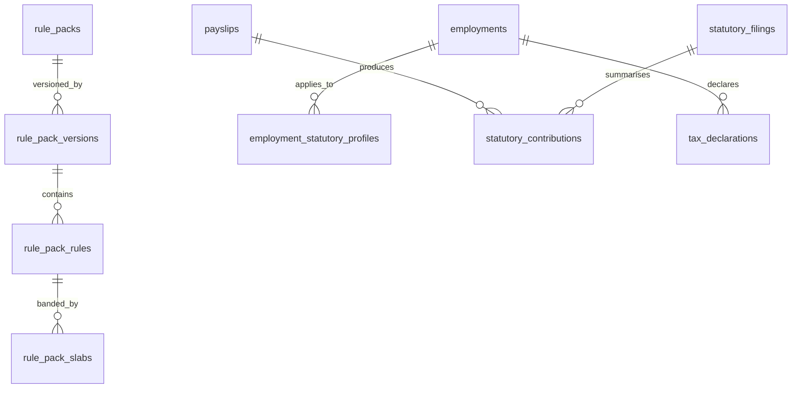

##### `rule_packs` — A1, **platform-owned** (published by Ametecs, not by a tenant)
`pack_key`, `jurisdiction_code` (`IN`, `IN-TG`, `IN-MH`, …), `statute_code`
(`epf|esi|pt|lwf|tds|bonus|gratuity|minimum_wages`), `publisher`, `description`.
**Keys.** UQ `(pack_key)` · IX `(jurisdiction_code, statute_code)`.
**Policy.** Platform-owned · audit `full` · PII `none` · retention `R-PERM`.

##### `rule_pack_versions` — A5, platform-owned, signed
| Column | Type | N | Default | Notes |
|---|---|---|---|---|
| `id`, `uuid` | | N | | |
| `rule_pack_id` | BIGINT UNSIGNED | N | — | FK RESTRICT |
| `pack_version` | VARCHAR(20) | N | — | semantic |
| `content_hash` | BINARY(32) | N | — | |
| `signature` | VARBINARY(1024) | N | — | Ametecs' private key never leaves Ametecs |
| `public_key_id` | VARCHAR(60) | N | — | |
| `published_at` | DATETIME(3) | N | — | |
| `source_reference` | VARCHAR(1000) | N | — | the authority for the values inside |
| `verified_by` | VARCHAR(200) | N | — | the named compliance owner (spine D-03) |
| `verified_on` | DATE | N | — | |
| `effective_from`, `effective_to`, `open_marker` | A5 | | | |
| `notes` | TEXT | Y | NULL | |

**Keys.** PK `id` · UQ `(uuid)`, `(rule_pack_id, pack_version)`,
`(rule_pack_id, effective_from)` · IX `(rule_pack_id, effective_from, effective_to)`.
**Policy.** Platform-owned · immutable once published · delete: never ·
audit `full` · PII `none` · retention `R-PERM`.

##### `rule_pack_activations` — A5, **tenant-owned**
Which pack version a given tenant has accepted, and from when. Separates Ametecs'
publication from a customer's activation.
`rule_pack_version_id` (FK RESTRICT), `accepted_by_user_id`, `accepted_at`,
`activation_mode_code` (`manual|auto`), `impact_preview_json`, plus A5 dating.
**Keys.** UQ `(tenant_id, rule_pack_version_id)`,
`(tenant_id, rule_pack_id, open_marker)` (via a denormalised `rule_pack_id`) ·
IX `(tenant_id, effective_from, effective_to)`.
**Policy.** Tenant-owned · audit `full` · PII `none` · retention `R-PERM`.

##### `rule_pack_rules` — A3, platform-owned
`rule_pack_version_id` (FK CASCADE — composition within an immutable published version),
`rule_code`, `label`, `eligibility_expression` (SPX), `calculation_expression` (SPX),
`rounding_mode_code`, `rounding_unit`, `periodicity_code`
(`monthly|half_yearly|annual|on_event`), `wage_base_flag_code` (which component flag
constitutes the base — never a component name), `ceiling_amount`, `floor_amount`,
`employee_rate`, `employer_rate`, `admin_charge_rule_json`, `applies_scope_json`,
`source_reference`.
**Keys.** UQ `(rule_pack_version_id, rule_code)` ·
IX `(rule_pack_version_id)`.
**Policy.** Platform-owned · immutable · audit `full` · PII `none` · retention `R-PERM`.

> **Legal-values discipline.** No rate, ceiling, slab or due date is asserted anywhere in
> this blueprint as legally correct. `rule_pack_rules.source_reference`,
> `verified_by` and `verified_on` exist precisely so that every value is traceable to its
> authority before publication (spine S12).

##### `rule_pack_slabs` — A3, platform-owned
`rule_pack_rule_id` (FK CASCADE), `slab_no`, `from_amount`, `to_amount` (NULL = open),
`rate_percent`, `flat_amount`, `month_modifier` (the periodic uplift some states apply),
`gender_code`, `age_from`, `age_to`, `attribute_predicate_json` (declarative exemptions).
**Keys.** UQ `(rule_pack_rule_id, slab_no)` · IX `(rule_pack_rule_id, from_amount)`.
**Policy.** as `rule_pack_rules`.
*Why the modifier and predicate columns exist:* SmartPRS 2 encodes the Maharashtra
February uplift as `if ($key === 'maharashtra')` in PHP and the female exemption as a
hard-coded branch; both are instances of a general pattern (`F-…` req. 15, 16).

##### `employment_statutory_profiles` — A5
Per employment, per scheme, dated, with a recorded reason.
`employment_id` (FK RESTRICT), `scheme_code` (`epf|eps|edli|esi|pt|lwf|tds`),
`applicability_code` (`applicable|not_applicable|voluntary|exempt|excluded_above_ceiling|
international_worker|apprentice`), `reason_code`, `reason_text`,
`registration_org_unit_id` (FK RESTRICT — the establishment under which they are covered),
`member_id_ciphertext` / `member_id_blind_index` (UAN, ESIC IP number),
`period_lock_from`, `period_lock_to` (the ESI half-year determination carried forward),
`tax_regime_code`, plus A5 dating.
**Keys.** UQ `(tenant_id, employment_id, scheme_code, effective_from)`,
`(tenant_id, employment_id, scheme_code, open_marker)` ·
IX `(tenant_id, scheme_code, applicability_code)`,
`(tenant_id, registration_org_unit_id, scheme_code)`.
**Policy.** Tenant-owned · history A5 · delete never · audit `full` ·
PII `sensitive` · retention `R-STAT-8Y`.
*Why:* SmartPRS 2's `pf_applicable` and `esi_applicable` columns exist and **do not drive
the engine**; migrating their populated values will change payroll outcomes, so a
reconciliation report before cutover is mandatory (`F-…` req. 9).

##### `statutory_contributions` — A3 of `payslips`
Derived from payslip lines, never recomputed from CTC.
`payslip_id` (FK RESTRICT), `scheme_code`, `rule_pack_version_id` (FK RESTRICT),
`wage_base_amount`, `employee_amount`, `employer_amount`, `admin_charge_amount`,
`sub_split_json` (EPS/EPF/EDLI), `rounding_mode_code`, `trace_id` (FK RESTRICT).
**Keys.** UQ `(tenant_id, payslip_id, scheme_code)` ·
IX `(tenant_id, scheme_code, payslip_id)`.
**Policy.** Tenant-owned · immutable with the payslip · audit `event-only` ·
PII `sensitive` · retention `R-STAT-8Y`.

##### `statutory_filings` — A1
`statute_code`, `jurisdiction_code`, `registration_org_unit_id` (FK RESTRICT),
`period_code`, `due_on`, `filing_state_code` (`due|prepared|filed|acknowledged|revised`),
`filed_on`, `acknowledgement_number`, `challan_reference`, `bsr_code`, `deposit_on`,
`total_amount`, `covered_run_ids_json`, `evidence_document_id` (FK RESTRICT),
`filed_by_user_id`.
**Keys.** UQ `(tenant_id, uuid)`, `(tenant_id, statute_code, registration_org_unit_id,
period_code)` · IX `(tenant_id, due_on, filing_state_code)`.
**Policy.** Tenant-owned · history: state transitions · delete: never ·
audit `full` · PII `none` · retention `R-STAT-8Y`.
*Why the state is explicit:* the system must never assert a filing status it has not
observed (`F-…` req. 29).

##### `tax_declarations` — A1 (+ `tax_declaration_items` A3, derivable)
`employment_id` (FK RESTRICT), `financial_year_code`, `regime_code`,
`regime_elected_on`, `declaration_window_from/to`, `proof_window_from/to`, `locked_on`,
`lifecycle_state_code`, `previous_employer_income`, `previous_employer_tds`,
`other_income`, `perquisites_json`.
Items carry `section_code` (`80c|80d|80ccd1b|24b|hra|lta|…`), `declared_amount`,
`proof_amount`, `verified_amount`, `proof_document_id` (FK RESTRICT),
`verification_state_code`.
**Keys.** UQ `(tenant_id, employment_id, financial_year_code)`;
items UQ `(tenant_id, tax_declaration_id, section_code, line_no)`.
**Policy.** Tenant-owned · audit `full` · PII `sensitive` · retention `R-STAT-8Y`.

---

### C9 — Money Movement (8 tables)

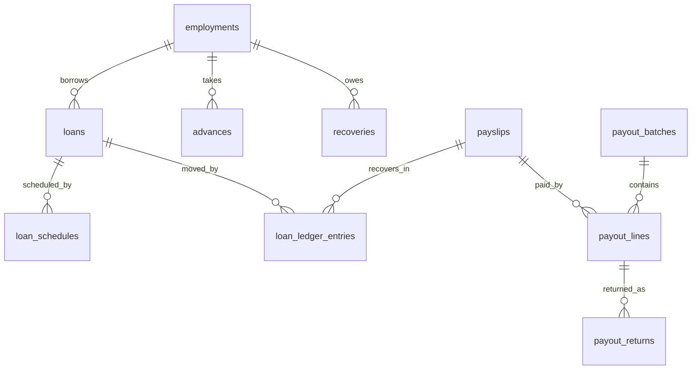

##### `loans` — A1
`employment_id` (FK RESTRICT), `loan_type_code`, `principal_amount`, `currency_code`,
`interest_rate_percent` `DECIMAL(9,6)`, `interest_method_code`, `instalment_count`,
`instalment_amount`, `first_recovery_period_code`, `sanctioned_by_user_id`,
`sanction_workflow_instance_id` (FK RESTRICT), `disbursed_on`,
`disbursement_payout_line_id` (FK RESTRICT), `max_recovery_percent_of_net`
`DECIMAL(9,6)`, `lifecycle_state_code` (`requested|sanctioned|disbursed|recovering|
closed|written_off`), `closed_on`.
**Keys.** UQ `(tenant_id, uuid)` · IX `(tenant_id, employment_id, lifecycle_state_code)`,
`(tenant_id, lifecycle_state_code)`.
**Policy.** Tenant-owned · history: ledger · delete: never · audit `full` ·
PII `sensitive` · retention `R-PAY-8Y`.
*Why the columns are all present:* SmartPRS 2's payroll engine reads
`loans.installment_amount`, `installments_total`, `type` and `start_month` — **four columns
that exist in no migration and are created by no code at all** — so `safeRow()` drops them
silently and the engine produces a wrong number rather than an error (`A-payroll.md` §2.6,
DEF-P02).

##### `loan_schedules` — A3
`loan_id` (FK RESTRICT), `instalment_no`, `due_period_code`, `principal_component`,
`interest_component`, `total_amount`, `status_code` (`pending|recovered|waived|deferred`).
**Keys.** UQ `(tenant_id, loan_id, instalment_no)` ·
IX `(tenant_id, due_period_code, status_code)`.
**Policy.** Tenant-owned · audit `transitional` · PII `none` · retention `R-PAY-8Y`.

##### `loan_ledger_entries` — A4, **the outstanding balance**
`loan_id` (FK RESTRICT), `entry_type_code` (`disbursement|recovery|waiver|interest|
reversal|write_off`), `amount_delta` (signed `DECIMAL(18,4)`), `payslip_id` (FK RESTRICT),
`payroll_run_id` (FK RESTRICT), `loan_schedule_id` (FK RESTRICT),
`reversal_of_entry_id` (FK self RESTRICT), `trace_id`, `occurred_at`, `recorded_at`.
**Keys.** PK `id` · UQ `(tenant_id, loan_id, payslip_id, entry_type_code)` — one recovery
per loan per payslip, enforced by the database ·
IX `(tenant_id, loan_id, occurred_at)`, `(tenant_id, payroll_run_id)`.
**Policy.** Tenant-owned · append-only; a superseded run's recoveries are reversed by
compensating entries **inside the same transaction as the supersession** ·
audit `event-only` · PII `none` · retention `R-PAY-8Y`.
*Why a ledger and not a counter:* SmartPRS 2 keeps `installments_paid` on the loan and
adjusts it in a best-effort `try/catch` **after** the payroll transaction commits, so a
payslip can say "Loan EMI ₹5,000 deducted" while the counter never advances and the loan is
recovered forever; two concurrent regenerates decrement it twice and re-open a closed loan
(`M-…` §6.2 C-2, C-3). Its `outstanding` column is read as a stop condition and written by
nothing (`A-payroll.md` §2.6).

##### `advances` — A1, `recoveries` — A1
`advances`: `employment_id`, `amount`, `reason`, `recovery_plan_code`
(`single|spread`), `instalment_amount`, `instalment_count`, `first_recovery_period_code`,
`workflow_instance_id`, `lifecycle_state_code`. Movements use `loan_ledger_entries` with
`advance_id` populated instead of `loan_id` (one ledger, two parents, `CHECK` exactly one).
`recoveries`: the general case — `employment_id`, `cause_code`
(`loan|advance|clawback|excess_payment|penalty|asset|notice_shortfall`),
`source_table`/`source_id`, `total_amount`, `recovered_amount` (derived),
`max_percent_of_net`, `priority_no` (the order in which competing recoveries take from a
net), `lifecycle_state_code`.
**Keys.** `recoveries` UQ `(tenant_id, uuid)`;
IX `(tenant_id, employment_id, lifecycle_state_code, priority_no)`.
**Policy.** Tenant-owned · audit `full` · PII `sensitive` · retention `R-PAY-8Y`.

##### `payout_batches` — A1
`batch_no` (from `cfg_code_sequences`), `payroll_run_id` (FK RESTRICT, nullable for
non-payroll payouts), `payment_method_code` (`neft|rtgs|imps|upi|cheque|cash`),
`source_bank_account_ref`, `value_on`, `line_count`, `total_amount`, `currency_code`,
`gate_decision_id` (FK RESTRICT — the compliance gate that permitted release),
`file_document_id` (FK RESTRICT — the generated bank file),
`lifecycle_state_code` (`draft|gated|released|acknowledged|partially_returned|closed`),
`released_by_user_id`, `released_at`.
**Keys.** UQ `(tenant_id, uuid)`, `(tenant_id, batch_no)` ·
IX `(tenant_id, lifecycle_state_code, value_on)`, `(tenant_id, payroll_run_id)`.
**Policy.** Tenant-owned · history: released batches are immutable; a correction is a new
batch plus a reversal line · delete: never · audit `full` · PII `none` ·
retention `R-PAY-8Y`.

##### `payout_lines` — A3
`payout_batch_id` (FK RESTRICT), `line_no`, `employment_id` (FK RESTRICT),
`payslip_id` (FK RESTRICT, nullable), `employee_bank_account_id` (FK RESTRICT — **the
dated account row in force at release**), `amount`, `currency_code`,
`beneficiary_name_snapshot`, `account_last4_snapshot`, `ifsc_snapshot`,
`reference_no`, `status_code` (`pending|sent|settled|returned|cancelled`).
**Keys.** UQ `(tenant_id, payout_batch_id, line_no)`,
`(tenant_id, payslip_id)` where non-null — **one payout line per payslip** ·
IX `(tenant_id, employment_id, status_code)`.
**Policy.** Tenant-owned · immutable after release · audit `full` ·
PII `sensitive` (snapshots are deliberate: the file that was sent must be reproducible) ·
retention `R-PAY-8Y`.

##### `payout_returns` — A4
`payout_line_id` (FK RESTRICT), `returned_on`, `reason_code`, `bank_reason_text`,
`amount`, `resolution_code` (`reissue|hold|manual`), `resolved_by_user_id`,
`replacement_payout_line_id` (FK RESTRICT).
**Keys.** IX `(tenant_id, payout_line_id)`, `(tenant_id, returned_on)`.
**Policy.** Tenant-owned · append-only · audit `event-only` · PII `none` ·
retention `R-PAY-8Y`.

---

### C10 — Talent (6 tables)

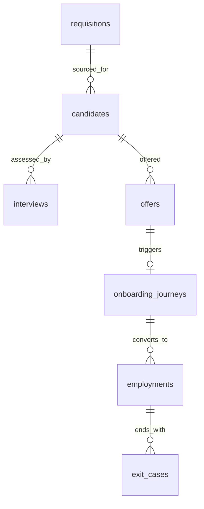

##### `requisitions` — A1
`requisition_no`, `org_unit_id` (FK RESTRICT), `designation_id` (FK RESTRICT),
`grade_id` (FK RESTRICT), `employment_type_code`, `positions_approved`,
`positions_filled`, `budget_ctc_min`/`budget_ctc_max` `DECIMAL(18,4)`, `justification`,
`required_by_on`, `workflow_instance_id` (FK RESTRICT), `lifecycle_state_code`
(`draft|approved|open|on_hold|filled|closed|cancelled`).
**Keys.** UQ `(tenant_id, uuid)`, `(tenant_id, requisition_no)` ·
IX `(tenant_id, lifecycle_state_code, required_by_on)`, `(tenant_id, org_unit_id)`.
`CHECK (positions_filled <= positions_approved)`.
**Policy.** Tenant-owned · audit `full` · PII `none` · retention `R-STAT-8Y`.

##### `candidates` — A1
`requisition_id` (FK RESTRICT, nullable — speculative applications), `person_id`
(FK RESTRICT, nullable until conversion), `full_name`, `contact_email_blind_index`,
`contact_mobile_blind_index`, `source_code`, `current_stage_code`,
`stage_changed_at`, `expected_ctc`, `offered_ctc`, `notice_period_days`,
`consent_recorded_at`, `consent_purpose_code`, `consent_expires_on`,
`lifecycle_state_code` (`sourced|screened|interviewing|offered|hired|rejected|withdrawn|
purged`), `rejection_reason_code`, `converted_employment_id` (FK RESTRICT).
**Keys.** UQ `(tenant_id, uuid)`,
`(tenant_id, requisition_id, contact_email_blind_index)` — hire idempotency is keyed on
the candidate, never on a name ·
IX `(tenant_id, current_stage_code)` ← the pipeline board,
`(tenant_id, consent_expires_on)` ← the PII purge sweep,
`(tenant_id, converted_employment_id)`.
**Policy.** Tenant-owned · history: `candidate_stage_events` (A4, derivable) ·
delete: never; **purged under `R-PII-CONSENT`** · audit `full` ·
PII `identifying`, contact values encrypted · retention `R-PII-CONSENT`.
*Why:* SmartPRS 2 keys its hire idempotency on `where('name', $c->name)`, so hiring a
second person with the same name creates **no employee at all** while reporting the first
one's code as the hire (`D-employee-master.md` Q6 #4); and rejected candidates' CVs,
contact details, ID proofs and interview notes are kept indefinitely with no consent expiry
and no bulk purge — the most exposed PII class in the product (`M-…` §6.5).

##### `interviews` — A1
`candidate_id` (FK RESTRICT), `round_no`, `interview_kind_code`, `scheduled_at_utc`,
`timezone`, `mode_code`, `panel_user_ids_json`, `outcome_code`, `score` `DECIMAL(9,4)`,
`feedback_text`, `feedback_by_user_id`, `lifecycle_state_code`.
**Keys.** UQ `(tenant_id, candidate_id, round_no)` ·
IX `(tenant_id, scheduled_at_utc)`.
**Policy.** Tenant-owned · audit `full` · PII `identifying` · retention
`R-PII-CONSENT`.

##### `offers` — A1
`candidate_id` (FK RESTRICT), `offer_no`, `structure_config_version_id` (FK RESTRICT),
`annual_ctc`, `currency_code`, `proposed_joining_on`, `proposed_designation_id`,
`proposed_org_unit_id`, `valid_until_on`, `issued_at`, `responded_at`,
`response_code` (`accepted|declined|lapsed|withdrawn`), `document_id` (FK RESTRICT),
`e_sign_reference`, `workflow_instance_id`, `lifecycle_state_code`.
**Keys.** UQ `(tenant_id, uuid)`, `(tenant_id, offer_no)`,
`(tenant_id, candidate_id, offer_no)` · IX `(tenant_id, lifecycle_state_code,
valid_until_on)`.
**Policy.** Tenant-owned · history: versions of the offer are separate rows superseding
each other · audit `full` · PII `sensitive` (compensation) · retention `R-STAT-8Y`.

##### `onboarding_journeys` — A1 (+ `journey_tasks`, `journey_submissions` A3, derivable)
`candidate_id` (FK RESTRICT, nullable), `employment_id` (FK RESTRICT, nullable),
`journey_config_version_id` (FK RESTRICT), `invite_token_hash`, `invite_expires_at`,
`otp_attempt_count`, `otp_locked_until`, `progress_percent`,
`submitted_at`, `verified_at`, `verified_by_user_id`, `converted_at`,
`payload_purged_at`, `lifecycle_state_code`.
**Keys.** UQ `(tenant_id, uuid)`, `(tenant_id, invite_token_hash)` ·
IX `(tenant_id, lifecycle_state_code, invite_expires_at)`.
**Policy.** Tenant-owned · delete: never; **the submitted payload is purged or redacted
once injected** · audit `full` · PII `sensitive` while unpurged ·
retention `R-PII-CONSENT`.
*Why the token is hashed and the payload purged:* SmartPRS 2 returns a one-time code in a
response, never invalidates OTPs on resend, and retains the onboarding payload
indefinitely (`D-…` req. 36, 39).

##### `exit_cases` — A1 (+ `exit_clearance_items` A3, derivable)
`employment_id` (FK RESTRICT), `initiated_on`, `resignation_on`, `last_working_on`,
`notice_days_required`, `notice_days_served`, `notice_shortfall_recovery_id`
(FK `recoveries(id)` RESTRICT), `exit_reason_code`, `is_rehire_eligible`,
`final_settlement_run_id` (FK `payroll_runs(id)` RESTRICT),
`workflow_instance_id`, `lifecycle_state_code` (`initiated|clearance|settled|closed`).
**Keys.** UQ `(tenant_id, uuid)`, `(tenant_id, employment_id, initiated_on)` ·
IX `(tenant_id, lifecycle_state_code, last_working_on)`.
**Policy.** Tenant-owned · audit `full` · PII `none` · retention `R-STAT-8Y`.

---

### C11 — Compliance (6 tables)

The product's differentiator (spine S19 #1). Its whole design is that DRA, PCC, BGV, code
of conduct and agent authorisation are **instances of one model**, not five hard-coded
features.

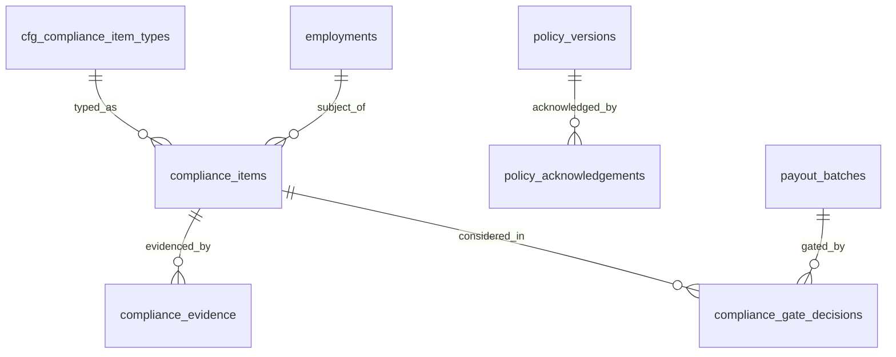

##### `cfg_compliance_item_types` — typed configuration payload
| Column | Type | N | Default | Notes |
|---|---|---|---|---|
| `id`, `tenant_id`, `config_version_id` | | N | | UQ on version |
| `item_type_code` | VARCHAR(40) | N | — | `dra`, `pcc`, `bgv`, `coc`, `agent_auth`, or anything a customer invents |
| `name` | VARCHAR(160) | N | — | |
| `subject_kind_code` | VARCHAR(40) | N | — | `employment|off_roll_agent|vendor|establishment` |
| `applies_expression` | TEXT | Y | NULL | SPX Boolean over role, department, engagement type, state |
| `validity_source_code` | VARCHAR(40) | N | — | `issue_plus_period|explicit_expiry|perpetual` |
| `validity_months` | SMALLINT UNSIGNED | Y | NULL | |
| `renewal_lead_days` | SMALLINT UNSIGNED | Y | NULL | |
| `evidence_required` | TINYINT(1) | N | 1 | |
| `evidence_document_type_code` | VARCHAR(40) | Y | NULL | |
| `valid_state_codes_json` | JSON | N | — | **the single definition of "valid"** used by the score, the gate and the report |
| `alert_ladder_json` | JSON | N | — | bucket boundaries, windows, recipients, escalation |
| `score_weight` | DECIMAL(9,4) | N | 0 | |
| `missing_record_scores_zero` | TINYINT(1) | N | 1 | a missing record never scores as compliant |
| `verification_workflow_key` | VARCHAR(80) | Y | NULL | |

**Keys.** PK `id` · UQ `(config_version_id)`, `(tenant_id, item_type_code,
config_version_id)`.
**Policy.** Tenant-owned · versioned · audit `full` · PII `none` · retention `R-PERM`.
*Why:* SmartPRS 2 has DRA requiring `verified` while PCC accepts `submitted`,
asymmetrically and undocumented, and three separate definitions of "valid" behind the
score, the gate and the report (`F-…` req. 34, 36).

##### `compliance_items` — A1
`item_type_code` + `item_type_config_version_id` (FK RESTRICT), `subject_kind_code`,
`subject_id`, `subject_uuid`, `reference_no`, `issued_on`, `valid_from`, `valid_to`,
`status_code` (from the type's own vocabulary), `verified_by_user_id`, `verified_at`,
`waiver_reason`, `waived_by_user_id`, `renewal_task_workflow_instance_id`,
`lifecycle_state_code`.
**Keys.** UQ `(tenant_id, uuid)`,
`(tenant_id, item_type_code, subject_kind_code, subject_id, issued_on)` ·
IX `(tenant_id, valid_to)` ← the expiry sweep,
`(tenant_id, subject_kind_code, subject_id, item_type_code)` ← the gate lookup,
`(tenant_id, item_type_code, status_code)`.
**Policy.** Tenant-owned · history: supersession on renewal · delete: never ·
audit `full` · PII `sensitive` (a PCC or BGV result is about a person) ·
retention `R-STAT-8Y`.
*Why indexed on `valid_to`:* SmartPRS 2's compliance registers are unindexed and its
`documents.expiry` is alerted on by nothing (`F-…` DEFECT-F-38; `D-…` DEF-18).

##### `compliance_evidence` — A3
`compliance_item_id` (FK RESTRICT), `document_id` (FK RESTRICT), `evidence_kind_code`,
`uploaded_by_user_id`, `uploaded_at`, `verification_state_code`.
**Keys.** UQ `(tenant_id, compliance_item_id, document_id)`.
**Policy.** Tenant-owned · audit `full` · PII `sensitive` · retention with the item.

##### `compliance_gate_decisions` — A4, the money gate
| Column | Type | N | Default | Notes |
|---|---|---|---|---|
| `id`, `tenant_id` | | N | | |
| `gate_point_code` | VARCHAR(40) | N | — | `payroll_run_approval|payout_batch_release|commission_payment|work_allocation|attendance_marking` |
| `subject_kind_code`, `subject_id`, `subject_uuid` | | N | — | |
| `context_table`, `context_id` | | Y | NULL | the run or batch being gated |
| `gate_mode_code` | VARCHAR(40) | N | — | `off|warn|block` — the configured mode at decision time |
| `verdict_code` | VARCHAR(40) | N | — | `pass|warn|block|overridden|error_blocked` |
| `evaluated_items_json` | JSON | N | — | every item and its state, so the decision is explainable months later |
| `override_by_user_id`, `override_reason` | | Y | NULL | |
| `gate_policy_config_version_id` | BIGINT UNSIGNED | N | — | FK RESTRICT |
| `occurred_at`, `recorded_at` | | N | | |

**Keys.** PK `id` · IX `(tenant_id, gate_point_code, occurred_at)`,
`(tenant_id, subject_kind_code, subject_id)`, `(tenant_id, context_table, context_id)`.
**Policy.** Tenant-owned · append-only · audit `event-only` · PII `none` ·
retention `R-STAT-8Y`.
*Why `error_blocked` is a verdict:* a gate never fails open. An error inside evaluation
blocks and alerts (`F-…` req. 39, SEC-F-04).

##### `policy_versions` — A5 (payload of the `policy` artefact) · `policy_acknowledgements` — A4
`policy_versions`: `policy_code`, `title`, `body_document_id` (FK RESTRICT),
`requires_acknowledgement`, `reacknowledge_on_version_bump`, `audience_expression` (SPX),
plus A5 dating.
`policy_acknowledgements`: `policy_version_id` (FK RESTRICT), `user_id` (FK RESTRICT),
`employment_id` (FK RESTRICT), `acknowledged_at`, `ip_address` `VARBINARY(16)`,
`user_agent_hash`, `signature_document_id`.
**Keys.** acknowledgements UQ `(tenant_id, policy_version_id, user_id)` — per **version**,
so a bump demands a fresh acknowledgement and the history of all acknowledgements survives
· IX `(tenant_id, user_id)`, `(tenant_id, policy_version_id)`.
**Policy.** Tenant-owned · append-only · audit `event-only` · PII `identifying` (IP) ·
retention `R-STAT-8Y`.

---

### C12 — Communication (4 tables)

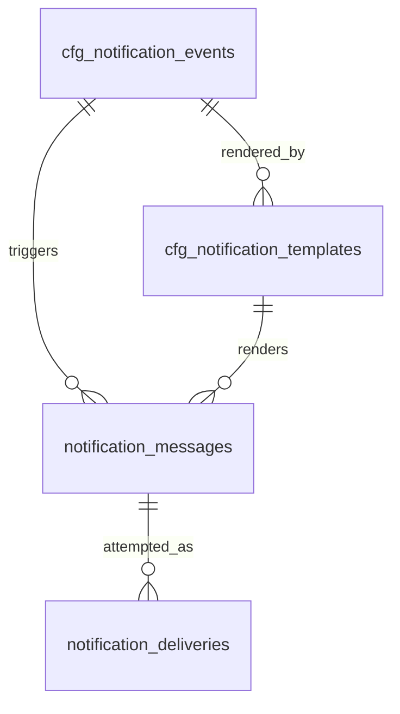

##### `cfg_notification_events` — typed payload
`event_key` (matching the domain event catalogue), `label`, `description`,
`merge_variables_json` (the declared catalogue — an unknown variable is a publish-time
error), `default_channel_codes_json`, `audience_expression` (SPX),
`is_mandatory` (mandatory notifications ignore per-user preferences),
`throttle_window_seconds`.
**Keys.** UQ `(config_version_id)`, `(tenant_id, event_key, config_version_id)`.
**Policy.** Tenant-owned · versioned · audit `full` · PII `none` · retention `R-PERM`.

##### `cfg_notification_templates` — typed payload
`notification_event_key`, `channel_code` (`email|sms|whatsapp|push|in_app`),
`locale_code`, `subject_template`, `body_template`, `provider_template_ref`
(for WhatsApp-style approved templates), `attachment_rule_json`.
**Keys.** UQ `(config_version_id)`, `(tenant_id, notification_event_key, channel_code,
locale_code, config_version_id)`.
**Policy.** Tenant-owned · versioned · audit `full` · PII `none` · retention `R-PERM`.

##### `notification_messages` — A4
`notification_event_key`, `template_config_version_id` (FK RESTRICT), `channel_code`,
`recipient_kind_code` (`user|employment|external`), `recipient_user_id` (FK RESTRICT),
`recipient_employment_id` (FK RESTRICT), `recipient_address_blind_index`,
`subject_rendered`, `body_hash` (**not the body**, where the body may contain sensitive
values), `body_rendered` (retained only when the template is classed non-sensitive),
`correlation_id`, `source_event_uuid`, `queued_at`.
**Keys.** PK `(id, queued_on)` (partition key) ·
IX `(tenant_id, notification_event_key, queued_at)`,
`(tenant_id, recipient_user_id, queued_at)`, `(correlation_id)`.
**Policy.** Tenant-owned · append-only · audit `event-only` ·
PII `identifying`; **credential-grade values are never written to a message log** ·
retention `R-LOG-13M` · partitioned monthly.
*Why:* SmartPRS 2 writes one aggregate row per broadcast rather than one per recipient, and
its WhatsApp log stores plaintext temporary passwords forever (`E-…` req. 65, 72).

##### `notification_deliveries` — A4
`notification_message_id` (FK RESTRICT), `attempt_no`, `provider_code`,
`provider_message_ref`, `status_code` (`sent|delivered|failed|bounced|rejected|read`),
`error_code`, `error_text`, `attempted_at`, `settled_at`.
**Keys.** UQ `(tenant_id, notification_message_id, attempt_no)` ·
IX `(tenant_id, status_code, attempted_at)`, `(provider_message_ref)`.
**Policy.** As `notification_messages`.

---

### C13 — Integration (9 tables)

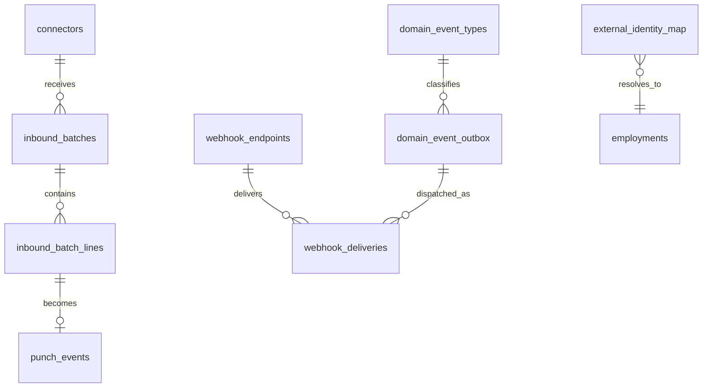

##### `connectors` — A1
`connector_kind_code` (`device_pull|rest|soap|sql|csv|sftp|webhook_in`),
`recipe_config_version_id` (FK RESTRICT), `name`, `endpoint_url`,
`egress_allowlist_json`, `credential_ciphertext`, `schedule_cron`, `timezone`,
`last_run_at`, `last_success_at`, `consecutive_failure_count`, `health_state_code`,
`lifecycle_state_code`.
**Keys.** UQ `(tenant_id, uuid)`, `(tenant_id, name)` ·
IX `(tenant_id, health_state_code)`, `(tenant_id, lifecycle_state_code, last_run_at)`.
**Policy.** Tenant-owned · audit `full` · PII `restricted` (credential) ·
retention `R-PERM`.
*Why the allow-list column:* egress is restricted by scheme and host, blocking loopback,
link-local and private ranges unless a LAN connector explicitly permits them (spine S17).

##### `inbound_batches` — A4 · `inbound_batch_lines` — A3
`inbound_batches`: `connector_id` (FK RESTRICT), `api_client_id` (FK RESTRICT),
`external_batch_ref`, `line_count`, `accepted_count`, `duplicate_count`,
`quarantined_count`, `rejected_count`, `payload_hash`, `received_at`, `processed_at`,
`lifecycle_state_code`.
`inbound_batch_lines`: `line_no`, `external_event_id`, `verdict_code`, `verdict_detail`,
`punch_event_id` (FK RESTRICT, nullable).
**Keys.** batches UQ `(tenant_id, api_client_id, external_batch_ref)`;
lines UQ `(tenant_id, inbound_batch_id, line_no)`,
IX `(tenant_id, verdict_code)`.
**Policy.** Tenant-owned · append-only · audit `event-only` · PII `none` ·
retention `R-LOG-13M` (the punches themselves are retained under `R-ATT-3Y+`).
*Why per-line verdicts:* the acknowledgement carries a per-punch verdict and nothing is
silently dropped (spine S10).

##### `idempotency_keys` — A4
`api_client_id` (FK RESTRICT), `idempotency_key`, `request_method`, `request_path`,
`request_hash`, `response_status`, `response_body_hash`, `response_ref`,
`expires_at`.
**Keys.** UQ `(tenant_id, api_client_id, idempotency_key)` ·
IX `(expires_at)`.
**Policy.** Tenant-owned · append-only, TTL-aged · audit `event-only` · PII `none` ·
retention: 30 days (configuration).

##### `webhook_endpoints` — A1
`name`, `target_url`, `secret_ciphertext`, `signing_algorithm_code`,
`subscribed_event_keys_json` (also normalised into `webhook_subscriptions`, A3,
derivable), `freshness_window_seconds`, `max_attempts`, `backoff_policy_code`,
`lifecycle_state_code`, `last_success_at`, `consecutive_failure_count`.
**Keys.** UQ `(tenant_id, uuid)`, `(tenant_id, name)` ·
IX `(tenant_id, lifecycle_state_code)`.
**Policy.** Tenant-owned · audit `full` · PII `restricted` · retention `R-PERM`.

##### `webhook_deliveries` — A4
`webhook_endpoint_id` (FK RESTRICT), `domain_event_outbox_id` (FK RESTRICT),
`attempt_no`, `request_body_hash`, `signature`, `nonce`, `response_status`,
`response_body_excerpt`, `duration_ms`, `status_code` (`pending|delivered|failed|
dead_lettered`), `next_attempt_at`, `attempted_at`.
**Keys.** UQ `(tenant_id, webhook_endpoint_id, domain_event_outbox_id, attempt_no)` ·
IX `(tenant_id, status_code, next_attempt_at)`, `(tenant_id, webhook_endpoint_id,
attempted_at)`.
**Policy.** Tenant-owned · append-only · audit `event-only` · PII: inherits the payload ·
retention `R-LOG-13M` · partitioned monthly.

##### `domain_event_types` — A2, platform-owned
`event_key`, `event_version`, `owning_context`, `payload_schema_json`,
`is_externally_publishable`, `description`.
**Keys.** UQ `(event_key, event_version)`.
**Policy.** Platform-owned · audit `full` · PII `none` · retention `R-PERM`.
This is the machine-readable form of the event catalogue in Part V §V.9.3, and CI asserts
that every event a context publishes is registered here and schema-valid.

##### `domain_event_outbox` — A4, **the transactional outbox**
`event_uuid` BINARY(16), `event_key`, `event_version`, `aggregate_type`,
`aggregate_id`, `aggregate_uuid`, `aggregate_version`, `correlation_id`,
`causation_id`, `actor_user_id`, `payload_json`, `occurred_at`, `published_at`,
`publish_attempt_count`, `status_code` (`pending|published|failed`).
**Keys.** PK `(id, occurred_on)` (partition key) · UQ `(tenant_id, event_uuid)` ·
IX `(status_code, occurred_at)` ← the relay's access path,
`(tenant_id, aggregate_type, aggregate_id)`, `(correlation_id)`.
**Policy.** Tenant-owned · append-only · written **in the same transaction as the state
change** · audit `event-only` · PII: inherits the payload · retention `R-LOG-13M` ·
partitioned monthly.

##### `external_identity_map` — A5
`system_code` (`sbb|smartept|smartdcm|<customer system>`), `external_id`,
`subject_kind_code` (`employment|org_unit|device|candidate`), `subject_id`,
`subject_uuid`, `mapped_by_user_id`, plus A5 dating.
**Keys.** UQ `(tenant_id, system_code, external_id, open_marker)`,
`(tenant_id, system_code, external_id, effective_from)` ·
IX `(tenant_id, subject_kind_code, subject_id)`.
**Policy.** Tenant-owned · history A5 · delete never · audit `full` ·
PII `identifying` · retention `R-STAT-8Y`.
*Why dated:* re-issuing an external id must not silently rebind history (Part V R-V-071).

---

### C15 — Audit & Observability (4 tables)

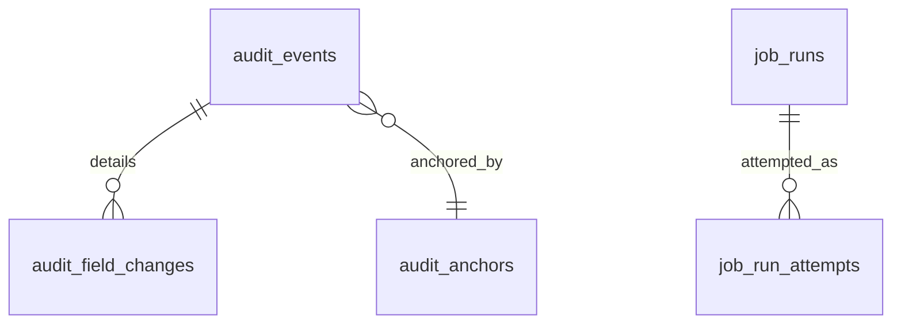

##### `audit_events` — A4, hash-chained **per tenant**
| Column | Type | N | Default | Notes |
|---|---|---|---|---|
| `id` | BIGINT UNSIGNED AI | N | — | part of PK |
| `tenant_id` | BIGINT UNSIGNED | N | — | FK RESTRICT — the chain is per tenant |
| `occurred_on` | DATE | N | — | **partition key** |
| `chain_seq` | BIGINT UNSIGNED | N | — | monotonic **per tenant**; allocated under a row lock on the tenant's chain head |
| `actor_user_id` | BIGINT UNSIGNED | Y | NULL | FK RESTRICT — **a user id**; NULL only for system actions, which name `actor_system_code` |
| `actor_system_code` | VARCHAR(40) | Y | NULL | `scheduler|connector|migration` |
| `actor_display_name` | VARCHAR(200) | N | — | denormalised for display; never the identity |
| `ip_address` | VARBINARY(16) | Y | NULL | |
| `user_agent_hash` | BINARY(32) | Y | NULL | |
| `action_code` | VARCHAR(60) | N | — | `create|update|state_change|delete_request|export|view_sensitive|publish|approve|reject|override` |
| `entity_table` | VARCHAR(64) | N | — | |
| `entity_id` | BIGINT UNSIGNED | N | — | |
| `entity_uuid` | BINARY(16) | Y | NULL | |
| `reason` | VARCHAR(1000) | Y | NULL | |
| `workflow_instance_id` | BIGINT UNSIGNED | Y | NULL | FK RESTRICT |
| `config_version_id` | BIGINT UNSIGNED | Y | NULL | FK RESTRICT — the rule version in force |
| `request_id`, `correlation_id` | BINARY(16) | Y | NULL | |
| `prev_hash` | BINARY(32) | N | — | |
| `row_hash` | BINARY(32) | N | — | over the canonical serialisation of this row |
| `occurred_at`, `recorded_at` | DATETIME(3) | N | — | |

**Keys.** PK `(id, occurred_on)` · UQ `(tenant_id, chain_seq, occurred_on)`,
`(tenant_id, row_hash, occurred_on)` ·
IX `(tenant_id, entity_table, entity_id, occurred_at)`,
`(tenant_id, actor_user_id, occurred_at)`, `(tenant_id, occurred_at)`,
`(correlation_id)`.
**Policy.** Tenant-owned · **append-only, enforced by privilege**: the application database
user has `INSERT` and `SELECT` and no `UPDATE`/`DELETE` on this table ·
audit: is the audit · PII `identifying` (IP, actor) · retention `R-PERM` unless a
retention class explicitly permits archival, and never before ·
**partitioned monthly**.
*Why per tenant and locked:* SmartPRS 2's chain head is a global
`orderByDesc('id')->value('row_hash')` with no tenant filter and no lock, so two tenants
writing in the same millisecond fork the chain and `verify()` reports tampering — the
integrity control destroys its own credibility under ordinary concurrency (`M-…` §6.2 C-6).
*Why the actor is an id:* SmartPRS 2 stores the actor as a name string across eleven
columns (`J-database.md` §6.10).

##### `audit_field_changes` — A3
`audit_event_id` (FK RESTRICT), `field_key`, `old_value_masked`, `new_value_masked`,
`old_value_hash`, `new_value_hash`, `is_sensitive`.
**Keys.** UQ `(tenant_id, audit_event_id, field_key)` ·
IX `(tenant_id, field_key)`.
**Policy.** Append-only · sensitive values are stored **hashed** with a masked display
form, so the audit proves a change without re-exposing the datum ·
PII `sensitive` · retention with the event.

##### `audit_anchors` — A4
`anchor_on` DATE, `chain_seq_from`, `chain_seq_to`, `merkle_root` BINARY(32),
`signature` VARBINARY(1024), `public_key_id`, `verified_at`, `verification_result_code`.
**Keys.** UQ `(tenant_id, anchor_on)` · IX `(tenant_id, anchor_on)`.
**Policy.** Tenant-owned · append-only · retention `R-PERM`.
A daily signed anchor makes a chain break detectable and attributable to a date
(spine S14).

##### `job_runs` — A4 (+ `job_run_attempts` A3, derivable)
`job_key`, `job_kind_code` (`scheduled|queued|command`), `scope_json`, `queue_name`,
`started_at`, `finished_at`, `duration_ms`, `outcome_code` (`success|failed|timed_out|
skipped_locked`), `rows_processed`, `error_class`, `error_message`, `error_trace_hash`,
`triggered_by_user_id`.
**Keys.** PK `(id, started_on)` · IX `(tenant_id, job_key, started_at)`,
`(outcome_code, started_at)`.
**Policy.** Tenant-owned where the job is tenant-scoped, platform otherwise ·
append-only · audit `event-only` · PII `none` · retention `R-LOG-13M` ·
partitioned monthly.
*Why:* SmartPRS 2's most damaging operational failures come from customers running no
scheduler and no queue worker, with no signal that either had stopped (spine S2).

---

## XXVIII.6 The derivable tables, and the rule that generates them

**R-XXVIII-060** A table is derivable only when its archetype (XXVIII.3) plus its
`(parent, key, purpose)` triple determines its columns, keys, indexes and policies
completely. Its DDL is generated from that declaration by a code generator whose output is
committed as an ordinary migration and reviewed like any other. No derivable table
introduces a business decision; the moment one does, it moves into the core catalogue
above.

**The generation rules.**

| Archetype | Generated columns | Generated keys | Generated policy |
|---|---|---|---|
| **A3 child/line** | `id`, `tenant_id`, `<parent>_id`, `line_no`, declared payload columns, `created_at` | PK `id`; UQ `(tenant_id, <parent>_id, line_no)`; FK `<parent>_id` per the declared `ON DELETE`; IX `(tenant_id, <parent>_id)` | tenant scope, audit and retention **inherited from the parent** |
| **A4 log/ledger** | `id`, `tenant_id`, declared payload columns, `occurred_at`, `recorded_at`, plus `<date>_on` where partitioned | PK `(id, <date>_on)` when partitioned else `id`; IX `(tenant_id, <declared filter>, occurred_at)` | append-only; `INSERT`/`SELECT` privilege only; `event-only` audit; retention from the declaration |
| **A5 dated** | the A5 block: `effective_from`, `effective_to`, `open_marker` | UQ `(tenant_id, <owner>_id, open_marker)` and `(tenant_id, <owner>_id, effective_from)`; IX `(tenant_id, <owner>_id, effective_from, effective_to)`; CHECK on the range | history: A5; delete: never |
| **A2 reference** | `code`, `name`, `sort_order`, `deleted_at` | UQ `(tenant_id, code)`; IX `(tenant_id, deleted_at)` | audit `full`; retention `R-PERM` |
| **cfg payload** | `id`, `tenant_id`, `config_version_id`, declared payload columns | UQ `(config_version_id)`; FK RESTRICT | immutable once its version is published |

**The derivable register.** Each row names the table, its owning context, its archetype,
its parent and its natural key. It is the complete remainder **of this part's clusters** —
not of the schema; the other parts specify 372 tables of their own (§XXVIII.6.1).

| Table | Ctx | Archetype | Parent | Natural key |
|---|---|---|---|---|
| `licence_events` | C1 | A4 | `licences` | `(licence_id, occurred_at, event_code)` |
| `tenant_deployments` | C1 | A5 | `tenants` | `(tenant_id, open_marker)` |
| `cfg_retention_classes` | C1 | cfg payload | `config_versions` | `(tenant_id, retention_class_code, config_version_id)` |
| `cfg_entitlement_plans`, `cfg_entitlement_features` | C1 | cfg payload / A3 | `config_versions` | `(config_version_id, feature_key)` |
| `config_version_tests` | C14 | A3 | `config_versions` | `(config_version_id, test_no)` |
| `cfg_rule_actions` | C14 | A3 | `cfg_rules` | `(cfg_rule_id, line_no)` |
| `cfg_workflow_nodes`, `cfg_workflow_transitions` | C14 | A3 | `cfg_workflows` | `(cfg_workflow_id, node_key)` |
| `workflow_transitions` | C14 | A4 | `workflow_instances` | `(instance_id, occurred_at, seq)` |
| `workflow_delegations` | C14 | A5 | `users` | `(tenant_id, from_user_id, open_marker)` |
| `cfg_templates`, `cfg_report_definitions`, `cfg_code_sequences`, `cfg_document_types`, `cfg_gate_policies`, `cfg_connector_recipes`, `cfg_roster_patterns`, `cfg_attendance_day_rules`, `cfg_shifts`, `cfg_holiday_calendars`, `cfg_policies` | various | cfg payload | `config_versions` | `(config_version_id)` |
| `code_sequence_counters` | C4/C7 | A1 | — | `(tenant_id, sequence_code, scope_key, period_key)`; allocation takes `FOR UPDATE` |
| `precedence_weights` | C14 | A2 | — | `(dimension_code)`; **platform-owned, not tenant-editable** (spine S3.2) |
| `role_permissions`, `api_client_scopes`, `role_assignment_units` | C2 | A3 | `roles` / `api_clients` / `role_assignments` | the pair |
| `org_unit_name_history` | C3 | A5 | `org_units` | `(org_unit_id, open_marker)` |
| `person_relations` (dependants, nominees) | C4 | A5 | `persons` | `(person_id, relation_type_code, open_marker)` |
| `employee_compensation_lines` | C7 | A3 | `employee_compensations` | `(compensation_id, component_code)` |
| `payroll_run_employees` | C7 | A3 | `payroll_runs` | `(run_id, employment_id)` |
| `payroll_reconciliations` | C7 | A4 | `payroll_runs` | `(run_id, check_code)` |
| `variable_pay_inputs` | C7 | A4 | `payroll_periods` | `(period_id, employment_id, input_code)` |
| `tax_declaration_items` | C8 | A3 | `tax_declarations` | `(declaration_id, section_code, line_no)` |
| `statutory_filing_lines` | C8 | A3 | `statutory_filings` | `(filing_id, line_no)` |
| `advance_ledger_entries` | C9 | A4 | `advances` | shares the `loan_ledger_entries` shape |
| `recovery_instalments` | C9 | A3 | `recoveries` | `(recovery_id, instalment_no)` |
| `candidate_stage_events` | C10 | A4 | `candidates` | `(candidate_id, occurred_at)` |
| `journey_tasks`, `journey_submissions` | C10 | A3 | `onboarding_journeys` | `(journey_id, task_key)` |
| `exit_clearance_items` | C10 | A3 | `exit_cases` | `(exit_case_id, item_key)` |
| `compliance_renewal_tasks` | C11 | A3 | `compliance_items` | `(item_id, due_on)` |
| `notification_preferences` | C12 | A5 | `users` | `(user_id, event_key, channel_code, open_marker)` |
| `webhook_subscriptions` | C13 | A3 | `webhook_endpoints` | `(endpoint_id, event_key)` |
| `connector_run_logs` | C13 | A4 | `connectors` | `(connector_id, started_at)` |
| `integration_credentials` | C13 | A5 | `connectors` | `(tenant_id, connector_id, credential_key, open_marker)`; **write-only from the UI** (Part VI K10); `connectors.credential_ciphertext` is the current-value denormalisation of the open row |
| `job_run_attempts` | C15 | A3 | `job_runs` | `(job_run_id, attempt_no)` |
| `audit_export_log` | C15 | A4 | — | `(tenant_id, occurred_at)` |

**Framework tables** (`migrations`, `sessions`, `cache`, `cache_locks`, `jobs`,
`job_batches`, `failed_jobs`, `personal_access_tokens`) are owned by the framework, carry
no business meaning, and are excluded from the manifest. `sessions.user_id` **is** a real
foreign key, unlike SmartPRS 2's `foreignId()` without `->constrained()`
(`J-database.md` §Q4).

**Count.** The core catalogue in XXVIII.5 specifies **118 tables** in full across the
fifteen clusters; with the three vocabulary tables of XXVIII.4 that is **121**. The
derivable register above names **48** distinct further tables, generated from their
archetype — so **this part names 168 distinct tables**, every one of them defined by a
migration and none of them created at runtime.

**This part is not the whole schema, and no longer claims to be.** The other parts and
the appendices specify a further **372** tables to the same Section 123 standard. The
schema-wide total is **540 distinct tables** (§XXVIII.6.1). The previously stated figure
of "162 tables total" counted only this part's own catalogue and asserted it was the
application schema; it was not.

### XXVIII.6.1 The authoritative table register is generated, not written

The counts above, and the full cross-part list, are produced by
`tools/generate-registers.py` and published as
[`docs/registers/REGISTER-TABLES.md`](registers/REGISTER-TABLES.md). That file is
**machine-generated and must not be hand-edited**; it is regenerated from the parts
themselves on every run.

**The division of labour is exact:**

| | Authority for |
|---|---|
| **This part (§XXVIII.2, §XXVIII.3, §XXVIII.5, §XXVIII.6)** | The **specification** — conventions, archetypes, integrity, tenancy, indexing, partitioning, and the full column-level definition of the tables it owns |
| **The owning module part** | The **specification** of every table it declares (spine S20: table, purpose, columns, types, keys, indexes, tenancy, history, audit, PII) |
| **`REGISTER-TABLES.md`** | The **index** — which tables exist, which part owns each, which cluster it carries, and where two parts define one name with different columns |

A register row never overrides a part. Where the two disagree, the part wins and the
register is stale until the script is re-run. Appendix A §A.6 residual risk 2 is the
reason this is generated: a hand-maintained cross-part list inside one document written
in parallel by forty authors was wrong within a month, and this part's own arithmetic
proved it.

**R-XXVIII-115** The cross-part table register MUST be generated by
`tools/generate-registers.py` and MUST NOT be hand-edited. CI MUST re-run the generator
and fail the build if the committed `docs/registers/REGISTER-TABLES.md` differs from the
generated output. *Rationale:* a register that can drift silently is the defect this
requirement exists to remove.

**R-XXVIII-116** A table specification that the generator cannot parse MUST be counted
and listed as UNKNOWN in the register, never dropped. A part MAY be edited into one of
the recognised specification shapes to clear it; the register MUST NOT be edited instead.

---

## XXVIII.7 The custom-field storage design

Spine S9 requires that adding "LinkedIn Profile" to the employee record is configuration.
Law 2 requires that it never executes DDL. Those two together dictate a three-tier storage
strategy.

### XXVIII.7.1 The three storage kinds

| `storage_kind_code` | Where the value lives | When it is used | Who can create it |
|---|---|---|---|
| `column` | A real, migration-owned column on the entity's table | Core identity and hot-query attributes: `employee_code`, `joined_on`, `lifecycle_state_code`, the assignment dimensions | Ametecs, by migration |
| `attribute` | A typed row in `entity_field_values` | **Every customer-defined field, and every system field that is not query-hot** | A tenant administrator, at runtime, with no DDL |
| `generated` | A generated column on the entity's table, populated from the `entity_field_values` row and indexed | A field that has become query-hot | Ametecs, by migration — a **promotion**, never a runtime `ALTER` |

### XXVIII.7.2 Why not a JSON column, and why not a column per field

| Option | Rejected because |
|---|---|
| One `JSON` column per entity | MySQL cannot enforce a type, a value set, a uniqueness rule or a foreign key inside JSON. Filtering and sorting need a functional index per path, which is DDL, which is Law 2 again. SmartPRS 2's statutory rates live in exactly such a blob and cannot be queried, diffed or constrained (`J-database.md` §2.1.1 #44) |
| A real column per custom field | This is SmartPRS 2's behaviour: 34 `employees` columns are created by controllers at request time, always as `VARCHAR(255)`, so `dra_expiry` is `DATE` on one install and `VARCHAR` on another and every date comparison silently becomes a string comparison (`D-employee-master.md` §2.1 SCHEMA-01; `J-database.md` §6.7) |
| A table per custom entity | Same objection; it is DDL at runtime |

The typed-row store keeps the type (each `v_*` column is a real MySQL type), keeps the
constraint (a unique index on the blind index; a foreign key from `v_code` validated by the
write service against the value set), and keeps Law 2.

### XXVIII.7.3 Indexing `entity_field_values`

The access patterns and their indexes:

| Pattern | Index |
|---|---|
| Render one entity's custom fields | `UQ (tenant_id, entity_definition_id, entity_row_id, field_definition_id)` — a single range scan per row |
| Filter the directory by a code field ("all employees whose `shift_preference` is `NIGHT`") | `IX (tenant_id, field_definition_id, v_code)` |
| Filter or sort by a date field ("visa expiring in 60 days") | `IX (tenant_id, field_definition_id, v_date)` |
| Filter by a numeric or money field | `IX (tenant_id, field_definition_id, v_decimal)` |
| Search a text field | `IX (tenant_id, field_definition_id, v_text(64))` prefix index |
| Enforce uniqueness | `UQ (tenant_id, field_definition_id, v_blind_index)`, created only for fields that declare it |

**The known ceiling, stated.** A directory query filtering on **three** attribute-stored
fields at once becomes three semi-joins into `entity_field_values`. At 10,000 employees
each semi-join is an index range of at most 10,000 rows, which MySQL handles, but the plan
degrades as the number of simultaneously filtered attribute fields grows. The mitigation is
promotion (XXVIII.7.4), and the trigger is measured, not guessed: the query log records
every attribute field used in a filter or sort, and a monthly report ranks them.

### XXVIII.7.4 The promotion path

1. Telemetry shows field `X` is used in a filter or sort above the configured threshold.
2. Ametecs authors a migration adding
   `x_promoted <type> GENERATED ALWAYS AS (…) STORED` — or, where the expression cannot be
   generated, a real column plus a backfill and a write-through in the write service — and
   an index on it.
3. The field definition's `storage_kind_code` becomes `generated` and `storage_column` is
   set, in the same release.
4. The read path is unchanged: every surface reads through the field definition, so nothing
   above the repository knows the storage moved.
5. Demotion is the same process in reverse.

**R-XXVIII-070** Promotion is a controlled release activity. No runtime code path may
create, alter or drop a column for a custom field, in any circumstance, under any
configuration.

**R-XXVIII-071** Exactly one `v_*` column is populated per row, enforced by a `CHECK`
constraint, and which one is determined by `field_definitions.data_type_code`. A type
change on a field definition is a new dated version plus a migration-run conversion, never
an in-place reinterpretation.

**R-XXVIII-072** Every surface — directory, edit, self-onboarding, bulk import, bulk
export, ESS, MSS, mobile, public API, recruitment conversion, letters, reports, payslip —
reads the field list from `field_definitions` and the permissions from
`field_surface_rules`. There is no second list anywhere. SmartPRS 2's own field-registry
header documents the alternative: adding one field costs 6–16 edits across 8 files, and
four surfaces derive while nine do not (`D-employee-master.md` Q2, DEF-24).

---

## XXVIII.8 Indexing strategy for the query shapes that matter at 10,000 employees

The row-count model, taken from the measured as-is analysis (4 punches/day, ~250 working
days/year, 3 years retained) (`M-quality-performance-testing.md` §6.3):

| Employees per tenant | `punch_normalised` | `attendance_days` | `payslip_lines` (36 months, ~14 lines) | `audit_events` |
|---:|---:|---:|---:|---:|
| 1,000 | 3.0 M | 1.1 M | 0.5 M | ~5 M |
| 5,000 | 15.0 M | 5.5 M | 2.5 M | ~25 M |
| 10,000 | **30.0 M** | **11.0 M** | **5.0 M** | ~50 M |

### XXVIII.8.1 The ten query shapes that decide whether the product is usable

| # | Shape | Where it runs | Supporting index | Expected plan |
|---|---|---|---|---|
| Q1 | Punches for one employee for a date range | payroll, attendance report, ESS | `punch_normalised (tenant_id, employment_id, punch_on)` + monthly partition pruning | range scan over ≤ 4 × days rows in ≤ 2 partitions |
| Q2 | All punches for a tenant for one day | daily derivation, dashboards | `punch_normalised (tenant_id, punch_on)` + partition pruning | one partition, ~40,000 rows at 10k employees |
| Q3 | Attendance days for a period, whole tenant | payroll settlement, exception report | `attendance_days (tenant_id, work_on, status_code)` + yearly partition | ~300,000 rows at 10k employees, index-only for the status filter |
| Q4 | The assignment in force for an employee on a date | **everything** — scope resolution, payroll, reports, ESS | `employment_assignments (tenant_id, employment_id, effective_from, effective_to)` | one row, one index dive |
| Q5 | All employments in force for a pay group on a date | payroll population | `employment_assignments (tenant_id, pay_group_code, effective_from, effective_to)` | range scan; ~10,000 rows worst case, once per run, not once per employee |
| Q6 | Payslip lines for a period by component | statutory returns, registers, per-component reporting | `payslip_lines (tenant_id, component_code, payslip_id)` joined to `payslips (tenant_id, payroll_period_id, …)` | **a SQL aggregate**, which is impossible in SmartPRS 2 because the lines are JSON |
| Q7 | An approver's pending inbox | every approval screen | `workflow_tasks (tenant_id, assignee_user_id, status_code)` | index-only for the count, ≤ 200 rows for the list |
| Q8 | Leave balance for an employee as at a date | ESS, approval, payroll | `leave_ledger_entries (tenant_id, employment_id, leave_type_code, leave_year_code, effective_on)` | range scan over a year's entries (tens of rows) |
| Q9 | Compliance items expiring in a window | the daily compliance sweep, the gate | `compliance_items (tenant_id, valid_to)` | range scan over the window only |
| Q10 | Audit trail for one entity | "who changed this?" | `audit_events (tenant_id, entity_table, entity_id, occurred_at)` + partition pruning by date filter | bounded |

### XXVIII.8.2 Rules

**R-XXVIII-080** Every foreign key column is indexed (MySQL creates one for the constraint;
the composite `(tenant_id, fk_id)` form is created explicitly where the query shape is
tenant-scoped).

**R-XXVIII-081** Every column used as a filter in a list screen, an inbox or a scheduled
sweep is indexed **with `tenant_id` leading**. SmartPRS 2 indexes none of its approval
`status` columns and none of its eight `deleted_at` columns (`J-database.md` §Q5).

**R-XXVIII-082** Every date or period column used in a `BETWEEN` is a real `DATE` and is
part of a composite index whose leading column is `tenant_id` and whose trailing column is
the date. Date arithmetic on a `VARCHAR` is impossible because no such column exists.

**R-XXVIII-083** No query in a request path is unbounded. Every collection endpoint is
cursor-paginated with a maximum page size; every export is a queued job writing to object
storage. SmartPRS 2 has **zero** `paginate()` calls and 308 unbounded `get()` calls, and
its boot payload returns every employee and every payslip the tenant has ever had — which
fails outright at 10,000 employees (`M-…` §6.3 PERF-1).

**R-XXVIII-084** No N+1 in a batch path. Payroll resolves attendance, leave, loans and
statutory profiles for the whole population in set-based queries per stage, not per
employee. SmartPRS 2 issues at least six queries per employee inside its payroll loop —
60,000 queries at 10,000 employees, which cannot complete (`M-…` §6.3 PERF-3).

**R-XXVIII-085** Index additions are justified by a captured query plan and reviewed like
code. An index that no plan uses is removed.

**R-XXVIII-086** Covering indexes are used where a hot query reads few columns — notably
`workflow_tasks (tenant_id, assignee_user_id, status_code, due_at)` for the inbox badge,
and `attendance_days (tenant_id, work_on, status_code, employment_id)` for the daily
exception count.

**R-XXVIII-087** The connection runs `sql_mode = STRICT_ALL_TABLES,NO_ENGINE_SUBSTITUTION`
with `innodb_strict_mode = ON`. Silent truncation is not an available behaviour.

---

## XXVIII.9 Partitioning and archival

### XXVIII.9.1 Which tables are partitioned, and how

| Table | Partition scheme | Granularity | Retained hot | Reason |
|---|---|---|---|---|
| `punch_events` | `RANGE (TO_DAYS(received_on))` | monthly | 13 months | Raw evidence; largest table; queried almost exclusively by recent date |
| `punch_normalised` | `RANGE (TO_DAYS(punch_on))` | monthly | 25 months | Q1/Q2 always carry a date predicate, so pruning is near-total |
| `attendance_days` | `RANGE (TO_DAYS(work_on))` | yearly | 3 years | Q3 is period-bounded; yearly keeps the partition count low |
| `audit_events` | `RANGE (TO_DAYS(occurred_on))` | monthly | 24 months | Append-only, never updated, always date-filtered |
| `notification_messages`, `notification_deliveries` | `RANGE` monthly | monthly | 13 months | Pure log |
| `webhook_deliveries`, `domain_event_outbox`, `job_runs`, `auth_events`, `calculation_traces` | `RANGE` monthly | monthly | 13 months | Pure log or trace |

**R-XXVIII-090 — the constraint this imposes, stated explicitly.** MySQL requires every
unique key on a partitioned table to contain the partition key. Therefore, on every
partitioned table: the primary key is `(id, <partition column>)`, and the public-id unique
key is `(tenant_id, uuid, <partition column>)`. A lookup by `uuid` alone on a partitioned
table is a partition-wide scan, so **every API path that addresses a partitioned row
carries its date**, or resolves through an unpartitioned index table. This is a real cost
of partitioning and it is accepted deliberately: without it, a 30-million-row punch table
cannot be aged, and ageing is what makes retention possible at all.

**R-XXVIII-091** Partition maintenance (creating next month's partition, dropping or
archiving the oldest) is a scheduled job with a visible failure channel, and it runs three
months ahead. A missing future partition is a health-check failure, not a runtime error.

### XXVIII.9.2 Archival and purge

Three distinct operations, deliberately separate:

| Operation | What it does | Reversible? | Who may run it |
|---|---|---|---|
| **Archive** | Moves partitions or row sets to `*_archive` tables on cheaper storage, or exports them to signed, encrypted object storage with a manifest. The data remains retrievable and reportable | Yes | Scheduled job, per retention class |
| **Anonymise** | Replaces `identifying` and `sensitive` values with irreversible tokens, retaining the row's structure so statutory aggregates still reconcile. Crypto-shredding the person's identifier key is the mechanism for encrypted columns | No | An approved workflow, audited |
| **Purge** | Deletes rows permanently | No | Only where the retention class declares `purge_permitted = 1`, only after the retention period, only with no legal hold, and always audited |

**R-XXVIII-092** No archival, anonymisation or purge occurs without a retention class. A
table with no class is a build failure.

**R-XXVIII-093** A **legal hold** on a subject blocks every purge and anonymisation
touching it, and the blocked attempt is audited.

**R-XXVIII-094** Purge and anonymisation run as scheduled jobs with a dry-run mode, a
preview count, a per-run cap, and a completion record in `job_runs`. They never run inside
a user's page load. SmartPRS 2 archives employees **inside a page load**, recording as the
actor whoever happened to open the page (`M-…` §6.3 PERF-1).

**R-XXVIII-095** The high-volume tables each have a declared default retention, all of
them tenant-configurable upward and floored by statute:

| Table | Default retention | Floor |
|---|---|---|
| `punch_events` | 3 years hot + archive to 8 | statutory attendance floor (rule pack) |
| `punch_normalised` | 3 years hot + archive to 8 | as above |
| `attendance_days` | 8 years | as above |
| `payslips`, `payslip_lines`, `payroll_runs` | 8 years, then archive, **never purged while any statutory filing references them** | wage-register floor (rule pack) |
| `audit_events` | never purged before its class permits; archived after 24 months | — |
| `notification_*`, `webhook_deliveries`, `job_runs`, `domain_event_outbox` | 13 months | — |
| `candidates` and their documents | consent expiry, default 12 months after rejection | — |

*Why every row of that table exists:* SmartPRS 2 has **no retention policy of any kind** —
no `prune`, no rotation, no purge-on-exit, no purge-on-cancellation — while retaining
Aadhaar, PAN, UAN, ESIC, bank account, IFSC, date of birth and address indefinitely for
archived and soft-deleted employees, and retaining rejected candidates' CVs, ID proofs and
interview notes forever (`M-…` §6.5).

---

## XXVIII.10 Tenancy enforcement at the persistence layer

Law 6 says tenancy is structural, not clerical. SmartPRS 2 is the counter-example: its
declared mechanism filters on `users.company_id`, **a column no migration ever creates**,
so the filter is never appended and the isolation it advertises does not exist
(`J-database.md` §6.3, SEC-TEN-01); the live mechanism is a hand-written
`->when($tid, …)` repeated across **1,413 query sites**, where a falsy tenant id silently
means "no filter".

### XXVIII.10.1 The mechanism, in five layers

**Layer 1 — the schema.** `tenant_id NOT NULL` with a foreign key on every tenant-owned
table; `tenant_id` first in every unique key (R-XXVIII-020…022). A cross-tenant row cannot
be *stored* consistently even if a query forgot its filter.

**Layer 2 — the connection context.** Every request, job and command resolves exactly one
tenant before any query runs, and sets it on a request-scoped `TenantContext`. A code path
that reaches the repository with no tenant set **throws**. There is no "all tenants" mode
except an explicitly constructed `PlatformContext`, which requires a platform permission
and writes an audit event naming the operation and its scope.

**Layer 3 — the query builder.** Every tenant-owned model uses a global scope that appends
`tenant_id = :context` and refuses to be removed except through
`withPlatformScope(reason:)`, which is permission-checked and audited. Raw query builder
access to a tenant-owned table is prohibited by the dependency-rule test; repositories are
the only path.

**Layer 4 — the write guard.** Inserts have `tenant_id` set by the persistence layer from
the context, never from the payload. An insert whose payload carries a different
`tenant_id` is rejected as a programming error.

**Layer 5 — the assertion harness.** In every non-production environment a query listener
inspects every statement touching a tenant-owned table and fails the test run if the
predicate is absent. In production the same check runs as a sampled assertion feeding the
operations dashboard.

**R-XXVIII-100** Cross-tenant access is an explicit, audited capability. It is never the
absence of a filter, and never a silent coercion to the lowest-id tenant — which is what
`?? DB::table('tenants')->value('id')` does at six sites in SmartPRS 2
(`J-database.md` BR-TEN-003).

**R-XXVIII-101** For every aggregate and every API endpoint, a **generated** cross-tenant
isolation test exists and runs in CI: seed two tenants, act as tenant A, attempt to read,
update and delete tenant B's row by id and by uuid, assert 404 or 403 and assert no row
changed.

**R-XXVIII-102** The production database user has no `ALTER`, `CREATE` or `DROP`, and no
`UPDATE`/`DELETE` on append-only tables. A deployment that requires those privileges fails
closed.

### XXVIII.10.2 What was considered and rejected

| Option | Verdict |
|---|---|
| **MySQL row-level security** | Does not exist in MySQL 8. Not available |
| **A database per tenant** | Rejected for SaaS: 200+ schemas to migrate in lockstep, connection-pool pressure, and cross-tenant platform reporting becomes a fan-out. **Retained as the on-premise shape**, where there is one tenant anyway — and the application cannot tell the difference, which is spine S18's deployment parity |
| **A schema (database) per tenant with a shared connection** | Same objection; also makes the shared configuration and rule-pack tables awkward |
| **Views with a session variable** | Fragile: any code path that opens a connection without setting the variable silently sees nothing or everything, and the failure mode is invisible. Rejected precisely because SmartPRS 2's failure was an invisible filter |
| **The five-layer mechanism above** | **Adopted.** It fails loudly at layer 2 rather than silently at layer 3, and layer 1 means even a bug cannot produce a consistently-stored cross-tenant row |

**PRODUCT OWNER DECISION REQUIRED — D-XXVIII-01: single shared database, or database
per tenant, for SaaS?** Recommendation: **shared database with the five-layer mechanism**,
with the option of promoting a large or contractually isolated customer to its own
database without an application change (the connection resolver already supports it,
because on-premise is that shape). Trade-off: shared-database isolation depends on tooling
discipline that must be enforced in CI forever; per-tenant databases give physical
isolation at a permanent operational cost that on-premise customers, who today do not
reliably run a cron worker, cannot absorb.

---

## XXVIII.11 Migration-readiness assessment: SmartPRS 2 → SmartPRS 3

Verdicts, as defined by the source analysis (`J-database.md` §Q10):
**CLEAN** = migrate with column renames and type declarations only ·
**TRANSFORM** = migrate through a defined transformation ·
**AMBIGUOUS** = a Product Owner must decide what the data means before it can move ·
**DO NOT MIGRATE** = leave behind.

### XXVIII.11.0 The five blockers that precede any table work

These are properties of the source estate, not of any one table. Each is a project task
with an owner and a deliverable.

| # | Blocker | Why | Deliverable before cutover |
|---|---|---|---|
| B1 | **The source schema cannot be read from source code.** 49 tables and ~15 column types exist only as a consequence of runtime execution history | `J-database.md` §Q3 | An **introspection harness** that reads `information_schema` on each live install and emits a per-install schema profile. Every migration script branches on that profile, not on the repository |
| B2 | **No install is a reference install.** There is no canonical schema to diff against | `J-database.md` migration blocker 2 | A per-customer schema inventory, signed off before that customer's migration is scheduled |
| B3 | **Duplicates are guaranteed** on `employees.pan / uan / bank_acc / esic_no / mobile / email`, on `payroll_runs (company, month)` and on `payslips (employee, month)`, because the constraints were deliberately never applied | `J-database.md` §Q5, §6.9 | A de-duplication decision list per tenant, resolved by the customer, before the target unique indexes can be created |
| B4 | **Orphans are guaranteed everywhere**, because there are no foreign keys and an admin endpoint exists solely to sweep them | `J-database.md` §Q4 | An orphan report per table pair; each orphan is either re-parented, moved to a quarantine table, or explicitly discarded with sign-off. No orphan silently becomes a NULL |
| B5 | **Demo data contamination.** In the reference database 798 of 1,254 punches carry `source='demo'`, and the demo tenant is identified only by `subdomain='demo'` | `J-database.md` §6.10 | An explicit exclusion filter, applied and reported per tenant. Never a filter by hope |

### XXVIII.11.1 CLEAN — migrate with renames and type declarations

| SmartPRS 2 table | Target | Note |
|---|---|---|
| `tenants` | `tenants` | Add `home_timezone`, `financial_year_start_month`, `default_currency`; drop all behaviour keyed on `subdomain` |
| `plans`, `subscriptions`, `invoices`, `payments`, `payment_gateways` | Platform billing tables (Part on SaaS) | Well-typed; enums become `status_values` rows |
| `users` | `users` | Rename tenancy; **drop the never-existing `company_id` assumption**; make email unique per tenant; add `employment_id` and populate it from the name/email resolver **once, with an exception report** |
| `companies`, `departments`, `designations`, `branches`, `teams` | `org_units` (typed) + `designations` | Flatten into the typed tree; each becomes a node of its type |
| `banks` | reference data | |
| `holidays`, `leave_types` | `holiday_calendar_days`, `cfg_leave_types` | Small and clean; wrap in a configuration artefact version dated from the earliest payroll period |
| `attendance_corrections` | `punch_corrections` | **The best-designed table in the source schema**: real `TIME` columns, a composite index and complete audit columns |
| `statutory_configs` | `rule_pack_activations` + `employment_statutory_profiles` | Effective-dated, scoped and indexed — the model SmartPRS 3 generalises (spine S19 #6) |
| `probation_events`, `commission_logs`, `licence_events`, `client_updates` | append-only equivalents | |
| `api_keys`, `smartept_webhook_endpoints` | `api_clients`, `webhook_endpoints` | Credentials already stored correctly |
| `employee_import_jobs`, `employee_archives` | job records / archive store | Self-contained |

### XXVIII.11.2 TRANSFORM — the ten that carry real work

| # | Source | Target | Transformation | Risk |
|---|---|---|---|---|
| T1 | `employees` | `persons` + `employments` + `employment_assignments` + `person_identifiers` + `employee_bank_accounts` | (a) detect per install whether `dob`, `doj`, `dra_expiry`, `pcc_expiry`, `pcc_deadline` are `DATE` or `VARCHAR` and parse accordingly; (b) reconcile the `aadhaar`↔`national_id` and `employment_type`↔`employment_stage` duplicate pairs, which were back-filled only for *some* rows; (c) normalise `dra_status`/`pcc_status` case; (d) split the archive dimension (`archived_at`, `backup_due_at`) from the delete dimension (`deleted_at`) into an explicit lifecycle state; (e) de-duplicate the six identifier columns; (f) resolve the seven **name-string** org columns to ids | **Highest.** Combines B3 and B4 |
| T2 | `attendance_logs` | `punch_events` + `punch_normalised` | Convert the `emp_code` **string** join to `employment_id`, resolved against the employee master **as at the punch date** — which is not recoverable where a code was ever re-issued. Exclude `source='demo'`. Widen `direction`. Rebuild both unique keys, which are inert wherever `tenant_id` is NULL | **High.** Unrecoverable cases must be quarantined, not guessed |
| T3 | `attendance_pending` | two tables (quarantine, bulk staging) | **Must be split before anything else.** Route rows by which column set is populated; after the August repair migration a single table can hold both, and both features' invariants are broken | High |
| T4 | `payroll_runs`, `payslips` | `payroll_periods` + `payroll_runs` + `payslips` + **`payslip_lines`** | Convert `month VARCHAR(7)` and the free-text `cycle_label` to a real period; **explode the `earnings`/`deductions` JSON into line rows** — the single highest-value transformation in the migration, and the one with the largest unknown (D-XXVIII-02) | **Highest** |
| T5 | `salary_components`, `late_policy`, `shifts`, `pay_cycles`, `min_wages`, `holidays`, `leave_types` | configuration artefacts + versions | Wrap each row in an artefact and a version dated from the earliest period it could have affected, so historical payslips resolve to *something* explicit. Detect `calc_value` `VARCHAR`-vs-`DECIMAL` per install and normalise. Convert `VARCHAR 'HH:MM'` shift times to `TIME` | High — these tables have **no effective dating today**, so the dates are reconstructed, and every reconstructed version is flagged `migration_baseline` |
| T6 | `statutory_settings` (a JSON blob with no migration) | `rule_pack_activations` + tenant overrides | Decompose per scheme, per jurisdiction, per effective date. Reconcile against `pf_esi_settings` / `tds_rules` / `pt_slabs` where rows exist (D-XXVIII-03) | High — a mismatch means a past payslip cannot be re-derived |
| T7 | `commissions`, `commission_payments`, `salary_payments`, `loan_recoveries`, `agent_earnings` | C9 ledgers | Reconcile the two coexisting status vocabularies in one VARCHAR column; resolve whether `amount` is gross or net per row (D-XXVIII-04); convert `month` strings to periods; add the missing indexes and every foreign key | High — money |
| T8 | `loans`, `advances`, `clawbacks` | `loans` + `loan_schedules` + `loan_ledger_entries` | Reconstruct a ledger from a mutable counter; four columns the engine reads (`installment_amount`, `installments_total`, `type`, `start_month`) **do not exist anywhere**, so the schedule must be inferred from `emi` and recovery history and reconciled to `amount` | High — reconciliation exceptions are expected and must be listed, not absorbed |
| T9 | `documents`, `letters`, `self_onboarding*`, `employee_references` | C4 / C10 tables | Reconcile three `documents` shapes; back-fill NULL `tenant_id` from the employee; split `letters` templates (`is_template=1`) from issued letters — different entities sharing a table; add `tenant_id` to the three child tables that lack it; move every file off the public disk to private storage and re-key | Medium — but this is the **PII exposure** fix, so it is not deferrable |
| T10 | `notification_log`, `mail_log`, `wa_log`, `messages_log`, `late_notifications`, `subscription_alerts`, `activity_logs` | C12 / C15 | Apply a retention cut-off **at migration time**, since there has never been one. Verify the `activity_logs` hash chain first; rows written before the chain columns were added at runtime have NULL hashes and cannot be verified (D-XXVIII-05) | Medium |

Also TRANSFORM, mechanically: `incentive_schemes` (two disjoint shapes — detect by column
presence; they are different entities), `offroll_agents` (reconcile `company_id`
present/absent and the two `rate` scales), `code_of_conduct_ack` (reconcile
`employee_id` vs `user_id`+`employee`; the `acknowledged` default flipped from false to
true between creators), the training and assessment tables (link column differs in name
*and* type; `status` case conflict; missing `tenant_id`), the recruitment tables (schema
must be discovered from the live database), and the runtime-only masters `roster`,
`overtime`, `policies`, `awards`, `notices`, `dra_certs`, `posh_complaints`,
`feature_flags` — whose schema depends on which `MasterController` definition version
created them.

### XXVIII.11.3 AMBIGUOUS — a Product Owner decision precedes the script

| # | Question | Why it blocks |
|---|---|---|
| A1 | Is the legacy `attendance` (singular) table empty on every client install? | It is the only table with a proper `unique(employee_id, date)` and has zero code references. If any install has rows, there are two attendance sources to merge |
| A2 | Do `pf_esi_settings`, `tds_rules` or `pt_slabs` carry rows never copied into the `statutory_settings` blob? | If yes, **the rates used in past payrolls may differ from what the blob says**, and those payslips cannot be re-derived. This is a compliance exposure, not merely a migration question |
| A3 | Is multi-company employment a real requirement? (`employee_company` exists and is never used; `also_works_for` offers "Multiple companies") | Determines whether Person/Employment cardinality is 1:N in practice — Part V decision D-V-02 |
| A4 | What do `offroll_agents.dra` and `.pcc` hold — a status, a certificate number, or an expiry date? | Not determinable from source. Blocks the off-roll agent compliance model |
| A5 | Is `commissions.amount = NET` true for all historical rows? | Rows predating the convention may hold a gross. Money reconciliation |
| A6 | Is `payslips.earnings`/`deductions` JSON structurally stable across all revisions? | Determines whether T4 is one mechanical pass or a per-revision reverse-engineering exercise. **The largest single unknown in the migration** |
| A7 | Which `settings` sentinel means "platform" — `0` or `NULL`? Both are in production use | Data merge |
| A8 | On each install, which feature's rows are in `attendance_pending`, and were punches lost while the "wrong" schema was in place? | Possible unrecoverable attendance loss |
| A9 | Is the `activity_logs` hash chain intact on any install? | Determines whether the existing audit trail has evidentiary value worth migrating |
| A10 | Coordinates written before the `DECIMAL(11,7)` repair are permanently truncated to ±557 m. Re-derive historical geofence verdicts, invalidate them, or accept them? | Affects any historical attendance dispute |
| A11 | Which installs carry `dob`/`doj`/`dra_expiry`/`pcc_expiry`/`pcc_deadline` as `VARCHAR`? Determinable only by introspection | Sizes the date-parsing work and identifies whose compliance alerts have been firing on the wrong people |

### XXVIII.11.4 DO NOT MIGRATE

| Group | Tables | Reason |
|---|---|---|
| Framework | `cache`, `cache_locks`, `sessions`, `jobs`, `job_batches`, `failed_jobs`, `personal_access_tokens` | Transient infrastructure; re-issue tokens |
| Dead | `salary_runs`, `salary_slips`, `leave_applications` | Named only by dead models; **no migration ever created them — they do not exist** |
| Superseded | `password_reset_tokens` (never used), `notifications_feed`, `company_emails`, `activity_log` (Spatie; written only by unreachable models), `pt_slabs` table (all references are JSON keys, never the table) | |
| Fabricated | `attendance_logs WHERE source='demo'` — 798 of 1,254 rows in the reference database | Must be excluded by an explicit filter |
| Funnel PII | `demo_requests`, `leads`, `signups` | Marketing data with no retention basis; belongs in a CRM |
| Commercial subsystem | `coupons`, `coupon_redemptions`, `renewals`, `subscription_alerts`, `onprem_clients`, `onprem_payments`, `licences`, `licence_devices`, `releases`, `release_grants` | Migrate only if SmartPRS 3 keeps the same commercial model — a separate product decision |
| Re-derivable | `mobile_devices` (re-register), `biometric_unmapped` (recompute), `wa_templates`/`sms_templates` (provider-side objects), `feature_flags` (superseded by configuration) | |

### XXVIII.11.5 The migration harness

**R-XXVIII-110** Every migration script is idempotent, resumable, dry-runnable, and
produces three artefacts per run: a **row-count reconciliation** (source vs target per
table), an **exception report** (every row not migrated, with its reason), and a
**value reconciliation** for money (source sums vs target sums per period per company,
asserted to the paisa).

**R-XXVIII-111** A migration that would silently drop a row fails instead. Nothing is
absorbed into a NULL.

**R-XXVIII-112** Cutover is gated on: zero unexplained exceptions, an exact money
reconciliation for the last three closed periods, and a parallel-run comparison of at
least one full payroll period computed in both systems with a per-employee, per-component
difference report.

---

## XXVIII.12 Tests

| # | Test | Asserts |
|---|---|---|
| DB-T1 | **No runtime DDL.** CI grep over `app/`, `routes/`, `updater/` for `Schema::`, `ALTER TABLE`, `CREATE TABLE`, `SHOW COLUMNS` | Zero hits outside `database/migrations` |
| DB-T2 | **Least privilege.** Boot against a DML-only database user | Application starts, all suites pass, no `ALTER` is attempted |
| DB-T3 | **Fresh equals production.** `migrate:fresh` vs the reference structure dump | Byte-identical; the fingerprint matches |
| DB-T4 | **Every FK declared.** Reflect `information_schema` | Every `*_id` column on a business table has a foreign key with an explicit `ON DELETE`; count of unconstrained `*_id` columns = 0 |
| DB-T5 | **Tenant participation.** Reflect every unique index on a tenant-owned table | `tenant_id` is present and leading in every one |
| DB-T6 | **No ENUM.** Reflect column types | Zero `ENUM` columns; every status column has its `status_values` foreign key |
| DB-T7 | **One row in force.** Concurrent inserts of overlapping A5 rows from two connections | Exactly one succeeds; `open_marker` unique key raises on the other |
| DB-T8 | **As-at correctness.** The V.16 T1 fixture | Exactly one assignment row per query date; boundary dates resolve to the correct side |
| DB-T9 | **Duplicate run impossible.** Two concurrent payroll generations for the same period, group, type and lot | One succeeds; the other fails on the unique key, not on a PHP pre-check |
| DB-T10 | **Reconciliation.** Every payroll run | `SUM(payslip_lines) = run totals` exactly; per employee `earnings − deductions = net`; a deliberate ₹0.01 perturbation fails the run |
| DB-T11 | **Append-only enforced.** Attempt `UPDATE` and `DELETE` on `punch_events`, `audit_events`, every ledger, as the application user | Permission denied at the database |
| DB-T12 | **Audit chain per tenant.** 1,000 concurrent audited writes across two tenants | Both chains verify; zero forks; zero false tamper alarms |
| DB-T13 | **Cross-tenant isolation.** Generated per aggregate and per endpoint | Every attempt returns 404/403; no row changes |
| DB-T14 | **Missing tenant context throws.** Invoke a repository with no `TenantContext` | Exception, not an unfiltered query |
| DB-T15 | **Partition maintenance.** Fast-forward the clock three months | Future partitions exist; the health check passes; no runtime partition creation |
| DB-T16 | **Retention.** A record under legal hold, and a record past its retention with purge permitted | The first is refused and audited; the second is purged and audited |
| DB-T17 | **Custom field round-trip.** Create a custom field, write it through import, read it through export, API and payslip template | Identical value on all four surfaces; zero DDL executed |
| DB-T18 | **Promotion transparency.** Promote a field to a generated column | All queries return identical results before and after; no application code above the repository changes |
| DB-T19 | **Money exactness.** Every money path | Zero float operations (static analysis); split-then-sum equals the original to the paisa |
| DB-T20 | **Performance at 10,000.** Seeded tenant with 10,000 employees and 30 M punches | Q1–Q10 of XXVIII.8.1 each complete within their declared budget; the boot payload is paginated and bounded |

---

## XXVIII.13 Open items

| # | Item | Recommendation | Trade-off |
|---|---|---|---|
| **D-XXVIII-01** | Shared database or database per tenant for SaaS (XXVIII.10.2) | Shared, five-layer enforcement, with per-tenant promotion available | Discipline enforced by CI forever, versus a permanent operational cost |
| **D-XXVIII-02** | **Is `payslips.earnings`/`deductions` JSON structurally stable across all historical revisions?** | Assume it is not until proven; budget a per-revision analysis pass | The largest single unknown in the migration (`J-database.md` PO-6) |
| **D-XXVIII-03** | Do any installs hold statutory rows in `pf_esi_settings` / `tds_rules` / `pt_slabs` that were never copied into the `statutory_settings` blob? | Introspect every install before scheduling its migration | If yes, past payslips may not be re-derivable — a compliance exposure (`J-database.md` PO-2) |
| **D-XXVIII-04** | Is `commissions.amount` net for all historical rows? | Treat as unknown; require a discriminator or a per-tenant decision | Money reconciliation (`J-database.md` PO-5) |
| **D-XXVIII-05** | The retention durations themselves, per entity class | Ametecs proposes defaults; the statutory floors come from the rule pack and are signed off by the named compliance owner (spine D-03); a tenant may lengthen, never shorten below the floor | Nothing exists today, and the DPDP Act 2023 obligations cannot be met without this table being populated (`M-…` §6.5) |
| **D-XXVIII-06** | Right-to-erasure mechanics | Crypto-shred the person's identifier keys and anonymise names and contacts; retain statutory rows in anonymised form with a tombstone | Anonymised payroll history stays reportable in aggregate but not per person; hard deletion would breach the retention floors (`J-database.md` PO-8) |
| **D-XXVIII-07** | Employee-code uniqueness scope, which determines a **unique index** | Configurable, default per legal entity (Part V D-V-03) | Where the chosen scope is tighter than the source, migration must de-duplicate before the index can be created |
| **D-XXVIII-08** | Whether `attendance_days` is partitioned yearly or monthly | Yearly at ≤10,000 employees; monthly above | Monthly multiplies the partition count and the maintenance surface for no gain at the target scale |
| **D-XXVIII-09** | Whether historical geofence verdicts, computed from coordinates truncated to ±557 m, are re-derived, invalidated or accepted | Flag them as `precision_unknown` rather than silently re-deriving from data that cannot be recovered | Any historical attendance dispute turns on this (`J-database.md` PO-16) |

---

## XXVIII.14 Requirements index

| Req | Statement (abbreviated) | Origin |
|---|---|---|
| R-XXVIII-001 | One schema authority: migrations. No DDL in application code | `J-database.md` §6.5 |
| R-XXVIII-002 | `migrate:fresh` reproduces production; a boot-time schema fingerprint is compared and surfaced | `J-database.md` §Q3 |
| R-XXVIII-003 | Every migration is idempotent, resumable and re-runnable | `J-database.md` §6.8 |
| R-XXVIII-004 | No default database connection; a missing one fails the boot | `J-database.md` SEC-DB-07 |
| R-XXVIII-005 | No migration `up()` deletes business rows | `J-database.md` §6.8; `M-…` D-1 |
| R-XXVIII-006 | Naming conventions; one tenancy column name | spine S16 |
| R-XXVIII-007 | Types are declared by semantic, per the type table | `J-database.md` §4.1, §6.7, §Q9 |
| R-XXVIII-008 | No column stores a list | `J-database.md` §Q9 M5 |
| R-XXVIII-009 | Case-sensitive collation on codes | `J-database.md` §4.3 |
| R-XXVIII-010 | FK on every relationship with an explicit `ON DELETE` | `J-database.md` §Q4 |
| R-XXVIII-011 | Every business-unique combination is a database constraint including `tenant_id` | `J-database.md` §Q5 |
| R-XXVIII-012 | Declared field uniqueness is materialised as a real index | `J-database.md` req. 11 |
| R-XXVIII-013 | Check-then-write on a countable resource takes a row lock | `M-…` §6.2 |
| R-XXVIII-014 | `row_version` optimistic concurrency on every mutable business row | `M-…` §6.2 C-4 |
| R-XXVIII-020 | `tenant_id NOT NULL` + FK on every tenant-owned table | `J-database.md` §Q7 |
| R-XXVIII-021 | `tenant_id` leads every unique and tenant-scoped composite index | `J-database.md` §6.4 |
| R-XXVIII-022 | No null-tenant state, no `0` sentinel; platform tables have no tenant column | `J-database.md` §6.10 |
| R-XXVIII-023 | No table holding tenant data lacks a tenant column | `J-database.md` SEC-TEN-02 |
| R-XXVIII-030 | No database `ENUM`; vocabularies are reference data | `J-database.md` §6.6 |
| R-XXVIII-031 | Every surface renders a vocabulary from `status_values` | `J-database.md` req. 10 |
| R-XXVIII-032 | Engine code branches on a code only where the domain is non-extensible | spine S1 Law 1 |
| R-XXVIII-033 | Adding a value is an insert; retiring one never rewrites history | `J-database.md` §6.6.2 |
| R-XXVIII-034 | Lifecycle transitions are data, with permission, reason and guard | `E-…` req. 17 |
| R-XXVIII-050 | Nothing is overwritten; derived records are superseded; evidence is append-only | spine S1 Law 3 |
| R-XXVIII-051 | No general soft delete; removal is a lifecycle state | `M-…` D-7 |
| R-XXVIII-052 | Every table declares a retention class | `J-database.md` §8 #10 |
| R-XXVIII-053 | Every table declares its audit coverage | spine S14 |
| R-XXVIII-054 | Every column carries a PII class; `sensitive`/`restricted` are encrypted and masked | spine S13 |
| R-XXVIII-055 | No table serves two features | `J-database.md` §6.1.2 |
| R-XXVIII-060 | A table is derivable only when its archetype determines it completely | design |
| R-XXVIII-070 | Field promotion is a release activity; never a runtime `ALTER` | spine S1 Law 2 |
| R-XXVIII-071 | Exactly one `v_*` column per value row, enforced by `CHECK` | spine S9 |
| R-XXVIII-072 | Every surface reads its field list from `field_definitions` | `D-…` Q2 |
| R-XXVIII-080 | Every foreign key column is indexed | `J-database.md` §Q5 |
| R-XXVIII-081 | Every filter column used by a screen or sweep is indexed, `tenant_id` leading | `J-database.md` §Q5 |
| R-XXVIII-082 | Period columns are real dates inside composite indexes | `J-database.md` §Q9 D3 |
| R-XXVIII-083 | No unbounded query in a request path | `M-…` §6.3 |
| R-XXVIII-084 | No N+1 in a batch path | `M-…` §6.3 PERF-3 |
| R-XXVIII-085 | Indexes are justified by a captured plan | design |
| R-XXVIII-086 | Covering indexes on the hot inbox and exception counts | design |
| R-XXVIII-087 | Strict SQL mode; silent truncation is unavailable | `J-database.md` §6.6 |
| R-XXVIII-090 | Partitioned tables carry the partition key in every unique key; API paths carry the date | MySQL constraint, stated |
| R-XXVIII-091 | Partition maintenance runs three months ahead with a visible failure channel | design |
| R-XXVIII-092 | No archival, anonymisation or purge without a retention class | `M-…` §6.5 |
| R-XXVIII-093 | A legal hold blocks purge and anonymisation, and the block is audited | design |
| R-XXVIII-094 | Purge and anonymisation are scheduled jobs with dry-run and caps | `M-…` §6.3 PERF-1 |
| R-XXVIII-095 | Declared default retention per high-volume table, floored by statute | `M-…` §6.5 |
| R-XXVIII-100 | Cross-tenant access is an explicit, audited capability | `J-database.md` BR-TEN-003 |
| R-XXVIII-101 | Generated cross-tenant isolation tests per aggregate and per endpoint | spine S1 Law 6 |
| R-XXVIII-102 | Production database user holds no DDL privilege and no write on append-only tables | `J-database.md` SEC-DB-02 |
| R-XXVIII-110 | Every migration script produces row-count, exception and money reconciliations | `J-database.md` §Q10 |
| R-XXVIII-111 | A migration that would silently drop a row fails instead | `J-database.md` migration blockers |
| R-XXVIII-112 | Cutover is gated on zero unexplained exceptions and a parallel-run comparison | design |

**Totals for this part:** **118 core tables specified in full** across 15 bounded contexts,
plus the **3** vocabulary tables of §XXVIII.4 (**121**) · **48 derivable tables** named
with their generating archetype · **168 distinct tables named in this part**, out of a
schema-wide **540** (§XXVIII.6.1 — the register is generated, this part is not the whole
schema) · 15 Mermaid ERDs · 5 table archetypes · **54 numbered requirements** (the
generator's count, including the two added by this pass; the part previously claimed 56
and did not have them) · 20 named
database regression tests · 9 Product Owner decisions · a migration-readiness verdict for
every SmartPRS 2 table group, with 5 named blockers and 11 ambiguities that must be
resolved before a script is written.

All counts on this line are the generator's, not a hand count. Re-run
`python3 tools/generate-registers.py` to reproduce them.
