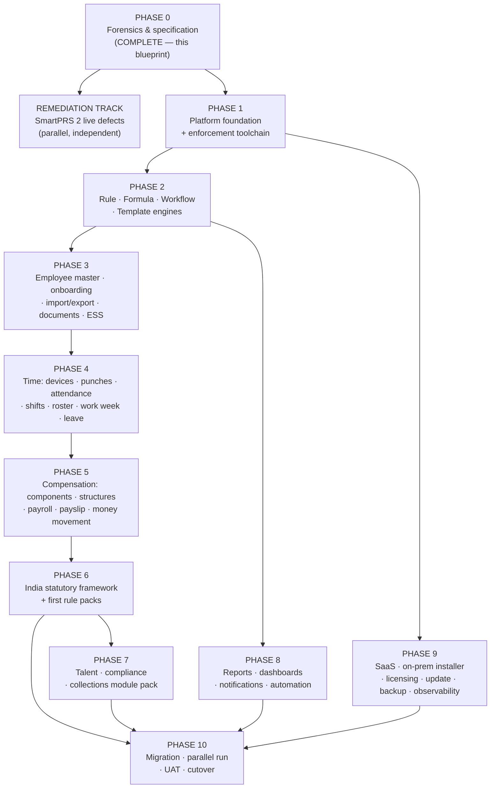

# PART XXXII — IMPLEMENTATION PHASES AND ROADMAP

---

## XXXII.0 Purpose

This part sequences the build. It states what is delivered in each phase, why
that order and not another, what must be true before a phase may start, what
must be true before it may be called finished, and where the honest uncertainty
in the plan sits.

It does not give a date. Anyone who gives a date for this programme before the
Tier 1 decisions in Part XXXIV are answered and the SmartPRS 2 discovery
programme in Part XXIX §XXIX.2 has run is guessing, and the guess will be quoted
back at them. What this part gives instead is a **sequence with hard gates**, a
**sizing method**, and the **specific unknowns that must close before a date is
credible**.

---

## XXXII.1 The sequencing principle

The order is not "most valuable first" and not "easiest first". It is
**dependency-first, with the platform's own enforcement built before anything it
must enforce**.

Three rules produced this sequence:

1. **The engines come before the modules.** Every module is a consumer of the
   rule, formula, workflow and metadata engines. Building a module first means
   building its logic twice — once inline, once again as configuration. That is
   exactly how SmartPRS 2 ended up with four late-minute implementations and
   three incompatible working-day definitions.
2. **The enforcement toolchain comes before the code it governs.** Every gate in
   Part IV §IV.10 exists because its absence produced a confirmed defect.
   Retrofitting a no-runtime-DDL rule onto 100,000 lines is not a refactor; it is
   an archaeology project. Build the gates in Phase 1 and every later line is born
   compliant.
3. **Money last among the domain modules, but its tests first.** Payroll depends
   on attendance, leave, structure and statutory. It is also the module where a
   defect is a rupee. The golden-test matrix (Part XXX) is written *before* the
   payroll engine, not after, so the engine is built against asserted values.

---

## XXXII.2 The phase map

Two things in that graph matter more than the boxes.

**The remediation track is independent.** SmartPRS 2 has confirmed defects that
are costing customers money and creating exposure *now* — loans never recovered,
LOP leave paid in full, a nightly job creating a known-password administrator, a
published default on-premise credential, private documents on a public disk.
None of those should wait for a rebuild. Part II lists them with a
remediate-now verdict; Part XXIX §XXIX.4 routes the two with a legal clock to
Phase 0 of the migration programme. **This track is staffed separately and does
not consume rebuild capacity.**

**Phase 9 starts early.** The installer, licensing and observability are not a
finishing touch. They are the difference between a product that can be delivered
to two hundred on-premise customers and one that cannot, and SmartPRS 2's worst
operational failures are all in this area. Beginning it alongside Phase 1 —
even at low intensity — means the first internal deployment is done the real way.

---

## XXXII.3 Phase specifications

### PHASE 0 — Forensic analysis and specification

**Status: complete.** This blueprint, its fourteen as-is analyses, and the
SmartPRS 2 → SmartPRS 3 migration matrix are the deliverable.

| | |
|---|---|
| Delivered | 14 evidence-based as-is analyses (19,468 lines); 35-part blueprint; ~350 defects and ~200 security findings recorded with `file:line` evidence; ~330 decisions registered |
| Exit gate | **Product Owner approval of this blueprint**, and answers to the Tier 1 decisions in Part XXXIV §2 |
| Not yet done | The per-install discovery programme (Part XXIX §XXIX.2). No production schema dump has ever been taken. This is a Phase 0 completion item and it gates Phase 10 sizing |

---

### PHASE 1 — Platform foundation

**Builds the thing every other phase stands on, and the gates that keep it
honest.**

| | |
|---|---|
| Scope | Tenancy (structural, non-nullable, persistence-enforced) · identity, authentication, MFA · the permission + data-scope model · the audit ledger with its hash chain · the organisation model with effective-dated assignments · the universal configuration artefact, versioning and scope resolution · the `Money` value object · the injected clock · correlation ids · the outbox · the module skeleton |
| Also builds | **The entire enforcement toolchain of Part IV §IV.10** — dependency rules, the business-literal ban, the DDL ban and the privilege-stripped database user, the route policy sweep, the generated cross-tenant suite, the float ban, the empty-catch ban, the no-PII-in-logs test |
| Entry gate | Blueprint approved; platform and front-end decisions confirmed (D-IV-01, D-IV-02) |
| Exit gate | Every gate in §IV.10 is **blocking in CI**; a generated cross-tenant isolation test exists for every aggregate built so far and passes; an as-at query answers "what was this org assignment on date D?"; the audit chain verifies; `migrate:fresh` matches the deployed structure exactly |
| Risk if rushed | This is the phase where cutting corners recreates SmartPRS 2. There is no later opportunity to make tenancy structural |

---

### PHASE 2 — The engines

**Rule · Formula · Workflow · Template.**

| | |
|---|---|
| Scope | The SPX parser, type checker, compiler and sandbox · the rule engine with its action catalogue, precedence, conflict detection and decision trace · the formula engine with money discipline, dependency graph and calculation trace · the workflow engine with its node catalogue, participant resolution and immutable decisions · the template engine · the simulator, the conflict detector and the stored-test regression harness |
| Entry gate | Phase 1 exit gate passed |
| Exit gate | Each engine has a **conformance suite** (Part XXX §3) that is independent of any module and passes: grammar and type checking, determinism, precedence and tie-breaking, aggregation window semantics, cycle detection, money exactness and allocation, trace completeness, fail-closed on evaluation error. A rule with no valid precedence winner **blocks publication** and the administrator sees the two conflicting artefacts |
| Why here | Every subsequent module is a consumer. Building a module before the engines guarantees the logic is written twice |

---

### PHASE 3 — People

| | |
|---|---|
| Scope | The entity schema engine and field definitions · the single `EntityWriteService` with PATCH semantics · effective-dated employment, assignment and compensation history · the configurable employee state machine · self-onboarding journeys · the import/export engine · documents and the expiry ladder · ESS |
| Entry gate | Phase 2 exit gate passed |
| Exit gate | Adding one new employee field touches **zero code files** and appears correctly on all thirteen surfaces; import/export round-trip symmetry is proven per field; no importer drops a column silently; "what was this employee's branch on 15 May?" returns one row; every employee write produces a field-level audit record |
| Note | This phase alone removes the largest single class of SmartPRS 2 implementation cost |

---

### PHASE 4 — Time and absence

| | |
|---|---|
| Scope | Device adapters and connector recipes · the canonical punch contract · the four-layer attendance architecture · shift master · roster · the work-week, weekly-off and holiday engines with **one** evaluator · the work-time policy rules · the time settlement engine · absence detection · regularisation with overlay corrections · the recalculation command · leave types, accrual, adjacency (sandwich), comp-off and the leave ledger |
| Entry gate | Phase 3 exit gate passed |
| Exit gate | The attendance golden-test matrix (Part XXX §5) passes, including every cross-midnight case; `is_weekly_off()` has exactly one implementation, asserted by a CI check; recalculation is idempotent and produces a diff; a correction on a locked period creates a tracked arrears record with an owner and a target period; comp-off exists end to end |
| Highest risk | Cross-midnight and timezone semantics. These are the cases SmartPRS 2 gets structurally wrong, and they are subtle enough to get wrong twice. Budget explicit design review here |

---

### PHASE 5 — Compensation and money movement

| | |
|---|---|
| Scope | Salary components with flag-driven semantics · salary structures with inheritance and CTC reverse calculation · the payroll period engine · the payroll pipeline with input snapshots · preview and the exception catalogue · the staged approval lifecycle · run versioning and lots · payslips and the template designer · the unified money-movement model: loans, advances, recoveries, commissions, incentives, reimbursements |
| Entry gate | Phase 4 exit gate passed; **the payroll golden-test matrix is written and failing** (Part XXX §4) |
| Exit gate | The golden-test matrix passes with exact values; the run-level reconciliation assertion aborts a run on any mismatch; no component name appears as a literal anywhere in the codebase; a re-run reproduces the original result exactly and reports any changed input; every recovery reverses cleanly |
| Sequencing note | Statutory deductions are stubbed here behind the rule-pack interface and filled in Phase 6. The pipeline is built and tested against a synthetic pack |

---

### PHASE 6 — India statutory framework

| | |
|---|---|
| Scope | The rule-pack format, signing, verification and distribution · the pack authoring and review pipeline at Ametecs · jurisdiction and applicability resolution · the per-statute engines (PF, ESI, PT, LWF, TDS, minimum wages, gratuity, bonus, protected leave) · returns, registers and file formats · statutory snapshotting on every payslip |
| Entry gate | Phase 5 exit gate passed; **the named compliance owner is appointed** (Part XVII D-XVII-01, Part XXXIV Tier 1) |
| Exit gate | Every statutory value in the first pack has been verified against its primary source by the named compliance owner and carries a `source_reference`; the pack signature verifies; a pack change reaches a test install with no application deployment; every payslip records the pack version and resolved values used; there is exactly one implementation of each statutory calculation, asserted by a CI check |
| Hard dependency | **No compliance owner, no phase.** This is not an engineering blocker that can be worked around; the platform can compute nothing statutory it cannot attribute |

---

### PHASE 7 — Talent, compliance and the collections pack

| | |
|---|---|
| Scope | Recruitment and the configurable pipeline · candidate→employee conversion with no re-entry · offer, NDA and letter generation with immutable signed artefacts · probation, increment, promotion, transfer · resignation, exit and full-and-final · the compliance command centre with **one** validity service · the generalised compliance-to-money gate · the Collections Compliance module pack as the reference pack |
| Entry gate | Phase 6 exit gate passed |
| Exit gate | `compliance_status()` has exactly one implementation, asserted by a CI check; a generated compliance document contains no assertion that was not derived from stored evidence, and anything unchecked reports as "not assessed"; the module-pack mechanism installs the collections pack into a clean tenant and the pack contains no PHP |

---

### PHASE 8 — Reports, dashboards and automation

| | |
|---|---|
| Scope | The report builder over declared datasets · saved, shared and scheduled reports · the dashboard builder with action-oriented widgets · the notification automation engine, subscriptions, audiences, channels and the outbox · the delivery-status contract |
| Entry gate | Phase 2 exit gate passed (it depends on the engines, not on the domain modules), with content following each module as it lands |
| Exit gate | A customer can create a report and add a column with no code; every dashboard widget links to the action it implies; a message is recorded delivered only on provider acknowledgement; no OTP, password or full sensitive identifier is persisted in a message log |

---

### PHASE 9 — Delivery, deployment and operations

| | |
|---|---|
| Scope | The SaaS control plane, provisioning, subscriptions and billing · the on-premise installer and health check · licensing with asymmetric signing · the signed update system with database backup and rollback · backup **and a proven restore** · the operations console and alerting · the full observability stack |
| Entry gate | Starts at low intensity alongside Phase 1; the installer must exist before the first internal deployment |
| Exit gate | A clean on-premise install completes with **no default credential**, registers its scheduler and worker, and passes its own health check; an update applies, fails deliberately, and rolls back both code and database; a restore drill succeeds and its date is visible in the UI; the operations console shows every item in Part XXXI §XXXI.7 |
| Why early | These are the capabilities whose absence in SmartPRS 2 causes the most customer-visible harm, and they cannot be bolted on at the end without being bolted on badly |

---

### PHASE 10 — Migration, parallel run and cutover

| | |
|---|---|
| Scope | The discovery programme per install · the migration tooling · configuration reconstruction per customer · the parallel-run comparison harness · reconciliation · UAT · cutover, per tenant and across the on-premise estate |
| Entry gate | Phases 6–9 exit gates passed; the six migration gates in Part XXIX passed for the tenant in question; the contaminated-data decisions answered |
| Exit gate | Per tenant: the reconciliation report passes its tolerance policy, with Class C corrections reported as successes; the customer signs off; the rollback plan is in place and tested |
| Honest note | Configuration reconstruction — discovering what each customer's policy *actually is*, because it lives in PHP and in people's heads rather than in their database — is the largest and least predictable item in the entire programme. Part XXIX §XXIX.5 sizes it as a deliverable with three instruments. Treat it as the schedule risk it is |

---

## XXXII.4 What runs in parallel

Sequential phases do not mean a sequential team.

| Track | Runs during | Independent because |
|---|---|---|
| **Remediation of live SmartPRS 2 defects** | Throughout | Different codebase, different people, different urgency |
| **Delivery and operations (Phase 9)** | Phase 1 onward | Depends on the platform, not on domain modules |
| **Statutory content authoring** | Phase 5 onward | Content work, not code; the compliance owner and reviewers, not engineers |
| **Front end** | Phase 2 onward, per module | Consumes `/api/v3`; the API contract is the coordination point |
| **The golden-test matrices** | One phase ahead of the module they test | Written against the specification, not the implementation |
| **Discovery per install (Part XXIX §2)** | From Phase 0 completion | Read-only against customer systems; the sooner it starts, the sooner Phase 10 can be sized |
| **Documentation** (Parts XXXVII–XXXIX equivalents: admin manuals, developer extension guides) | Alongside each module | A module is not complete without it — Part XXX definition of done |

---

## XXXII.5 How to size this, without pretending to know

A credible estimate needs three inputs the programme does not yet have. State
them, get them, then estimate.

| Unknown | How it closes | Blocks |
|---|---|---|
| The real SmartPRS 2 data shape per install | Run the Part XXIX §XXIX.2 discovery programme against every install | Phase 10 sizing entirely |
| How many customers, and how divergent their policies are | The configuration-reconstruction interviews (Part XXIX §XXIX.5) on three representative customers | Phase 10, and the size of the seeded policy-pack library |
| Team shape and availability | Product Owner | Everything |

**The sizing method** once those are known: size Phases 1 and 2 in detail
(they are fully specified and have no external dependency), deliver them, and
then re-estimate Phases 3–9 against measured velocity. Phase 10 is sized only
after discovery, and per tenant, never as an aggregate.

**A calibration point that is knowable now:** SmartPRS 2 is 81,592 lines of PHP
across 84 controllers, of which the analysis judges roughly 15% carries logic
worth carrying forward, 3% is directly reusable, and the remainder is either
liability or must be rebuilt. SmartPRS 3 will be larger in line count and far
smaller in behavioural surface, because most of what SmartPRS 2 expresses as code
becomes rows in configuration tables.

**PRODUCT OWNER DECISION REQUIRED — D-XXXII-01: the team shape.** The
recommendation is a small senior core for Phases 1 and 2 — the engines and the
enforcement toolchain reward depth over headcount and punish parallelism — then
widening from Phase 3 as the module boundaries make parallel work safe. Adding
people to Phase 1 makes Phase 1 slower.

---

## XXXII.6 Release strategy

| Release | Contents | Audience |
|---|---|---|
| **Internal alpha** | Phases 1–3 | Ametecs implementation team; used to configure a real customer's policy without running payroll |
| **Internal beta** | Phases 1–5 with a synthetic statutory pack | Ametecs; parallel-run harness against a live SmartPRS 2 tenant, comparing attendance and gross pay |
| **Pilot** | Phases 1–7 with the first verified rule packs | One friendly cloud customer, running in parallel with SmartPRS 2 for a full quarter |
| **v3.0 GA (cloud)** | Phases 1–9 | New cloud customers; migration of existing cloud tenants begins |
| **v3.0 GA (on-premise)** | Phases 1–9 plus a proven installer, update and restore | On-premise estate, one customer at a time |
| **v3.1** | Deferred scope from Part III §III.10 | — |

The pilot running a **full quarter in parallel** is not padding. It is the only
way to discover that a customer's real policy differs from their stated policy,
which the analysis predicts will be common.

---

## XXXII.7 Definition of done, per phase

A phase is complete only when every module in it satisfies the acceptance
principle of governing-brief Section 116, restated as an auditable checklist a
reviewer signs (Part XXX §XXX.10):

- [ ] Business behaviour works, verified against exact expected values
- [ ] Configuration works — every declared configurable item is changeable in the Studio with no code
- [ ] Permissions work — every operation has a policy binding, and it fails closed
- [ ] Tenant isolation works — the generated cross-tenant suite passes
- [ ] Audit works — every sensitive action produces a ledger entry with before/after values
- [ ] History works — effective-dated queries return the right version for a past date
- [ ] Notifications work — subscriptions resolve, deliver, and record delivery honestly
- [ ] Import and export work where relevant, with no silent drops and proven round-trip symmetry
- [ ] Effective dates work — a past period resolves the policy that applied then
- [ ] Explainability works — every derived number returns a trace
- [ ] Tests pass, including the golden matrix for that module
- [ ] Documentation exists — technical and customer-facing
- [ ] Failure behaviour exists and is visible — nothing fails silently

"The screen appears, the API responds and the row saves" is explicitly **not**
done. That standard is what produced a product where eleven months of payroll
are fabricated and no one noticed.

---

## XXXII.8 Requirements arising from this part

| ID | Requirement |
|---|---|
| R-XXXII-001 | No phase shall begin before its entry gate is demonstrably passed, recorded and signed. |
| R-XXXII-002 | The enforcement toolchain of Part IV §IV.10 shall be complete and blocking in CI at the end of Phase 1, before any domain module is built. |
| R-XXXII-003 | The golden-test matrix for a module shall be written and failing before that module's implementation begins. |
| R-XXXII-004 | The remediation of live SmartPRS 2 defects shall be staffed and tracked separately from the rebuild and shall not be deferred to it. |
| R-XXXII-005 | No date shall be committed externally for a phase until its entry-gate unknowns in §XXXII.5 are closed. |
| R-XXXII-006 | Phase 6 shall not begin until the named statutory compliance owner is appointed. |
| R-XXXII-007 | The definition of done in §XXXII.7 shall be applied per module and signed by a named reviewer; a module failing any item is not complete. |
| R-XXXII-008 | The per-install discovery programme shall begin immediately on blueprint approval and shall not wait for Phase 10. |
| R-XXXII-009 | The pilot customer shall run in parallel with SmartPRS 2 for a minimum of one full payroll quarter before cutover. |

---

## XXXII.9 Product Owner decisions

| ID | Decision | Recommendation |
|---|---|---|
| **D-XXXII-01** | Team shape and phasing of headcount | Small senior core for Phases 1–2; widen from Phase 3 |
| **D-XXXII-02** | Is the SmartPRS 2 remediation track funded separately, or does the rebuild absorb it? | Fund separately. Several defects are costing money now and two have a legal clock; deferring them to a multi-quarter rebuild is not a defensible position |
| **D-XXXII-03** | Cloud-first or on-premise-first for GA? | Cloud first. Ametecs controls the environment, can observe failures directly, and can fix forward. The on-premise estate is the harder problem and benefits from a quarter of production evidence |
| **D-XXXII-04** | Which customer is the pilot? | A cloud customer with a moderately unusual policy and a good working relationship — unusual enough to exercise the configuration model, tolerant enough to survive discovering their own policy is not what they thought |
| **D-XXXII-05** | Does SmartPRS 2 continue to receive feature work during the rebuild? | No — remediation only. Feature work on SmartPRS 2 is work done twice and widens the migration surface |

---

*End of Part XXXII.*
