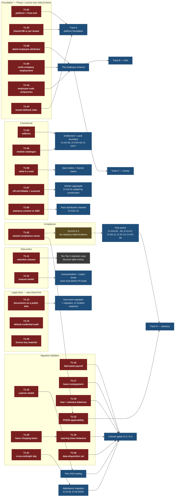

# PART XXXIV — DECISIONS REQUIRED FROM THE PRODUCT OWNER

**Purpose.** Every other part of this blueprint raises decisions in its own closing
section. This part consolidates all of them into one queue, ranks them by what
they block, and gives the Product Owner a document that can be worked through in
sittings rather than read end to end. It adds no new design. Where a decision
belongs to legal, to a compliance professional or to a customer, §XXXIV.5 routes
it there instead of leaving it in the owner's queue.

**Scale, and scope.** This part covers **the spine, every numbered part, and every
appendix** — not Parts I–XXXI, which is what it previously said and which left
thirty-two decisions outside the only queue there is.

**360** decision identifiers exist across the corpus (three in the spine, 357 in
the parts and appendices), plus two `I-` information items Part VI raises
alongside its decisions — **362 register rows** in all. The count is the
generator's, from
[`docs/registers/REGISTER-DECISIONS.md`](registers/REGISTER-DECISIONS.md),
produced by `tools/generate-registers.py`; it is no longer a hand count.

| Tier | Decisions | Identifiers they cover | *of which added by the scope correction* |
|---|---:|---:|---|
| Tier 1 — blocking | 35 | 85 | +9 decisions / +10 identifiers |
| Tier 2 — phase-gating | 190 | 206 | +14 / +16 |
| Tier 3 — configurable default | 58 | 58 | +5 / +5 |
| Not the Product Owner's (§XXXIV.5) | 12 | 13 | +0 / +1 |
| **Total** | **295** | **362** | **+28 / +32** |

Merges are the reason the two columns differ, and every merge is named in the
register at §XXXIV.6.

> **What changed, and why.** The 330 rows this part previously declared covered
> the spine and Parts I–XXXI. Parts XXXII, XXXIII and XXXV and Appendices B and C
> raise **thirty-two further identifiers** between them, none of which reached
> this queue — including phase-sequencing, risk-acceptance and cutover decisions
> that are Tier 1. They are added at §XXXIV.6.1 with their tier, and the totals
> above include them. `D-XXXI-08` is **not** among them: it is a mis-spelling of
> `D-31-08` that appears once, in Appendix A's own prose, and names no decision
> (Appendix A R-12 — Part XXXI mints `D-<arabic>-nn`). The register carries no row
> for it.

---

## XXXIV.1 How to use this part

### XXXIV.1.1 The three tiers

| Tier | Definition | Count | What a decision becomes when answered | If it is not answered |
|---|---|---|---|---|
| **TIER 1 — BLOCKING** | A wrong or absent answer invalidates design work already done, changes the data model, changes the commercial model, or runs against a legal clock | 35 | An **architectural constant** — recorded in the spine or in the part that owns it, and thereafter not re-openable without a re-design | Phase 1 does not start. Work done in the interim is at risk of being discarded |
| **TIER 2 — PHASE-GATING** | Needed before a specific delivery track begins, but not before Phase 1 | 190 | A **seeded artefact** — a published configuration version, a migration default, a workflow definition, a rule pack entry | That track cannot leave design. Other tracks continue |
| **TIER 3 — CONFIGURABLE DEFAULT** | SmartPRS 3 works either way; the answer sets what ships and a tenant may override it | 58 | A **configuration default** — a platform-level (K1) value in the Configuration Studio, overridable per tenant | The recommendation in the owning part ships as the default. Nothing is blocked |

The tier test, applied in order:

1. Does the answer change a table, a key, a unique index or an aggregate boundary? → Tier 1.
2. Does the answer change what is sold, what is billed, or what an existing customer owns? → Tier 1.
3. Is there a legal clock — a disclosure obligation, a limitation period, a filing? → Tier 1.
4. Does another part state that it blocks something? → Tier 1.
5. Does a named delivery track stall without it? → Tier 2.
6. Otherwise → Tier 3.

### XXXIV.1.2 The decision protocol

**Who decides.** The Product Owner decides Tier 1 and Tier 2 personally.
Tier 3 may be delegated to the lead architect, who records the answer and
notifies the Product Owner in the release note for the phase. The decisions in
§XXXIV.5 are **not** the Product Owner's and are routed by name.

**How a decision is recorded.** A decision is not answered until it is written
down in one of three places, and the place is determined by the tier:

| Tier | Recorded as | Where it lives | Changing it later |
|---|---|---|---|
| 1 | An **architectural constant** | An amendment to `SPINE.md` or to the owning part, dated and signed | A re-design of the affected parts, re-approved |
| 2 | A **seeded artefact** | A published `config_versions` row, a migration default, or a rule-pack entry — created by the phase that consumes it | A new artefact version with an effective date (spine S4); history is preserved |
| 3 | A **configuration default** | A platform-scope (K1) value in the Configuration Studio | An ordinary tenant override; no release needed |

**Deferral.** A Tier 1 decision cannot be deferred; it can only be answered or
the programme stopped on that front. A Tier 2 decision may be deferred once, to
the start of the track it gates, and the deferral is recorded with a date. A
Tier 3 decision left unanswered ships as the recommendation in the owning part —
which is the default behaviour, not a failure.

**Evidence discipline.** Every recommendation in this part carries the
recommendation made by the part that raised it. Where a recommendation depends
on a figure from SmartPRS 2, that figure is recorded as *"the value SmartPRS 2's
code currently uses"* and is **never** asserted as correct. No statement of
Indian law appears anywhere in this part.

### XXXIV.1.3 Suggested sittings

| Sitting | Contents | Attendees | Duration |
|---|---|---|---|
| **S1 — Commercial** | T1-03 to T1-08 (editions, module catalogue, AMC gate, seats, off-roll) | Product Owner, sales lead, finance | Half day |
| **S2 — Legal clock** | T1-13, T1-14, T1-26 and §XXXIV.5 routing | Product Owner, external counsel, operations | Half day, **first** |
| **S3 — Data model** | T1-01, T1-09 to T1-12, T1-24, T1-25 | Product Owner, lead architect | Full day |
| **S4 — Migration liabilities** | T1-16 to T1-23, T1-26 | Product Owner, migration lead, a customer-facing account owner | Full day |
| **S5 — Compliance appointment** | T1-02, then §XXXIV.5 hand-over | Product Owner alone; the outcome is a named person | One hour |

S2 and S5 have the shortest agendas and the longest lead times. They should be
held first.

---

## XXXIV.2 TIER 1 — BLOCKING

Twenty-six decisions, worked up as T1-01 … T1-26 below. Each must be answered
before Phase 1 starts. Each is stated as a question a non-engineer can answer.

**Nine further Tier 1 decisions** arrived with the scope correction and are
registered at §XXXIV.6.1 — `D-XXXII-02`, `D-XXXII-03`, `D-XXXIII-01`,
`D-XXXIII-03`, `D-XXXV-01`, `D-B-01`, `D-B-06`, `D-B-07`, `D-C-01`. They are
Tier 1 on the same test and block Phase 1 on the same terms; they do **not** yet
have a worked-up T1 entry here, and writing those nine entries is the next
editorial task on this part. Until then, read §XXXIV.6.1 alongside this section
rather than instead of it. (`D-B-02` is Tier 1 too and merges into T1-11, so it
needs no entry of its own.)

---

### T1-01 · What technology are we building this on?

**Merges** spine D-01, spine D-02, Part IV D-IV-01, Part IV D-IV-02.

**The question.** Do we build SmartPRS 3 as one Laravel/PHP application with a
React front end, or something else?

**Why it blocks.** Every part of this blueprint has been written against a
single-artefact Laravel modular monolith serving SaaS and on-premise identically
(spine S0, S2, S18). A different answer invalidates the module boundaries, the
migration tooling design, the on-premise installer, and the deployment parity
requirement that Part XXVI and Part XXXI are built on.

| Option | Consequence |
|---|---|
| **A. Laravel 12 / PHP 8.4 modular monolith, MySQL 8, React + TypeScript SPA** | On-premise parity is achievable; team knowledge carries; migration tooling reads both schemas in one process; engines stay extractable behind interfaces |
| B. PHP core plus separate engine services | On-premise becomes multi-service. Customers who today do not reliably run one cron worker would operate a service mesh. Parity with SaaS is lost |
| C. Non-PHP rewrite | Discards the team's knowledge and the migration path; adds 12–18 months. The problem is architectural, not language-borne |

**Recommendation: A**, including React + TypeScript for the SPA (hiring depth in
India), with a database-queue fallback supported on-premise so a missing Redis
does not produce an install with no worker (Part IV D-IV-03).

**Consult:** lead architect. No external party.

**If unanswered:** nothing starts. This is the first decision.

---

### T1-02 · Who is the named person who signs off statutory content?

**Merges** spine D-03, Part I D-I-08, Part XVII D-XVII-01, Part XIII D-XIII-10,
Part XX D-XX-15, Part XV D-XV-01 (counter-signature), Part VI I-VI-01.

**The question.** Which named individual at Ametecs verifies every statutory
value against its primary source, holds the signing identity for a rule pack,
and is accountable if a value is wrong?

**Why it blocks.** A rule pack cannot be signed without a verifier and a filed
source reference (Part XVII R-XVII-028). An unsigned pack cannot be activated
(R-XVII-026). Without an activated pack, SmartPRS 3 computes **no statutory
deduction at all**. It is on the critical path ahead of the first line of
statutory code, and it is the longest-lead item in the programme.

| Option | Consequence |
|---|---|
| **A. Appoint or hire an internal Head of Statutory Compliance, plus a named deputy** | Accountability sits inside Ametecs where the liability is; expedited packs are operationally possible |
| B. Retain an external firm as the owner | Turnaround becomes contractual, not operational; the signing identity sits outside Ametecs, which the architecture forbids |
| C. The Product Owner owns it personally | It is a continuous specialist function and cannot be a part-time responsibility of the person deciding everything else |
| D. Distribute across engineering | This is precisely what produced ~90 uncited statutory values in PHP constants |

**Recommendation: A, with B as the independent reviewer** for the publication
gate and for opinions where an instrument is ambiguous.

**Consult:** Product Owner alone decides; external counsel advises on the
liability position.

**If unanswered:** no rule pack ships. No statutory deduction can be computed.
Parts XIII, XIV, XV, XVII, XVIII and XX all stall at the same point.

---

### T1-03 · Do editions exist in SmartPRS 3, and what do existing L1/L2 customers own?

**Merges** Part XXVII D-XXVII-01, Part I D-I-02, Part I D-I-03.

**The question.** SmartPRS 2 sells three on-premise price points and delivers one
product. In SmartPRS 3, is there one product or three tiers — and what do the
customers who paid for L1 and L2 actually own?

**Why it blocks.** It fixes the entitlement model, the licence claim set and the
pricing model (Part XXVII §XXVII.3). It is also potentially contractual: if
entitlements are enforced in v3, customers currently receiving everything lose
function during the highest-risk migration in the product's life.

| Option | Consequence |
|---|---|
| **A. Drop editions.** One product, priced on seats, companies and individually purchased optional modules. Every existing customer issued the full standard entitlement set; `edition` migrates as a historical sales attribute | Simplest entitlement model; forgoes a price ladder; requires a commercial review of what L1/L2 customers were sold |
| B. Keep three tiers, grandfather existing customers | Viable if the ladder is commercially important; creates a permanently grandfathered population to support forever |
| C. Keep three tiers and enforce them against existing customers | Withdraws function from paying customers at cutover. A contractual question, not a technical one |

**Recommendation: A**, plus a separate commercial review — with a named owner and
a date — of what L1 and L2 customers were sold and whether anything is owed.

**Consult:** sales, finance, **legal** (on the contractual position of existing
licences).

**If unanswered:** the entitlement model, the licence payload and the price list
cannot be designed. Parts XXV, XXVI and XXVII all stall.

---

### T1-04 · What is the canonical module catalogue?

**Merges** Part I D-I-01, Part XXI D-XXI-09.

**The question.** What is the single authoritative list of modules that
permissions, plan gating, edition gating, the licence and the price list all read
from?

**Why it blocks.** SmartPRS 2 holds six disagreeing in-code vocabularies (16 /
10 / 14 / 50 / 57 / 107 entries), a marketing claim of "16 modules", and a
licence agreement referencing a catalogue that is not in the repository. Part XXI
calls this *"the single most schedule-critical decision in this part"*: until it
is populated, entitlement, licensing and the module-pack boundary are all blocked.

**Recommendation.** Adopt Part I §I.4.2's 30-module engineering inventory, agree
a commercial list of ≤16 sellable modules on top of it, and seed both as one
reference table. **Populate it commercially first** — the price list is the source
of truth, not the controller set.

**Consult:** sales (the sellable list), lead architect (the engineering list).

**If unanswered:** the module registry cannot be seeded, so the permission
catalogue, the entitlement grammar and the pack boundary have nothing to resolve
against.

---

### T1-05 · If a customer's support contract has lapsed, do they still receive statutory corrections?

**Merges** Part XVII D-XVII-02, Part XXVII D-XXVII-02, Part III D-III-03,
Part XXIX D-XXIX-14. **Answer once.**

**The question.** SmartPRS 2 refuses all updates — including a Professional Tax
correction — when the AMC has lapsed. Should SmartPRS 3 do the same?

**Why it blocks.** It determines the rule-pack channel's authorisation model
(licence validity versus support currency), which is built into Part XXVII's
distribution design and Part XVII's pack acceptance flow. It is also a liability
position, not only a commercial one.

| Option | Consequence |
|---|---|
| **A. Never gate statutory content.** Authorise the pack channel on licence validity. Gate features, application updates, support SLAs and advisory services instead | Forgoes a renewal lever; removes the position where Ametecs produced a correction and withheld it |
| B. Gate statutory content on AMC | A renewal lever. A wrong deduction computed by SmartPRS is Ametecs' defect; having produced the correction and withheld it for commercial reasons is materially worse than not having produced it — and the withholding is recorded in the product's own audit trail |

**Recommendation: A.** If B is selected, Part XXVII R-XXVII-117 applies and is
not optional: the refusal must be explicit, visible to the customer, and audited
on both sides. **Silence is unacceptable under either choice.**

**Consult:** **legal** (liability position), sales (renewal economics).

**If unanswered:** the pack distribution channel cannot be built, and Part XXIX
cannot state a support position for customers who decline to migrate.

---

### T1-06 · What is a seat?

**Merges** Part XXV D-XXV-05, Part I D-I-04, Part X D-X-03, Part XXVII D-XXVII-07,
`I-…` Q-11, Q-17.

**The question.** In one sentence: which people does a customer pay for?

**Why it blocks.** v3.0 pricing cannot be published and the migration cannot
compute a per-customer delta until this is fixed. Part XXV calls it *"the single
most commercially consequential decision in this part"*. It also determines a
counting query that runs in the persistence layer, so it is a data-model
question as well as a price one.

**What is known.** SmartPRS 2 counts active on-roll employees pooled across
companies; archived employees still bill on SaaS but not on-premise, and the
error message states the on-premise behaviour to both; off-roll agents never
bill; two of five enforcement doors bypass the cap; the whole check fails open;
on-premise defaults to effectively unlimited (`seats_licensed = 100000`, and a
`.lic` seats field defaulting to 0 meaning no limit).

**Recommendation.** A seat is **a Worker with an active employment on the last
day of the billing period**, counted by the persistence layer, measured
peak-in-period and pooled tenant-wide; **archived does not consume a seat** (it is
what the product already tells customers); the seat-free stage list ships as the
six SmartPRS 2 statuses plus `archived`, all tenant-editable; on-premise seats
are an **explicit licence claim**, with `seat_unlimited` as a deliberate value and
never a default.

**Consult:** finance, sales. Existing customers must be told before renewal, not
at migration.

**If unanswered:** pricing cannot be published; Part XXV's metering and Part
XXVII's licence claim set cannot be finalised.

---

### T1-07 · Are off-roll agents billable, and are they compliance-scanned?

**Merges** Part XXV D-XXV-06, Part I D-I-05, Part XX D-XX-02, Part XXI D-XXI-04,
Part XXI D-XXI-01 (the modelling consequence).

**The question.** Off-roll collection agents are potentially the majority of a
customer's field force. Do they consume a paid seat, and are they inside the
compliance machinery?

**Why it blocks.** It is simultaneously the largest revenue question and the
largest compliance-promise gap in the product. Today an agency can run 500
off-roll agents on a 25-seat plan, and those agents sit outside every compliance
mechanism while being the population the recovery-agent norms target. The answer
also determines whether off-roll workers are an engagement **kind** on one
Worker table (Part XXI D-XXI-01) or a second parallel person model — a data-model
decision that cannot be retrofitted cheaply.

**Recommendation.** **Compliance tracking: yes, unconditionally** — modelled as an
engagement kind on the one Worker table, so compliance, documents, custom fields,
gates and money movement include off-roll agents by construction. **Billing: yes,
on a separate, cheaper meter** — pricing them as full seats prices the collections
vertical out of the market.

**Consult:** sales and finance (the meter), a customer (the price change lands at
renewal, not at migration). Compliance tracking is **not** conditional on the
commercial answer.

**If unanswered:** Part XXI's compliance register cannot be modelled and Part
XXV's meters cannot be defined.

---

### T1-08 · Which employee attributes must be effective-dated?

**Merges** Part X D-X-01, Part V D-V-01.

**The question.** Which facts about an employee must the system be able to answer
*"as at a past date"* — and therefore be stored as dated rows rather than as
columns that get overwritten?

**Why it blocks.** This is the single largest shape decision in the schema. It
determines the row count of the employment-assignment table, the editors, the
history views, and whether "what was this employee's branch on 15 May?" is
answerable at all — a question SmartPRS 2 cannot answer. It cannot be retrofitted
cheaply, because retrofitting means the history for the period before the
retrofit does not exist.

**Recommendation.** The set in Part X §X.6.1: **org assignments, classification
dimensions (designation, grade, category, employment type, stage, shift,
location, pay group), reporting managers, employment status, compensation,
statutory identifiers and applicability, bank details, contacts and addresses** —
each as one dated row carrying all dimensions (Part V D-V-01), not one row per
dimension.

**Consult:** lead architect. HR operations should review the list for anything
missing that they routinely back-date.

**If unanswered:** the employee schema, the payroll input snapshot and the
statutory resolution algorithm have no substrate.

---

### T1-09 · May one person hold two employments in the group at once?

**Merges** Part V D-V-02, Part X D-X-06, `J-…` PO-3.

**The question.** Can the same human being be employed by two group companies
simultaneously, and must the system model that?

**Why it blocks.** A yes splits Person from Employment as separate aggregates,
which changes every table that names an employee. Part V states plainly that
retrofitting it later would touch all of them.

**Recommendation.** **Model it now** (Person/Employment split), and switch the UI
affordance on per tenant so customers who do not need it never see a selector.
Drop SmartPRS 2's free-text `also_works_for` field, which records the situation
without modelling it.

**Consult:** lead architect; one customer with a group structure, to confirm the
case is real.

**If unanswered:** the core schema cannot be finalised.

---

### T1-10 · Is an employee code unique across the whole customer, or per company?

**Merges** Part V D-V-03, Part XXVIII D-XXVIII-07.

**The question.** If two group companies both have an employee "1001", is that
allowed?

**Why it blocks.** It is the primary business key of the whole system and it
materialises as a **unique index**. Where the chosen scope is tighter than the
source data, the migration must de-duplicate before the index can be created —
so the answer sizes a migration pass that has to happen before any employee row
loads.

**Recommendation.** Configurable per tenant, **default per legal entity**. A group
running a shared series configures tenant scope explicitly.

**Consult:** lead architect; the migration lead sizes the de-duplication.

**If unanswered:** the employee table cannot be created.

---

### T1-11 · How long is each kind of record kept?

**Merges** Part V D-V-05, Part XXVIII D-XXVIII-05, Part XXII D-XXII-12, and the
retention halves of Part XIX PO-XIX-03, Part XXIII PO-XXIII-05, Part XI D-XI-08,
Part XIII D-XIII-14, Part XX D-XX-11, Part XX D-XX-12.

**The question.** For each class of record — attendance punches, payslips and
wage registers, audit entries, candidate PII, onboarding selfies and identity
documents, notification logs, ex-employee records — how long must it be kept, and
how long may it be kept?

**Why it blocks.** Every table in Part XXVIII declares a retention class, and the
migration applies the **first** retention cut-off there has ever been. Without a
policy the migration either carries everything across (including logs holding
plaintext passwords) or invents a cut-off. There is a second, sharper problem:
SmartPRS 2's **published privacy policy commits to ninety days** while nothing
implements any retention at all. That contradiction must be resolved before
release — either the published commitment is amended or the retention is
shortened. It cannot remain as it is.

**Recommendation.** Ametecs proposes a default per entity class; the **statutory
floors come from the rule pack** and are signed by the compliance owner of T1-02;
a tenant may lengthen but never shorten below the floor. Separate *operational
logs* from *evidentiary records* in the published policy, because the two have
genuinely different needs.

**Consult:** **legal** (the published-policy contradiction and the DPDP position),
the compliance owner (the floors). This is a Product Owner decision on the
configurable band only — see §XXXIV.5.

**If unanswered:** no table can declare a retention class, so Part XXVIII cannot
be finalised and the migration cannot run its first cut-off.

---

### T1-12 · When someone demands deletion, what is actually deleted?

**Merges** Part V D-V-06, Part XXVIII D-XXVIII-06, Part XXI D-XXI-06,
Part XXIII PO-XXIII-04, `M-…` Q-2.

**The question.** An ex-employee or a rejected candidate asks for their data to
be erased. What is deleted, what is retained for statutory reasons, and what is
anonymised?

**Why it blocks.** It determines whether the target schema needs anonymisation
columns, a crypto-shredding key per subject, or hard deletion with a tombstone —
and those must exist **before** any PII loads. It also sets whether an audit entry
survives erasure, which Part XXIII flags as a genuine tension between a
data-protection obligation and an evidentiary one.

**Recommendation (engineering position, subject to counsel).** Crypto-shred the
person's identifier keys and anonymise names and contacts, retaining statutory
records in anonymised form against a pseudonymous reference with a tombstone and
a recorded retention exception. In the audit ledger, redact the diff values and
preserve the entry.

**Consult: legal, and obtain the position in writing.** Part XXIII states
explicitly that this is a legal question, not an engineering one, and no legal
position is asserted anywhere in this blueprint. See §XXXIV.5.

**If unanswered:** PII cannot be loaded into the target schema.

---

### T1-13 · Are employee identity documents currently readable without logging in? **LEGAL CLOCK**

**Merges** Part XXII D-XXII-13, Part XXIX D-XXIX-08, `G-…` Q-01, Q-12.

**The question.** On live installations, are employees' identity, address, bank
and police-verification documents being served from a publicly readable path?

**Why it blocks.** Part XXII calls this *"the single highest-value question in the
dossier"*. It cannot be determined from the repository, because the file that
would answer it is not in version control. If the answer is yes, this is a
**possible disclosure event with a legal clock**, and the document migration in
Part XXIX becomes an incident response rather than a migration. Access-log
evidence must be collected **first**, before logs rotate.

**What must happen, in order.**

1. Determine the live configuration on every install — this is an operations
   task, not a decision, and it is Phase 0.
2. Collect access-log evidence before rotation destroys it (Part XXIX R-XXIX-029).
3. Contain: move private documents off any public path.
4. **Take legal advice** on notification obligations — the customer's, and
   Ametecs' own as a processor. **This blueprint states no legal position and
   makes no assessment of any obligation.**

**Recommendation.** Steps 1–3 begin immediately and do not wait for a decision.
Step 4 is counsel's.

**Consult: legal, immediately.** Operations for steps 1–3. Affected customers,
on counsel's advice.

**If unanswered:** the exposure, if real, continues; and the clock, if one is
running, runs regardless of whether the question has been asked.

---

### T1-14 · Does the deployed base carry known default credentials, and who owns the remediation?

**Merges** Part II D-II-01, D-II-02, D-II-03, D-II-04, Part XXIX I-08, I-09,
`L-…` OQ-L-01, `G-…` Q-02, Q-03, `N-…` Q-09.

**The question.** Four sub-questions, one sitting:

| | Question | Why it matters |
|---|---|---|
| a | How many installs carry `admin@smartprs.local` with the password published in the README? | It is created by an ungated seeder whose own docblock instructs running it on an on-premise install |
| b | Is `demo:reset` scheduled on customer servers? | The 03:30 schedule entry is unconditional and ships in every edition. If the scheduler runs, that install has an active `admin`-role account with a source-published password **re-created nightly** |
| c | Is `SMARTPRS_TEAM_PIN` a live bypass in the shipped build? | Config ships the literal default and documents it as unlocking unrestricted demos with no write guard; a controller comment claims it was removed |
| d | Who owns the ~25-item remediation programme, and does it run in parallel with the rebuild or before it? | At least four of those items are critical security items, several are one-line fixes |

**Why it blocks.** Part II calls (a) *"the highest-urgency item in Parts I and II
combined"* and `L-…` calls (b) *"the single most urgent question in this
document"*. These are not rebuild questions — they are live-estate questions, and
the rebuild must not become a reason to defer them.

**Recommendation.** Audit the entire deployed base — SaaS and on-premise — before
anything else in this blueprint. Run the remediation programme **in parallel**
with the rebuild, with a named owner and a fixed end date. Answering (b) is the
difference between a high internal risk and a disclosed vulnerability across the
installed base.

**Consult:** operations (the audit), **legal** if (a) or (b) is confirmed on
customer servers.

**If unanswered:** the programme proceeds without knowing whether it is also an
incident response.

---

### T1-15 · What is the cutover model for the on-premise estate?

**Merges** Part II D-II-05, and depends on Part XXIX I-01.

**The question.** For roughly 200 on-premise installs whose schemas differ from
each other, do we discover each customer's schema and write a bespoke migration,
or export everything through one canonical interchange format and re-import?

**Why it blocks.** No production schema has ever been captured; eight tables have
competing definitions; some column types are decided by which screens a customer
happened to open. Part XXIX states that a `mysqldump --no-data` from every
production install *"blocks every data-migration estimate"*. The choice determines
the entire shape of the migration tooling in Part XXIX.

| Option | Consequence |
|---|---|
| A. Per-customer schema discovery and bespoke migration | Requires each source schema to be knowable; effort scales with the estate; highest fidelity |
| **B. Export and re-import through a canonical interchange format** | Does not require the source schema to be knowable in advance; one tool, many customers; some fidelity is traded for tractability |

**Recommendation: B**, because it does not require the source schema to be
knowable — and Part XXIX's tooling already introspects `information_schema`
rather than assuming a column exists.

**Consult:** migration lead, operations. One on-premise customer should be asked
what an acceptable outage window is.

**If unanswered:** Part XXIX's tooling cannot be built and no cutover date can be
committed.

---

### T1-16 · What happens to eleven months of fabricated "paid" payroll?

**Merges** Part XIV D-XIV-08, Part XXIX D-XXIX-01, Part XXX D-XXX-05,
`A-…` OQ-5, `M-…` Q-6.

**The question.** Most live databases contain payroll runs marked `paid`, with
full-CTC payslips, that were fabricated by a demonstration data path rather than
computed. They are indistinguishable from real runs except by heuristics. Do we
quarantine them, delete them, or migrate them marked unverified?

**Why it blocks.** Part XIV states: *"Nothing else in the migration can be planned
until this is answered."* The wage register is a statutory document; Ametecs
cannot decide unilaterally what a customer's historical register says.

| Option | Consequence |
|---|---|
| **A. Quarantine** — migrate into a `quarantined_migration` run state, excluded from YTD, from every statutory register and from the reconciliation assertion, visible with an explicit banner, requiring a per-period customer decision | Migration becomes a conversation rather than a script. It is the only defensible position |
| B. Delete at migration | Cleaner, but destroys whatever an ESI period lock or a YTD figure was computed from |
| C. Migrate as-is, marked unverified | Carries fabricated money into a compliance record |

**Recommendation: A.** Auto-quarantine where three or four heuristics match;
escalate where one or two match; migrate where none match. Report the
company-months that contain no real payroll at all.

**Consult:** each affected **customer**, per period. Finance, on the aggregate
exposure.

**If unanswered:** the migration cannot be planned at all.

---

### T1-17 · Employees were paid for unpaid leave. Do we recover it, write it off, or disclose it?

**Merges** Part XIII D-XIII-01, Part XXIX D-XXIX-02, `E-…` PO-01.

**The question.** Every approved leave since go-live — including leave filed
explicitly as "Loss of Pay" — was credited as a paid day. How far back must this
be corrected, and what is the remedy?

**Why it blocks.** The amount must be **known** before cutover, because it is a
disclosed liability. The remedy is a per-tenant decision with employee-relations
and legal dimensions.

| Option | Consequence |
|---|---|
| A. Recover in full from employees | Recovery from employees for an employer's system error is legally and industrially fraught, and in some contracts impermissible |
| **B. Write off historically, correct forward** | A real cost, absorbed. Preserves the employment relationship. Requires employee communication before the first SmartPRS 3 run |
| C. Recover prospectively only | A middle position; still requires the historical figure to be quantified |

**Recommendation.** Run the quantification report **immediately, before any
migration work**. Then decide per tenant. Recommended default: **write off closed
financial years and correct forward**, with employees told before the first run.

**Consult:** **legal** (the recovery position), each affected **customer** (it is
their money and their employee relationship), finance.

**If unanswered:** a quantified, undisclosed liability sits on every customer's
books and the first SmartPRS 3 payslip changes without explanation.

---

### T1-18 · What happens to loan and advance balances that cannot be reconciled?

**Merges** Part XVIII D-XVIII-04, Part XVIII D-XVIII-05, Part XXIX D-XXIX-03,
`A-…` OQ-6, `A-…` DEF-P02.

**The question.** Loan EMIs have either never been recovered or have been
recovered indefinitely past the end of the loan; advance shortfalls were silently
dropped. The outstanding column is defaulted to zero and written by nothing. What
opening balance does each obligation start SmartPRS 3 with?

**Why it blocks.** Part XVIII calls it *"the single largest cutover risk in this
part"*. The first SmartPRS 3 payslip either deducts a defensible number or it
does not.

**Recommendation.** Create every obligation but **frozen** (`pending_reconciliation`),
excluded from payroll, on a blocking cutover report that a **named person per
tenant** clears against the tenant's own records. **Do not import a computed
guess.** Where a loan is found **over-recovered**, quantify the excess per
employee, present it, and raise a pay-to-employee obligation for the excess — it
is the employee's money.

**Consult:** each affected **customer** (they sign the per-employee balances),
finance (the refund is a cash event), **legal** where an over-recovery is
material.

**If unanswered:** cutover cannot complete for any tenant with an open loan book.

---

### T1-19 · What opening leave balance does each employee start with?

**Merges** Part XIII D-XIII-02, Part XXIX R-XXIX-026, `E-…` PO-02.

**The question.** Carry-forward was never applied in SmartPRS 2, so the stored
balance does not represent entitlement. What balance does each employee open
with in SmartPRS 3?

**Why it blocks.** Leave balances are money-adjacent (encashment, F&F) and are
irreversible in practice once granted. Deriving them from the stored
carry-forward would grant balances nobody accrued.

**Recommendation.** **Stated per tenant on a signed file, never computed.** It is
per-tenant effort; the alternative is fast, wrong, and wrong in the employee's
favour — which makes it unrecoverable.

**Consult:** each affected **customer** — they sign the file.

**If unanswered:** the leave ledger has no opening position and the first accrual
run is meaningless.

---

### T1-20 · Is leave charged in calendar days or working days?

**Merges** Part XIII D-XIII-04, `E-…` PO-07.

**The question.** If an employee takes leave from Friday to Monday, is that two
days or four? And are the historic stored values recomputed?

**Why it blocks.** It changes every balance, every accrual and every encashment
value, and it interacts directly with T1-19: because history is frozen, the
opening balances embed the old arithmetic, which is exactly why they must be
*stated* rather than derived.

**Recommendation.** Default **`working_days`**, with an adjacency ("sandwich")
policy available for customers who want the weekend bridged. **Do not recompute
history** — freeze it and publish a divergence report showing which historic
values the new engine would have computed differently.

**Consult:** each affected **customer** (it is their leave policy, and it is
visible to every employee).

**If unanswered:** the leave engine has no counting basis and T1-19 cannot be
signed.

---

### T1-21 · Which calendar day does a night shift belong to?

**Merges** Part XI D-XI-01, Part XXIX D-XXIX-05, `B-…` OQ-B-01.

**The question.** A shift runs 22:00 to 06:00. Is that one attendance day or two,
and which month do the hours of 30 September's night belong to?

**Why it blocks.** It is a data-model decision — the attendance day is derived by
a rule, not by the punch's calendar date — and it determines whether historic
night-shift punches are re-attributed at migration, which moves money between
months that have already been paid and filed.

| Option | Consequence |
|---|---|
| **A. The shift's start date owns the whole shift** | 30 September's night lands in September. Matches most Indian rostering practice |
| B. The shift's end date owns it | Matches some night-allowance conventions; splits the month boundary the other way |
| C. The calendar date of each punch | SmartPRS 2's implicit behaviour; offered only to reproduce legacy behaviour during migration |

**Recommendation: A** as the platform default, overridable per shift. **Do not
re-attribute historic punches** — freeze historical payroll and publish a
per-tenant impact report first.

**Consult:** a **customer** running a night shift. Part XXIX I-05 records that
whether *any* customer runs one is not currently known — establish that first.

**If unanswered:** the attendance day rule, and therefore every derived
attendance figure, has no definition.

---

### T1-22 · Customers filled in "PF applicable" and "ESI applicable" for years. Those fields drive nothing. What now?

**Merges** Part XVII D-XVII-07, Part XXIX (Class C correction C-PF-APPL),
`F-…` §12 item 2.

**The question.** These columns are populated, are printed on payslips, and are
read by no calculation. Honouring them in SmartPRS 3 will change payroll outcomes
for real employees.

**Why it blocks.** The as-is analysis states plainly: *"This decision must be made
before any migration is designed."*

| Option | Consequence |
|---|---|
| **A. Honour them from an agreed cutover date, after a mandatory reconciliation report** | Correct behaviour begins at a clean boundary; the customer sees exactly who changes and by how much, before it happens. Historical figures remain on the old basis, which is unavoidable |
| B. Migrate everything to `auto` and re-collect | Discards genuine customer data and forces re-entry for thousands of employees |
| C. Honour them and reprocess historical periods | Reprocesses periods already paid and already filed |

**Recommendation: A.** The reconciliation report is a mandatory, **customer-signed**
pre-cutover artefact, and the customer decides per employee where a value looks
like a data-entry error rather than an intention.

**Consult:** each affected **customer**; the compliance owner of T1-02 on the
treatment itself.

**If unanswered:** the migration cannot be designed.

---

### T1-23 · Shared database, or one database per tenant?

**Merges** Part XXVIII D-XXVIII-01, Part XXV D-XXV-01 (the silo tier).

**The question.** Do all SaaS tenants share one database with enforced row-level
isolation, or does each get their own?

**Why it blocks.** It is the foundational storage decision of Part XXVIII and it
determines the shape of the tenancy enforcement in Part XXII, the provisioning
pipeline in Part XXV, and the generated cross-tenant isolation suite.

**Recommendation.** **Shared, with five-layer enforcement**, and per-tenant
promotion available as a priced tier for regulated and enterprise buyers.
Trade-off: discipline enforced by CI forever, versus a permanent operational cost
per tenant.

**Consult:** lead architect; sales, on whether a dedicated-database tier is
saleable.

**If unanswered:** no table can be created.

---

### T1-24 · May customers define their own roles?

**Merges** Part XXII D-XXII-01, Part I D-I-07, `G-…` Q-13, `N-…` Q-07.

**The question.** Can a tenant administrator create a role called "Branch
Manager" or "Payroll Officer", or may they only choose from a list Ametecs ships?

**Why it blocks.** `G-…` Q-13 states it directly: *"This decision cannot be
deferred — it changes the schema."* It determines whether the permission tables
are tenant-partitioned or global with a per-tenant assignment layer. The related
question — may a user hold more than one role? — is answered yes by spine S13,
which separates permission from data scope.

**Recommendation.** **Tenant-defined**, with Ametecs' system roles shipped as a
strong default so most customers never author one, and cloning as the only
derivation path. Every role change is maker-checkered and audited.

**Consult:** lead architect; a customer with a non-standard org shape.

**If unanswered:** the permission schema cannot be created, and Part XXII's
239 requirements have no substrate.

---

### T1-25 · Is the shipped licence key material safe, and who holds the signing keys?

**Merges** Part XXVII D-XXVII-03, D-XXVII-04, D-XXVII-11, `I-…` Q-03, Q-04.

**The question.** Three sub-questions, one sitting:

| | Question | Consequence if the answer is bad |
|---|---|---|
| a | Is the `.lic` key pair shipped with SmartPRS 2 a development pair? | Every perpetual licence already issued is forgeable, and the cutover window becomes a remediation deadline rather than a project milestone |
| b | Was the shared licence signing secret ever shipped to customers, and to how many? | If it was, every affected build carries a disclosed signing key and the affected customers must be identified — even though the code path is dead |
| c | Who holds custody of the SmartPRS 3 signing keys, and who may authorise rotation or revocation? | Today the private key is a `0600` file on one server, excluded from every backup, overwritable by a force flag. Losing it means **no licence can ever be issued or renewed again for any existing customer** |

**Why it blocks.** (a) and (b) determine whether the migration is also an incident
response. (c) is the difference between a bad week and an unrecoverable business
event, and the custody model must exist before the first v3 licence is issued.

**Recommendation.** Verify (a) and (b) against the real delivery tree, then
**rotate regardless**. For (c): a cloud KMS with hardware backing, non-exportable
keys, two-person authorisation on every signing operation, and a **named
three-person quorum of whom two are required** for rotation or revocation.

**Consult:** operations (verification), **legal** if (b) is confirmed, lead
architect (custody design).

**If unanswered:** licensing cannot be built, and the estate's exposure is
unknown.

---

### T1-26 · The migration data-disposition set

**Merges** Part XXIX D-XXIX-04, D-XXIX-06, D-XXIX-07, D-XXIX-09, D-XXIX-10,
D-XXIX-11, D-XXIX-12, D-XXIX-13; Part XI D-XI-02; Part XXIII PO-XXIII-06;
Part XXVIII D-XXVIII-09.

**The question.** Eight related questions about contaminated or unreliable data,
all of the same shape — *"what do we do with this?"* — and all answerable in one
sitting with the migration lead. Each blocks Part XXIX's gate G-3 or G-4.

| Ref | Question | Recommendation |
|---|---|---|
| **a** (D-XXIX-04) | **Stranded commissions** — earnings computed, approved, and never paid. What is owed, to whom, and is it paid? | Reconstruct intent from the payment ledger and the audit prose; report the unpaid value; the **customer** decides payment |
| **b** (D-XXIX-06) | **Destroyed police-verification `overdue` records** — a regulated record, overwritten | Recover from backup where one exists; otherwise re-verify the affected agents |
| **c** (D-XXIX-07) | **The audit chain** — migrate as verified history? It cannot be | Migrate marked `pre_migration_unverified` and anchor a fresh per-tenant chain. Tell the customer plainly. Keep the legacy archive, labelled on **every** screen and export, not only at import (PO-XXIII-06) |
| **d** (D-XXIX-09) | **Demonstration and fabricated attendance** — including pre-rev-51 rows that cannot be distinguished from real punches | Exclude demo-sourced rows by explicit filter; flag the indistinguishable residue and have the customer accept it in writing |
| **e** (D-XXIX-10) | **Attendance rows attributed to `USER-%` placeholders** counting as present days | Quarantine; attribute where the login resolves; otherwise leave unattributed and exclude from payable days |
| **f** (D-XXIX-11 / D-XI-02) | **Corrections approved against a locked period** — unprocessed liabilities the employee was told would be handled | Enumerate, price, and settle as **arrears** in the first SmartPRS 3 run. These are obligations the employee was promised. Enumerate the existing rows before cutover |
| **g** (D-XXIX-12) | **The saved permission matrix** in the legacy state blob — is it the intent to honour? | Extract as **intent**; re-confirm with the customer before enforcement. Enforcing it silently would stop users who work today |
| **h** (D-XXIX-13 / D-XXVIII-09) | **How many parallel payroll cycles** before cutover, and what happens to geofence verdicts computed from coordinates truncated to roughly ±557 m? | Two cycles standard; three where a night shift, multiple companies, an active compliance gate, more than 100 commission earners or a large correction class is present. Flag truncated verdicts `precision_unknown` rather than silently re-deriving from data that cannot be recovered |

**Consult:** migration lead throughout; each affected **customer** for (a), (b),
(d) and (g); **legal** for (b), which is a regulated record.

**If unanswered:** Part XXIX gates G-3 and G-4 cannot be passed, so no cutover
can be scheduled.

---

## XXXIV.3 TIER 2 — PHASE-GATING

One hundred and seventy-six decisions, covering 190 register rows. Each is needed before a named delivery track begins, not
before Phase 1. **Part XXXII does not yet exist**, so these are grouped by
delivery track; when the phase plan is written, each track maps to a phase and
this grouping is superseded without the contents changing.

Format: question · recommendation · consult · what it gates.

### XXXIV.3.1 Track A — Platform foundation (configuration, rules, formulas, workflow, metadata, security)

| ID | Question | Recommendation | Consult | Gates |
|---|---|---|---|---|
| **D-IV-04** | Build the enforcement toolchain before feature work? | **Yes.** Every gate exists because its absence produced a confirmed defect; retrofitting after 100,000 lines is how SmartPRS 2 happened | Architect | All of Phase 1 |
| **D-IV-03** | Is Redis a hard prerequisite on-premise, or is a database-queue fallback supported? | **Support the fallback.** Lowering the prerequisite bar raises the proportion of installs that actually work | Architect, support | On-prem installer |
| **D-VI-01 / D-VIII-07** | May a tenant administrator author formulas, or only an Ametecs consultant? *(one decision, two parts)* | **Consultant authors, tenant approves and publishes**, for v3.0. Grant tenants *policy-value* editing on day one and formula authoring only once the engine is proven. A formula produces money | Product, services | Formula engine, Configuration Studio permissions |
| **D-VI-02** | Does a configuration rollback rewrite history? | **No.** Rollback changes the future only; a separately permissioned retro-correction exists for the genuine case, always with a recomputation, a diff and an approval | Architect | Configuration lifecycle |
| **D-VI-04** | Who owns configuration in a SaaS tenant by default — Ametecs or the customer? | **Ametecs-managed for the first 12 months**, with a defined graduation path once a tenant's administrators are trained and its regression suite meets a coverage minimum | Services, sales | Permission seeding |
| **D-VII-01** | On a rule-evaluation failure at a payment gate, hold or release? | **Hold.** A tenant that chose blocking chose it to prevent paying a non-compliant agent, and an engine error is not evidence of compliance. Evaluated at preview, so a failure surfaces hours earlier | Product, a customer | Rule engine, compliance gate |
| **D-VII-03** | Migration default for the minimum-hours presence gate | **Seed at 0 minutes** — preserve SmartPRS 2 behaviour exactly — and present the gate as a dated policy change the customer makes after go-live, with the cost shown | Migration lead | Attendance migration |
| **D-VII-06** | Who may publish rules in a customer organisation? | Publication of payroll and payment-gate rules restricted to a named **Finance-side** role, distinct from the HR role that authors attendance and leave rules | Product, a customer | Permission catalogue |
| **D-VII-07** | Does Ametecs ship industry starter rule packs, and are they supported artefacts? | **Yes**, and treat a shipped pack as a supported artefact with its own version, changelog, tests and upgrade path — with a named owner | Product | Rule pack authoring |
| **D-VIII-01** | Does a dependent formula read the rounded result or the exact value? | **Rounded**, so a payslip is re-derivable from the numbers printed on it. If exact composition is preferred it must be per formula and visible in the trace, never a global switch | Architect, payroll lead | Formula engine |
| **D-VIII-02 / D-XIV-02** | Which loss-of-pay bases ship, and which is the platform default? *(one decision, two parts)* | Ship all five; make **payable days** the default for new tenants; scope the choice at company, grade and pay group. **Migration preserves each customer's current basis exactly** and offers the change as a dated, previewed decision after go-live | Payroll lead, a customer | Payroll engine, migration |
| **D-VIII-03** | The overtime divisor and wage base at cutover | Seed each customer at their current figures **to the paise**, and surface the divisor, the shift hours and the wage base as three configuration values from day one | Payroll lead | Payroll migration |
| **D-VIII-05** | Which date resolves a formula version within a period? | **Period end** by default, declared per calculation point, with per-day available for day-derived calculations | Architect | Formula engine |
| **D-VIII-09** | Minimum-net-pay floor: defer recoveries, or block the run? | **Defer**, with a visible per-employee note on the payslip and in the preview, plus an ageing report on deferred recoveries and an escalation after a configurable number of periods | Payroll lead | Recovery orchestrator |
| **D-VIII-10** | Arrears: recompute-and-difference, or apply a day fraction? | **Recompute-and-difference.** It is the only method that produces correct statutory amounts on the arrear and the only one that survives a structure change between periods. *(Taxability is a compliance ruling — §XXXIV.5)* | Architect | Payroll engine |
| **D-IX-03** | May delegation apply to segregated (maker-checker) workflows? | **Yes**, but only to a delegate who independently holds the segregated role, with the constraint re-checked after substitution. Forbidding it produces month-end deadlock | Product | Workflow engine |
| **D-IX-05** | Is edit-after-approval retained, and for which entity types? | Retain for **commission claims only**, until locked, invalidating decided steps, with a structured before/after diff in the audit ledger | Product, a customer | Workflow engine |
| **D-IX-07** | Are very small tenants exempt from maker-checker? | **No exemption.** Fill the second side with a named external checker, or accept that those operations need two accounts | Product, sales | Workflow seeding |
| **D-IX-09** | Should administrator roles continue to satisfy both sides of every gate? | **No.** Split into distinct approver roles at migration and let the segregation health check surface every tenant where one person holds both | Product | Role migration |
| **D-IX-10** | Does the nine-type request catalogue survive, or is it redesigned? | Seed the nine as bindings so nothing breaks, then let tenants disable what they do not use; treat commission, clawback and gate-driven flows as a **collections pack** rather than platform defaults | Product | Workflow seeding, pack boundary |
| **D-IX-12** | Should a workflow be able to require a legally weightier signature on named nodes? | Model the ladder now (tick, typed name, OTP, digital signature); implement the first two in v3.0; the stronger two are declared-but-unimplemented and **fail closed** if configured | Product, legal | Workflow schema |
| **D-X-11** | Which employment stages does the business actually need? | Seed today's three plus Contract, Trainee, Apprentice and Consultant, and attach the statutory treatment of each to the **rule pack**, never to the stage name | Product, compliance owner | Employee schema |
| **D-X-12** | Does a tenant administrator publish field changes directly, or does Ametecs? | Tenant publishes low-risk changes; high-risk changes (type, uniqueness, PII class, encryption, requiredness promotion, history mode) require maker-checker inside the tenant | Product | Metadata engine |
| **D-X-04** | The exit lifecycle, and is the `exited` state protected? | `exited` produced only by the exit workflow and protected by the transition table | Product | Employee status migration |
| **D-X-02** | The arrears divisor and proration basis for back-dated compensation changes | Seed SmartPRS 2's current divisor and calendar-day basis as the default **formula**, and expose both as parameters. **No value asserted as legally correct** | Payroll lead | Lifecycle, payroll |
| **D-XXII-02** | Which data scopes does the business actually need at v3.0? | Ship all thirteen; default the wizard to self, direct reports, branch, department and tenant, and put the rest behind "advanced" | Product | Permission model |
| **D-XXII-03** | Does Tenant Administrator hold payroll approval by default? | **No.** Segregation is real from day one, with a documented, audited one-click clone for customers who genuinely have one person | Product, a customer | Role seeding |
| **D-XXII-04** | Is a two-person rule mandatory on payroll approval, or configurable? | **Configurable, default on.** Disabling it is a maker-checker change with an audit record naming the control being removed | Product | Payroll workflow |
| **D-XXII-05** | What is Ametecs support contractually permitted to see, and under what consent? | **Diagnostic-only by default**, with consented, time-boxed elevation for anything beyond read-only | Legal, support | Platform access model |
| **D-XXII-06** | Is MFA mandatory for privileged roles at v3.0, or phased? | **Mandatory at v3.0**, with a configurable per-tenant grace period and assignment *suspension* rather than deletion at expiry | Product, security | Authentication |
| **D-XXII-08** | Must an unauthenticated device-ingestion path remain for legacy terminals? | **No** — the Bridge is the supported path. Available per tenant as an explicit, audited acceptance of residual risk | Product, support, a customer | Device ingestion |
| **D-XXII-09** | What happens to the permission matrices customers configured in the legacy state blob? | **Extract and report; do not apply.** Present each tenant its own matrix beside the proposed mapping and let the customer choose | Migration lead, customers | Role migration |
| **D-XXII-11** | Do we ship SCIM at v3.0? | **Defer to v3.1.** Ship SAML and OIDC at v3.0; build the identity schema so SCIM needs no migration | Product | Identity |
| **D-XXII-07** | Is SMS OTP required as an MFA method? | **Defer to v3.1.** TOTP plus email OTP plus recovery codes covers the requirement | Product | Authentication |
| **D-V-04** | Person merge policy — automatic on identifier match, or always manual? | **Always manual**, permissioned, audited, with a preserved merge record. Automatic merge on an identifier already known to contain duplicates would silently join two people | Architect | Person aggregate |
| **D-V-08** | Are historic transfer, increment and probation rows trustworthy enough to replay into assignment history? | **Replay them**, flagged as migration-replayed; synthesise nothing else. Partial but honest beats a single baseline row and total loss of known history | Migration lead | Assignment history |
| **D-V-07** | Which analytics measures from the sister product enter the domain? | Only agent-and-period keyed measures, never borrower-level data | Product | Incentive engine |
| **D-I-07** | May a user hold more than one role? | **Yes** — spine S13 already separates permission from data scope and allows several role-to-scope assignments | Product | Permission model |
| **D-I-09** | What is the target scale per tenant? | **Fix a number.** It sets pagination, indexing and job-decomposition targets for every later part. The largest figure in the analyses is a modelled 10,000 employees; real customer headcounts are not recorded | Product, sales | Performance budgets |

### XXXIV.3.2 Track B — Time (attendance, calendar, leave)

| ID | Question | Recommendation | Consult | Gates |
|---|---|---|---|---|
| **D-XI-03 / D-VII-03** | Does presence require a minimum of worked time? *(one decision, two parts)* | **Yes**, with a seeded threshold — but migrate existing tenants at zero so no historic loss of pay changes silently, then let each tenant opt in | Migration lead, a customer | Attendance engine |
| **D-XI-04** | The trust model for the legacy device-ingestion endpoint | Pre-registration plus a per-device enrolment secret, a tenant IP allow-list, and quarantine-until-claimed. Deprecate unauthenticated auto-registration | Security, support | Device ingestion |
| **D-XI-05** | What does an unknown punch-direction token become? | **`unknown` plus a review queue**, per device with a tenant default. Safer than silently treating it as an entry, which four sites do today | Support | Punch normalisation |
| **D-XI-07** | Should mapping a device identity rewrite historic punches? | **Never as a side effect.** Re-attribution is explicit, previewed, audited, and blocked into locked periods without approval | Architect | Identity mapping |
| **D-XI-09** | Preserve break and overtime punch types as distinct? | **Yes** — carry them in the direction value set and collapse to in/out only during pairing, when the shift strategy says so. Collapsing at ingestion loses break evidence permanently | Architect | Punch schema |
| **D-XI-10** | Does the direct LAN device adapter ship at launch? | Ship it **only if a live customer uses it**; otherwise defer. Survey device inventories first | Support, operations | Adapter launch matrix |
| **D-XI-12** | Who approves an egress allow-list entry — the tenant or Ametecs? | **Tenant** for LAN and private ranges with an explicit acknowledgement; **Ametecs** for public-internet hosts on SaaS | Security | Connector egress |
| **D-XI-13** | Is the sister time-capture product a permanent bespoke integration, or the first of many signed-webhook senders? | Treat it as **the first of many**: one signed-webhook adapter with a product-specific profile | Architect | Integration design |
| **D-XI-14** | Will any deployment run outside IST? | Build for it (per-device and per-tenant zones are already required); confirm whether daylight-saving zones are in scope for v3.0 before release | Sales, operations | Time policy tests |
| **D-XII-02** | What did the legacy holiday `applies_to` column mean? | Survey the distinct values on every live install and map each to a scope predicate **by hand, per tenant. Do not guess in migration code** | Migration lead, customers | Holiday migration |
| **D-XII-03** | Are historic weekly-off determinations recomputed under the corrected rule? | **No.** Freeze history, recompute forward, and publish the divergence report | Migration lead | Calendar migration |
| **D-XII-04** | Are historic incentive points recomputed once points use the real calendar? | **No.** Recompute forward; publish the divergence per employee per month so the customer can choose to issue a manual adjustment | Migration lead, customers | Incentive migration |
| **D-XII-05** | Is a weekly off paid, and is that a property of the pay group or the pattern? | **Pay group** — it is a remuneration question. Seed as paid for monthly-rated groups; prompt for daily-rated ones | Payroll lead | Calendar and payroll |
| **D-XII-07** | Which day types count as working days by default? | The set in Part XII §XII.6, but **as an onboarding question, not an assumption** — including work-from-home and training changes the loss-of-pay denominator for some customers | A customer | Calendar engine |
| **D-XII-10** | Who may work on a holiday declared closed — nobody, or an override role? | An override with an explicit permission and a mandatory reason, fully audited. An unaudited override is how SmartPRS 2's fail-open guards were justified | Product | Calendar engine |
| **D-XIII-03** | What is the leave-year basis per customer — calendar, April–March, or joining anniversary? | Default **April–March** to align with payroll and reporting; per-tenant and per-type overridable. Any choice changes something, because SmartPRS 2 splits the two | A customer | Leave engine |
| **D-XIII-05** | Does an over-drawn leave application get refused or converted to unpaid? | **Converted**, with the employee told clearly and shown the pay impact before submission. A refusal is what made the SmartPRS 2 bypass attractive | Product, a customer | Leave engine |
| **D-XIII-07** | Do comp-off, overtime and additional pay compete, and who chooses? | **Employee chooses within a window**, HR default applies if they do not; comp-off does not stack with overtime | Product, a customer | Comp-off engine |
| **D-XIII-09** | Which leave types are encashable, and on what basis? | **Earned leave only, at exit**, on a declared base with a declared divisor — every value tenant-configured. The divisor materially changes the amount and must be an explicit customer decision. *Tax treatment is rule-pack content* | A customer, compliance owner | Encashment, F&F |
| **D-XIII-12** | Are leave reasons and medical certificates visible to the reporting manager? | Reason: to the approver, not the team calendar. **Certificate: HR only, never the line manager** | Legal, HR | Leave, PII classes |
| **D-XIII-13** | Is leave-submission notification mandatory or configurable? | **Mandatory** — configurable in channel and template, not in whether it is sent. Optional reproduces the failure where leave sits unapproved because nobody knows it exists | Product | Notifications |
| **D-XIII-15** | Does a leave balance follow an employee across a legal-entity transfer? | Configurable per type; default **carry** within a tenant, **settle** across legal entities | Finance, a customer | Transfer, leave ledger |

### XXXIV.3.3 Track C — Money (salary structure, payroll, payslip, loans, commission)

| ID | Question | Recommendation | Consult | Gates |
|---|---|---|---|---|
| **D-XIV-01 / D-VII-04 / D-VIII-04** | An employee has no attendance evidence at all. Pay in full, or treat as absent? *(one behaviour, three parts — answer once)* | **Hold the payslip for review** at tenant level, overridable to pay-in-full per company, grade or employee. Today the employee is paid 100 %, deliberately, so a broken device cannot zero a salary — at the cost that a genuinely absent employee is paid in full, with no override | Payroll lead, a customer | Payroll engine |
| **D-XIV-04** | Recovery order and shortfall policy defaults | Ship the **current order as the default** so migrating customers see no change, with per-kind shortfall defaults that stop losing money on advances and clawbacks while preserving current loan behaviour | Payroll lead | Recovery orchestrator |
| **D-XIV-05 / D-XVIII-08** | Does the loan full-instalment-only rule survive as an option, and what is seeded at cutover? *(one decision)* | **Yes, as one of four shortfall policies per loan type.** Seed exactly today's behaviour and present partial recovery as a one-click change with an impact preview | Payroll lead, a customer | Loan engine |
| **D-XIV-06 / D-XVIII-11** | Does a back-dated salary decrease create a recovery? *(one decision)* | **Yes** — a symmetric negative arrears instruction routed to the recovery policy, subject to the minimum-net floor and a mandatory employee notification, **with write-off available as an explicit approved choice**. Deliver a migration report of every historical decrease that produced nothing | Legal, finance, a customer | Payroll engine |
| **D-XIV-09** | Are payroll lots exposed in the UI at launch? | **Yes**, behind a per-tenant entitlement. Lots are designed in regardless, because the unique key and the year-to-date de-duplication must be right from day one | Product | Payroll schema |
| **D-XIV-10** | Does "downloading the bank file is the disbursement" survive? | **No.** Disbursement becomes an explicit, separately authorised command with an optional bank-side confirmation. Today a single link visit marks a whole run disbursed, without HR approval and with no employee notification | Finance, a customer | Payroll, workflow |
| **D-XIV-11** | Approval chain shape at launch | Ship the two-stage chain with segregation enforced and let tenants add stages. **The segregation rule will fail for tenants whose administrator satisfies both sides today** — which is the control being repaired, and must be communicated before cutover | A customer | Payroll workflow |
| **D-XV-01** | Who owns the component-semantics review at migration? | Ametecs prepares the proposal per tenant, labelled with the heuristic that produced each value; the **customer's** named payroll owner signs it; the compliance owner counter-signs anything touching a statutory base | Customer, compliance owner | Payroll cutover |
| **D-XV-02** | Does the platform ship a seeded component library? | **Yes** — a disable-able library of common Indian components with **flags left at platform defaults and explicitly marked "confirm before use"** | Product | Structure seeding |
| **D-XV-03** | Line-level structure inheritance: on by default, or opt-in? | **Opt-in.** Whole-structure resolution is easier to reason about; the field exists at launch because retrofitting inheritance into published structures is awkward | Architect | Structure engine |
| **D-XV-07** | Minimum-wage enforcement severity at launch | **Block** at the structure publish gate and as a payroll exception, with a documented per-scope override to warn that records a compliance exception. It must surface during migration rehearsal, not on the first live run | Compliance owner, a customer | Structure, payroll |
| **D-XV-09** | Are per-employee component overrides permitted at all? | **Yes.** Negotiated individual arrangements are real, and forcing a bespoke structure per person produces sprawl nobody can audit. Every override appears as an explicit step in the trace and needs the same approval | Payroll lead | Structure engine |
| **D-XVI-01** | Default payslip publication timing | **On disbursement confirmation**, so an employee never receives a payslip for money that has not moved — with publication on period lock available per scope for customers with no confirmation feed | Product, a customer | Payslip engine |
| **D-XVI-02** | Is the public payslip-verification endpoint enabled by default? | **Off by default, enabled per legal entity.** It is a genuine differentiator and an unauthenticated endpoint keyed on a token printed on a document; a customer must opt in knowing that | Product, legal | Payslip engine |
| **D-XVI-03** | Digital signature: platform key store, or customer hardware module? | **Support both.** Platform-managed signing means Ametecs holds a key that signs a customer's financial document, which some customers will refuse | Legal, a customer | Payslip signing |
| **D-XVI-04** | Default payslip acknowledgement mode | **Explicit confirmation** (actor, time, IP, document hash), with OTP available where a stronger record is needed, and "not required" retained because many customers do not want the obligation | Product | Payslip engine |
| **D-XVI-05** | Messaging delivery of payslips: document or link? | **Link only**, through a signed expiring URL. An attached salary document sits in a third-party message store outside the tenant's control, where the access log cannot see who opened it | Legal, product | Delivery channels |
| **D-XVI-09** | Retain the rendered payslip PDF, or re-render from lines? | **Store it** for the full payroll retention class — the hash-backed archival copy is what makes verification and legal defence possible — with an archival tier after the first 24 months | Legal, finance | Payslip storage |
| **D-XVI-10** | What does a migrated payslip with incomplete lines show? | **Suppress the affected section and say so.** The alternative is printing a plausible number the system did not compute, which is the defect being removed | A customer | Payslip migration |
| **D-XVIII-01** | Are part-disbursed (tranche) loans in scope for v3.0? | **No.** One disbursement per loan; a facility is several loans under a group. No analysed customer has the case | Product | Loan engine |
| **D-XVIII-02** | Is the recovery order tenant-editable, or Ametecs-only? | **Tenant-editable, classified high-risk** — diff, impact preview and maker-checker before publication | Product | Recovery orchestrator |
| **D-XVIII-03** | Are commissions and incentives prorated for mid-period joiners and leavers? | **Not by default** — earned on performed work, not elapsed time — with proration available per type for tenure-based and flat monthly incentives | Sales ops, a customer | Commission engine |
| **D-XVIII-06** | Is a historical commission amount a gross or a net, and who confirms? | Determine per row from the runtime gross and tax columns; **quarantine every ambiguous row** and require tenant confirmation. Neither treatment may be assumed | Customer, finance | Commission migration |
| **D-XVIII-10** | Is retroactive re-pricing of scheme claims retained? | **No.** Replace it with an explicit, previewed, approved adjustment run. Today a rate typo silently rewrites a month of agent earnings and returns approved claims to pending | Sales ops, a customer | Commission engine |
| **D-XVIII-15** | Nine fields the legacy insert silently dropped — loan tenure and purpose, advance reason, expense reason, clawback month | **Accept the historical loss** and re-collect prospectively; present affected historical records with an explicit "not recorded in the previous system" marker rather than a blank | Migration lead | Loan and expense migration |
| **D-XVIII-16** | Should the expression library gain a scalar instalment function for eligibility predicates? | **Optional.** Nothing requires it; without it the predicate is expressed on the derived instalment one step later, and adding it extends a deliberately closed function set | Architect | Expression language |

### XXXIV.3.4 Track D — Statutory

| ID | Question | Recommendation | Consult | Gates |
|---|---|---|---|---|
| **D-XVII-03** | The default auto-acceptance policy for rule packs | Auto-accept packs whose impact is none or prospective, with notification and a seven-day objection window; **always manual** for retrospective packs, for packs raising blocking findings, and for a jurisdiction's first pack | Compliance owner, a customer | Pack distribution |
| **D-XVII-04** | What happens when an employee's jurisdiction is unmapped? | **A blocking preview exception**, mitigated by a coverage-gap report that surfaces the problem at configuration time, and by letting a customer declare the statute not applicable with a basis and evidence. Falling through to a nearby jurisdiction **is** SmartPRS 2's behaviour | Compliance owner | Statutory engine |
| **D-XVII-05** | Do gratuity and bonus become payable, or stay as registers? | **Both payable**, with the multi-year set-on/set-off ledger built from day one even if bonus payment ships slightly later — a ledger that starts in year two cannot reconstruct year one | Product, compliance owner | Statutory scope |
| **D-XVII-06** | How far back must rule packs reach? | **Back to the start of the migrated data the customer brings**, bounded by the statutory record-retention floor, determined per customer at migration and recorded. Where a period predates verified content the system says so and refuses — it does not guess | Compliance owner, migration lead | Pack verification effort |
| **D-XVII-08** | Does SmartPRS 3 commit to full declaration-and-proof income tax, both regimes? | **Yes, built fully**, sequenced: taxable build-up, both regimes, surcharge and the year-to-date true-up first; then declarations, proofs and rent allowance; then the annual forms. **The true-up is not deferrable** | Product, compliance owner | Tax module scope |
| **D-XVII-09** | Which jurisdictions must v3.0 ship verified content for? | All states and union territories **addressable** from day one; **verified content** ships for the jurisdictions where the installed base and near-term pipeline operate, published in that order, with the rest visibly blocked rather than silently wrong. The Product Owner supplies the jurisdiction list from the customer base | Product, sales, compliance owner | Pack authoring plan |
| **D-XVII-10** | Does Ametecs remediate SmartPRS 2's fabricated assertions now? | **Yes, promptly, independently of the rebuild.** The fix is subtractive: print "not recorded" instead of a filed status, remove the literal finding, remove the unearned integrity claim, fix the acknowledgement lookup. Removing an unverified assertion is always safe | Legal, operations | Live-estate exposure |
| **D-XVIII-14 / D-XXI-07 / D-IX-06** | Default compliance-gate severity at migration for the newly available gate points *(one decision, three parts)* | Seed each tenant's **existing gate value exactly**, extend it to new gate points at the weakest setting, publish the exposure report, and raise a task per point. Blocking on day one stops payment for every subject with a lapsed credential | A customer | Compliance gate |
| **D-XX-03** | Does an inter-state transfer mid-month split the payroll period for statutory purposes? | **Yes, with a per-head split rule**, defaulting to the establishment in force on the last day of the period owning the return. Making the rule per head and per tenant contains the cost | Compliance owner | Transfer, filings |

### XXXIV.3.5 Track E — Lifecycle, recruitment and the compliance vertical

| ID | Question | Recommendation | Consult | Gates |
|---|---|---|---|---|
| **D-XX-01** | What is the authoritative person identity key, and its precedence? | Tax number, then provident-fund number as **confirming** keys; email and mobile blind indexes as **suggesting** keys that raise a human confirmation, never an automatic link. Email and mobile are shared within families and reused by agencies | Architect, HR | Person aggregate, deduplication |
| **D-XX-04** | May a full and final settlement be paid before clearance completes? | **Yes, under a distinct permission held by few**, with a mandatory reason printed on the statement and reported monthly. An easily reached override becomes the norm and the gate stops meaning anything | HR, finance, a customer | Exit module |
| **D-XX-05** | Were any confidentiality agreements ever created through the product, and is any compliance score based on a real signature? | **Treat every such component of every existing score as unearned** until the report is produced per tenant. Re-collect on SmartPRS 3 rather than migrating unverified rows — the score is presented to banks and in regulator-facing audits | Legal, customers | Compliance migration |
| **D-XX-06** | Are existing token-based offer acceptances and signatures relied upon, and must they be re-papered? | **Re-paper anything relied upon.** Migrate the rest marked as legally insufficient evidence, visibly. The evidential gaps are cumulative: no document shown, no identity proof, a mutable document, no audit entry, no expiry, no single use | **Legal**, customers | Document migration |
| **D-XX-07** | What is the appraisal rating scale, and what must it drive? | A 1–5 scale with named anchors, per tenant, driving increment eligibility and band, promotion eligibility, confirmation and incentive gates. Wiring appraisal to money raises the governance bar: calibration, moderation and an appeal route become necessary | HR, a customer | Appraisal module |
| **D-XX-08** | Is a compensation revision applied automatically on its effective date? | **Yes**, with a per-tenant "hold for explicit release" flag for finance teams that rely on a manual gate | Finance, a customer | Increment module |
| **D-XX-10** | Which day basis counts notice period — calendar, working or payable days? | **Calendar days by default**, per-policy overridable. It is the single most disputed number in a separation and must be visible on the settlement statement either way | Legal, HR, a customer | Exit module |
| **D-XX-13** | Does conversion block when statutory identity is absent, or warn? | **Warn at conversion, block at first payroll.** Blocking at conversion stops a business hiring someone who has genuinely not yet received an identifier | HR, a customer | Onboarding |
| **D-XX-14** | Does an exit reason's semantics affect gratuity, notice and rehire automatically? | **Yes for notice and rehire** (declared on the reason's semantics). **No for gratuity** — that is rule-pack content, never a tenant switch, because letting a tenant configure it invites an unlawful configuration | Compliance owner | Exit module |
| **D-XXI-01** | One engagement table with a kind, or two tables? | **One table, one kind column**, so compliance, documents, custom fields, gates and money movement include off-roll workers by construction. Two tables re-create the defect | Architect | Worker aggregate *(see T1-07)* |
| **D-XXI-02 / D-XVIII-12 / D-I-06** | Does the collections vertical ship as a paid pack or in core? *(one decision, three parts)* | **Pack**, with a defined core. Core = obligations, ledger, recovery, schemes, credentials, policy acknowledgement, cases, the expiry engine, scoring and the general gate. Pack = the agent-authorisation item set, portfolios and bank billing, escalations, the regulator audit pack, off-roll payout shapes. Core-only makes every non-collections customer carry a vertical; pack-only makes the core unsellable to security, staffing and logistics | Sales, product | Module boundary |
| **D-XXI-03** | What do the legacy off-roll credential columns actually contain? | **Not determinable from source.** Obtain a production extract of distinct values before writing the triage rules; until then the migration produces "not assessed" items and an exception report. Guessing produces confident wrong compliance data | Migration lead, operations | Off-roll compliance migration |
| **D-XXI-05** | Which regulatory item set does the audit pack ship with? | The **compliance owner** supplies the item set, and it ships as versioned pack content with a source reference per item. Without a verified set the pack is an unverified assertion in a regulated setting | Compliance owner | Audit pack |
| **D-XXI-08** | Who may waive a compliance obligation, and to what maximum? | A distinct waive permission, a mandatory reason and authoriser, a maximum duration per type, and every waiver on the audit pack. A generous policy makes the register decorative; a strict one drives users to avoid recording obligations at all | Compliance officer, a customer | Compliance register |
| **PO-XIX-01** | Is messaging a real notification channel for HR events? | **Yes, for a declared subset** — payslip ready, approval pending, decision notices and one-time passcodes — per-tenant opt-in with a cost warning at activation. If the answer is no, the seeded template library is **removed** rather than left as an unfulfilled promise | Product, finance | Notification channels |
| **PO-XIX-02** | Which notification classes are mandatory? | Mandatory: payslip publication, statutory notices and filings, security events on the user's own account, legally required acknowledgements, disciplinary communications, account lifecycle. Optional: celebrations, announcements, team activity, digests, nudges | Legal, product | Notification engine |
| **PO-XIX-04** | Is push notification in v3.0? | **Yes, but gated on the mobile client's own roadmap.** If the mobile client is not in v3.0, the push channel, the token registry and the device approval flow ship **together or not at all** — shipping half of it is what created the current state | Product | Mobile |
| **PO-XIX-05** | Does the mobile device gate become a real server-side control? | **Build the server-side enforcement.** The claim is already made to customers; the alternative is to withdraw it in writing | Product, legal | Mobile security |
| **PO-XIX-06 / D-XXV-09** | Auto-suspension policy for unpaid subscriptions *(one decision, two parts)* | Warn-only for enterprise contracts, suspend-after-grace for self-serve, both per-tenant configurable and **both gated on warnings actually delivered** | Sales, finance, legal | Subscription lifecycle |
| **PO-XIX-09** | Does the notification engine send to external parties by default? | **Available but off by default**, requiring explicit per-contact opt-in recorded with a consent reference | Legal | Notification engine |
| **PO-XIX-10** | The welcome message and the temporary password | **The password is never transmitted, on any channel, under any flag.** The welcome message carries a signed, single-use, expiring set-password link. Recorded as a decision only because it changes a customer-visible onboarding flow | Security, product | Onboarding |
| **PO-XXIII-01** | The audit-integrity enforcement mechanism where per-table database privilege cannot be expressed | Ship all five mechanisms; require four everywhere; make database privilege separation a strong recommendation the installer verifies and the health report states, so the customer knows which posture they are running | Architect, support | Audit ledger |
| **PO-XXIII-03** | External counter-notarisation of daily audit anchors | **Default on for SaaS; opt-in for on-premise**, presented at installation with a plain statement of what it does and does not disclose. Requiring it would make an air-gapped deployment impossible | Security, a customer | Audit anchoring |
| **PO-XXIII-07** | Who is the tenant's designated audit contact? | **Mandatory at provisioning, blocking completion**; the tenant owner is the default; a quarterly confirmation keeps it current. Without a named human a chain break alerts nobody | Product | Provisioning |
| **PO-XXIII-08** | Retrospective visibility of the sensitive-action review queue | Ship it, **off by default**, enabled deliberately, with a per-tenant SLA for sign-off. A review queue nobody works manufactures an appearance of oversight | Product, a customer | Audit module |

### XXXIV.3.6 Track F — Commercial (SaaS, licensing, API, integration)

| ID | Question | Recommendation | Consult | Gates |
|---|---|---|---|---|
| **D-XXIV-01** | How much of the write API ships at v3.0? | Full read API plus writes for employees, leave, attendance inputs, payroll variable inputs and documents; payroll execution and approval as job-and-workflow endpoints; statutory filing writes deferred to v3.1 | Product, partners | API scope |
| **D-XXIV-03** | Is API access included in every plan, or a commercial tier? | Read API included in all plans at a modest rate; write API and webhooks from the mid tier; higher limits as a paid add-on — **enforced by the same authorisation layer as roles**, unlike SmartPRS 2's plan gate, which begins with an unconditional return | Sales, product | Entitlement model |
| **D-XXIV-04** | Who approves an egress exception? | Tenant administrator requests; an Ametecs platform-security owner approves; time-boxed, auto-expiring with notification. **Blocking for the on-premise LAN connector design** | Security | Connector design |
| **D-XXIV-05** | Are the deprecation and sunset windows commercially acceptable? | 12 months for an endpoint, 18–24 months for a major version, 18 months minimum for the device-bridge punch contract — the bridge window is the constraining one, because it lives on a customer's LAN | Sales, support | API versioning |
| **D-XXIV-06** | Sister-product contract ownership and direction | One jointly owned contract document with a named owner in each product; inbound half at v3.0, outbound at v3.1. **Closing the replay gap requires the other product to ship its side first** — confirm that it can and will, and by when | Product owners of both | Integration plan |
| **D-XXIV-07** | The device-bridge support window, and who pays for bridge upgrades | Support the current contract version and the one preceding it for 18 months; bridge upgrades included in support and delivered by a self-updating agent on a signed channel | Support, customers | Bridge lifecycle |
| **D-XXIV-08** | Ametecs Identity as an identity provider — now or later? | At v3.0 be a service provider only (SAML and OIDC); defer being an identity provider until at least two products are live on the shared contract. **Take this with Part XXII's session model** | Product | Identity |
| **D-XXIV-09** | Who runs partner certification, and is it chargeable? | A published, runnable suite the partner executes themselves, with an Ametecs review of requested scopes and the data-handling declaration; free first time, chargeable after a partner-side breaking change | Product, partners | Partner programme |
| **D-XXIV-11** | Does Ametecs or the customer own the partner credential relationship? | **The customer.** A partner credential exists only with the customer's recorded, inspectable, revocable consent, per customer, visible in the customer's own console | Legal | Partner credentials |
| **D-XXIV-12** | The compatibility window for the legacy API and device path | A translating shim for the legacy punch and ping endpoints for 12 months with deprecation headers and per-install usage reporting; the device path is redesigned and its legacy behaviour is not shimmed beyond quarantine. **Confirm how many bridge installs exist and who can reach them** — currently unanswered and a prerequisite for the migration plan | Operations, support | Migration plan |
| **D-XXV-01** | Is a dedicated-database tier offered? | **Yes, priced**, on the same artefact and schema — otherwise regulated and enterprise buyers are unservable | Sales | Tenancy topology *(see T1-23)* |
| **D-XXV-02** | Data residency commitments | India region only in v3.0, recorded on the tenant record. A later second region becomes a migration rather than an addition if not recorded now | Legal, sales | Provisioning |
| **D-XXV-04** | Grandfathering on plan-version change | Pin the subscription; migrate explicitly. Otherwise customers who paid a year in advance are silently repriced | Finance | Plan model |
| **D-XXV-07** | Export window and hold period before purge | 30 days export, 60 days hold, both per contract. Either extreme is bad: an unbounded retention liability, or customers losing statutory records they are obliged to keep | Legal, sales | Offboarding |
| **D-XXV-08** | Default over-limit behaviour | Warn and meter for SaaS; block available. Blocking a payroll department on the first of the month is a churn cost | Sales | Entitlement |
| **D-XXV-10** | Minimum commitment and billing cycle set | Retain the current cycle set as shipped default **data**, and allow monthly per contract | Finance | Billing |
| **D-XXV-11** | Does the tenant see a customer-facing status feed? | **Yes.** Otherwise every incident becomes a support ticket and containment actions look like outages | Support | Status page |
| **D-XXV-12** | Who owns the compliance and tax configuration of the seller identity? | The **named finance owner** at Ametecs, with maker-checker. Today the vendor's tax identifier is a code default that a misconfigured deployment issues invoices under | Finance | Invoicing |
| **D-XXVII-05** | Offline tolerance for a licensed installation, and the proof-of-life cadence | Proof of life every 7 days; offline tolerance 45 days standard; unlimited for a licence explicitly issued as air-gapped, reconciled by a signed status export at each support interaction. Both are licence claims, so a specific customer can be issued different values with no code change | Sales, support | Licensing |
| **D-XXVII-06** | Is the read-only degradation position a contractual commitment? | **Yes, and state it in the contract.** A customer whose licence lapses retains sign-in, read, report, export and download of everything already produced; every write is refused. A hard lock-out turns a commercial dispute into a payroll incident affecting employees who are not party to it | Legal, sales | Licence gate |
| **D-XXVII-08** | Published security remediation targets per severity | Publish them. These are the numbers a customer's security review asks for; publishing none is itself an answer, and it is the answer that loses enterprise deals | Security, sales | Support policy |
| **D-XXVII-09** | May Ametecs auto-apply an update to a customer installation? | **Customer-initiated by default, with opt-in auto-update** bounded so it is never a destructive migration, never a major version, never an unacknowledged precondition. Ametecs never pushes | Support, customers | Update channel |
| **D-XXVII-10 / D-XXVI-10** | The supported-version window and end-of-life policy *(one decision, two parts)* | Current and previous minor supported; the one before that in maintenance for a published period; older is end of life — **which still runs and still receives statutory packs. End of life must never be a kill switch** | Sales, support, legal | Version register |
| **D-XXVII-12** | Is a licence required for a private-cloud instance Ametecs hosts for one customer? | **Yes** — private cloud is a deployment binding that carries a licence, so entitlement, seats and instances resolve through one mechanism regardless of who operates the infrastructure | Sales | Licensing |
| **D-III-02** | Is collections still the lead market, or is the generic HR core now the lead? | **Lead with the generic core**, sell the collections pack as the differentiator. Six of thirteen claimed vertical capabilities are genuinely vertical, which makes a core-plus-pack model both honest and viable | Sales, product | Positioning, module boundary |
| **D-III-04** | Does Ametecs commit publicly to "no forks" as a product guarantee? | **Yes.** It is the promise that makes the price defensible, and it is only credible if stated before the first customer asks for one | Sales, product | Positioning |

### XXXIV.3.7 Track G — Delivery (on-premise, deployment, testing, migration)

| ID | Question | Recommendation | Consult | Gates |
|---|---|---|---|---|
| **D-XXVI-01** | Which platforms are supported on-premise, and to what tier? | Linux (declared distributions), Windows Server and container images as tier 1; desktop-class development stacks **unsupported**. Declaring a floor is cheaper than pretending | Support | Installer |
| **D-XXVI-02** | May a customer operate without an off-server backup destination? | Only with a recorded, time-limited, contractual acknowledgement, and the warning is never dismissible. Silent acceptance recreates the position where a server loss loses the backups too | Legal, support | Backup design |
| **D-XXVI-03** | The published recovery-time and recovery-point objectives per reference architecture | Publish them per architecture tier. Without published targets a customer cannot size their infrastructure and Ametecs cannot be held to — or defended by — a number | Support, sales | Backup and DR design |
| **D-XXVI-04** | Restore-drill cadence, and is it mandatory? | Monthly by default, quarterly minimum at the largest architecture, **mandatory for supported installations**. An optional drill is a drill that never runs | Support | DR programme |
| **D-XXVI-05** | May the on-premise operator perform a restore themselves? | **Yes**, with two-person authorisation and typed confirmation. Otherwise Ametecs owns every customer's data recovery at Ametecs' availability | Support | Operations console |
| **D-XXVI-06 / D-31-03** | Is telemetry sent to Ametecs by default? *(one decision, two parts)* | **Opt-in, off by default**, redacted, metrics and health only — never log content, never personal data — with a visible indicator of exactly what is sent. Off by default means Ametecs cannot see degradation before a customer reports it; that is the correct trade for this market | Legal, support | Telemetry |
| **D-XXVI-07** | Is a fully air-gapped install supported, and at what tier? | **Yes, tier 2**: all business function supported, with the unavailable capabilities published. Ambiguity produces the current outcome, where offline activation is advertised and disabled | Sales, support | Deployment matrix |
| **D-XXVI-08** | Who owns the customer's backup encryption key? | **The customer**, with an optional escrow the customer opts into. Vendor-held keys make Ametecs a target; customer-held keys mean a lost key is an unrecoverable backup, which must be stated in the contract | Legal, a customer | Backup design |
| **D-XXVI-09** | Is source protection mandatory on customer builds? | **Decide explicitly.** If yes it becomes a blocking prerequisite, not a warning — today a plain-source install is permitted and the embedded verification key is one editable line | Product, security | Build pipeline |
| **D-XXX-01** | Is the release gate genuinely absolute, or is there an override? | **Absolute, with no override mechanism in the tooling.** The moment an override exists it becomes the release process. The escape hatch for an emergency is **revert**, which is faster and leaves the gate intact | Engineering, product | CI gates |
| **D-XXX-02** | What is the coverage floor for money, statutory and identity code? | 95 % line / 90 % branch / 85 % mutation on that class. Below that, the mutation score is the number that matters and the line figure is decoration | Quality owner | Test strategy |
| **D-XXX-03** | Who is the named quality owner, and do they hold a veto? | **A named individual, not a committee**, holding a veto over release with escalation to the Product Owner. The alternative puts the gate under the person with the strongest incentive to open it | Product Owner | Release process |
| **D-XXX-04** | How many customer regression baselines run nightly? | A baseline for every customer whose configuration deviates materially from a shipped template; template-identical customers are represented by the template's baseline. Materiality is measured by configuration diff, not revenue | Engineering, support | Regression programme |
| **D-XXX-06** | Do customers see their own quality evidence? | **Visible to the customer and exportable as a signed statement.** The target market's own auditors ask exactly this, and no competitor offers it | Sales, product | Quality reporting |
| **D-XXX-07** | Does the three-clean-period parallel-run requirement apply to every customer? | **Yes, without exception** — but the period count varies: three for any customer above a declared headcount or with statutory complexity, one for the smallest. The alternative is discovering a divergence after the source system is decommissioned, which has no remedy | Migration lead, customers | Cutover gate |
| **D-XXX-08** | Is a performance-budget breach release-blocking or a warning? | **Blocking at the release gate**, warning on a feature branch. A latency regression that ships is never subsequently prioritised | Engineering | CI gates |
| **D-31-01** | What availability and latency objectives does Ametecs commit to, and is any of it contractual? | Adopt internal objectives now; publish an availability SLA only after two clean quarters of measurement. Internal-first is reversible; contractual is not | Sales, legal | SLA |
| **D-31-02** | Who carries the pager, and how is it compensated? | Two-person weekly rotation, business hours full, after hours for the highest severity plus declared critical windows (payroll days, month-end, filing windows), with explicit time in lieu. **Below two people, formally suspend after-hours cover and tell customers** rather than pretending | Product Owner, engineering | On-call |
| **D-31-04** | Which tenants form the canary cohort, and are they told? | Internal tenants first, then a small volunteer cohort with a commercial acknowledgement; **never** a tenant inside a payroll lock or a filing window; **disclosed, not covert** | Sales, customers | Release process |
| **D-31-07** | What is the acceptable data-loss window for biometric attendance? | Default 7 days, per-connector configurable up to the upstream provider's real retention, with the effective value shown on the device panel. Today's answer is 24 hours, then permanent loss | Support, device vendors | Ingestion design |
| **D-31-08** | May the payroll-run gate be overridden when attendance is stale? | **Yes, but only** with a named authorising role, a typed reason, an audit entry, and the staleness printed on the run's exception list and on every payslip trace | Payroll lead, a customer | Payroll gate |
| **D-31-09** | Who is the alert recipient of record on an on-premise install? | The installer requires **two** recipients — a person and a role mailbox — with a meta-alert on bounce, re-confirmed at each annual renewal. One recipient becomes a leaver's dead mailbox | Support | Installer |
| **D-31-10** | Does Ametecs operate a customer-facing status page for the SaaS estate? | **Yes, from go-live**, with per-incident updates; the on-premise estate is served by the advisory channel. Half-maintaining one is worse than not having one | Support, sales | Operations |
| **D-XXVIII-02** | Is the legacy payslip earnings/deductions JSON structurally stable across historical revisions? | **Assume it is not until proven**; budget a per-revision analysis pass. Recorded as *"the largest single unknown in the migration"* | Migration lead | Payslip migration |
| **D-XXVIII-03** | Do any installs hold statutory rows that were never copied into the settings blob? | **Introspect every install before scheduling its migration.** If yes, past payslips may not be re-derivable — a compliance exposure | Migration lead, compliance owner | Statutory migration |
| **D-XXVIII-04 / D-XVIII-06** | Is the historical commission amount net for all rows? *(one decision, two parts)* | **Treat as unknown**; require a discriminator or a per-tenant decision. Money reconciliation depends on it | Migration lead, customers | Commission migration |
| **D-XXIX-15** | Customers who decline to migrate — what support position, and do statutory updates reach them? | **State it explicitly, in writing, per customer.** Silence here is the worst outcome | Sales, legal | On-premise waves |
| **D-II-06** | Will Ametecs accept a hard stop on new SmartPRS 2 features during the rebuild? | **Yes**, with the sole exception of the remediation list and statutory changes that cannot wait. Every feature added during the rebuild must be re-specified, re-built and re-tested — and it lands in an architecture this blueprint argues cannot safely absorb it | Product Owner, sales | Programme scope |
| **D-III-01** | Confirm the v3.0 scope boundary | **Accept as listed.** Each deferral is reversible and none blocks a customer today | Product Owner | Scope |

---

## XXXIV.4 TIER 3 — CONFIGURABLE DEFAULTS

Fifty-three decisions. SmartPRS 3 works whichever way each is answered. The
answer ships as a platform-scope (K1) default in the Configuration Studio and a
tenant may override it. **If none of these is answered, the recommended default
ships and nothing is blocked** — which is why they carry a table row rather than
a page.

| ID | Question | Options | Recommended default | Configured in |
|---|---|---|---|---|
| **D-I-10** | Build or remove the unimplemented assistant nav item? | build / remove / defer | **Remove from SmartPRS 2 now**; decide separately whether v3 ships one | Product backlog |
| **D-VI-03** | Is there a partner adapter SDK? | yes / no / later | **Yes for device and connector adapters only, signed and reviewed by Ametecs — not in v3.0** | Partner programme |
| **D-VI-05** | How many concurrent sandboxes, and are they entitled? | unlimited / capped | **Unlimited sandboxes**; simulation cohort size and monthly simulation minutes are the entitlement limits | Plan `limit_json` |
| **D-VI-06** | Does the customer see the platform defaults? | hidden / read-only / editable | **Read-only, clearly labelled, with one-click "override for my tenant"** | Configuration Studio |
| **D-VII-02** | May an artefact declare a specificity override? | yes / no / Ametecs-only | **No.** The remedy for a disputed precedence outcome is to narrow a scope | Rule engine (not exposed) |
| **D-VII-05** | Rule trace retention | 3 / 13 / 24 months | **13 months**, tenant-configurable upward to the tenant's payroll retention class, with reproduce covering anything older | Retention classes |
| **D-VII-08** | Is first-match conflict resolution offered at all? | yes / no | **Keep it**, forbidden on high-risk rules, with every new rule defaulting to highest-priority-only | Rule definition |
| **D-IX-01** | May a maker-checker workflow contain an auto-approve node? | yes / no | **No.** Express "below a threshold needs no approval" as a condition branch, so the trace says "no approval required" rather than "approved by the system" | Workflow validator |
| **D-IX-02** | The default tenant fallback approver | role / named user | **A role at company scope with any-one completion**, never a named user | Workflow defaults |
| **D-IX-04** | Block or warn when publishing a changed workflow with instances in flight? | block / warn | **Warn**, with a mandatory acknowledgement naming the in-flight count and the oldest instance | Workflow publish gate |
| **D-IX-08** | Are the seeded approval thresholds real policy or placeholders? | policy / placeholder | **Seed as the values SmartPRS 2's code currently uses, marked unconfirmed**, requiring tenant confirmation at cutover. No value is asserted as correct | Workflow seed |
| **D-IX-11** | Who owns the platform-seeded workflow library? | Ametecs / tenant / fork-on-edit | **Ametecs owns the seed; a tenant forks on first edit**, so upgrades still improve unforked definitions | Artefact origin state |
| **D-X-05** | Import volume and SLA target | 10k / 50k / 100k rows | **50,000 rows; preview ≤3 min, commit ≤15 min**, queue worker mandatory | Import config |
| **D-X-07** | Retain the self-declared credential flags? | drop / retain | **Retain** as a `self_declared` verification state on the document type | Document type master |
| **D-X-08** | Per-employee probation length | fixed / per-employee | **Expose as a dated employee field** | Field definitions |
| **D-X-09** | Is the messaging number unique? | unique / not unique | **Not unique by default**; a per-tenant declaration | Field uniqueness |
| **D-X-10** | Employee self-service editable field set | narrow / wide | **Contacts, address, emergency contact and preferences only**, each approval-routed; widen per tenant | Surface rules |
| **D-X-13** | Retention for staged imports, exports, one-time passcodes and onboarding payloads | various | **7 days / 48 hours / 30 days / purge at activation plus 90 days for verification evidence** | Retention classes |
| **D-XI-06** | Is a device user id scoped per device (the same PIN meaning different people on two sites)? | global / per device | **Per device with an any-device fallback** | Identity mapping |
| **D-XI-08** | Retention for punch evidence, quarantine, health snapshots and traces | various | **Punch evidence to the statutory register period; logs 13 months; traces 13 months**, with the day's trace retained as long as the day | Retention classes |
| **D-XI-11** | Device sync frequency granularity | fixed dropdown / arbitrary | **Arbitrary interval or cron plus an active window**, with presets | Device config |
| **D-XI-15** | Are late-cut penalties actually applied in production today? | survey | **Survey each install before designing the migration mapping.** If unset everywhere, the late-penalty design is greenfield, not a migration | Discovery pack |
| **D-XII-01** | The platform-default weekly-off pattern for a new tenant | none / Sunday / configurable | **Sunday, paid, absorbing a holiday collision** — with every tenant prompted at onboarding to confirm or change it | Calendar defaults |
| **D-XII-06** | Default behaviour when a holiday falls on a weekly off | absorb / substitute | **Absorb**, with the substitute offered prominently at onboarding because many Indian employers grant it | Calendar defaults |
| **D-XII-08** | Do restricted-holiday elections require approval? | yes / no | **No by default**, configurable per calendar | Calendar config |
| **D-XII-09** | Is a religious-observance election personal data that must be masked? | yes / no | **Yes.** Managers see *that* a day is elected, not *which* observance, unless they hold an explicit permission | PII classes |
| **D-XII-11** | How many periods of calendar are materialised forward? | 1 / 3 / 12 | **Current period plus two**, with on-demand materialisation for any range a report or simulation requests | Calendar job |
| **D-XII-12** | Retention for superseded calendar-day generations | all / last N | **All generations for locked periods; the last three otherwise**, then collapse | Retention classes |
| **D-XIII-06** | Is the leave adjacency ("sandwich") rule on by default? | on / off | **Off** — SmartPRS 2's default is off, and turning it on would silently double some employees' leave consumption at cutover | Leave policy seed |
| **D-XIII-08** | Default comp-off expiry | 30 / 60 / 90 days | **60 days**, tenant-configurable, with a reminder at 15 days | Comp-off policy |
| **D-XIII-14** | Retention for leave applications, ledger rows, documents and traces | various | **Ledger and applications to the statutory register period; medical documents the shortest defensible period; traces with the record they explain** | Retention classes |
| **D-XIV-12** | Retention of superseded payroll run versions | purge / retain | **Retain for the full payroll retention class**, payslips marked superseded, excluded from every aggregate but queryable | Retention classes |
| **D-XIV-13** | Should the calculation guide be generated from the rules? | generated / hand-written | **Generated.** It is a client-facing promise about engine behaviour, and four of SmartPRS 2's statements already contradict its engine | Documentation build |
| **D-XV-04** | May a tenant define a new component *kind*? | yes / no | **No — kinds stay platform-owned**, because a new kind changes the arithmetic of a total. Categories remain tenant-extensible | Component master |
| **D-XV-05** | Is percent-of-CTC computed on annual or period CTC? | annual / period | **Annual CTC divided by periods per year**, so the base tracks the pay cycle | Component definition |
| **D-XV-06** | Does renaming a component require a new version? | yes / no | **No** — name, short name, description and payslip caption are display metadata, editable on a published version and audited. **Take with Part XVI's caption pinning; both halves together** | Component master |
| **D-XV-08** | How many structure versions may be in flight? | limited / unlimited | **Unlimited drafts, one published version per artefact per scope per effective range** | Publish validator |
| **D-XVI-06** | Payslip password protection default | on / off / per channel | **On for email and messaging, off for authenticated self-service and mobile.** Any deterministic derivation is weak; a per-employee secret is stronger and generates support load. Both offered | Delivery config |
| **D-XVI-07** | Does an employee see who viewed their payslip? | none / role and date / full identity | **Role and date by default**, with full identity available per tenant policy. The full record exists in the audit ledger either way | Payslip config |
| **D-XVI-08** | How many payslip templates ship seeded? | 1 / 3 / many | **Three** — standard monthly, final settlement, bilingual — all as ordinary editable tenant artefacts | Template seed |
| **PO-XIX-07** | Who receives platform-level operational alerts for an on-premise install? | customer / Ametecs / both | **The customer's own named operator is primary in every case**; Ametecs receives a hash-and-status-only feed where a support agreement permits it, never content or employee data | Alert routing |
| **PO-XIX-08** | Digest defaults per notification class | immediate / digest | **Attendance exceptions and team activity daily-digested; approvals and decisions immediate** | Notification defaults |
| **D-XX-11** | Retention for rejected candidates' data | 3 / 6 / 12 months | **6 months after the terminal decision**, per-tenant configurable, **with the volumes shown before the number is fixed** | Retention classes |
| **D-XX-12** | Post-exit retention: how long, and in what form? | various | **Statutory registers, payroll records, settlement statement and letters to statutory retention; contact and identity data the shortest defensible period then anonymise; biometric templates purged on exit** | Retention classes |
| **D-XXI-10** | Cross-part reference reconciliation (a Part XVIII citation points at the wrong part; column spellings differ between Parts XXI and XXVIII) | editorial | **Retarget the reference to Part XXI and adopt Part XXI's spellings in Part XXVIII's register.** Editorial, not architectural — but a blueprint that cross-references a part that does not exist will not survive review | Document edit |
| **D-XXII-10** | Are password expiry and complexity on by default? | on / off | **Off by default, prominently configurable**, with the platform floor always enforcing length and breach checking. A customer whose auditor requires rotation enables it in one place | Password policy |
| **PO-XXIII-02** | Read-auditing scope | declared set / unbounded | **The declared classified set**, with per-tenant extension permitted and **per-tenant reduction prohibited** — the floor is what makes the product defensible in an inspection | Audit config |
| **D-XXIV-02** | Is user-delegated OAuth in scope at v3.0? | yes / defer | **Defer to v3.1.** Ship client credentials and API keys at v3.0; add the delegated flow when a partner needs to act as a named user | API scope |
| **D-XXIV-10** | Sandbox data, and who resets it? | Ametecs / partner / automatic | **Wholly synthetic Indian seed data authored once by Ametecs**, self-service reset by the partner, automatic weekly reset. Authored from the migration analysis's real failure cases — never from customer data | Partner sandbox |
| **D-XXV-03** | More than one payment provider at launch? | one / several | **Build the abstraction, ship one.** Otherwise a provider change becomes a rewrite of six call sites, as it is today | Payment adapter |
| **D-XXVIII-08** | Is the attendance-day table partitioned yearly or monthly? | yearly / monthly | **Yearly at or below 10,000 employees; monthly above** | Partitioning policy |
| **D-31-05** | Is there a published SaaS maintenance window, and may deployments happen outside it? | window / anytime / both | **A published low-traffic weekly window** for anything needing maintenance mode; zero-downtime deployments permitted any time under the expand/contract policy | Deployment policy |
| **D-31-06** | How long are logs, traces and metrics retained, and where? | various | **Logs 90 days hot / 1 year cold; traces 14 days; metrics 15 months** (so year-on-year comparison works); on-premise defaults to local retention with export optional | Retention classes |

---

## XXXIV.5 Decisions that are NOT the Product Owner's

Twelve identifiers, plus the legal and compliance halves of nine Tier 1 and Tier 2
decisions, belong to someone else. They are listed here so they are routed to the
right person rather than sitting in the owner's queue.

**The Product Owner's only role in this section is to name the person and set the
date by which the answer is needed.**

### XXXIV.5.1 Legal — external counsel

**This blueprint asserts no legal position and no legal value anywhere. Each item
below is stated as a question for counsel, with the engineering consequence of
each possible answer. Where an item is marked with a clock, the clock runs
whether or not the question has been asked.**

| Ref | Question for counsel | Engineering consequence | Clock |
|---|---|---|---|
| **L1** *(T1-13; D-XXII-13, D-XXIX-08)* | If employee identity, address, bank and police-verification documents have been served from a publicly readable path on live installations, what obligations arise — for the customer as data fiduciary, and for Ametecs as processor? | Determines whether the document migration is a migration or an incident response, and whether access-log evidence must be preserved as evidence rather than as diagnostics | **Yes** |
| **L2** *(T1-12; PO-XXIII-04, D-V-06, D-XXVIII-06, D-XXI-06)* | How is an erasure obligation reconciled with an evidentiary and statutory record-keeping obligation? Specifically: may an audit entry survive erasure with its diff values redacted? | Determines whether the schema needs anonymisation columns, a crypto-shredding key per subject, or hard deletion with a tombstone — and these must exist **before** any personal data loads | No |
| **L3** *(T1-11; PO-XXIII-05, PO-XIX-03, D-XXVIII-05)* | SmartPRS 2's **published privacy policy commits to ninety days** while nothing implements any retention. Which is amended — the commitment, or the practice? And what are the statutory retention floors per record class? | Every table declares a retention class; the migration applies the first retention cut-off there has ever been. This contradiction cannot survive release in its present form | **Yes** |
| **L4** *(T1-17; D-XIII-01)* | May an employer recover, from employees, money overpaid because of the employer's own system error — and does the answer differ for a closed financial year? | Determines whether the leave overpayment is recovered, written off or disclosed, per tenant | No |
| **L5** *(D-XIV-06 / D-XVIII-11)* | May a back-dated salary decrease produce a recovery from an employee, and are there contract terms under which it may not? | Determines whether negative arrears are enabled by default and whether write-off must be an equally available outcome | No |
| **L6** *(D-XX-06, D-XX-05)* | Are the existing token-based offer acceptances, confidentiality agreements and code-of-conduct acknowledgements legally relied upon, given that no document was shown, no identity was proved, the document was mutable, no audit entry was written, and the token had no expiry and no single-use guarantee? | Determines whether they are re-papered or migrated marked as evidentially insufficient. Compliance scores built on them are presented to banks and in regulator-facing audits | **Possibly** |
| **L7** *(T1-03; D-XXVII-01)* | What did customers who bought the L1 and L2 editions contract for, and is anything owed if the tiers are dropped or if entitlements are enforced for the first time? | Determines whether existing customers are granted the full entitlement set, grandfathered, or downgraded | No |
| **L8** *(T1-05; D-XVII-02, D-XXVII-02)* | What is Ametecs' position if it has produced a statutory correction and withheld it from a customer for commercial reasons — where the withholding is recorded in the product's own audit trail? | Determines whether the pack channel is authorised on licence validity or on support currency | No |
| **L9** *(T1-25; D-XXVII-03, D-XXVII-04)* | If the shipped licence key pair is a development pair, or if the shared signing secret reached customer builds, what disclosure and remediation obligations arise? | Determines whether licence key rotation is a project milestone or a remediation deadline | **Possibly** |

### XXXIV.5.2 Compliance professional — the named owner appointed under T1-02

These are statutory determinations. **Not one of them is answered anywhere in this
blueprint, and none may be guessed.** Each becomes signed rule-pack content with a
`source_reference`, a `verified_by` and a `verified_on`, or it does not ship.

| Ref | Determination required | What it gates |
|---|---|---|
| **C1** *(D-VIII-06, D-XIV-03, D-XVIII-07; `A-…` OQ-3)* | Which variable-pay components — commission, incentive, overtime, night allowance, arrears — enter which statutory base. Today **none** of them attracts any statutory deduction, which the analysis identifies as a live exposure | The default base flags every customer inherits at cutover. **It increases employer and employee cost the month it takes effect, and carries retrospective exposure.** Every affected customer must be told before cutover with a quantified impact preview |
| **C2** *(`A-…` OQ-4)* | Whether the suppression of statutory deductions for employees on probation and internship is a lawful arrangement to be preserved as configuration, or a mistaken belief to be removed. **The analysis explicitly did not verify the claim** | Employment-stage statutory treatment (D-X-11); a migration correction class |
| **C3** *(D-VIII-08)* | The rounding mode **and the order of rounding and capping** per statutory sub-head. Three orders produce three different figures from identical inputs, and SmartPRS 2 silently takes one of them | Every statutory contribution amount |
| **C4** *(D-XVIII-13)* | The withholding rate, the higher no-identifier rate, the threshold and the head for commission payments. SmartPRS 2's code uses a value; **that value is not asserted here as correct** and the pack must not activate until it is verified | Commission payouts |
| **C5** *(`A-…` OQ-12; `F-…` §12 item 1)* | Verification of every slab, rate, ceiling, threshold and due date against its primary source — including which state Professional Tax values are authoritative, the pension-scheme cap, the insurance rates, the bonus caps and the gratuity divisor. SmartPRS 2's own source labels its tables *"indicative — verify before filing"* | Every rule pack. Nothing statutory ships without this |
| **C6** *(D-XIII-11)* | Whether a given leave type has a statutory baseline in a given jurisdiction and sector | Whether a leave type ships as statutory or as company policy. Treating it as statutory where it is not creates a false compliance claim; the reverse creates a real gap |
| **C7** *(D-XX-14 second half)* | Whether an exit reason may lawfully affect gratuity eligibility | Whether gratuity eligibility is rule-pack content (recommended) or a tenant switch (which would invite an unlawful configuration) |
| **C8** *(D-VIII-10, D-XIV-07)* | Whether arrears are taxable, and whether relief on arrears must be supported | The arrear taxability flag and whether relief computation is in scope |
| **C9** *(Part VI I-VI-01)* | Per statutory rule, whether a company policy falling below it is `block`, `exception_required` or `warn` | The configuration validator's floor severities — a prerequisite for the first rule pack |
| **C10** *(D-XIII-09 second half)* | The tax treatment of leave encashment | The encashment component's flags |

### XXXIV.5.3 The customer's own policy

Ametecs must not answer these. Where SmartPRS 2 supplied a default, that default
was Ametecs setting a customer's employment policy — which is precisely what the
configuration architecture exists to stop.

| Ref | Decision | Why it is the customer's | How it is collected |
|---|---|---|---|
| **K1** *(T1-19; D-XIII-02)* | Opening leave balance per employee | It is an entitlement the employer owes; deriving it would grant balances nobody accrued | A signed file per tenant before cutover |
| **K2** *(T1-18; D-XVIII-04)* | Opening loan and advance balance per employee | It is money owed between the employer and the employee, and the source book is unreliable | A signed per-employee reconciliation, cleared by a named person per tenant |
| **K3** *(D-XV-01)* | Confirmation of every migrated component's statutory-base flags | The flags decide statutory liability, and the only available seed is the name heuristic being removed | Ametecs proposes, labelled with the heuristic that produced each value; the customer's named payroll owner signs; the compliance owner counter-signs anything statutory |
| **K4** *(D-XVIII-09)* | The minimum-net-pay floor | Any non-zero floor Ametecs picked would be Ametecs setting the customer's employment policy. Zero is not a real policy either, so it must be asked | Seed at zero exactly as today, then a Configuration Studio task per tenant |
| **K5** *(D-XX-09)* | Probation duration, and whether it differs by employment stage | SmartPRS 2 defaults to a duration in code, which then appears in confirmation letters nobody chose | **Ship no platform default**; require each tenant to publish a probation policy at go-live |
| **K6** *(D-XII-01, D-XII-07)* | The weekly-off pattern and the working-day set | The working-day set is the loss-of-pay denominator, and including or excluding training and work-from-home changes every employee's pay | An onboarding question, not an assumption |
| **K7** *(T1-16; D-XIV-08)* | Whether each fabricated payroll period is deleted or accepted | The wage register is a statutory document; Ametecs cannot decide unilaterally what a customer's historical register says | A per-period decision against a reconciliation report |
| **K8** *(D-XII-02, D-XXI-03)* | The meaning of legacy values whose intent cannot be determined from source — the holiday applicability column, the off-roll credential columns | Only the customer knows what they meant when they typed it | A production extract of distinct values, mapped by hand per tenant. **Never guessed in migration code** |

---

## XXXIV.6 The complete decision register

Every decision identifier raised anywhere in the spine, in Parts I–XXXI, sorted by
part. **This is the tracking artefact.** Status is `Open` for all of them;
nothing in this blueprint has been decided. The identifiers raised by Parts XXXII,
XXXIII and XXXV and by Appendices B and C follow at **§XXXIV.6.1**; they are part
of this register, and the totals in the header include them.

**How to read it.** Where the *Merge / note* column shows `→`, the row is a
component of a merged decision recorded elsewhere in this part — answer it there,
once. Where it shows `=`, two parts raise the identical question from different
sides and the entries are interchangeable. Where the Tier column shows `—`, the
decision is not the Product Owner's and is routed in §XXXIV.5.

**The merges.** Thirty-one identifier groups collapse. The largest are: the
compliance owner (five identifiers), the migration data-disposition set (eleven),
the seat definition (four), off-roll billing (four), the support-contract gate on
statutory content (four), the erasure model (four), and the default-credential
audit (four). Two the parts flag themselves are recorded as stated: Part XVII
`D-XVII-02` and Part XXVII `D-XXVII-02` are one decision; Part V `D-V-01` and
Part X `D-X-01` are one decision.

| ID | Part | Question (short) | Tier | Owner | Status | Merge / note |
|---|---|---|---|---|---|---|
| `D-01` | Spine | The SmartPRS 3 technology platform | **1** | PO + architect | Open | → T1-01 (with D-02, D-IV-01, D-IV-02) |
| `D-02` | Spine | The SPA framework | **1** | PO + architect | Open | → T1-01 |
| `D-03` | Spine | The named statutory compliance owner | **1** | PO | Open | → T1-02 (with D-I-08, D-XVII-01, D-XIII-10, D-XX-15) |
| `D-I-01` | I | The canonical module catalogue | **1** | PO + sales | Open | → T1-04 (with D-XXI-09) |
| `D-I-02` | I | Are the three on-prem editions real? | **1** | PO + sales | Open | → T1-03 |
| `D-I-03` | I | Is plan-based module gating a product capability? | **1** | PO + sales | Open | → T1-03 |
| `D-I-04` | I | What is a seat? | **1** | PO + finance | Open | → T1-06 |
| `D-I-05` | I | Are off-roll agents billable and compliance-scanned? | **1** | PO + sales | Open | → T1-07 |
| `D-I-06` | I | Which vertical capabilities are a paid pack, which are core? | 2 | PO + sales | Open | → D-XXI-02 (with D-XVIII-12) |
| `D-I-07` | I | May a user hold more than one role? | 2 | PO | Open |  |
| `D-I-08` | I | Who is the named compliance owner who signs a rule pack? | **1** | PO | Open | → T1-02 |
| `D-I-09` | I | What is the target scale per tenant? | 2 | PO + sales | Open |  |
| `D-I-10` | I | Build or remove the unimplemented assistant nav item? | 3 | PO | Open |  |
| `D-II-01` | II | How many installs carry the published default credential? | **1** | PO + operations | Open | → T1-14 |
| `D-II-02` | II | Is the team-PIN bypass live in the shipped build? | **1** | PO + security | Open | → T1-14 |
| `D-II-03` | II | Was the shared licence-signing secret in every client build? | **1** | PO + operations | Open | → T1-14 (see also D-XXVII-04) |
| `D-II-04` | II | Who owns the remediation programme, and when does it run? | **1** | PO | Open | → T1-14 |
| `D-II-05` | II | The acceptable cutover model for the on-premise estate | **1** | PO + migration lead | Open | → T1-15 |
| `D-II-06` | II | A hard stop on new SmartPRS 2 features during the rebuild? | 2 | PO + sales | Open |  |
| `D-III-01` | III | Confirm the v3.0 scope boundary | 2 | PO | Open |  |
| `D-III-02` | III | Is collections the lead market, or the generic HR core? | 2 | PO + sales | Open |  |
| `D-III-03` | III | Is the rule-pack subscription a separate commercial line? | **1** | PO + legal | Open | → T1-05 |
| `D-III-04` | III | Commit publicly to 'no forks' as a product guarantee? | 2 | PO + sales | Open |  |
| `D-IV-01` | IV | Confirm the platform: Laravel modular monolith | **1** | PO + architect | Open | → T1-01 |
| `D-IV-02` | IV | Confirm the front-end framework | **1** | PO + architect | Open | → T1-01 |
| `D-IV-03` | IV | Is Redis a hard on-prem prerequisite, or a DB-queue fallback? | 2 | Architect | Open |  |
| `D-IV-04` | IV | Build the enforcement toolchain before feature work? | 2 | PO + architect | Open |  |
| `D-V-01` | V | Assignment granularity: one dated row, or one per dimension | **1** | Architect | Open | → T1-08 (with D-X-01) |
| `D-V-02` | V | May one person hold concurrent employments in two companies? | **1** | PO + architect | Open | → T1-09 (with D-X-06) |
| `D-V-03` | V | Employee-code uniqueness scope | **1** | PO + architect | Open | → T1-10 (with D-XXVIII-07) |
| `D-V-04` | V | Person merge policy: automatic on match, or always manual? | 2 | Architect | Open |  |
| `D-V-05` | V | Retention classes per entity — the durations | **1** | PO + legal | Open | → T1-11 |
| `D-V-06` | V | Right-to-erasure semantics | **1** | Legal | Open | → T1-12 |
| `D-V-07` | V | Which sister-product measures enter the domain | 2 | PO | Open |  |
| `D-V-08` | V | Replay historic transfer/increment/probation rows into history? | 2 | Migration lead | Open |  |
| `D-VI-01` | VI | May a tenant author formulas, or only an Ametecs consultant? | 2 | PO + services | Open | = D-VIII-07 |
| `D-VI-02` | VI | Does configuration rollback rewrite history? | 2 | Architect | Open |  |
| `D-VI-03` | VI | Is there a partner adapter SDK? | 3 | PO | Open |  |
| `D-VI-04` | VI | Who owns configuration in a SaaS tenant by default? | 2 | PO + services | Open |  |
| `D-VI-05` | VI | How many concurrent sandboxes, and are they entitled? | 3 | PO | Open |  |
| `D-VI-06` | VI | Does the customer see the platform defaults? | 3 | PO | Open |  |
| `I-VI-01` | VI | Statutory floor severities per rule (block / exception / warn) | — | Compliance owner | Open | → §XXXIV.5.2 C9 |
| `I-VI-02` | VI | The v3.0 configuration artefact-type list | 2 | Architect | Open | Information item, owned by Part V |
| `D-VII-01` | VII | Rule-evaluation failure at a payment gate: hold or release? | 2 | PO + a customer | Open |  |
| `D-VII-02` | VII | May an artefact declare a specificity override? | 3 | Architect | Open |  |
| `D-VII-03` | VII | Migration default for the minimum-hours presence gate | 2 | Migration lead | Open | = D-XI-03 |
| `D-VII-04` | VII | Zero punches for a whole period: what is the default? | 2 | PO + a customer | Open | → D-XIV-01 (with D-VIII-04) |
| `D-VII-05` | VII | Rule trace retention | 3 | PO | Open |  |
| `D-VII-06` | VII | Who may publish rules in a customer organisation? | 2 | PO + a customer | Open |  |
| `D-VII-07` | VII | Does Ametecs ship supported industry starter rule packs? | 2 | PO | Open |  |
| `D-VII-08` | VII | Is first-match conflict resolution offered at all? | 3 | Architect | Open |  |
| `D-VIII-01` | VIII | Does a dependent formula read the rounded or the exact value? | 2 | Architect | Open |  |
| `D-VIII-02` | VIII | Which loss-of-pay bases ship, and which is default? | 2 | Payroll lead | Open | = D-XIV-02 |
| `D-VIII-03` | VIII | The overtime divisor and wage base at cutover | 2 | Payroll lead | Open |  |
| `D-VIII-04` | VIII | Proration for an employee with no punches at all | 2 | PO + a customer | Open | → D-XIV-01 |
| `D-VIII-05` | VIII | Which date resolves a formula version within a period? | 2 | Architect | Open |  |
| `D-VIII-06` | VIII | Which variable-pay components enter which statutory base? | — | Compliance owner | Open | → §XXXIV.5.2 C1 (with D-XIV-03, D-XVIII-07) |
| `D-VIII-07` | VIII | Tenant or consultant formula authoring | 2 | PO + services | Open | = D-VI-01 |
| `D-VIII-08` | VIII | Rounding and cap order for statutory sub-heads | — | Compliance owner | Open | → §XXXIV.5.2 C3 |
| `D-VIII-09` | VIII | Minimum-net-pay floor: defer recoveries or block the run? | 2 | Payroll lead | Open |  |
| `D-VIII-10` | VIII | Arrears: recompute-and-difference; are arrears taxable? | 2 | Architect | Open | Taxability half → §XXXIV.5.2 C8 |
| `D-IX-01` | IX | May a maker-checker workflow contain an auto-approve node? | 3 | Architect | Open |  |
| `D-IX-02` | IX | The default tenant fallback approver specification | 3 | PO | Open |  |
| `D-IX-03` | IX | May delegation apply to segregated workflows? | 2 | PO | Open |  |
| `D-IX-04` | IX | Block or warn on publishing with instances in flight? | 3 | PO | Open |  |
| `D-IX-05` | IX | Is edit-after-approval retained, and for which entities? | 2 | PO + a customer | Open |  |
| `D-IX-06` | IX | Default severity for compliance gates at migration | 2 | A customer | Open | → D-XVIII-14 (with D-XXI-07) |
| `D-IX-07` | IX | Maker-checker exemption for very small tenants? | 2 | PO + sales | Open |  |
| `D-IX-08` | IX | Are the seeded approval thresholds policy or placeholders? | 3 | A customer | Open |  |
| `D-IX-09` | IX | Should administrator roles satisfy both sides of every gate? | 2 | PO | Open |  |
| `D-IX-10` | IX | Does the nine-type request catalogue survive? | 2 | PO | Open |  |
| `D-IX-11` | IX | Who owns the platform-seeded workflow library? | 3 | PO | Open |  |
| `D-IX-12` | IX | May a workflow require a legally weightier signature? | 2 | PO + legal | Open |  |
| `D-X-01` | X | The definitive set of effective-dated employee attributes | **1** | Architect | Open | → T1-08 |
| `D-X-02` | X | Arrears divisor and proration basis for back-dated changes | 2 | Payroll lead | Open |  |
| `D-X-03` | X | Does archiving free a licensed seat? | **1** | PO + finance | Open | → T1-06 |
| `D-X-04` | X | The exit lifecycle, and is the exited state protected? | 2 | PO | Open |  |
| `D-X-05` | X | Import volume and SLA target | 3 | Architect | Open |  |
| `D-X-06` | X | Multi-company employment / the free-text 'also works for' | **1** | PO + architect | Open | → T1-09 |
| `D-X-07` | X | Retain the self-declared credential flags? | 3 | PO | Open |  |
| `D-X-08` | X | Per-employee probation length as a dated field | 3 | PO | Open |  |
| `D-X-09` | X | Is the messaging number unique? | 3 | PO | Open |  |
| `D-X-10` | X | Self-service editable field set and approval policy | 3 | PO | Open |  |
| `D-X-11` | X | Which employment stages does the business need? | 2 | PO + compliance owner | Open | Statutory half → §XXXIV.5.2 C2 |
| `D-X-12` | X | Who publishes field changes — tenant or Ametecs? | 2 | PO | Open |  |
| `D-X-13` | X | Retention for staged imports, exports, passcodes, onboarding | 3 | PO + legal | Open |  |
| `D-XI-01` | XI | Which calendar day does a cross-midnight shift belong to? | **1** | PO + a customer | Open | → T1-21 (with D-XXIX-05) |
| `D-XI-02` | XI | Corrections approved against a locked period | **1** | Migration lead | Open | → T1-26(f) (with D-XXIX-11) |
| `D-XI-03` | XI | Does presence require a minimum of worked time? | 2 | Migration lead | Open | = D-VII-03 |
| `D-XI-04` | XI | The trust model for the legacy device-ingestion endpoint | 2 | Security | Open | Related: D-XXII-08 |
| `D-XI-05` | XI | What does an unknown punch-direction token become? | 2 | Support | Open |  |
| `D-XI-06` | XI | Is a device user id scoped per device? | 3 | Architect | Open |  |
| `D-XI-07` | XI | Should mapping a device identity rewrite historic punches? | 2 | Architect | Open |  |
| `D-XI-08` | XI | Retention for punch evidence, quarantine, health, traces | 3 | PO + legal | Open |  |
| `D-XI-09` | XI | Preserve break and overtime punch types as distinct? | 2 | Architect | Open |  |
| `D-XI-10` | XI | Does the direct LAN device adapter ship at launch? | 2 | Support | Open |  |
| `D-XI-11` | XI | Device sync frequency granularity | 3 | Support | Open |  |
| `D-XI-12` | XI | Who approves an egress allow-list entry? | 2 | Security | Open | Related: D-XXIV-04 |
| `D-XI-13` | XI | Is the sister time-capture product bespoke, or the first of many? | 2 | Architect | Open |  |
| `D-XI-14` | XI | Will any deployment run outside IST? | 2 | Sales + operations | Open |  |
| `D-XI-15` | XI | Are late-cut penalties applied in production today? | 3 | Operations | Open | Survey item |
| `D-XII-01` | XII | The platform-default weekly-off pattern for a new tenant | 3 | A customer | Open | → §XXXIV.5.3 K6 |
| `D-XII-02` | XII | What did the legacy holiday applicability column mean? | 2 | Migration lead | Open | → §XXXIV.5.3 K8 |
| `D-XII-03` | XII | Recompute historic weekly-off determinations? | 2 | Migration lead | Open |  |
| `D-XII-04` | XII | Recompute historic incentive points on the real calendar? | 2 | Migration lead | Open |  |
| `D-XII-05` | XII | Is a weekly off paid — pay group or pattern? | 2 | Payroll lead | Open |  |
| `D-XII-06` | XII | Default collision behaviour: holiday on a weekly off | 3 | PO | Open |  |
| `D-XII-07` | XII | Which day types count as working days by default? | 2 | A customer | Open | → §XXXIV.5.3 K6 |
| `D-XII-08` | XII | Do restricted-holiday elections require approval? | 3 | PO | Open |  |
| `D-XII-09` | XII | Is a religious-observance election masked personal data? | 3 | PO + legal | Open |  |
| `D-XII-10` | XII | Who may work on a holiday declared closed? | 2 | PO | Open |  |
| `D-XII-11` | XII | How many periods of calendar are materialised forward? | 3 | Architect | Open |  |
| `D-XII-12` | XII | Retention for superseded calendar-day generations | 3 | Architect | Open |  |
| `D-XIII-01` | XIII | How far back must the leave overpayment be corrected? | **1** | PO + legal + customer | Open | → T1-17 (with D-XXIX-02) |
| `D-XIII-02` | XIII | What opening leave balance does each employee start with? | **1** | A customer | Open | → T1-19 |
| `D-XIII-03` | XIII | The leave-year basis per customer | 2 | A customer | Open |  |
| `D-XIII-04` | XIII | Calendar days or working days, and is history recomputed? | **1** | A customer | Open | → T1-20 |
| `D-XIII-05` | XIII | Over-drawn application: refuse, or convert to unpaid? | 2 | PO + a customer | Open |  |
| `D-XIII-06` | XIII | Is the leave adjacency rule on by default? | 3 | PO | Open |  |
| `D-XIII-07` | XIII | Do comp-off, overtime and additional pay compete? | 2 | PO + a customer | Open |  |
| `D-XIII-08` | XIII | Default comp-off expiry | 3 | PO | Open |  |
| `D-XIII-09` | XIII | Which leave types are encashable, and on what basis? | 2 | A customer | Open | Tax half → §XXXIV.5.2 C10 |
| `D-XIII-10` | XIII | Compliance owner for the leave content of the rule pack | **1** | PO | Open | → T1-02 |
| `D-XIII-11` | XIII | Is paternity leave a statutory baseline or company policy? | — | Compliance owner | Open | → §XXXIV.5.2 C6 |
| `D-XIII-12` | XIII | Are leave reasons and certificates visible to the manager? | 2 | Legal + HR | Open |  |
| `D-XIII-13` | XIII | Is leave-submission notification mandatory or configurable? | 2 | PO | Open |  |
| `D-XIII-14` | XIII | Retention for applications, ledger, documents and traces | 3 | PO + legal | Open |  |
| `D-XIII-15` | XIII | Does a balance follow across a legal-entity transfer? | 2 | Finance + customer | Open |  |
| `D-XIV-01` | XIV | Zero attendance evidence: pay in full or treat as absent? | 2 | PO + a customer | Open | = D-VII-04 = D-VIII-04 |
| `D-XIV-02` | XIV | Which proration basis is the platform default? | 2 | Payroll lead | Open | = D-VIII-02 |
| `D-XIV-03` | XIV | Which variable earnings enter which statutory base? | — | Compliance owner | Open | → §XXXIV.5.2 C1 |
| `D-XIV-04` | XIV | Recovery order and shortfall policy defaults | 2 | Payroll lead | Open |  |
| `D-XIV-05` | XIV | Does the loan full-instalment-only rule survive as an option? | 2 | Payroll lead | Open | = D-XVIII-08 |
| `D-XIV-06` | XIV | Does a back-dated salary decrease create a recovery? | 2 | PO + legal | Open | = D-XVIII-11; legal half → §XXXIV.5.1 L5 |
| `D-XIV-07` | XIV | Are arrears taxable, and is relief in scope for v3.0? | — | Compliance owner | Open | → §XXXIV.5.2 C8 |
| `D-XIV-08` | XIV | Eleven months of fabricated 'paid' payroll | **1** | PO + a customer | Open | → T1-16 (with D-XXIX-01, D-XXX-05) |
| `D-XIV-09` | XIV | Are payroll lots exposed in the UI at launch? | 2 | PO | Open |  |
| `D-XIV-10` | XIV | Does 'downloading the bank file is the disbursement' survive? | 2 | Finance + customer | Open |  |
| `D-XIV-11` | XIV | Approval chain shape at launch | 2 | A customer | Open |  |
| `D-XIV-12` | XIV | Retention of superseded payroll run versions | 3 | PO + legal | Open |  |
| `D-XIV-13` | XIV | Should the calculation guide be generated? | 3 | PO | Open |  |
| `D-XV-01` | XV | Who owns the component-semantics review at migration? | 2 | A customer | Open | → §XXXIV.5.3 K3 |
| `D-XV-02` | XV | Does the platform ship a seeded component library? | 2 | PO | Open |  |
| `D-XV-03` | XV | Line-level structure inheritance: default or opt-in? | 2 | Architect | Open |  |
| `D-XV-04` | XV | May a tenant define a new component kind? | 3 | Architect | Open |  |
| `D-XV-05` | XV | Is percent-of-CTC on annual or period CTC? | 3 | Architect | Open |  |
| `D-XV-06` | XV | Does renaming a component require a new version? | 3 | Architect | Open | Take with Part XVI caption pinning |
| `D-XV-07` | XV | Minimum-wage enforcement severity at launch | 2 | Compliance owner + customer | Open |  |
| `D-XV-08` | XV | How many structure versions may be in flight? | 3 | Architect | Open |  |
| `D-XV-09` | XV | Are per-employee component overrides permitted at all? | 2 | Payroll lead | Open |  |
| `D-XVI-01` | XVI | Default payslip publication timing | 2 | PO + a customer | Open |  |
| `D-XVI-02` | XVI | Is the public verification endpoint enabled by default? | 2 | PO + legal | Open |  |
| `D-XVI-03` | XVI | Digital signature: platform key store or customer HSM? | 2 | Legal + customer | Open |  |
| `D-XVI-04` | XVI | Default payslip acknowledgement mode | 2 | PO | Open |  |
| `D-XVI-05` | XVI | Messaging delivery of payslips: document or link? | 2 | Legal + PO | Open |  |
| `D-XVI-06` | XVI | Payslip password protection default | 3 | PO | Open |  |
| `D-XVI-07` | XVI | Does an employee see who viewed their payslip? | 3 | PO | Open |  |
| `D-XVI-08` | XVI | How many payslip templates ship seeded? | 3 | PO | Open |  |
| `D-XVI-09` | XVI | Retain the rendered PDF, or re-render from lines? | 2 | Legal + finance | Open |  |
| `D-XVI-10` | XVI | What does a migrated payslip with incomplete lines show? | 2 | A customer | Open |  |
| `D-XVII-01` | XVII | Who is the named compliance owner? (BLOCKING) | **1** | PO | Open | → T1-02 |
| `D-XVII-02` | XVII | Is rule-pack delivery gated on an active support contract? | **1** | PO + legal | Open | → T1-05 (= D-XXVII-02) |
| `D-XVII-03` | XVII | The default rule-pack auto-acceptance policy | 2 | Compliance owner | Open |  |
| `D-XVII-04` | XVII | What happens when a jurisdiction is unmapped? | 2 | Compliance owner | Open |  |
| `D-XVII-05` | XVII | Do gratuity and bonus become payable, or stay registers? | 2 | PO + compliance owner | Open |  |
| `D-XVII-06` | XVII | How far back must rule packs reach? | 2 | Compliance owner | Open |  |
| `D-XVII-07` | XVII | The populated 'PF applicable' / 'ESI applicable' values | **1** | PO + a customer | Open | → T1-22 |
| `D-XVII-08` | XVII | Commit to both tax regimes and full declaration/proof? | 2 | PO + compliance owner | Open |  |
| `D-XVII-09` | XVII | Which jurisdictions ship verified content for v3.0? | 2 | PO + sales | Open |  |
| `D-XVII-10` | XVII | Remediate SmartPRS 2's fabricated assertions now? | 2 | PO + legal | Open |  |
| `D-XVIII-01` | XVIII | Are part-disbursed (tranche) loans in scope for v3.0? | 2 | PO | Open |  |
| `D-XVIII-02` | XVIII | Is the recovery order tenant-editable or Ametecs-only? | 2 | PO | Open |  |
| `D-XVIII-03` | XVIII | Are commissions and incentives prorated for joiners/leavers? | 2 | Sales ops + customer | Open |  |
| `D-XVIII-04` | XVIII | Loan and advance balances that cannot be reconciled | **1** | A customer | Open | → T1-18 (with D-XVIII-05, D-XXIX-03) |
| `D-XVIII-05` | XVIII | Loans found over-recovered at migration | **1** | A customer + finance | Open | → T1-18 |
| `D-XVIII-06` | XVIII | Is a historical commission amount gross or net? | 2 | A customer | Open | = D-XXVIII-04 |
| `D-XVIII-07` | XVIII | Do variable earnings now enter the statutory bases? | — | Compliance owner | Open | → §XXXIV.5.2 C1 |
| `D-XVIII-08` | XVIII | Loans at cutover: keep full-instalment-only, or partial? | 2 | Payroll lead | Open | = D-XIV-05 |
| `D-XVIII-09` | XVIII | The seeded recovery order and net floor at cutover | — | A customer | Open | → §XXXIV.5.3 K4 |
| `D-XVIII-10` | XVIII | Is retroactive re-pricing of scheme claims retained? | 2 | Sales ops + customer | Open |  |
| `D-XVIII-11` | XVIII | Backdated salary decreases producing no recovery today | 2 | PO + legal | Open | = D-XIV-06 |
| `D-XVIII-12` | XVIII | Do schemes and the collections gate ship core or pack? | 2 | PO + sales | Open | → D-XXI-02 |
| `D-XVIII-13` | XVIII | The commission withholding rate, threshold and head | — | Compliance owner | Open | → §XXXIV.5.2 C4 |
| `D-XVIII-14` | XVIII | Gate severity per tenant at migration | 2 | A customer | Open | = D-XXI-07 = D-IX-06 |
| `D-XVIII-15` | XVIII | The nine fields the legacy insert silently dropped | 2 | Migration lead | Open |  |
| `D-XVIII-16` | XVIII | Add a scalar instalment function to the expression library? | 2 | Architect | Open |  |
| `PO-XIX-01` | XIX | Is messaging a real notification channel for HR events? | 2 | PO + finance | Open |  |
| `PO-XIX-02` | XIX | Which notification classes are mandatory? | 2 | PO + legal | Open |  |
| `PO-XIX-03` | XIX | Retention per log class vs the published privacy policy | — | Legal | Open | → §XXXIV.5.1 L3 |
| `PO-XIX-04` | XIX | Is push notification in v3.0? | 2 | PO | Open |  |
| `PO-XIX-05` | XIX | Does the mobile device gate become a real server control? | 2 | PO + legal | Open |  |
| `PO-XIX-06` | XIX | Auto-suspension policy | 2 | Sales + legal | Open | = D-XXV-09 |
| `PO-XIX-07` | XIX | Who receives operational alerts for an on-premise install? | 3 | Support | Open |  |
| `PO-XIX-08` | XIX | Digest defaults per notification class | 3 | PO | Open |  |
| `PO-XIX-09` | XIX | Does the engine notify external parties by default? | 2 | Legal | Open |  |
| `PO-XIX-10` | XIX | The welcome message and the temporary password | 2 | Security + PO | Open |  |
| `D-XX-01` | XX | The authoritative person identity key and its precedence | 2 | Architect + HR | Open |  |
| `D-XX-02` | XX | Do off-roll agents consume a seat and get compliance-tracked? | **1** | PO + sales | Open | → T1-07 |
| `D-XX-03` | XX | Does a mid-month inter-state transfer split the period? | 2 | Compliance owner | Open |  |
| `D-XX-04` | XX | May a settlement be paid before clearance completes? | 2 | HR + finance | Open |  |
| `D-XX-05` | XX | Were any confidentiality agreements ever really signed? | 2 | Legal + customers | Open | Related: L6 |
| `D-XX-06` | XX | Are existing token-based acceptances legally relied upon? | 2 | Legal | Open | → §XXXIV.5.1 L6 |
| `D-XX-07` | XX | The appraisal rating scale, and what it must drive | 2 | HR + a customer | Open |  |
| `D-XX-08` | XX | Is a compensation revision applied automatically? | 2 | Finance + customer | Open |  |
| `D-XX-09` | XX | Default probation duration by employment stage | — | A customer | Open | → §XXXIV.5.3 K5 |
| `D-XX-10` | XX | Which day basis counts notice period? | 2 | Legal + HR | Open |  |
| `D-XX-11` | XX | Retention for rejected candidates' data | 3 | PO + legal | Open |  |
| `D-XX-12` | XX | Post-exit retention: how long and in what form? | 3 | PO + legal | Open |  |
| `D-XX-13` | XX | Does conversion block on absent statutory identity, or warn? | 2 | HR + a customer | Open |  |
| `D-XX-14` | XX | Does an exit reason affect gratuity, notice and rehire? | 2 | Compliance owner | Open | Gratuity half → §XXXIV.5.2 C7 |
| `D-XX-15` | XX | Compliance owner for exit-related rule-pack content | **1** | PO | Open | → T1-02 |
| `D-XXI-01` | XXI | One engagement table with a kind, or two tables? | 2 | Architect | Open | Consequence of T1-07 |
| `D-XXI-02` | XXI | Does the collections vertical ship as a pack or in core? | 2 | PO + sales | Open | = D-XVIII-12 = D-I-06 |
| `D-XXI-03` | XXI | What do the legacy off-roll credential columns contain? | 2 | Migration lead | Open | → §XXXIV.5.3 K8 |
| `D-XXI-04` | XXI | Do off-roll agents consume a licensed seat? | **1** | PO + sales | Open | → T1-07 |
| `D-XXI-05` | XXI | Which regulatory item set does the audit pack ship with? | 2 | Compliance owner | Open |  |
| `D-XXI-06` | XXI | Erasure versus regulatory retention | **1** | Legal | Open | → T1-12 |
| `D-XXI-07` | XXI | Default gate severity for the new gate points | 2 | A customer | Open | = D-XVIII-14 |
| `D-XXI-08` | XXI | Who may waive a compliance obligation, and to what maximum? | 2 | Compliance officer | Open |  |
| `D-XXI-09` | XXI | The canonical module catalogue | **1** | PO + sales | Open | → T1-04 |
| `D-XXI-10` | XXI | Cross-part reference and column-spelling reconciliation | 3 | Architect | Open | Editorial |
| `D-XXII-01` | XXII | May tenant administrators define their own roles? | **1** | PO + architect | Open | → T1-24 |
| `D-XXII-02` | XXII | Which data scopes does the business need at v3.0? | 2 | PO | Open |  |
| `D-XXII-03` | XXII | Does Tenant Administrator hold payroll approval by default? | 2 | PO + a customer | Open |  |
| `D-XXII-04` | XXII | Is a two-person rule mandatory on payroll approval? | 2 | PO | Open |  |
| `D-XXII-05` | XXII | What is Ametecs support permitted to see, and on what consent? | 2 | Legal + support | Open |  |
| `D-XXII-06` | XXII | Is MFA mandatory for privileged roles at v3.0? | 2 | PO + security | Open |  |
| `D-XXII-07` | XXII | Is SMS one-time-passcode required as an MFA method? | 2 | PO | Open |  |
| `D-XXII-08` | XXII | Must an unauthenticated device path remain for legacy terminals? | 2 | PO + support | Open | Related: D-XI-04 |
| `D-XXII-09` | XXII | What happens to the permission matrices in the legacy blob? | 2 | Migration lead | Open | = D-XXIX-12 → T1-26(g) |
| `D-XXII-10` | XXII | Are password expiry and complexity on by default? | 3 | Security | Open |  |
| `D-XXII-11` | XXII | Do we ship directory provisioning at v3.0? | 2 | PO | Open |  |
| `D-XXII-12` | XXII | Retention and residency for identity documents, audit, backups | **1** | PO + legal | Open | → T1-11 |
| `D-XXII-13` | XXII | Breach assessment on the current public-disk exposure | **1** | Legal | Open | → T1-13 (= D-XXIX-08) |
| `PO-XXIII-01` | XXIII | Enforcement where per-table privilege cannot be expressed | 2 | Architect + support | Open |  |
| `PO-XXIII-02` | XXIII | Read-auditing scope | 3 | PO | Open |  |
| `PO-XXIII-03` | XXIII | External notarisation of daily audit anchors | 2 | Security + customer | Open |  |
| `PO-XXIII-04` | XXIII | Erasure versus evidence in the audit ledger | **1** | Legal | Open | → T1-12 |
| `PO-XXIII-05` | XXIII | Retention periods per audit class | — | Legal | Open | → §XXXIV.5.1 L3 |
| `PO-XXIII-06` | XXIII | Does the legacy activity archive ship to customers at all? | **1** | Migration lead + customer | Open | → T1-26(c) |
| `PO-XXIII-07` | XXIII | Who is the tenant's designated audit contact? | 2 | PO | Open |  |
| `PO-XXIII-08` | XXIII | Retrospective visibility of the sensitive-action review queue | 2 | PO + a customer | Open |  |
| `D-XXIV-01` | XXIV | How much of the write API ships at v3.0? | 2 | PO + partners | Open |  |
| `D-XXIV-02` | XXIV | Is user-delegated OAuth in scope at v3.0? | 3 | PO | Open |  |
| `D-XXIV-03` | XXIV | Is API access included in every plan, or a commercial tier? | 2 | Sales | Open |  |
| `D-XXIV-04` | XXIV | Who approves an egress exception? | 2 | Security | Open | Related: D-XI-12 |
| `D-XXIV-05` | XXIV | Are the deprecation and sunset windows acceptable? | 2 | Sales + support | Open |  |
| `D-XXIV-06` | XXIV | Sister-product contract ownership and direction | 2 | Both product owners | Open |  |
| `D-XXIV-07` | XXIV | Device-bridge support window and who pays for upgrades | 2 | Support + customers | Open |  |
| `D-XXIV-08` | XXIV | Ametecs Identity as an identity provider — now or later? | 2 | PO | Open | Take with Part XXII session model |
| `D-XXIV-09` | XXIV | Who runs partner certification, and is it chargeable? | 2 | PO + partners | Open |  |
| `D-XXIV-10` | XXIV | Sandbox data and who resets it | 3 | PO | Open |  |
| `D-XXIV-11` | XXIV | Who owns the partner credential relationship? | 2 | Legal | Open |  |
| `D-XXIV-12` | XXIV | Compatibility window for the legacy API and device path | 2 | Operations + support | Open |  |
| `D-XXV-01` | XXV | Is a dedicated-database tier offered? | 2 | Sales | Open | Related: T1-23 |
| `D-XXV-02` | XXV | Data residency commitments | 2 | Legal + sales | Open |  |
| `D-XXV-03` | XXV | More than one payment provider at launch? | 3 | Architect | Open |  |
| `D-XXV-04` | XXV | Grandfathering on plan-version change | 2 | Finance | Open |  |
| `D-XXV-05` | XXV | What consumes a seat? | **1** | PO + finance | Open | → T1-06 |
| `D-XXV-06` | XXV | Are off-roll agents billable? | **1** | PO + sales | Open | → T1-07 |
| `D-XXV-07` | XXV | Export window and hold period before purge | 2 | Legal + sales | Open |  |
| `D-XXV-08` | XXV | Default over-limit behaviour | 2 | Sales | Open |  |
| `D-XXV-09` | XXV | Is auto-suspension permitted for enterprise contracts? | 2 | Sales + legal | Open | = PO-XIX-06 |
| `D-XXV-10` | XXV | Minimum commitment and billing cycle set | 2 | Finance | Open |  |
| `D-XXV-11` | XXV | Does the tenant see a customer-facing status feed? | 2 | Support | Open |  |
| `D-XXV-12` | XXV | Who owns the tax configuration of the seller identity? | 2 | Finance | Open |  |
| `D-XXVI-01` | XXVI | Which platforms are supported on-premise, and to what tier? | 2 | Support | Open |  |
| `D-XXVI-02` | XXVI | May a customer operate without an off-server backup? | 2 | Legal + support | Open |  |
| `D-XXVI-03` | XXVI | Published recovery-time and recovery-point objectives | 2 | Support + sales | Open |  |
| `D-XXVI-04` | XXVI | Restore-drill cadence, and is it mandatory? | 2 | Support | Open |  |
| `D-XXVI-05` | XXVI | May the on-premise operator perform a restore themselves? | 2 | Support | Open |  |
| `D-XXVI-06` | XXVI | Is telemetry sent to Ametecs by default? | 2 | Legal + support | Open | = D-31-03 |
| `D-XXVI-07` | XXVI | Is a fully air-gapped install supported, and at what tier? | 2 | Sales + support | Open |  |
| `D-XXVI-08` | XXVI | Who owns the customer's backup encryption key? | 2 | Legal + customer | Open |  |
| `D-XXVI-09` | XXVI | Is source protection mandatory on customer builds? | 2 | PO + security | Open |  |
| `D-XXVI-10` | XXVI | The supported-version window for on-premise installs | 2 | Sales + support | Open | = D-XXVII-10 |
| `D-XXVII-01` | XXVII | Do editions exist, and what do L1/L2 customers own? | **1** | PO + legal | Open | → T1-03 |
| `D-XXVII-02` | XXVII | Is rule-pack delivery gated on an active support contract? | **1** | PO + legal | Open | → T1-05 |
| `D-XXVII-03` | XXVII | Is the shipped licence key pair a development pair? | **1** | Operations + legal | Open | → T1-25 |
| `D-XXVII-04` | XXVII | Was the licence signing secret ever shipped to customers? | **1** | Operations + legal | Open | → T1-25 |
| `D-XXVII-05` | XXVII | Offline tolerance and proof-of-life cadence | 2 | Sales + support | Open |  |
| `D-XXVII-06` | XXVII | Is read-only degradation a contractual commitment? | 2 | Legal + sales | Open |  |
| `D-XXVII-07` | XXVII | The on-premise seat and instance model | **1** | PO + finance | Open | → T1-06 |
| `D-XXVII-08` | XXVII | Published security remediation targets per severity | 2 | Security + sales | Open |  |
| `D-XXVII-09` | XXVII | May Ametecs auto-apply an update to a customer install? | 2 | Support + customers | Open |  |
| `D-XXVII-10` | XXVII | The supported-version window and end-of-life policy | 2 | Sales + legal | Open | = D-XXVI-10 |
| `D-XXVII-11` | XXVII | Signing key custody and the rotation quorum | **1** | PO + architect | Open | → T1-25 |
| `D-XXVII-12` | XXVII | Is a licence required for a private-cloud instance? | 2 | Sales | Open |  |
| `D-XXVIII-01` | XXVIII | Shared database or database per tenant for SaaS | **1** | PO + architect | Open | → T1-23 |
| `D-XXVIII-02` | XXVIII | Is the legacy payslip JSON stable across revisions? | 2 | Migration lead | Open |  |
| `D-XXVIII-03` | XXVIII | Statutory rows never copied into the settings blob? | 2 | Migration lead + compliance owner | Open |  |
| `D-XXVIII-04` | XXVIII | Is the historical commission amount net for all rows? | 2 | A customer | Open | = D-XVIII-06 |
| `D-XXVIII-05` | XXVIII | Retention durations per entity class | **1** | PO + legal | Open | → T1-11 |
| `D-XXVIII-06` | XXVIII | Right-to-erasure mechanics | **1** | Legal | Open | → T1-12 |
| `D-XXVIII-07` | XXVIII | Employee-code uniqueness scope (drives a unique index) | **1** | PO + architect | Open | → T1-10 |
| `D-XXVIII-08` | XXVIII | Attendance-day partitioning: yearly or monthly? | 3 | Architect | Open |  |
| `D-XXVIII-09` | XXVIII | Historical geofence verdicts from truncated coordinates | **1** | Migration lead | Open | → T1-26(h) |
| `D-XXIX-01` | XXIX | Fabricated paid payroll: quarantine, delete or migrate marked? | **1** | PO + a customer | Open | → T1-16 |
| `D-XXIX-02` | XXIX | Leave overpayment: recover, write off or disclose? | **1** | PO + legal + customer | Open | → T1-17 |
| `D-XXIX-03` | XXIX | Loan and advance remediation, and the over-recovery remedy | **1** | A customer | Open | → T1-18 |
| `D-XXIX-04` | XXIX | Stranded commissions: what is owed, and is it paid? | **1** | A customer | Open | → T1-26(a) |
| `D-XXIX-05` | XXIX | Cross-midnight attendance day and historic re-attribution | **1** | PO + a customer | Open | → T1-21 |
| `D-XXIX-06` | XXIX | Destroyed police-verification overdue records | **1** | Legal + customer | Open | → T1-26(b) |
| `D-XXIX-07` | XXIX | The audit chain: migrate as verified history? | **1** | Migration lead | Open | → T1-26(c) |
| `D-XXIX-08` | XXIX | Documents on a public disk: containment and notification | **1** | Legal | Open | → T1-13 |
| `D-XXIX-09` | XXIX | Demo and fabricated attendance exclusion policy | **1** | A customer | Open | → T1-26(d) |
| `D-XXIX-10` | XXIX | Placeholder-attributed attendance rows counting as present | **1** | Migration lead | Open | → T1-26(e) |
| `D-XXIX-11` | XXIX | Corrections approved against a locked period | **1** | A customer | Open | → T1-26(f) |
| `D-XXIX-12` | XXIX | The legacy permission matrix: intent, or re-do access control? | **1** | Migration lead + customer | Open | → T1-26(g) |
| `D-XXIX-13` | XXIX | Number of shadow / parallel payroll cycles | **1** | Migration lead | Open | → T1-26(h) |
| `D-XXIX-14` | XXIX | Statutory content delivery versus the support-contract gate | **1** | PO + legal | Open | → T1-05 |
| `D-XXIX-15` | XXIX | Customers who decline to migrate: what support position? | 2 | Sales + legal | Open |  |
| `D-XXX-01` | XXX | Is the release gate genuinely absolute? | 2 | PO + engineering | Open |  |
| `D-XXX-02` | XXX | The coverage floor for money, statutory and identity code | 2 | Quality owner | Open |  |
| `D-XXX-03` | XXX | Who is the named quality owner, and do they hold a veto? | 2 | PO | Open |  |
| `D-XXX-04` | XXX | How many customer regression baselines run nightly? | 2 | Engineering + support | Open |  |
| `D-XXX-05` | XXX | Is fabricated payroll history migrated, quarantined or discarded? | **1** | PO + a customer | Open | → T1-16 |
| `D-XXX-06` | XXX | Do customers see their own quality evidence? | 2 | Sales + PO | Open |  |
| `D-XXX-07` | XXX | Does the three-clean-period parallel run apply to everyone? | 2 | Migration lead | Open |  |
| `D-XXX-08` | XXX | Is a performance-budget breach release-blocking? | 2 | Engineering | Open |  |
| `D-31-01` | XXXI | Availability and latency objectives, and are any contractual? | 2 | Sales + legal | Open |  |
| `D-31-02` | XXXI | Who carries the pager, and how is it compensated? | 2 | PO + engineering | Open |  |
| `D-31-03` | XXXI | May diagnostic telemetry leave an on-premise install? | 2 | Legal + support | Open | = D-XXVI-06 |
| `D-31-04` | XXXI | Which tenants form the canary cohort, and are they told? | 2 | Sales + customers | Open |  |
| `D-31-05` | XXXI | Is there a published SaaS maintenance window? | 3 | Support | Open |  |
| `D-31-06` | XXXI | How long are logs, traces and metrics retained, and where? | 3 | PO + legal | Open |  |
| `D-31-07` | XXXI | The acceptable data-loss window for biometric attendance | 2 | Support | Open |  |
| `D-31-08` | XXXI | May the payroll gate be overridden when attendance is stale? | 2 | Payroll lead + customer | Open |  |
| `D-31-09` | XXXI | Who is the alert recipient of record on an on-premise install? | 2 | Support | Open |  |
| `D-31-10` | XXXI | Does Ametecs operate a customer-facing status page? | 2 | Support + sales | Open |  |

### XXXIV.6.1 Parts XXXII, XXXIII and XXXV, and Appendices B and C

Thirty-two identifiers that this part's previous scope statement ("the spine and
Parts I–XXXI") excluded. They are queued here on the same terms as every row
above, tiered by the test at §XXXIV.1.2, and they are counted in the header
totals. Coverage is checked mechanically by `tools/generate-registers.py` — see
[`docs/registers/REGISTER-DECISIONS.md`](registers/REGISTER-DECISIONS.md), whose
"raised but absent from Part XXXIV" list must be empty apart from `D-XXXI-08`,
which names nothing (a mis-spelling of `D-31-08` in Appendix A's prose).

| ID | Part | Question (short) | Tier | Owner | Status | Merge / note |
|---|---|---|---|---|---|---|
| `D-XXXII-01` | XXXII | Team shape and phasing of headcount | 2 | PO + architect | Open |  |
| `D-XXXII-02` | XXXII | Is the SmartPRS 2 remediation track funded separately, or does the rebuild absorb it? | **1** | PO + finance | Open | Two of the defects it funds carry a legal clock (Part XXXIII CR-03, CR-04) — tier test 3 |
| `D-XXXII-03` | XXXII | Cloud-first or on-premise-first for GA? | **1** | PO + sales | Open | Changes what is sold and when — tier test 2 |
| `D-XXXII-04` | XXXII | Which customer is the pilot? | 2 | PO + sales | Open |  |
| `D-XXXII-05` | XXXII | Does SmartPRS 2 continue to receive feature work during the rebuild? | 2 | PO + sales | Open | = `D-II-06` |
| `D-XXXIII-01` | XXXIII | Accept the risk posture, or reduce scope to reduce it? | **1** | PO | Open | Changes the v3.0 scope boundary — see `D-III-01` |
| `D-XXXIII-02` | XXXIII | Who owns the risk register operationally? | 2 | PO | Open |  |
| `D-XXXIII-03` | XXXIII | Are the four clock-carrying remediation items (CR-03, CR-04, OR-03, OR-04) actioned now, ahead of everything? | **1** | PO + legal | Open | Legal clock — tier test 3. Overlaps T1-13 and T1-14 |
| `D-XXXV-01` | XXXV | Twenty-two new decisions arrived with the nine closed brief sections. Which are answered before Phase 1? | **1** | PO | Open | Gates Phase 1 entry — tier test 4 |
| `D-XXXV-02` | XXXV | Is subject-level brief coverage sufficient for sign-off, or is clause-level required? | 2 | PO | Open |  |
| `D-B-01` | B | Under whose scope is a scheduled report rendered? | **1** | PO + security | Open | Changes `report_schedules.render_identity_code` and a data-scope boundary — tier test 1 |
| `D-B-02` | B | Are export artefacts retained, and for how long? | **1** | PO + legal | Open | → T1-11 (retention durations) |
| `D-B-03` | B | Who may author report definitions? | 2 | PO + services | Open | = `D-VI-01` (tenant or consultant authoring) |
| `D-B-04` | B | Is dashboard personalisation in v3.0? | 2 | PO | Open |  |
| `D-B-05` | B | How far do completion actions go in v3.0? | 2 | PO | Open |  |
| `D-B-06` | B | How are custom-form permissions expressed? | **1** | PO + architect | Open | Answered in this pass by **R-XXII-010a** — reserved generative namespaces. Confirmation, not open design |
| `D-B-07` | B | PWA or a native mobile application in v3.0? | **1** | PO + sales | Open | Changes what is sold — tier test 2 |
| `D-B-08` | B | Is WCAG 2.2 AA a GA commitment or a post-GA commitment? | 2 | PO + sales | Open |  |
| `D-B-09` | B | Which languages are committed at GA? | 2 | PO + sales | Open |  |
| `D-B-10` | B | May a tenant edit product help text? | 3 | PO | Open |  |
| `D-B-11` | B | Who staffs the documentation programme, and is the gate blocking at GA? | 2 | PO | Open |  |
| `D-C-01` | C | At cutover, is derived OT or manual OT the source of record per tenant? | **1** | PO + payroll lead | Open | Changes what employees are paid in their first SmartPRS 3 month — tier test 2 |
| `D-C-02` | C | The seeded OT divisor per tenant | 2 | Payroll lead | Open | Migration default; relates to `D-VIII-03` |
| `D-C-03` | C | The seeded OT multipliers — no policy exists to seed from | 2 | Payroll lead | Open |  |
| `D-C-04` | C | Which statutory bases does overtime enter? | — | Compliance owner | Open | → §XXXIV.5.2 C1 (with `D-XIV-03`, `D-XVIII-07`) |
| `D-C-05` | C | The default `breach_behaviour` on an overtime cap | 3 | PO | Open |  |
| `D-C-06` | C | Is overtime reduced by loss of pay? | 2 | Payroll lead | Open |  |
| `D-C-07` | C | The default overtime eligibility posture at cutover | 2 | PO + a customer | Open |  |
| `D-C-08` | C | Who chooses between overtime, comp-off and extra pay by default? | 3 | PO | Open |  |
| `D-C-09` | C | Does a night premium multiply the day-type multiplier, or replace it? | 3 | Payroll lead | Open | `cfg_overtime_policies.night_premium_mode` |
| `D-C-10` | C | The seeded overtime rounding block | 3 | Payroll lead | Open |  |
| `D-C-11` | C | Does the manual overtime path survive cutover permanently, or sunset? | 2 | PO | Open |  |

**Four of the thirty-two merge into decisions already in the register** —
`D-XXXII-05` = `D-II-06`, `D-B-02` → T1-11, `D-B-03` = `D-VI-01`, `D-C-04` →
§XXXIV.5.2 C1 — which is why the header adds 32 identifiers but only 28 distinct
decisions.

---

## XXXIV.7 Decision dependencies

Some Tier 1 answers unlock Tier 2 questions. Others make Tier 2 questions
**disappear** — which is why answering in the right order costs less than
answering everything.

### XXXIV.7.1 The dependency graph



Read the graph as *"this must be answered before that can be"*. The two shortest
paths with the longest lead times are `T1-02 → §XXXIV.5.2 → rule packs → Track D`
and `T1-13 → legal advice → document migration`. Both start with naming a person,
and both are otherwise idle time.

### XXXIV.7.2 Tier 2 questions that disappear once a Tier 1 answer lands

| Answer this Tier 1 decision | These stop being questions |
|---|---|
| **T1-03** — drop editions | `D-I-02`, `D-I-03` cease to exist; the edition branch of the entitlement resolver is never built; the L1/L2 grandfathering question becomes a one-off commercial review rather than a permanent product surface |
| **T1-06** — the seat definition | `D-X-03` (does archiving free a seat) and `D-XXVII-07` (the on-premise seat model) are answered by the same sentence |
| **T1-07** — off-roll billable and scanned | `D-XXI-01` (one engagement table or two) is settled **by construction**, because a single Worker table is the only way compliance includes off-roll agents by default; `D-I-05`, `D-XX-02` and `D-XXI-04` all close |
| **T1-05** — never gate statutory content | The statutory half of `D-XXIX-15` closes, and `D-XXVII`'s refusal-visibility requirement becomes unreachable code that is never written |
| **T1-02** — the named compliance owner | Nothing disappears, but ten determinations in §XXXIV.5.2 become *assignable work* instead of *open questions*. This is the single largest conversion of open questions into scheduled work in the programme |
| **T1-11** — retention classes | Ten Tier 3 rows (`D-VII-05`, `D-X-13`, `D-XI-08`, `D-XII-12`, `D-XIII-14`, `D-XIV-12`, `D-XX-11`, `D-XX-12`, `D-31-06`, `PO-XXIII-02`) become entries in one table rather than ten separate decisions |
| **T1-16** — quarantine fabricated payroll | `D-XXX-05` closes with it; the payroll migration's exclusion rules follow mechanically |
| **T1-20** — the leave charging basis | `T1-19` becomes signable, because the customer now knows what unit the balance they are signing is measured in. Answering them in the other order produces a signed file in an undefined unit |
| **T1-21** — the cross-midnight attendance day | `D-XI-03` and `D-XII-03` reduce to migration-default choices rather than design choices |
| **T1-23** and **T1-24** — tenancy topology and role model | The whole of Part XXII's schema stops being provisional, and `D-XXII-02`'s scope list can be seeded |
| **T1-01** — the platform | `D-IV-03` (the queue fallback) becomes a live question. Under any answer other than A, roughly forty Tier 2 decisions in Tracks F and G are re-opened, because they assume one deployable artefact |

### XXXIV.7.3 The critical path

```
name the compliance owner (T1-02)
   → statutory determinations commissioned (§XXXIV.5.2)
   → first rule pack authored and verified
   → statutory engine testable
   → payroll parallel run possible
   → cutover
```

Nothing on this path can be compressed by adding engineers. It is the reason
T1-02 has a one-hour agenda and is scheduled first.

---

## XXXIV.8 What this part does not do

- It **adds no decision** that a part did not raise. Every identifier in
  §XXXIV.6 and §XXXIV.6.1 traces to a numbered open item in the spine, in a
  numbered part, or in an appendix.
- It **asserts no legal value and no legal conclusion.** Where a decision needs
  legal advice, §XXXIV.5.1 states the question and stops.
- It **does not decide anything.** Every recommendation here is the
  recommendation made by the part that owns the decision, restated so the owner
  can act on it without reading 66,000 lines.

**Totals for this part:** 362 register rows · 360 decision identifiers ·
295 distinct decisions after merging · 35 merge groups · 35 blocking decisions ·
190 phase-gating · 58 configurable defaults · 12 routed to legal, compliance or
the customer · 5 suggested sittings · 1 critical path.

Counts are the generator's, from `docs/registers/REGISTER-DECISIONS.md`. Re-run
`python3 tools/generate-registers.py` to reproduce them; its "raised but absent
from Part XXXIV" list is the check that this part is still complete.

---

*End of Part XXXIV.*
