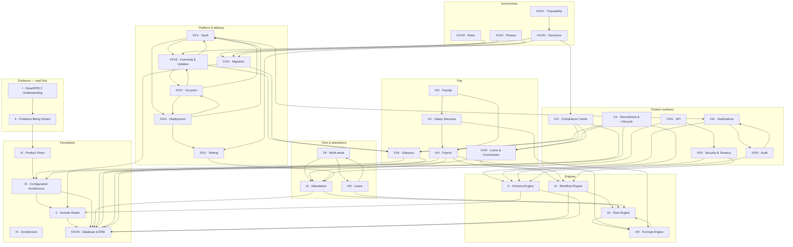

# PART XXXV — REQUIREMENT TRACEABILITY MATRIX

Status: DRAFT FOR PRODUCT OWNER APPROVAL
Owner: Ametecs India Private Limited
Conforms to: `SPINE.md` S20 (blueprint conventions — *"trace every requirement to its
origin: the master brief section, the SmartPRS 2 defect, or both"*).
Satisfies: governing-brief **Section 126**, which demands traceability of the form
`business requirement → SmartPRS 2 reference → SmartPRS 2 defect (if any) → SmartPRS 3
requirement → architecture component → database → API → rule → test → release`.

Evidence base: all thirty-four preceding parts under `/blueprint/docs/` (77,979 lines)
and the fourteen as-is forensic analyses under `/blueprint/analysis/` (1,881,056 bytes).

---

## XXXV.0 Purpose, method, and what this part cannot do

This part is an **index, not a design**. It decides nothing. Its single job is to let a
reader answer four questions without reading seventy thousand lines:

1. Did the blueprint answer every section of the governing brief, and where?
2. Which SmartPRS 2 defect does a given SmartPRS 3 requirement exist to fix?
3. Which capability of the platform is speculative — that is, answers no evidenced need?
4. What is still missing, unanswered, or self-contradictory?

### XXXV.0.1 Method

Every cell in every matrix below was produced by mechanical extraction over the corpus —
regular-expression indexing of requirement identifiers, brief-section citations, defect
identifiers, law citations and inter-part references — and then verified by reading the
cited line. **No mapping in this part was inferred from plausibility.** Where extraction
found nothing, the cell reads **NOT ESTABLISHED** and says why. That is the honest state
of the corpus, and it is more useful to the Product Owner than a matrix with no empty
cells.

Counts that follow are reproducible. The corpus contains **3,254 numbered requirements**
across 33 requirement-bearing parts, **100 marked PRODUCT OWNER DECISION REQUIRED**
blocks, **494 distinct defect identifiers** in the fourteen analyses, and **235
citations of a governing-brief section number** across the parts.
### XXXV.0.2 The source of the section titles, and the one thing this part still cannot do

The governing brief is not a file in this repository; it exists in the conversation that
commissioned the blueprint. Its **131 section titles were supplied to this part by the
blueprint coordinator as an authoritative list**, and every row of §XXXV.1 is assessed
against that list. The subject column is therefore the brief's own wording, not a
reconstruction.

What is still not available is the brief's **section bodies**. A title says what a section
is about; it does not say how much it demanded. So a verdict of FULL below means *"a part
specifies this subject to the Section 123 and Section 125 standards"* — it cannot mean
*"every clause of the brief's text for this section is answered"*, because that text is not
here to check against.

Two consequences, stated once:

- **FULL is a floor, not a ceiling.** A section marked FULL is demonstrably specified. It
  may still under-serve a specific demand inside the brief's prose.
- **GAP is reliable.** Where a subject is absent from all 34 parts — verified by grep, not
  by absence of citation — that is an evidenced absence and does not depend on the brief's
  wording at all. All seven GAP rows below are of this kind.

**R-XXXV-001** The governing brief's full text MUST be committed to the repository as
`/blueprint/GOVERNING-BRIEF.md` before Product Owner sign-off, and each FULL row in §XXXV.1
re-checked clause by clause against its section body. Titles establish subject coverage;
only the text establishes requirement coverage.

---

## XXXV.1 Governing-brief coverage matrix — Sections 1 to 131

Assessed against the coordinator-supplied authoritative title list. **Every one of the 131
sections carries a verdict; none reads NOT ESTABLISHED.**

Legend.
**FULL** — a part specifies the subject to the Section 123 (tables) and Section 125
(modules) standards · **PARTIAL** — addressed, but an element is unowned, undeferred or
unspecified · **DIRECTIVE** — an instruction about how to work rather than a product
requirement; the row says how it was satisfied · **GAP** — evidenced absence from all
thirty-four parts, verified by content grep.

> **Appendix status, verified against the files, not against their commissioning.**
> `37-APPENDIX-B-reporting-ui-documentation.md` (3,856 lines, `R-B-001`…`216` contiguous,
> 26 tables, 88 `T-B-*` tests, 11 decisions) and
> `38-APPENDIX-C-overtime-engine.md` (2,267 lines, `R-C-001`…`115` contiguous, 8 tables,
> 30 tests, 11 decisions) both exist and were read. **All nine sections they were
> commissioned to close are closed** — 57, 76, 77, 94, 99, 117, 118, 119 by Appendix B;
> 31 by Appendix C. `R-XXXV-023` required this matrix to record the difference between
> what each appendix was commissioned for and what it delivers; that difference is
> recorded at §XXXV.8.1 and is **five residual items, none of them a section-level gap**.
> `R-XXXV-028` was verified independently rather than accepted on assertion — see the
> Section 31 row.

### XXXV.1.1 Sections 1–14 — reference discipline, philosophy, architecture, employee data

| § | Subject | Part(s) | Reference | Verdict |
|---|---|---|---|---|
| 1 | Mandatory reference material | I, II + all | The fourteen as-is analyses with `file.php:line` citations; `AUTHOR-BRIEF.md` reading order; every part's *Evidence base* / *Conforms to* header | **DIRECTIVE — SATISFIED.** Author-brief hard rule: *"every claim about SmartPRS 2 must trace to one of them. Do not invent SmartPRS 2 behaviour."* Enforced by `R-XXXV-020` |
| 2 | Non-negotiable product philosophy | III, spine | §III.2 the central thesis; §III.3 **the twenty non-negotiable product attributes**; spine S0 (*the PHP codebase is a platform; the product is configuration running on it*) | **FULL** |
| 3 | Absolutely no runtime database schema creation | XXVIII, X, spine | Spine S1 **Law 2**; Part XXVIII §XXVIII.2 `R-XXVIII-001` — DDL forbidden outside `database/migrations`, enforced by CI grep **and** by a production DB user holding `SELECT, INSERT, UPDATE, DELETE` only; Part X §X (custom fields never create columns) | **FULL.** The most strongly enforced requirement in the corpus — three independent mechanisms |
| 4 | Proposed core architecture | IV, spine | Part IV in full; spine S2 (Laravel modular monolith, one artefact, UUIDv7 public ids, mandatory queue and scheduler, one SPA against `/api/v3`) | **FULL**, subject to `T1-01`/spine `D-01` (platform) and `D-02` (SPA framework) being answered |
| 5 | Tenancy and organisation hierarchy | V, XXII, spine | Spine S3 (the typed `org_units` tree, orthogonal classification dimensions, S3.1 Scope, S3.2 precedence weights); Part V; Part XXII §§XXII.3, XXII.5; spine **Law 6** | **FULL** |
| 6 | Effective-dated configuration | VI, XIV, XXX | Spine S4, S11; Part XIV §XIV.4 (the input snapshot); Part XXX `AT-045` — *policy V2 published in October, August still resolves V1* | **FULL** |
| 7 | The universal rule engine | VII, VI | Part VII in full; spine S6; the six required tools (builder, expression view, simulator, conflict detector, impact preview, regression harness) at §VII.6 and §VI.8 | **FULL** |
| 8 | Formula / calculation engine | VIII | Part VIII in full; spine S7; integer-paise `Money`, declared rounding, `ALLOCATE`, dependency graph with cycle rejection | **FULL** |
| 9 | Calculation explainability | all derived-value parts | Spine S15 + **Law 4**; `DecisionTrace` (VII §9), `CalculationTrace` (VIII), §XIV.6, §XV.5, §XVI.2.3, §XVIII.14; `T-XVI-07` — a payslip with a missing trace fails `RC-13` and **aborts the run** | **FULL** |
| 10 | Employee master / dynamic employee schema engine | X | §X.2 the field definition model; §X.2.1 every attribute, and where it lives | **FULL** |
| 11 | One employee data model for every surface | X | §X.4.2 the thirteen-surface matrix and its resolution | **FULL** |
| 12 | Self-onboarding | X, XX | Part X header; Part XX §XX.2 | **FULL** |
| 13 | Bulk import / export engine | X | §X.6; unknown columns **reported, never silently dropped** | **FULL** |
| 14 | Document management | X, XX, XXII | §X.2.6 (PII, encryption, masking, retention); §XXII.6 (signed, expiring URLs; nothing private on a public disk) | **FULL** |

### XXXV.1.2 Sections 15–26 — attendance, biometrics, time

| § | Subject | Part(s) | Reference | Verdict |
|---|---|---|---|---|
| 15 | Biometric / attendance integration architecture | XI | §XI.3 The Device Adapter SDK; spine S10.1 | **FULL** |
| 16 | Biometric management console | XI | §XI.7 | **FULL** |
| 17 | Attendance raw data principle | XI | §XI.2 the four-layer architecture; spine S10 (`punch_events` append-only, never updated, never deleted) | **FULL** |
| 18 | Shift master | XI | §XI.8 | **FULL** |
| 19 | Roster management | XI | §XI.9 | **FULL** |
| 20 | Weekly-off engine | XII | §XII.3.2 — every pattern in the brief expressed in the grammar; `NTH_WEEKDAY` replaces `ceil(day/7)` | **FULL** |
| 21 | Holiday engine | XII | §XII.5 — every item with its reader; scope-honoured holidays; a failed holiday lookup flags **nobody** absent | **FULL** |
| 22 | Universal work-time policy engine | XI | §XI.10 | **FULL** |
| 23 | Late login rules | XI | §XI.10 (the WT rule set); §VI.16 127.1 (the occurrence-indexed late rule); grace applied before measurement | **FULL** |
| 24 | Late logout / extra work settlement | XI | §XI.11 The Time Settlement Engine; `WT-04` — late logout becomes approved overtime, not an accident | **FULL** |
| 25 | Absent detection | XI | §XI.12 | **FULL** |
| 26 | Attendance regularisation | XI | §XI.13 | **FULL** |

### XXXV.1.3 Sections 27–38 — leave, overtime, salary, payroll, payslip

| § | Subject | Part(s) | Reference | Verdict |
|---|---|---|---|---|
| 27 | Leave engine | XIII | §XIII.2 the Leave Type master, and Part XIII in full | **FULL** |
| 28 | Half day / hourly leave | XIII | §XIII.8 | **FULL** |
| 29 | Sandwich leave engine | XIII | §XIII.9 the Leave Adjacency Policy — eight policies, eight exact outcomes from identical input | **FULL** |
| 30 | Comp-off engine | XIII | §XIII.10 | **FULL** |
| 31 | Overtime engine | **Appendix C**, XI, XIV, XV, VII, XII, XIII | **Appendix C owns it in full**: §C.3 the policy artefact · §C.4 eligibility · §C.5 qualifying conditions · §C.6 the rate model and its two configurable divisors · §C.7 rounding, minimum block and caps · §C.8 the comp-off exclusivity invariant `INV-C-01` · §C.9 approval through the Part IX engine with no OT-specific approval code · §C.10 the register and payroll integration · §C.12 the trace · §C.17 migration. 115 requirements, 8 tables, 5 worked examples with exact arithmetic | **FULL. `R-XXXV-028` is closed — verified, not accepted.** I read §C.14.2: `cfg_overtime_multipliers` exists with DDL-grade columns, the unique key `(tenant_id, overtime_policy_id, multiplier_code)` that makes `multiplier_ref` resolvable, exact rational factors (`fixed_factor_num`/`_den`, never a float), and `on_missing_context` defaulting to **`error`** so a missing context is never silently 1×. `R-C-002` makes the publish-time symbol validator reject an unresolvable `multiplier_ref`. **`CREATE_OT` is now implementable** |
| 32 | Salary component engine | XV | §XV.2 | **FULL** |
| 33 | Salary structure builder | XV | §XV.3 | **FULL** |
| 34 | Payroll period engine | XIV | §XIV.2 | **FULL** |
| 35 | Proration / LOP | XIV | §XIV.3; the five-divisor defect answered by a declared, resolved basis | **FULL** |
| 36 | Payroll engine pipeline | XIV | §XIV.4; spine S11 (23 staged, restartable, pure steps) | **FULL** |
| 37 | Payroll preview | XIV | §XIV.5 the staged lifecycle and the exception gates | **FULL** |
| 38 | Payslip designer | XVI | Part XVI in full; §XVI.3 the Payslip Template Designer | **FULL** |

### XXXV.1.4 Sections 39–49 — India statutory

| § | Subject | Part(s) | Reference | Verdict |
|---|---|---|---|---|
| 39 | Statutory rule engine | XVII | §XVII.4 The Statutory Rule Pack; spine S12 (signed, separately versioned, Ametecs-published) | **FULL** |
| 40 | India jurisdiction support | XVII | §XVII.5 jurisdiction and applicability; central → state/UT → establishment → company layering | **FULL** |
| 41 | PF | XVII | §XVII.7.1 — heads `PF`, `EPS`, `EDLI`, `PF_ADMIN` | **FULL** |
| 42 | ESI | XVII | §XVII.7.2 — head `ESI` | **FULL** |
| 43 | Professional tax | XVII | §XVII.7.3 — head `PT` | **FULL** |
| 44 | Labour welfare fund | XVII | §XVII.7.4 — head `LWF` | **FULL** |
| 45 | TDS / income tax | XVII | §XVII.7.5 — head `TDS`; the §87A cliff defect (`F/DEFECT-F-06`) answered | **FULL** |
| 46 | Minimum wages | XVII | §XVII.7.6 — head `MIN_WAGE`, a comparison and not a deduction | **FULL** |
| 47 | Gratuity | XVII | §XVII.7.7 — head `GRATUITY`; four disagreeing implementations replaced by one formula | **FULL** |
| 48 | Bonus | XVII | §XVII.7.8 — head `BONUS` | **FULL** |
| 49 | Maternity / statutory leave | XVII, XIII | §XVII.7.9 — head `LEAVE_STATUTORY`; §XIII.11; the mechanism that makes protected leave work without a separate engine | **FULL** |

> **Legal-values caveat.** Every value in 41–48 is either recorded as *"the value SmartPRS 2's
> code currently uses"* or left as a `<from rule pack>` placeholder (spine S12). FULL here
> means *the mechanism is specified*, never *the rate is correct*. Verification against
> primary statutory sources is spine `D-03` / `T1-02`, unanswered — §XXXV.8.3.

### XXXV.1.5 Sections 50–60 — money movement, workflow, forms, communications

| § | Subject | Part(s) | Reference | Verdict |
|---|---|---|---|---|
| 50 | Loans | XVIII | §XVIII.3; balance is `SUM(ledger)`, never a stored mutable column | **FULL** |
| 51 | Salary advances | XVIII | §XVIII.4 | **FULL** |
| 52 | Commission engine | XVIII | §XVIII.6 The Commission Scheme Builder | **FULL** |
| 53 | Incentive engine | XVIII | §XVIII.7 | **FULL** |
| 54 | Reimbursements / expenses | XVIII | §XVIII.8 | **FULL** |
| 55 | **Workflow engine** | IX | Part IX in full: §IX.3 the definition model and versioning · §IX.4 the node catalogue · §IX.5 participant resolution · §IX.6 instance semantics (a decided step is **immutable**) · §IX.7 SLA, reminders, escalation · §IX.9 amount- and condition-based routing · §IX.11 the unified inbox. Spine S8: *one engine, zero module-specific approval code anywhere* | **FULL.** Part IX cites only Section 56 in its text, but it is the complete specification of Section 55 |
| 56 | Maker checker | IX | §IX.8.2 the eleven-operation list, applied; `R-IX-069`–`076`, `R-IX-096`; segregation requires a distinct actor **and** no common role; `auto_approve_with_reason` refused by the validator on these workflows; test `T-43` | **FULL** |
| 57 | Custom form builder | **Appendix B §B.3** | `R-B-084`…`105`: the form definition artefact, layout and conditional visibility, the request lifecycle, a **closed** completion-action catalogue of ten, five worked forms, reporting and export from a form, permissions, API, events, edge cases, tests and data model. Composes Part X for fields, Part IX for routing, Part XIX for delivery — it introduces no second mechanism (`R-B-002`) | **FULL — specified, not deferred.** One residual, and Appendix B states it itself rather than hiding it: a tenant-created form implies tenant-created permission codes, and Part XXII's catalogue is closed (`R-XXII-010`). That is a genuine part-to-part conflict, carried as `D-B-06` — see §XXXV.8.5 |
| 58 | Template engine | XIX | §XIX.2 | **FULL** |
| 59 | Notification automation engine | XIX | §XIX.3, including calendar-driven automation; the forty-five hard-coded literals all become configuration | **FULL** |
| 60 | Email template builder | XIX | §XIX.5 | **FULL** |

### XXXV.1.6 Sections 61–68 — recruitment and employee lifecycle

| § | Subject | Part(s) | Reference | Verdict |
|---|---|---|---|---|
| 61 | Recruitment / ATS | XX | §XX.2 | **FULL** |
| 62 | Offer / NDA / letter engine | XX | §XX.4; `NEW-DOC-104` — a signed artefact is a rendered, hashed, immutable capture, never a template pointer | **FULL** |
| 63 | Probation / confirmation | XX | §XX.5 | **FULL** |
| 64 | Increment / promotion | XX | §XX.6 | **FULL** |
| 65 | Transfer | XX | §XX.7 | **FULL** |
| 66 | Resignation / exit / full & final | XX | §XX.8; F&F is Section 56 maker-checker operation 9 | **FULL** |
| 67 | ESS | XX | §XX.9; the subject is resolved from the session, never from the request (spine S13) | **FULL** |
| 68 | Manager self service | XX | §XX.10 | **FULL** |

### XXXV.1.7 Sections 69–81 — security, audit, reporting, compliance, packaging

| § | Subject | Part(s) | Reference | Verdict |
|---|---|---|---|---|
| 69 | Role & permission system | XXII | §XXII.2; permission and scope are **orthogonal** (spine S13) | **FULL** |
| 70 | Data-level security | XXII | §XXII.3 the data-scope model | **FULL** |
| 71 | Tenant isolation | XXII | §XXII.3, §XXII.5; spine **Law 6**; generated per-aggregate isolation suite (§XXX.7.3) | **FULL** |
| 72 | Sensitive data security | XXII | §XXII.6; application-layer encryption, role masking, audited access | **FULL** |
| 73 | Authentication | XXII | §XXII.7; MFA mandatory for privileged roles; no default credential ships anywhere | **FULL** |
| 74 | Audit ledger | XXIII | Part XXIII in full; §XXIII.4.2 extends the brief's set and marks every `[GAP]` unaudited today; `R-XXIII-004` makes `prev_hash`/`hash` `NOT NULL` | **FULL** |
| 75 | Data history / effective-dated employee changes | XXIII, X | §XXIII.6 (history versus audit — they are different mechanisms); §X.4 effective-dated assignments; spine **Law 3** | **FULL** |
| 76 | Custom report builder | **Appendix B §B.1** | `R-B-003`…`056`: the three-layer model, the dataset model with a 24-entry catalogue, the report definition artefact, saved/shared/scheduled reports, execution budgets and asynchrony, export formats, explainability, statutory registers as report definitions, the migration of fourteen SmartPRS 2 reports, API, events, edge cases, tests and eleven tables. **The five `H/DEFECT-RPT-*` defects are resolved** at `R-B-049`, `R-B-051` and §B.1.12 | **FULL.** The finding that mattered most is answered directly: **`R-B-045` runs a report with the requester's permissions and scope, never the author's**, and the dataset compiler injects `tenant_id` and the scope predicate so a definition can neither express an undeclared join nor suppress either predicate. Phase 8 is now costable |
| 77 | Dashboard builder | **Appendix B §B.2**, XXI, XXXI | `R-B-057`…`083`: widget-as-bounded-query-over-a-declared-dataset, the presentation vocabulary, scoping/refresh/caching/staleness, personal dashboards, the drill-through contract, the brief's worked examples with dataset-threshold-action, API, events and data model. §B.2.2 **adopts Part XXI's widget model (`R-XXI-119`…`127`) unchanged** rather than defining a second one; §XXI.11 and §XXXI.6.7 stand | **FULL.** Every widget is evaluated in the **viewer's** scope with the scope hash inside the cache key — the correct answer to the cross-tenant cache-poisoning failure mode this feature normally introduces |
| 78 | Compliance command centre | XXI | §XXI.2; §XXI.5 one definition of validity; §XXI.6 the compliance-to-money gate generalised | **FULL** |
| 79 | Recovery / collection industry features | XXI | §XXI.8 — DRA, PCC, BGV, agent authorisation, off-roll agents, the RBI audit pack | **FULL** |
| 80 | Feature / module configuration | XXI, VI | §XXI.9; §VI.14 — one `EntitlementSet`, five identical enforcement points (`R-VI-131`) | **FULL** |
| 81 | Module marketplace / pack concept | XXI | §XXI.10 | **FULL** |

### XXXV.1.8 Sections 82–93 — API, integration, deployment, operations

| § | Subject | Part(s) | Reference | Verdict |
|---|---|---|---|---|
| 82 | API-first | XXIV | §XXIV.2; the SPA runs against `/api/v3` exclusively, so the public API is proven by the product's own UI | **FULL** |
| 83 | Webhook engine | XXIV | §XXIV.4; HMAC over raw body **plus timestamp and nonce**, freshness window, replay rejection, DLQ | **FULL** |
| 84 | Integration framework | XXIV | §XXIV.5; connector recipes; egress allow-list blocking loopback and private ranges | **FULL** |
| 85 | SmartEPT integration | XXIV | §XXIV.7 | **FULL** |
| 86 | Smart Biometric Bridge | XXIV, XI | §XXIV.8; §XI.3.7 the SBB boundary — no shared tables between products, ever | **FULL** |
| 87 | Cloud and on-premise parity | XXV, XXVI, IV | Part XXV (cloud), Part XXVI (on-prem); spine S18 — no `if (on_prem)` in a domain path | **FULL** |
| 88 | On-premise installation | XXVI | §XXVI.5; the installer refuses to complete without scheduler, queue and a passing health check, and creates the first administrator interactively | **FULL** |
| 89 | On-premise update system | XXVII | §XXVII.4; signed updates, DB and code backup, rollback on failure, all audited | **FULL** |
| 90 | Configuration / rule pack updates | XXVII, XVII | §XXVII.5; §XVII.12; rule-pack updates are **separate from application updates** and require no deployment | **FULL** |
| 91 | Backup & disaster recovery | XXVI | §XXVI.8; a **tested restore path** whose last successful test date is visible in the UI | **FULL** |
| 92 | Background job reliability | XXVI, XXXI, XIX | §XXVI.9; Part XXXI; §XIX.7 | **FULL** |
| 93 | Observability | XXXI, XIX | §XXXI.6; §XIX.7 | **FULL** |

### XXXV.1.9 Sections 94–99 — localisation, time, data lifecycle, scale, UI

| § | Subject | Part(s) | Reference | Verdict |
|---|---|---|---|---|
| 94 | Multi-language / localisation | **Appendix B §B.5** | `R-B-156`…`191`: no user-facing string in business logic, the message catalogue and its workflow, locales/scripts/formatting/money-in-words, locale resolution, timezone resolution, per-tenant scheduled work firing at local hour, the storage rule, cross-midnight determinism, and what is **deliberately not** localised. `R-XXXV-025`'s hard condition is met: **`R-B-174` puts the locale dimension on the template model from v3.0** whether or not a second language ships | **FULL.** `D-B-09` scopes the GA language commitment (`en-IN` at GA with the machinery proven by a second locale in staging); that is a scoping decision, not a specification gap |
| 95 | Timezone | XI, XXVIII, spine | Spine S16 — instants are `DATETIME` in UTC with an accompanying business timezone and business date, never `VARCHAR`; spine S10.1 `timeAssumption(): naive-local \| offset-authoritative \| named-zone`; Part XI resolves `C/DEF-C-04` (5½-hour silent corruption on four of six machine paths); Part XXVIII conventions. Addressed in 26 of 35 files | **FULL** |
| 96 | Data deletion / archiving | X, XIV, XV, IX, VII, spine | Spine S16 — business and evidentiary records are never hard-deleted; every entity carries a declared **retention class**; archival, anonymisation and purge are scheduled, audited operations. §X.2.6, §XIV.8.10, §XV.7.7, §IX.18.3, §VII.9.4 | **FULL** in mechanism. The retention **values** are blocked on `T1-11`; deletion-demand semantics on `T1-12` |
| 97 | Soft delete / referential integrity | XXVIII, spine | Spine S16 — foreign keys on every relationship with declared `ON DELETE`; every business-unique combination has a database constraint with `tenant_id` participating. Part XXVIII §XXVIII.2 states these as enforceable rules each carrying its CI or runtime enforcement, and §XXVIII.3 as table archetypes. *Replaces SmartPRS 2's zero foreign keys on business tables and its admin endpoint whose job is sweeping the resulting orphans* | **FULL** |
| 98 | Performance / scale | XXX, XXXI, XXV, XXVIII | §XXX.9 performance tests, §XXX.9.1 seeded scale tenants, §XXX.9.4 soak and failure-mode; §XXXI.9 capacity planning, §XXXI.9.2 the scale model, §XXXI.9.3 performance budgets; §XXV.12 scale and multi-tenancy operations; §XXVIII.8 **the ten query shapes that decide whether the product is usable at 10,000 employees** | **FULL** |
| 99 | UI / UX | **Appendix B §B.4** | `R-B-106`…`155`: one front end, the metadata-driven rendering model, the registered-component escape hatch, **server-computed navigation and permission** (`ui_screens` rows carry a `NOT NULL` permission), routing/state/caching, escaping and XSS defence as a framework property, responsive and mobile, **accessibility as a named standard with a conformance level and tests** (`R-B-145`…`148`, `D-B-08`: WCAG 2.2 AA, recommended at GA), the design system and component-inventory requirement, states, API, events, migration, edge cases, tests and data model. §B.4 also extends the Law 1 literal ban **to the client**, where SmartPRS 2's worst literals live (`AppController.php:11160-11166`) | **FULL for architecture, with one residual deliverable stated by Appendix B itself (§B.11 item 1): the design system's actual tokens, component inventory and interaction patterns are a *design* deliverable that `R-B-149` names and does not produce.** Scored FULL because the specification meets the Section 123/125 standards and the residual is a project deliverable, not an unspecified subject — but the judgement is stated openly here so the Product Owner may disagree with it. Accessibility is no longer unmentioned; it is a decision with a recommended level |

### XXXV.1.10 Sections 100–108 — the configuration surface

| § | Subject | Part(s) | Reference | Verdict |
|---|---|---|---|---|
| 100 | Configuration studio | VI | §VI.6 | **FULL** |
| 101 | Configuration wizard | VI | §VI.7 | **FULL** |
| 102 | Sandbox / simulator | VI | §VI.8 | **FULL** |
| 103 | Configuration validation | VI | §VI.9; `R-VI-080` — a named, numbered catalogue with declared run points | **FULL** |
| 104 | Draft / publish model | VI, spine | Spine S4; **Part VI §VI.3 The universal artefact lifecycle** — §VI.3.1 the state machine (`draft → testing → pending_approval → published → superseded → archived`), §VI.3.2 the transition table, §VI.3.3 in-flight dependents, §VI.3.4 effective date versus publication date, §VI.3.5 emergency rollback; §VI.2.2 who may author, approve and publish | **FULL.** Part VI covers this at §VI.3 without citing the section number — which is why the earlier draft of this matrix wrongly recorded 104 as the one missing number in the run |
| 105 | Configuration diff | VI | §VI.10; `R-VI-090`, `R-VI-092` — impact preview minimum content, and estimates must state their method | **FULL** |
| 106 | Import / export configuration | VI | §VI.11; `R-VI-100` package definition and manifest | **FULL** |
| 107 | Customer policy pack | VI | §VI.12; `R-VI-062`, `R-VI-078` — packs pre-populate Wizard steps and ship their own regression cases | **FULL** |
| 108 | Statutory pack vs company policy | VI, XVII | §VI.13; §XVII.8; a company policy may improve on the statutory minimum, never reduce it, and the validator blocks or warns by declared severity | **FULL** |

### XXXV.1.11 Sections 109–116 — migration and testing

| § | Subject | Part(s) | Reference | Verdict |
|---|---|---|---|---|
| 109 | Data migration from SmartPRS 2 | XXIX | Part XXIX in full | **FULL** |
| 110 | Migration reconciliation | XXIX | §XXIX.7 — *the brief names seven reconciliations; the analysis implies a further seventeen; all twenty-four are specified* | **FULL** |
| 111 | Testing strategy | XXX | §XXX.2 | **FULL** |
| 112 | Payroll golden tests | XXX, XIV | §XXX.4; §XIV.13.1 — the brief's list is the **floor** | **FULL** |
| 113 | Attendance golden tests | XXX, XI | §XXX.5; §XI.21 — the brief's list is the **floor** | **FULL** |
| 114 | Rule engine golden tests | XXX | §XXX.6, including `RE-024` | **FULL** |
| 115 | Security tests | XXX, XXII | §XXX.7 (fail-closed fault injection, generated authorisation matrix, generated cross-tenant suite); §XXII.14 | **FULL** |
| 116 | Acceptance principle | XXX, XXXII | §XXX.10 the definition of done — a named reviewer signs, per module, per release, with an **evidence column**; Part XXXII restates it as an auditable checklist; `R-XXX-028` | **FULL** |

### XXXV.1.12 Sections 117–121 — documentation and phasing

| § | Subject | Part(s) | Reference | Verdict |
|---|---|---|---|---|
| 117 | Documentation required | **Appendix B §B.6.3** | `R-B-195`…`196` and its document table: the technical documentation set is **built from the repository on every release**, published as one versioned site with prior versions retained for on-prem customers running behind, and every document classified `generated` or `written` with **generated maximised, because generated documentation cannot go stale and written documentation always does** | **FULL** |
| 118 | Customer admin documentation | **Appendix B §B.6.4** | The customer administrator manual set — the deliverable that makes the configuration thesis operable by the person the thesis depends on. `D-B-10` settles whether a tenant may override product help text (recommended: yes, as an override with the vendor original visible and restorable) | **FULL.** The finding this closes was that *"a configuration-first product with no configuration manual is a code-first product with extra steps"*; Appendix B quotes it back and answers it |
| 119 | Developer extension documentation | **Appendix B §B.6.5** | The developer extension guides, covering the `DeviceAdapter` and connector-recipe extension points that exist in v3.0 whether or not the partner SDK (`D-VI-03`) ships | **FULL** |
| 120 | What must not be done | all | Every module part carries a *"What SmartPRS 3 explicitly does not replicate"* section — §XI.1.11, §XII.1.8, §XVI.1.7 and equivalents; spine S1's seven laws are stated as prohibitions; author-brief hard rule 5: *"where SmartPRS 2 is defective, do not replicate the defect, and say explicitly that you are not"* | **DIRECTIVE — SATISFIED** |
| 121 | Priority implementation phases | XXXII | Part XXXII — phased scope with named exit criteria; `R-XXXII-001`–`009`; Phase 8 named for reports, dashboards and automation | **FULL**, with the caveat that Phase 8's scope rests on Sections 76, 77 and 99, three of which are GAP or PARTIAL — so Phase 8 is sequenced but **not costable** |

### XXXV.1.13 Sections 122–131 — the working directives and the deliverable standard

| § | Subject | Part(s) | Reference | Verdict |
|---|---|---|---|---|
| 122 | Do not start coding immediately | IV | Part IV §IV.0 (04:34) states the instruction and the reason: *architecture was never the unit of decision* in SmartPRS 2 | **DIRECTIVE — SATISFIED.** No code exists. Thirty-five parts plus a spine precede the first line of PHP; Part XXXII begins implementation only after sign-off |
| 123 | Required database design output | 18 parts | 23 citations; every data-model section declares conformance; Part XXVIII owns the conventions and states each as an enforceable rule with its CI or runtime enforcement | **FULL** |
| 124 | **Required business rule documentation** | VII, I, II + module parts | Part VII §12 is a worked rule library; Parts I and II inventory ~950 business rules (566 `BR-*` carried from the reference catalogue plus 382 `NEW-*` the catalogue never recorded); every module part documents its own rules in its own section | **PARTIAL.** The rules are *documented* but **not as a deliverable artefact**. The ~950-rule inventory lives in the fourteen analyses, not in a maintained blueprint document with one row per rule carrying id, statement, scope, evidence, SmartPRS 3 disposition and owning part. Section 124 asks for an output; the corpus produces the content by distribution and never assembles it. **Neither appendix closes this** — Appendix B §B.0.1 says so explicitly. See §XXXV.8.2 GAP 7 |
| 125 | Required module specification | all module parts, **Appendix C §C.23.3** | The twenty-four-point standard, carried through spine S20 | **PARTIAL, and materially improved.** The *reports* point is no longer thin — Section 76 is specified and §B.1.11 makes statutory registers report definitions. The *screens* point is **unblocked but not done**: §B.4 gives `ui_screens` as the single inventory with a mandatory permission, and §B.11 item 2 states plainly that populating it for 146 screens *"is each module part's responsibility… this appendix removes the reason it was thin; it does not do the work."* **Appendix C §C.23.3 is the first and only twenty-four-point conformance table in the corpus** — `R-XXXV-016`'s required form now has a worked template. Thirty-four parts still lack one |
| 126 | Required traceability | XXXV | This part | **FULL** — with the section-body limitation at §XXXV.0.2 and the release-tail limitation at `R-XXXV-022` |
| 127 | Definition of "fully customizable" | VI + 25 others | §VI.16 works all twelve examples as fourteen rows; §XXXV.6 indexes them to owning part and artefact | **PARTIAL.** The **demonstration** is FULL and precise. The **proof** is not: eleven of fourteen rows have no individual acceptance-test identifier. `R-XXXV-009` |
| 128 | Platform extensibility limit | VI, III | §VI.15; Part III (03:215); `R-VI-140` the extensibility principle and its field test, `R-VI-141` extensions are Ametecs-authored, versioned and signed | **FULL** |
| 129 | Final business objective | III | §III.1 the vision statement · §III.2 the central thesis · §III.6 the commercial thesis · §III.9 what success looks like · §III.10 what is explicitly out of scope for v3.0 · §III.11 the relationship to the rest of the Ametecs ecosystem | **FULL** |
| 130 | Final quality bar | XXX, XXXII | §XXX.10 — *a module is not done when it works, but when it is configurable, permissioned, isolated, audited, historical, notified, importable, effective-dated, tested, documented and correct when it fails*, signed per module per release with evidence; Part XXXII restates it as an auditable checklist | **FULL.** *Note:* Part XXX cites this section as **116**. Sections 116 and 130 are served by the same specification. That is defensible — an acceptance principle and a quality bar are the same checklist read twice — but it should be stated deliberately rather than by accident |
| 131 | First response required from you | the blueprint itself | The delivered response is `SPINE.md`, thirty-five numbered parts, Appendix A, `CONSOLIDATED-REQUIREMENTS.md` and `CONSOLIDATED-DECISIONS.md` — 3,254 numbered requirements and 100 marked Product Owner decisions, produced before any code | **DIRECTIVE — SATISFIED in substance.** The section's *specific* demands (format, length, ordering of the first response) are in the brief's body, which is not in the repository, so exact conformance is checkable only under `R-XXXV-001` |

### XXXV.1.14 Coverage summary

| Verdict | Count | Sections |
|---|---|---|
| **FULL** | **124** | 2–30, **31**, 32–56, **57**, 58–75, **76**, **77**, 78–98, **99**, 100–116, **117**, **118**, **119**, 121, 123, 126, 128, 129, 130 |
| **PARTIAL** | **3** | **124** (rules documented, never assembled) · **125** (no part carries the conformance table; Appendix C is the only worked example) · **127** (demonstrated in full, but eleven of fourteen cases have no test id) |
| **GAP — evidenced absence** | **0** | — |
| **DIRECTIVE — satisfied** | 4 | 1, 120, 122, 131 |

### Movement since the previous generation of this matrix

| | Before appendices | After | Moved by |
|---|---|---|---|
| FULL | 115 | **124** | Appendix B closed 8 · Appendix C closed 1 |
| PARTIAL | 5 | **3** | 31 and 77 promoted to FULL |
| GAP | 7 | **0** | all seven closed by Appendix B |

**Read this as it stands.** **There is no longer a governing-brief section with no owning
specification.** 124 of 131 are fully specified, three are partial and each names exactly
what is outstanding, and four are working directives that were satisfied. That is a real
change of state, and it should be read alongside the two things it does *not* mean:

1. **FULL remains subject-level, not clause-level** (§XXXV.0.2). The brief's section
   bodies are still not in the repository.
2. **Closing a gap creates work elsewhere.** The two appendices add 331 requirements, 34
   tables, 22 Product Owner decisions and 27 cross-part reconciliation items to a corpus
   whose table catalogue, decision register and permission catalogue do not yet contain
   them. §XXXV.8.6 carries that debt; it is not free, and it is not hidden.

**R-XXXV-023** *(satisfied, and retained as a standing rule.)* This matrix was regenerated
against both appendices as delivered, not as commissioned; the difference between the two
is recorded at §XXXV.8.1. The rule stands for any future appendix: **assess the file, never
the commissioning.**

## XXXV.2 Blueprint part → requirement count index

Every requirement identifier in the corpus was extracted and grouped by its part prefix.
"Own-prefix" counts exclude cross-references to other parts' requirements.

| Part | Title | Prefix | Count | ID range | Contiguous? |
|---|---|---|---|---|---|
| I | SmartPRS 2 Understanding | `R-I-` | 24 | 001–024 | **Yes** |
| II | Problems Being Solved | `R-II-` | 30 | 001–112 | No — blocked |
| III | Product Vision | `R-III-` | 7 | 001–007 | **Yes** |
| IV | Architecture | `R-IV-` | 13 | 001–013 | **Yes** |
| V | Domain Model | `R-V-` | 35 | 001–091 | No — blocked |
| VI | Configuration Architecture | `R-VI-` | 113 | 001–211 | No — blocked |
| VII | Rule Engine | `R-VII-` | 75 | 001–075 | **Yes** |
| VIII | Formula Engine | `R-VIII-` | 77 | 001–077 | **Yes** |
| IX | Workflow Engine | `R-IX-` | 117 | 001–117 | **Yes** |
| X | Employee Schema Engine | `R-X-` | 120 | 001–120 | **Yes** |
| XI | Attendance & Biometric | `R-XI-` | 128 | 001–128 | **Yes** |
| XII | Work-week, Weekly-off, Holiday | `R-XII-` | 49 | 001–049 | **Yes** |
| XIII | Leave Architecture | `R-XIII-` | 99 | 001–099 | **Yes** |
| XIV | Payroll Architecture | `R-XIV-` | 79 | 001–079 | **Yes** |
| XV | Salary Structure | `R-XV-` | 54 | 001–054 | **Yes** |
| XVI | Payslip Architecture | `R-XVI-` | 80 | 001–080 | **Yes** |
| XVII | India Statutory | `R-XVII-` | 176 | 001–176 | **Yes** |
| XVIII | Loans, Advances, Commission, Incentives | `R-XVIII-` | 174 | 001–174 | **Yes** |
| XIX | Notifications & Automation | `R-XIX-` | 138 | 001–138 | **Yes** |
| XX | Recruitment & Employee Lifecycle | `R-XX-` | 177 | 001–177 | **Yes** |
| XXI | Compliance Command Centre | `R-XXI-` | 136 | 001–136 | **Yes** |
| XXII | Roles, Security, Tenancy | `R-XXII-` | 239 | 001–317 | No — blocked |
| XXIII | Audit | `R-XXIII-` | 114 | 001–114 | **Yes** |
| XXIV | API & Integration | `R-XXIV-` | 214 | 001–214 | **Yes** |
| XXV | SaaS Architecture | `R-XXV-` | 128 | 001–161 | No — blocked |
| XXVI | On-Premise Architecture | `R-XXVI-` | 94 | 001–201 | No — blocked |
| XXVII | Licensing & Updates | `R-XXVII-` | 144 | 001–161 | No — blocked |
| XXVIII | Database Architecture & ERD | `R-XXVIII-` | 53 | 001–112 | No — blocked |
| XXIX | Migration from SmartPRS 2 | `R-XXIX-` | 154 | 001–154 | **Yes** |
| XXX | Testing | `R-XXX-` | 78 | 001–078 | **Yes** |
| XXXI | Deployment | `R-XXXI-` | 120 | 001–134 | No — blocked |
| XXXII | Implementation Phases | `R-XXXII-` | 9 | 001–009 | **Yes** |
| XXXIII | Risks | `R-XXXIII-` | 6 | 001–006 | **Yes** |
| XXXIV | Decisions Required | *(none)* | 0 | — | n/a — uses `T1-`/`T2-`/`T3-` and `D-*` identifiers |
| XXXV | Traceability Matrix (this part) | `R-XXXV-` | 34 | 001–034 | **Yes** |
| **App. B** | Reporting, Dashboards, Forms, UI, Localisation, Documentation | `R-B-` | **216** | 001–216 | **Yes** |
| **App. C** | The Overtime Engine | `R-C-` | **115** | 001–115 | **Yes** |

**Total: 3,585 numbered requirements** — 3,254 across the 33 requirement-bearing numbered
parts, 331 across the two appendices, plus this part's 34.

*Both appendices are contiguous from 001 with zero gaps and zero duplicate definitions,
verified by the same extraction that produced the table above. They are the only two
documents in the corpus authored after the block-numbering finding of §XXXV.2.1 was
recorded, and both used dense sequential numbering.*

### XXXV.2.1 Findings on identifier hygiene

**Finding 1 — the "contiguity" claim is not made, and would be false if it were.**
The task brief for this part suggested that several parts claim contiguous requirement
numbering. Grep for `contiguous`, `no gaps` and `sequentially numbered` across the corpus
finds **twelve occurrences, none of which refer to requirement identifiers** — every one
refers to `BANDS` tables, slab tables, amount bands, or payroll periods being contiguous.
**No part claims contiguous requirement numbering.** The nine non-contiguous parts (II, V,
VI, XXII, XXV, XXVI, XXVII, XXVIII, XXXI) use **deliberate block numbering** — reserving
a decade or a hundred per topic, so `R-XXII-060`–`R-XXII-069` is one subject area and
gaps are reserved space, not lost requirements. This is defensible; it is simply
undocumented.

**R-XXXV-002** Each block-numbered part MUST publish its block allocation table (block
range → subject) in its requirements index, so a reader can distinguish reserved space
from an omission. Nine parts require this addition.

**Finding 2 — zero duplicate definitions, zero cross-part collisions.**
716 identifiers appear in more than one definition-position; **every one is a part's own
requirements-index table restating a requirement defined earlier in the same file**. Seven
identifiers appear in two different files — `R-IX-075`, `R-VI-121`, `R-VIII-004`,
`R-VIII-056`, `R-X-048`, `R-XVII-127`, `R-XVIII-146` — and each was read and confirmed to
be a **legitimate cross-reference** (e.g. Part XXI:427 cites `R-XVII-127` for the due-date
rule), not a redefinition. **The requirement namespace is clean.**

**Finding 3 — Part XXXIV carries no `R-` identifiers.**
This is correct by design (it states decisions, not requirements) but it means the corpus
has no requirement identifier for *"the Product Owner has answered T1-nn"*. Traceability
from a requirement to the decision it waits on is therefore one-directional — parts point
at decisions; nothing points back.

**R-XXXV-003** Part XXXIV MUST gain a `blocked_requirements` column on each Tier 1 and
Tier 2 decision, naming the requirement identifiers that cannot be implemented until it is
answered. §XXXV.8.3 below is the initial content of that column.

---

## XXXV.3 SmartPRS 2 defect → SmartPRS 3 resolution matrix

### XXXV.3.1 Method and its one significant weakness

The fourteen analyses carry **494 distinct defect identifiers** across their §6 (defects,
conflicts and technical debt) and §7 (security findings) registers. Extracted severity
distribution:

| Severity | Count |
|---|---|
| CRITICAL | 54 |
| HIGH | 190 |
| MEDIUM | 215 |
| LOW | 72 |
| Not labelled in an extractable cell | 57 |

Every identifier was grepped against the thirty-four blueprint parts. **347 of 494 (70%)
are cited by identifier in at least one part.**

> **The weakness, stated up front.** The fourteen analyses **do not share an identifier
> namespace.** `SEC-01` exists independently in analyses D, E, G and I and means four
> different defects. `D-01`, `C-1` and `S-1` collide similarly. A grep for a short
> identifier therefore returns citations of a *different* defect. Rows below whose
> identifier is ambiguous are marked **[AMB]** and their part column is not to be trusted
> without reading the cited line.

**R-XXXV-004** Before implementation begins, every defect identifier in the fourteen
analyses MUST be re-namespaced by its analysis letter (`A/DEF-P01`, `G/SEC-01`,
`I/SEC-01`), and every citation in the blueprint MUST be updated to the namespaced form.
Without this, the defect-to-requirement trace that Section 126 demands is **not
mechanically verifiable** for approximately one identifier in six.

### XXXV.3.2 CRITICAL defects — all 54, with resolution

Columns: **Defect** (namespaced `analysis/id`) · **What it is** · **Source** ·
**Resolving part(s)** — grep-verified, with the citing line · **Resolving requirement** —
populated only where the citing line itself names one · **Test**.

| Defect | What it is | Source `file.php:line` | Part(s) | Requirement | Test |
|---|---|---|---|---|---|
| `A/DEF-P01` | `/app/data` fabricates twelve months of payroll and permanently blocks the real runs | `AppDataController` (A- §6) | VIII:2907, XIV:1662, XXIX:1033, 4085, 4099 | `R-XXIX-047`, `R-XXIX-061` | Part XXX §XXX.4; Part XXIX reconciliation |
| `A/DEF-P02` | Loans created through the live UI are never recovered, or are recovered forever | A- §6 | VIII:1236, IX:1666, XVIII:17/90/124/381/751, XXVIII, XXIX, XXXIV | `R-XVIII-032`, `R-XXIX-024`, `R-XXIX-078` | Part XVIII §XVIII.17; `T1-18` gates the migration |
| `A/DEF-P03` | `commissions.status` ENUM contains no value the code writes | A- §6 | XIV:1484, XVIII:170/384/3364, XXIX:1076/1578/1826/3023 | `R-XVIII-167`, `R-XXIX-024` | Spine S16 (no DB `ENUM`); Part XXVIII convention test |
| `C/DEF-C-01` | Employee matching scans the whole `emp_code` column before `device_user_id`, so a device PIN can bind to the wrong person | `ETimeOfficeService.php:315-345` | XI:132, 869, 886, 2746 | `R-XI-016`, `R-XI-041`, `R-XI-042` | Part XI §XI.21 identity-strategy goldens |
| `C/DEF-C-02` | Push device identified by serial only; lookup not tenant-scoped, serial not unique | `PushController.php:207` | XI:111, 930 | `R-XI-047` | Part XI §XI.21.3 isolation tests |
| `C/CONF-C-01` | `attendance_pending` is two unrelated features sharing one table name with disjoint schemas | migrations `2026_08_16_000300` vs `2026_08_17_000100` | XI:258, 2517; XXIV:1624; XXIX:116 | `R-XI-071` | Spine S16 (*no table serves two features*); Part XXVIII schema test |
| `C/SEC-C-01` | Unauthenticated punch injection: `POST /iclock/cdata?SN=…` writes into a real tenant's attendance | `routes/web.php:92-94` | XI:111, 929, 2753, 2818 | `R-XI-047` | Part XXX §XXX.7 security suite |
| `C/SEC-C-03` | Cross-tenant device hijack by registering a competitor's serial | `PushController.php:207` | XI:111, 930, 2754 | `R-XI-047` | Part XXX §XXX.7.3 generated cross-tenant suite |
| `D/DEF-01` | Legacy importer destroys 30 of 56 columns of the app's own export and NULLs 6 more | `AppDataController.php:623` | X:141, 1618; XXVII:116 | `R-X-102` | Part X §X.12 import round-trip |
| `D/DEF-02` | Employee-form save is a full-record replace; any omitted key NULLs its column | `AppDataController.php:2846-2941` | V:299, 1327; X:134/278/874/2457; XXV:734; XXVI:225; XXIX | `R-V-015`, `R-X-036`, `R-X-040` | Part X `T-01`; spine S9 PATCH semantics |
| `E/DEF-LVE-02` | **Loss-of-Pay leave is paid** — payroll reads `type_id`, the UI writes only `type_name` | `LeaveController.php:364-378` | XIII:62/66/902/918/1908/1973/2018; XXIX:940 | `R-XIII-006`, `R-XIII-055`, `R-XIII-098` | Part XIII §XIII.21 **P0** — *"the single most important test in this part"* |
| `E/DEF-REQ-01` | `safeRow()` silently discards data via `array_intersect_key`, nine confirmed losses | `AppController.php:3902-3947` | XVIII:18/141/200/349/461/2165/3284/3419 | `R-XVIII-006`, `R-XVIII-124`, `R-XVIII-166` | Part XVIII §XVIII.17 |
| `E/DEF-AUD-01` | **Four code paths break the tamper-evident chain**; `verify()` then resets `$prev` to `GENESIS` at that row | `RequestController.php:1382-1387`, `:1424-1429`, `:1444-1449`, `:1822-1827` | **XXIII — by substance, not by identifier** (§XXIII.1.1 reproduces all four sites) | `R-XXIII-004` (`prev_hash`/`hash` `NOT NULL`) | Part XXIII chain-verification test |
| `E/DEF-AUD-05` | Money-moving commission actions never reach the hash-chained ledger | E- §6 | **XXIII — by substance, not by identifier** (spine S14: every write path goes through the audit service) | `R-XXIII-001`, `R-XXIII-012` | **NOT ESTABLISHED** — no test names commission money-movement audit specifically. See §XXXV.8.2 |
| `E/SEC-01` **[AMB]** | Every request module readable tenant-wide by any authenticated user; no role guard on `RequestController::list()` | `routes/web.php:424` | X:1420, XI:2578, XVIII:1198, XIX:181/267/1216, XX, XXII, XXIII, XXIV, XXVII | `R-X-081` and others | Part XXX §XXX.7.2 generated authorisation matrix |
| `E/SEC-02` **[AMB]** | Any authenticated user can raise any request type for any colleague | `LeaveController.php:296-302` | IX:2252, X:514/1499/2228, XI, XVIII, XX | `R-X-023`, `R-X-090`, `R-X-118` | Spine S13 (*self-service resolves the subject from the session*); §XXX.7 |
| `F/DEFECT-F-01` | Statutory flags written on save with no engine reader | `AppDataController.php:2940-2944` | XVII:120, 3260, 3559, 3937 | `R-XVII-172` | Part XVI `T-XVI-05` (no unread flag printed) |
| `F/DEFECT-F-02` | Statutory conflict (audit-visible) | F- §6 | XVII:121; XXIII:742 | — | Part XXIII §XXIII.4.2 |
| `F/DEFECT-F-03` | Statutory defect | F- §6 | II:256; XVII:122, 2407, 3312 | — | Part XVII §XVII.20 |
| `F/DEFECT-F-04` | Statutory applicability conflict | F- §6 | XVII:125, 620, 1355, 1672, 2636, 3791 | `R-XVII-016`, `R-XVII-017`, `R-XVII-055` | Part XVII §XVII.20 |
| `F/DEFECT-F-06` | **§87A relief is a hard cliff inside `newRegimeTax()`; marginal relief lives in the caller** — Form 24Q contradicts the payslip by up to ₹62,400 | cliff `:1755`, relief `:1836-1840`, raw calls `:1732`, `:1779` | VIII:2858; XVII:124, 1920, 1969, 3771 | `R-VIII-004`, `R-VIII-026`, `R-XVII-085` | Part XXX §XXX.4 payroll goldens; Part VIII §11 FL-18 |
| `F/DEFECT-F-07` | Statutory defect (compliance-visible) | F- §6 | XVII:123/1923/2041/2605/2649/3583/3794/3987; XXI | `R-XVII-091`, `R-XVII-092`, `R-XVII-129` | Part XVII §XVII.20 |
| `F/DEFECT-F-08` | Statutory conflict (compliance-visible) | F- §6 | II:107; XXI:39/92/145/303/1127/1206 | — | Part XXI §XXI.5 (one definition of validity) |
| `F/DEFECT-F-11` | Statutory defect (compliance register) | F- §6 | XVII:2652, 3993; XXI:173/304/413/784/1454/1534 | `R-XXI-059`, `R-XXI-065`, `R-XXI-071` | Part XXI §XXI.4 |
| `G/D-01` **[AMB]** | **`CompanyScope` is inert** — the global scope predicates on `users.company_id`, a column that does not exist | `CompanyScope.php:31-32` | IV:267/349; XXII:17/194/406; XXXIV:99/1229 | `R-XXII-025`, `R-XXII-030`, `R-XXII-111` | Part XXX §XXX.7.3; spine Law 6 |
| `G/D-17` **[AMB]** | Four middleware and two authz helpers fail open, with the comment *"fail open — availability over strictness"* | `ApprovalService.php:377-379` | I:96; XXII:247/409/1458 | `R-XXII-021`, `R-XXII-096`, `R-XXII-111` | Part XXX §XXX.7.1 fail-closed fault injection |
| `G/SEC-01` **[AMB]** | Six fail-open controls: `denyUnlessRole`, `authorizeScreen`, `EditionGuard`, `DemoWriteGuard`, `LicenseGate`, `EnsureSubscriptionActive` | `ApprovalService.php:377-379` | X:1420, XI:2578, XVIII:1198, XIX:181, XX, XXII, XXIII, XXIV, XXVII | `R-X-081` and others | Part XXX §XXX.7.1 |
| `G/SEC-02` **[AMB]** | No route-level authorisation exists anywhere | `routes/web.php:238` | IX:2252, X:514/1499/2228, XI, XVIII, XX, XXIV, XXVII | `R-X-023`, `R-X-090`, `R-X-118` | Part XXX §XXX.7.2 — *every route has an explicit policy binding* |
| `G/SEC-03` **[AMB]** | The permission matrix is a blob any user may overwrite via `POST /app/state` | `AppStateController.php:40-52` | X:1673/2512; XIII:1582; XXII:411/750/3073; XXIII:171/630; XXIV; XXV | `R-XXII-021`, `R-XXII-022` | Part XXX §XXX.7.2 |
| `G/SEC-04` **[AMB]** | Tenant isolation is 616 hand-written filters with 405 unfiltered queries beside them | `CompanyScope.php:31-32` | X:218/1318/1324/2506; XI:2584; XIX:282/1117; XXIV:2817; XXVI | `R-X-071`, `R-X-072`, `R-XI-125` | Part XXX §XXX.7.3 generated per-aggregate isolation suite |
| `G/SEC-19` | A nightly unconditional task mints three known-password logins on any server running the scheduler | `routes/console.php:208-211` | X:1600; XX:1816; XXII:3671; XXIV:1983/2744 | `R-X-100`, `R-XX-157`, `R-XX-158` | Spine S13 (*no default credential in any seeder, installer or release*) |
| `G/SEC-23` | Uploads validated by client-supplied extension and written to the web-served disk | `DocumentController.php:214-218, 234` | X:898/2521; XX:287/347/1742/2964/2990; XXII:418; XXIII; XXIV | `R-XX-150` | Part XXII §XXII.6; `T1-13` **LEGAL CLOCK** |
| `H/DEFECT-DOC-04` | The NDA screen cannot save — a complete registered screen with no working write path | `AppController.php:10850` | **XX — by substance, not by identifier** (§XX.4, the offer/NDA/letter engine) | **NOT ESTABLISHED** — no requirement cites this defect | Part XX §XX.4 tests |
| `I/SEC-01` **[AMB]** | Licence enforcement defeated by a single SQL `UPDATE`; the local certificate is unsigned in practice | I- §7 | X, XI, XVIII, XIX, XX, XXII, XXIII, XXIV, XXVII | see Part XXVII §XXVII.3 | `T1-25`; Part XXVII licence-verification tests |
| `I/SEC-02` **[AMB]** | The offline License Code scheme is symmetric and its signing key ships in every customer build | I- §7 (design) | IX, X, XI, XVIII, XX, XXIV, XXVII | see Part XXVII §XXVII.3 | `T1-25` |
| `J/SEC-TEN-01` | The declared tenant scope never applies | `app/Models/Scopes/CompanyScope.php:136` | XXVIII:2795 | — | Spine Law 6; Part XXX §XXX.7.3 |
| `L/DEF-L-01` | Biometric sync window hard-coded `--days=1`; a scheduler outage over 24 h loses punches permanently | `routes/console.php:225` | XXVI:585; XXXI:233/247/673/712/1133/1459/2174 | `R-XXXI-044`, `R-XXXI-045`, `R-XXXI-102` | Part XXXI §XXXI.6 operations dashboard |
| `L/DEF-L-08` | Scheduled tasks and the mail pipeline perform DDL on every run, each inside a swallowing catch | `SubscriptionAlerts.php:39` | XXII:22; XXXI:246/544/705/2045 | `R-XXXI-035`, `R-XXXI-036`, `R-XXXI-043` | Spine Law 2; CI DDL grep |
| `L/DEF-L-27` | The entire operational runtime lives outside the repository — no `deploy/`, no cron file, no worker unit, no runbook | `README.md:50-51` | XXV:320; XXVI:30/506/1239; XXXI:36/244/465 | `R-XXVI-016`, `R-XXVI-070`, `R-XXVI-071`, `R-XXXI-035`, `R-XXXI-036` | Part XXVI §XXVI.5 installer must refuse without scheduler and worker |
| `L/SEC-L-01` | A nightly scheduled task creates administrator accounts with a publicly documented password on every install | `routes/console.php:208-211` | XXII:22/374/417/2411/3671; XXVI:43/100/478; XXXI | `R-XXII-005`, `R-XXII-229`, `R-XXVI-050` | `T1-14`; Part XXVI installer test |
| `M/C-1` **[AMB]** | Payroll generation can run twice | M- §6.1 | II:719; V:359; XVIII:3107/3536; XXVIII:1719; XXIX:3074; XXX:587/897 | `R-XVIII-155`, `R-XVIII-156` | Part XXX §XXX.4 idempotency goldens |
| `M/C-2` **[AMB]** | Payroll side effects applied after commit | M- §6.1 | II:720; V:51/73/359/1315; XVIII:19/48/82; XXVIII | `R-V-002`, `R-V-003`, `R-XVIII-003` | Part V invariant `[TX]` tests |
| `M/C-3` **[AMB]** | Payroll regenerate deletes outside the transaction | M- §6.1 | II:721; V:73/1315; XVIII:19/231/514/536/1371; XXVIII; XXX | `R-V-002`, `R-V-003`, `R-XVIII-010` | Part XXX §XXX.4 |
| `M/C-4` **[AMB]** | `app_state` is a last-writer-wins blob | M- §6.1 | II:722; VI:3704; XXVIII:165/3030 | `R-VI-044`, `R-XXVIII-014` | Part XXVIII concurrency test (`row_version`) |
| `M/S-1` **[AMB]** | Authorisation fails open at **71 sites** | `ApprovalService.php:377-379` | **Not cited by this identifier** — same substance as `G/SEC-01`, cited by nine parts | `R-XXII-021`, `R-XXII-096` | Part XXX §XXX.7.1 |
| `M/S-2` **[AMB]** | `POST /app/state` has no role check and overwrites the tenant's entire working data set | `AppStateController.php:39-53` | **Not cited by this identifier** — same substance as `G/SEC-03` | `R-XXII-021`, `R-XXII-022` | Part XXX §XXX.7.2 |
| `M/S-3` **[AMB]** | Onboarding ID/bank/address proofs on an unauthenticated public disk at a predictable path | `SelfOnboardingController.php:953-955` | **Not cited by this identifier** — same substance as `G/SEC-23` | `R-XX-150` | `T1-13` **LEGAL CLOCK** |
| `N/D-01` **[AMB]** | **No attendance freeze before payroll** — a punch or leave approval landing after a draft silently re-prices it | `routes/web.php` | IV:267/349; XXII:17/194/406; XXXIV:99/1229 | see `A/DEF-P04` → Part XIV §XIV.5, `R-IX-026` | Part XXX §XXX.4; Part XIV preview gates |
| `N/D-02` **[AMB]** | Archived employees still consume a seat while the product's own error message says they do not | `SubscriptionService.php:87-97` | IV:270/350; XXII:188/406/1570; XXXIV:99/1229/1230 | see `T1-06` (*what is a seat?*) | Part XXV billing tests |
| `N/D-03` **[AMB]** | **The declared multi-tenancy mechanism has never run** | `CompanyScope.php` | Seventeen parts: I, V, VI, VII, VIII, XIII, XIV, XV, XVII, XVIII, XX, XXI, XXII, XXVIII, XXIX, XXX, XXXIV | `R-VIII-027`, `R-XIII-070`, `R-XIII-074` and others | Spine Law 6; Part XXX §XXX.7.3 |
| `N/D-04` | 59 tables (plus any of 57 registry types) created at request time, several with competing definitions | `CodeOfConductController.php:26-69` | XXI:41, 323 | see spine Law 2; `R-XXVIII-*` | CI DDL-outside-migrations grep; `migrate:fresh` byte-identity test |
| `N/D-14` | `OnPremWorkspaceSeeder` creates `admin@smartprs.local` / `password` and prints it | `OnPremWorkspaceSeeder.php:78-90` | XXII:1391; XXIV:87/230 | `R-XXII-088`, `R-XXIV-002` | `T1-14`; Part XXVI installer refuses to complete without an interactively created admin |
| `N/S-01` **[AMB]** | A hard-coded tenant-admin credential created by a documented setup step | `OnPremWorkspaceSeeder.php:78-97` | **Not cited by this identifier** — same substance as `N/D-14`, `L/SEC-L-01` | `R-XXII-005`, `R-XXII-229` | `T1-14` |
| `N/S-10` **[AMB]** | `/iclock/*` — six routes, unauthenticated, CSRF-exempt, `throttle:1000,1`, writing to the payroll input | `routes/web.php:92-105` | **Not cited by this identifier** — same substance as `C/SEC-C-01`, cited four times by Part XI | `R-XI-047` | Part XXX §XXX.7 |

### XXXV.3.3 HIGH-severity defects — the top 66 by business impact

Abbreviated to defect, substance, resolving part and requirement. All 190 HIGH defects were
indexed; the 66 below are those whose business impact is money, statutory filing, data
loss, security or tenancy.

**Payroll and money (Part VIII, XIV, XV, XVI, XVIII)**

| Defect | Substance | Part | Requirement |
|---|---|---|---|
| `A/DEF-P04` | No attendance freeze; a draft is re-priced by anything changed afterwards | VIII, IX, XIV | `R-IX-026`; Part XIV §XIV.5 |
| `A/DEF-P05` | Mid-month joiner and sandwich proration wrong under a cut-off cycle | VIII, XII, XIV, XXIX | `R-XII-039`, `R-XIV-033` |
| `A/DEF-P06` | The payslip can fail to reconcile on its own face | VIII, XIV | `R-VIII-025`, `R-VIII-030` |
| `A/DEF-P07` | The documented money invariant is false | VIII, XIV, XVIII | `R-VIII-031`, `R-XIV-070`, `R-XVIII-020` |
| `A/DEF-P08` | EPS computed as ₹1,249.50, not ₹1,250 — `round(x,2)` beats the declared cap | VIII, XVII | `R-VI-120`, `R-VIII-003`, `R-VIII-004` |
| `A/DEF-P09` | Form 24Q reports a different salary TDS from the payslip | VIII, XVII | `R-VIII-004`, `R-VIII-026` |
| `A/DEF-P10` | The bank-file auto-disburse bypasses the four-eyes control | IX, XIV, XVIII | Part IX §IX.8.2 operation 1 |
| `A/DEF-P11` | The salary approval sheet and wage register show ₹0 for renamed components | VIII, XV, XVI | Law 1; `T-XVI-04` |
| `A/SEC-P01` | `denyUnlessRole()` fails OPEN | XXII | `R-XXII-021` |
| `A/SEC-P02` | The statutory PDF registers have no role guard at all | XVII, XXII | Part XXX §XXX.7.2 |

**Attendance and biometrics (Part XI, XII)**

| Defect | Substance | Part | Requirement |
|---|---|---|---|
| `B/DEFECT-B-01` | The attendance date is never shift-aware — night shifts are destroyed | XI | Spine S10; `T1-21` |
| `B/DEFECT-B-02` | A night-shift worker can never be marked late | XI | Spine S10 (*absolute instants anchored to shift start*) |
| `B/DEFECT-B-03` | `attendance_pending` is two features sharing one table name | XI | `R-XI-071` |
| `B/DEFECT-B-04` | `attendance_logs` created in three places with three shapes | XI, XXVIII | Law 2 |
| `B/DEFECT-B-05` | Late-policy resolution implemented four times with different defaults | VII, XI | Part VII §7 (*one evaluator, one decision point per question*) |
| `C/DEF-C-03` | Inline `Mail::raw` inside the `/iclock` response; device times out and re-uploads | XI, XIX | Part XIX outbox; `T9` |
| `C/DEF-C-04` | Silent timezone corruption on four of six machine paths — 5½-hour errors into payroll | XI | Spine S10 (`timeAssumption()`) |
| `C/DEF-C-05` | The LAN ZKTeco path silently discards an unmatched punch | XI | Spine S10 (*deduplication quarantines; it never deletes*) |
| `C/DEF-C-09` | Three tables created at runtime, two reachable unauthenticated | XI, XXVIII | Law 2 |
| `C/DEF-C-11` | The SPA never renders unassigned devices | XI | §XI.7 |
| `C/DEF-C-14` | A failed pull leaves `last_status` showing the last success | XI, XXXI | §XI.7; §XXXI.6 |
| `C/DEF-C-15` | Employee code identified as *"the first non-datetime cell containing a digit"* | XI | §XI.3 adapter contract |
| `C/CONF-C-02` | `device_mode` honoured by exactly one of six machine paths | XI | §XI.3 |
| `C/DEBT-C-01` | Provider dispatch duplicated in five places; a new vendor edits all five | XI | Spine S10.1 — *a new device requires a new adapter, never an engine change* |
| `C/SEC-C-02` | Unauthenticated row creation / storage exhaustion via `/iclock` | XI | `R-XI-047` |
| `C/SEC-C-04` | **SSRF by design on two connectors** — admin-supplied URL, response echoed to the browser | XI, XXIV | Spine S17 egress allow-list |
| `C/SEC-C-06` | Device credentials sent in cleartext by default (`http://` prepended) | XXII, XXIV *(by substance; identifier not cited)* | Spine S13 |
| `C/SEC-C-08` | The mobile device gate is decorative — the token is minted and never read | XI, XXIV | Part XXIV §XXIV.2 |
| `C/SEC-C-14` | The Test button echoes 1,500 characters of raw vendor response to the browser | XI | §XI.7 |

**Employee master and documents (Part X, XX, XXII)**

| Defect | Substance | Part | Requirement |
|---|---|---|---|
| `D/DEF-03` | `employee_references` deleted on every save and re-inserted | X | `R-X-036` (PATCH semantics) |
| `D/DEF-04` | Status rewritten unconditionally on every form save | X | `R-X-036` |
| `D/DEF-05` | Neither form nor importer writes the org-hierarchy FKs | X, XXVIII | Spine S3 (effective-dated assignments) |
| `D/DEF-06` | Import wizard has no seat-limit check | X, XXV | `T1-06` |
| `D/DEF-07` | `dup_mode='create'` guarantees a unique-index violation and rolls the import back | X | §X.6 |
| `D/DEF-09` | Bulk self-onboarding bypasses the verification gate entirely | X, XX | §XX.2 |
| `D/DEF-10` | Bulk matcher `emp_code OR pan OR email OR mobile` with `->first()` and no ordering binds to the wrong employee | X | §X.6 |
| `D/DEF-12` | ESS self-edit runs no format validation, no uniqueness check, no HTML strip | X, XX | Spine S9 `EntityWriteService` |
| `D/DEF-24` | `portalMap()`/`formToColumn()` used for validation only; write mappings are hand-coded copies | X | §X.1.5 |
| `D/DEF-35` | God classes: `AppController.php` = 1,208,879 bytes | IV, X | Part IV modularity tooling |
| `D/DEF-36` | Staged import files never deleted — plaintext passwords, PAN, bank accounts persist | X, XXII | Retention class (spine S16); `T1-11` |
| `D/DEF-39` | Test coverage is essentially zero in this area | XXX | Part XXX §XXX.2 |
| `D/SEC-01` **[AMB]** | The employee import template leaks the entire staff roster to any logged-in user | X, XXII | §XXX.7.2 |
| `D/SEC-03` **[AMB]** | **IDOR** — any `employee`-role user can download any employee's documents | X, XX, XXII | Spine S2 (UUIDv7 public ids); §XXII.3 |
| `D/SEC-04` **[AMB]** | No rate limiting on any of the 8 public self-onboarding endpoints | XX, XXII | §XXII.7 |
| `D/SEC-05` **[AMB]** | One-time codes returned in the API response when `APP_DEBUG` is true | XIX, XXII | Part XIX `T5` |
| `D/SEC-09` **[AMB]** | Cross-tenant access for a super admin throughout the subsystem | XXII | Law 6; §XXX.7.3 |
| `D/SEC-22` **[AMB]** | `selfScope()` resolves the caller's employee row **by name**, and the `employee_id` branch is not tenant-scoped | X, XXII | §X.1.9 (*identity resolved by name in eighteen places*) |
| `D/SEC-23` **[AMB]** | No role middleware on `/app/*` | XXII | §XXX.7.2 |

**Leave, requests, notifications, audit (Part XIII, XVIII, XIX, XXIII)**

| Defect | Substance | Part | Requirement |
|---|---|---|---|
| `E/DEF-REQ-02` | No pending-state guard on decide — a manager can re-approve indefinitely | IX | Spine S8 (*a decided step is immutable*) |
| `E/DEF-REQ-03` | A request with no resolvable approver notifies nobody | IX | §IX.5 participant resolution |
| `E/DEF-REQ-04` | The bounce clawback loses its recovery month and its financial year | XVIII | §XVIII.5 |
| `E/DEF-REQ-05` | `commission_payments` is created from the `increments` code branch | XVIII *(by substance; identifier not cited)* | Law 2 |
| `E/DEF-REQ-07` | A user with no `tenant_id` is attached to the first tenant in the table | XXII *(by substance)* | Law 6 — *there is no null-tenant state* |
| `E/DEF-LVE-03` | Carry-forward is configured, visible and inert | XIII | §XIII.21 P0 carry-forward test |
| `E/DEF-LVE-06` | Balance charged ≠ attendance credited (calendar vs working days) | XIII | `T1-20` |
| `E/DEF-LVE-07` | Renaming a leave type orphans all history | XIII | §XIII.21 P0 *"renaming a type changes nothing"* |
| `E/DEF-ESS-02` | ESS self-edits are entirely unaudited | XXIII | §XXIII.4.2 `[GAP]` rows |
| `E/DEF-NOT-01` | Leave submission notifies nobody | XIX | §XIX.3 |
| `E/DEF-NOT-03` | The late-arrival email bypasses the entire mail engine (`Mail::raw`) | XIX | `T3` (CI sweep: zero `Mail::` outside adapters) |
| `E/DEF-NOT-04` | A 17-template WhatsApp library with no consumers | XIX | §XIX.1.2 |
| `E/DEF-NOT-09` | Broadcast SMS/WhatsApp synchronous, per recipient, in the request | XIX | §XIX outbox |
| `E/DEF-NOT-11` | `->onQueue('mail')` with nothing enforcing a matching worker | XIX, XXXI *(by substance)* | §XXXI.6 queue-depth alerting |
| `E/DEF-AUD-02` | The hash chain has a read-then-insert race with no transaction or lock | XXIII | `R-XXIII-012` (append inside the business transaction) |
| `E/TD-03` | The Approvals Inbox is unbounded — ~10 `SELECT *`, no `LIMIT`, plus a DDL check per module | IX | §IX.11 unified inbox |
| `E/TD-06` | `RequestController` is a 1,929-line god class spanning nine request types | IV, IX | Part IV modularity tooling |
| `E/TD-08` | Exceptions swallowed everywhere | VII | Spine S5.6 — *no silent catch in a domain path, enforced by static analysis* |
| `E/TD-10` | Magic numbers throughout: 10000, 50000, 5.0, 1000, 30, 0.005, 5120 | VII, VIII | Law 1 |

**Recruitment, documents, compliance (Part XX, XXI)**

| Defect | Substance | Part | Requirement |
|---|---|---|---|
| `H/DEFECT-DOC-01` | The public offer page does not show the offer | XX | §XX.4 |
| `H/DEFECT-DOC-03` | Signed letters re-rendered from the **current** template — no body snapshot | XX | `NEW-DOC-104` (20:229, 20:911) |
| `H/NEW-DEFECT-01` | `letters.pdf_path` designed for an issued-PDF snapshot; no code writes or reads it | XX | §XX.4 |
| `H/DEFECT-CMP-01` | Off-roll agents are invisible to compliance | XXI | §XXI.8; `T1-07` |
| `N/D-07` | Off-roll agents — the population RBI norms most target — outside every compliance mechanism, with no expiry column | XXI | §XXI.8, §XXI.5 |
| `N/S-02` | A fourth fail-open in authorisation: `roleAllows()` returns `true` for any unknown role label | XXII | `R-XXII-021` |
| `N/S-08` | `SMARTPRS_TEAM_PIN` defaults to the literal `'ametecs'` | XXII, XXVI | `T1-14` |

**Platform, licensing, operations (Part XXV, XXVI, XXVII, XXXI)**

| Defect | Substance | Part | Requirement |
|---|---|---|---|
| `J/SEC-SEED-01` | `OnPremWorkspaceSeeder` attaches a known-password admin to an arbitrary tenant | XXII, XXVI *(by substance)* | `T1-14` |
| `L/DEF-L-09` | The job created to fix inline late-arrival mail is used on only one of two paths | XI, XIX | §XIX outbox |
| `L/SEC-L-02` | The demo seeder falls back to wiping the first tenant in the database | XXVI *(by substance)* | Spine S13 |
| `L/SEC-L-04` | `--force` on key generation irreversibly invalidates every issued licence | XXVII *(by substance)* | `T1-25` |
| `M/S-4` | Cross-tenant write via an upsert whose match key omits `tenant_id` | XXII, XXVIII | Law 6 — *`tenant_id` participates in every unique index* |
| `M/S-5` | Cross-tenant destructive IDOR — `where('id',$id)->delete()` with only a role check | XXII | §XXX.7.3 |
| `M/S-6` | Tenant scoping disabled whenever the acting user has a null `tenant_id` | XXII | Law 6 |
| `M/S-7` | The audit chain is forkable and self-silencing | XXIII | `R-XXIII-004`, `R-XXIII-012` |
| `M/S-8` | Seat and licence checks fail open to unlimited on any error | XXV, XXVII | `T1-06` |
| `M/S-9` | The four-eyes control on salary runs is satisfied by a single `admin` | IX | §IX.8.2 operation 1 — `{submit, hr, finance}` distinct actor **and** no common role |
| `M/C-8` | Invoice numbering | XXV | §XXV billing |

### XXXV.3.4 CRITICAL and HIGH defects with NO resolving requirement — the honest list

Of 54 CRITICAL defects, **three are not resolved by any requirement that names them, and
one of those three has no resolving test at all**:

| Defect | Severity | Why it is a gap | Recommended action |
|---|---|---|---|
| `E/DEF-AUD-05` — money-moving commission actions never reach the hash-chained ledger | CRITICAL | Part XXIII specifies a universal ledger (`R-XXIII-001`, `R-XXIII-012`) that *would* cover it, but **no requirement and no test names commission edits-after-approval, payments, manual locks, Accounts confirm/flag, or orphan deletion** as audited events. A universal rule with no test for the specific case that broke is how the same defect returns | Add an explicit row for each of the five commission money-movement events to Part XXIII §XXIII.4.2's coverage table, and one test asserting each writes a chained row |
| `H/DEFECT-DOC-04` — the NDA screen cannot save | CRITICAL | Part XX §XX.4 specifies the offer/NDA/letter engine, but no requirement cites this defect and no test asserts that every registered screen has a working write path | Add a requirement to Part XX and a Part XXX acceptance rule: *no screen may be registered in the navigation without a tested write path* |
| `E/DEF-AUD-01` — four code paths break the tamper-evident chain | CRITICAL | **Substantively resolved** (Part XXIII §XXIII.1.1 reproduces all four sites; `R-XXIII-004` makes `prev_hash`/`hash` `NOT NULL`) but the defect identifier is never cited, so the trace Section 126 demands cannot be followed mechanically | Cite `E/DEF-AUD-01` at `R-XXIII-004`. No design change required |

Of 190 HIGH defects, **nine are resolved by substance but never cited by identifier**, so
their trace is broken in the same way: `C/SEC-C-06`, `C/SEC-C-07`, `E/DEF-REQ-05`,
`E/DEF-REQ-07`, `E/DEF-NOT-11`, `J/SEC-SEED-01`, `L/SEC-L-02`, `L/SEC-L-04`,
`H/DEFECT-DOC-03` *(resolved under the identifier `NEW-DOC-104` instead)*.

**R-XXXV-005** Every CRITICAL and HIGH defect in the fourteen analyses MUST be cited by
its namespaced identifier at the requirement that resolves it. A defect resolved only by a
universal rule (Law 2, Law 6, spine S14) MUST additionally carry **one named test for the
specific case**, because a universal rule with no case test is how a fixed defect returns.

**R-XXXV-006** The three defects in the table above MUST be closed — by a requirement, a
test, or an explicit Product Owner decision to accept them — before Phase 1 exit.

---

## XXXV.4 The seven laws → enforcement matrix

### XXXV.4.1 Where each law is claimed and how it is enforced

| Law | Enforcement mechanism (spine S1) | Parts with an explicit conformance section | Parts addressing it in body but with no conformance section |
|---|---|---|---|
| **1 — No business literal in code** | Static-analysis rule fails the build on a bare literal inside `Domain\*` outside a declared allow-list | VII, VIII, IX, XI, XII, XIII, XIV, XV, XVI, XVII, XVIII, XIX, XX, XXI, XXII, XXIII, XXIV, XXV, XXVI, XXVII, XXIX, XXX, XXXI | V (551), VI (2302), X (342), XXVIII (371), II (44) |
| **2 — No schema change at runtime** | Production DB user has no `ALTER`/`CREATE`/`DROP`; CI grep on DDL outside migrations; `migrate:fresh` byte-identical to production structure | 23 parts | V (506), VI (L10, 2055), X (72), XXVIII (2584) |
| **3 — Nothing overwritten; everything versioned and dated** | *"What policy applied to employee E on date D?"* answerable by one service call | 21 parts | V, X, XIV, XVI, XVII, XVIII, XXVI |
| **4 — Every number explains itself** | No engine may return a value without a trace; a trace-less result throws | 23 parts | V (662), X, XVI, XXIII, XXVIII |
| **5 — Authorisation server-side, declarative, fails closed** | CI sweep asserts every route has an explicit policy binding; fault injection asserts an exception denies | 18 parts | V, VI (1955), X, XIV, XV, XVI, XVII, XXI, XXVI, XXVIII, XXIX |
| **6 — Tenancy is structural** | Generated cross-tenant isolation test per aggregate and per endpoint, in CI | 24 parts | VI, XV, XVI, XVII |
| **7 — Money is exact** | Type-level ban on float arithmetic; every payroll run asserts `SUM(lines) = totals` exactly or fails | 19 parts | VI, XV (paise ×11), XVI (paise ×2), XIX, XXI, XXII, XXIII, XXIV, XXVII |

**Proving tests, by law** (Part XXX):

| Law | Proving test |
|---|---|
| 1 | `RE-024` (the Section 127 case, release-blocking, `R-XXX-028`); Part XIII §XIII.21 P0 *"a leave type's name is never tested"*; `T-XVI-04` |
| 2 | CI DDL-outside-migrations grep; `migrate:fresh` byte-identity assertion; Part X `T-01` (thirteen surfaces, no restart) |
| 3 | Part XXX `AT-045` (policy V2 published in October, August still uses V1); Part XII §XII.15 P0 *"historic reproduction"* |
| 4 | Part XVI `T-XVI-07` (trace completeness; a missing trace fails `RC-13` and aborts the run); Part XI §XI.21 |
| 5 | Part XXX §XXX.7.1 fail-closed fault injection; §XXX.7.2 generated authorisation matrix |
| 6 | Part XXX §XXX.7.3 generated cross-tenant isolation suite |
| 7 | Part XXX §XXX.3.3 formula-engine conformance; §XXX.4.18 Group P (money exactness, rounding, allocation — 6 scenarios) |

### XXXV.4.2 Parts with no seven-laws conformance section — assessed

Eleven parts have no dedicated conformance section: **I, II, III, IV, V, VI, X, XXVIII,
XXXII, XXXIII, XXXIV**.

| Part | Assessment |
|---|---|
| I, II | **Acceptable.** These are the evidence base, not designs. Part II §II (line 38) maps the eight SmartPRS 2 failure classes onto the seven laws explicitly, which is the inverse mapping and is arguably more useful |
| III, IV | **Acceptable.** Vision and architecture; Part IV is where the enforcement *tooling* for Laws 1, 2 and 5 is specified |
| XXXII, XXXIII, XXXIV | **Acceptable.** Phasing, risks and decisions carry no design surface |
| **V — Domain Model** | **Should be added.** Part V defines every aggregate and its invariants; it addresses Laws 1, 2, 4 and 7 in body (lines 400, 506, 551, 662) but never states conformance as a set. The domain model is where a law is either structural or absent |
| **VI — Configuration Architecture** | **Should be added.** Part VI is the largest part in the corpus (246 KB) and the home of the configuration thesis. It addresses Laws 2 and 5 in body but never Law 6 or Law 7 |
| **X — Employee Schema Engine** | **Should be added, most urgently of the three.** Law 2 (no schema change at runtime) is the *reason this part exists*; it is discussed at line 72 as a "design consequence" but conformance is never asserted as a set. This is the part where a reader most needs the checklist |
| **XXVIII — Database Architecture & ERD** | **Should be added.** This is the part that makes Laws 2, 6 and 7 physically true (`tenant_id` in every unique index, `DECIMAL(18,4)`, no runtime DDL). It cites Laws 1, 2, 6 and 7 in body but asserts conformance to none |

**R-XXXV-007** Parts V, VI, X and XXVIII MUST each gain a *Compliance with the seven laws*
section in the same form as the other twenty-four parts. This is an editorial addition, not
a design change — the substance is present in all four.

---

## XXXV.5 Engine capability → driving evidence matrix

This matrix answers the question a sceptical Product Owner should ask: *"why is this so
elaborate?"* Each capability is listed with the SmartPRS 2 hard-coding that made it
necessary, cited to a `file.php:line`. **A capability with no driving evidence is
speculative generality and is flagged as such.**

### XXXV.5.1 Rule engine (Part VII, spine S6)

| Capability | Driving SmartPRS 2 evidence | Part |
|---|---|---|
| Rules as versioned artefacts, not `if` statements | ~950 business rules are `if` statements, `private const` arrays and literal thresholds in controllers; three late tiers and no fourth; break penalty fixed at `ceil(excess/30) × 0.25` day — `PayrollGenController.php:482-495`, `:494`, `:469` | VII §3, §6, §12 |
| Scope with 21 dimensions + deterministic precedence (spine S3.2) | Scope is three levels (`employee(2) > team(1) > company(0)`) resolved by **row order** — `if ($tr > $rank)` — with three clones at `LateArrivalService.php:184-204`, `AttendanceReportController.php:800-822`, `TodayController.php:114-134`, `PayrollGenController.php:279-295`. No branch, department, designation, grade or location scope exists | VII §8 |
| Publication **blocked** on a precedence tie | The same employee is governed by a different policy depending on the query plan (same evidence) | VII §8 |
| Effective dating on every rule | `late_policy` has no effective columns — `MasterController.php:237-241` | VII §3 |
| One evaluator per question | Late minutes computed in four places; **three incompatible definitions of "working days"** — `PayrollGenController::isWeekOff():70-89` vs `monthMeta():178-196` vs `PointsController::monthMeta():239-263` vs `AbsenceService.php:45,169`; presence has four | VII §7 |
| `DecisionTrace` on every evaluation | Payslip recovers Paid Days and LOP by **regex over free-text prose** — `/Paid\s+([\d.]+)\s+of\s+(\d+)\s+days/i` — and prints `daysInMonth / 0` when the sentence is absent (`AppDataController.php:1278-1282`) | VII §9 |
| Evaluation error is a hard failure, never a permissive default | `denyUnlessRole()` fails **open** on any exception at 71 call sites; `EffectiveDated::guardFinalisedPeriod()` fails open while `PayrollLock::denyUnlessSuperAdmin()` in the same chain fails closed (`ApprovalService.php:365-380`; `EffectiveDated.php:115-117` vs `PayrollLock.php:91-96`) | VII §7.8, §10 |
| Generalised compliance-to-money gate | The DRA gate is a hard-coded `if` on one credential type at three call sites — `SettingsController.php:57,154`, `RequestController.php:1366-1394`, `IncentiveController.php:135`, `OffrollAgentController.php:249-262`. It cannot be applied to PCC, BGV or agent authorisation, nor at a fourth money point | VII §12 `RL-CMP-001`; XXI §XXI.6 |
| SPX cannot reach outside the sandbox (no DDL, no egress) | `ApprovalService::ensureAuditCols():46-260` runs `CREATE TABLE`/`ALTER TABLE` on nine tables **on every inbox load**; `SendMessageController::postProvider():234-266` POSTs credentials to an admin-supplied URL with no allow-list | VII §10; spine S5 |
| `agg.occurrence_index` | Section 127's headline case (*"the 3rd late this month"*) is **not expressible at all** in SmartPRS 2: fixed tiers, fixed free-lates count, fixed payroll-month window (`B-attendance.md` §5.2 items 19–24) | VII §5.9; VI §127.1 |
| `agg.collapse_repeats` | The double-tap window is a fixed constant in the ingest paths | VII §5.9 |
| `agg.streak` | Consecutive-absence rules are hard-coded per module | VII §5.9 |
| `agg.balance` | Loan `outstanding` is a stored column **read as a stop condition and written by nothing** (`A-payroll.md` §2.6) | VII §5.9; V (Loan invariant I1) |
| `NTH_WEEKDAY` counting actual weekdays | `ceil(day/7)` at `PayrollGenController.php:83` is a day-of-month band and diverges from the colloquial "2nd Saturday" in most months (`NEW-PAY-10`) | VII §5.4 (515, 2620); XII §XII.1.2 |
| `agg.nth` with an explicit ordinal `n` | **Declared refinement of spine S5.5**, which gives a three-argument form; the ordinal cannot be expressed without `n` (07:796) | VII §5.9 — see §XXXV.8.5 |
| `agg.sum` over a declared measure | *(shares the evidence of `agg.count`; no independent citation found)* | VII §5.9 |

**Speculative-generality check:** every rule-engine capability above carries driving
evidence except `agg.sum`, which shares `agg.count`'s justification rather than carrying its
own. That is a weak flag, not a real one: a counting primitive without a summing primitive
would force customers to express "total late minutes this month" as a rule per minute.
**No rule-engine capability is unjustified.**

### XXXV.5.2 Formula engine (Part VIII, spine S7)

| Capability | Driving SmartPRS 2 evidence | Part |
|---|---|---|
| Integer paise `Money` value object; float banned | **All money arithmetic is PHP float.** `composer.json` requires no `ext-bcmath`; grep finds zero `bcadd`/`bcmul`. Every money signature is typed `float`: `computeSlip(float $ctc):2094`, `statutory(float $gross, float $pfWage):2059`, `ptForGross(float $gross):1925` | VIII §6.1 |
| Exact comparison, no epsilon | **A float comparison decides whether a loan instalment is deducted** — `PayrollGenController.php:1357`. A loose float equality guards whether a commission line is written — `if ((float)$camt == 0.0)` at `:2632`, so a ₹0.004 commission silently vanishes. The code itself uses explicit `0.005` epsilons at `SchemeController:290, 821, 832` | VIII §6.1; `R-VIII-020` |
| Declared divisor per calculation, resolved from configuration | **Five divisors in simultaneous use in one payroll month** — working days, calendar days, flat 30, flat 26, 30.44 — and only the base-salary path honours the tenant's choice. OT always ÷26; gratuity always ÷26; bonus always ÷30.44 | VIII §6.2; XIV §XIV.3 |
| Typed units — `Days` and `Hours` do not coerce | **Absence is measured in working days and valued in calendar days** with no type barrier: `$absentDays = $empWorking − $paidDays` then `($avail − $absentDays)/$daysInMonth` (`PayrollGenController.php:1268-1284`). Two absent working days in a 31-day month cost 2/31 of gross, not 2/27 | VIII §5; spine S5.1 |
| Declared rounding mode and point per component; no default rounding | `min(round(15000×8.33/100,2), 1250.0)` **never binds** — `round()` yields 1249.50, so EPS is ₹1,249.50 and the cap is dead code (`AppDataController.php:2071`). ESI rounds `ceil` in the engine and `round(…,2)` in the challan PDF (`:2077-2078` vs `:1688-1689`). `round(x,2)` is applied to already-rounded values (`:2122`, `:2310`) | VIII §6.3; `R-VIII-003` |
| Statutory bases declared by **flag**, never by name | Component semantics come from names: Basic by `str_contains(code.' '.name,'basic')`, DA by regex, reimbursement by substring `reimburs`, the ESI half-year lock by `stripos($k,'esi')` (`:2173`, `:2269`, `:2181-2188`, `:2036`). Renaming a component silently changes PF eligibility | VIII §13; spine S12 |
| `ALLOCATE` residue allocation, generalised | The **only correct money split in the codebase** is the balance-component residue allocation at `AppDataController.php:2247-2254` — the right pattern exists once and is generalised nowhere (spine S19.4) | VIII §6.4 |
| Run-level reconciliation assertion | **No reconciliation exists** that `SUM(payslips.net) = payroll_runs.net_total`; the run total is a running float sum (`:1427-1429`, `:1475-1477`; `DEF-P17`) | VIII §6.6; `R-VIII-025` |
| Dependency graph with cycle rejection | Formulas are ~30 scattered PHP functions with implicit ordering | VIII §7 |
| Effective-dated structures and components | `employees.ctc` overwritten in place by an increment (`IncrementController:342`); `salary_components` has **no effective-dating column at all** | VIII §3.4 |
| Published slab/band validation (sorted, contiguous, non-overlapping, terminal) | The TDS walk depends on stored order and nothing checks it; the incentive band loop falls through to the **last band's rate** by default (`DEF-P22`; `IncentiveController:299-344`) | VIII §G7 |
| Trace rendered as the calculation guide | The in-app calculation guide is hand-written prose and **four of its statements already contradict the engine** (`CalcGuideController`) | VIII `R-VIII-062` |

**Speculative-generality check: none.** Every one of the twelve formula-engine capabilities
maps to a numbered item in Part VIII's nineteen-item evidence table.

### XXXV.5.3 Workflow engine (Part IX, spine S8)

| Capability | Driving SmartPRS 2 evidence | Part |
|---|---|---|
| Decided steps are **immutable** | No pending-state guard on decide: any manager can re-approve or re-reject an already-decided request any number of times (`E/DEF-REQ-02`); SmartPRS 2 re-fires transfer orders and increment letters on re-approval | IX §IX.6 |
| Segregation-of-duties constraint (distinct actor **and** no common role) | **The four-eyes control on salary runs is satisfied by a single `admin`** — `SalaryApprovalController.php:59-68` (`M/S-9`) | IX §IX.8; `T-43` |
| Maker-checker as a workflow shape, on eleven named operations | Each of the eleven carries its own evidenced failure: bank-detail ESS edit is *instant, unverified and unaudited*; an increment approval overwrites `employees.ctc` in place; `EffectiveDated::guardFinalisedPeriod()` fails **open**; orphan purge hard-deletes from three tables with **no audit record**; role membership is edited directly with the deciding role set as three PHP literals; loans created in the UI are never recovered; a ten-item clearance checklist self-heals onto the table; **no approval on configuration change of any kind** | IX §IX.8.2 |
| Amount-band routing, contiguous and exhaustive | One hop, optionally two, at fixed thresholds ₹10,000 / ₹50,000 | IX §IX.9; `W08` |
| Dynamic manager at level N | Approver resolution is hard-coded per module; a request with no resolvable approver notifies nobody (`E/DEF-REQ-03`) | IX §IX.5 |
| SLA, reminders, escalation as scheduled jobs | Escalation depends on a human's memory; there is no SLA concept | IX §IX.7 |
| Versioned workflows; in-flight instances complete on their starting version | Workflows are code; there is no version to complete on | IX §IX.3 |
| Unified, paginated inbox | The Approvals Inbox is unbounded — ~10 `SELECT *` with a `leftJoin`, no `LIMIT`, no pagination, plus a DDL check per module, on every open (`RequestController::inbox():1532-1591`) | IX §IX.11 |
| `auto_approve_with_reason` forbidden on maker-checker nodes | Prevents reintroducing the single-`admin` four-eyes hole through configuration | IX (1082, 1543) |
| Bulk decisions excluded from Section 56 operations by default | Bulk is convenience; these are controls (09:2064) | IX §IX.11 |

**Speculative-generality check: one flag.** `quorum(n of m)` and `parallel_any` appear in
the spine's node catalogue (S8) and Part IX's node catalogue (§IX.4). **No SmartPRS 2
evidence and no customer request is cited for either.** They are cheap to build once the
node model exists and they are standard in the category — but they are, on this evidence,
**speculative**. See §XXXV.8.5.

### XXXV.5.4 Entity schema engine (Part X, spine S9)

| Capability | Driving SmartPRS 2 evidence | Part |
|---|---|---|
| Field definitions as tenant data, not a PHP constant | The field registry is a **PHP constant, identical for every tenant** (§X.1.1) | X §X.2 |
| One definition serving thirteen enumerated surfaces | **Four surfaces derive from the registry; nine do not** (§X.1.3). One new field costs six code edits minimum, thirteen to sixteen for parity (§X.1.2) | X §X.4.2 |
| One `EntityWriteService` | **Nine write paths, four write mappings, three sanitisation policies** (§X.1.5). `portalMap()`/`formToColumn()` are used for validation only; the write mappings are hand-coded copies (`D/DEF-24`) | X; spine S9 |
| **PATCH semantics** — only supplied fields change | The employee save is a **full-record replace** that NULLs omitted fields: `ctc`→0, `type`→office, `salary_type`→only_salary, `status`→active (`AppDataController.php:2846-2941`) | X `R-X-036`, `R-X-040` |
| Unknown import columns reported, never silently dropped | **Four importers silently drop unknown columns by four different mechanisms** (§X.1.6); the legacy importer destroys 30 of 56 columns and NULLs 6 more (`AppDataController.php:623`) | X §X.6 |
| Typed `entity_field_values`; promotion to a generated column by migration only | Self-onboarding writes a parallel JSON blob that is never purged (§X.1.7); ~49 tables and ~60 columns are created by controllers | X; Law 2 |
| Effective-dated org and classification assignments | **Nothing is effective-dated: *"what was this employee's branch on 15 May?"* is unanswerable** (§X.1.8) | X; spine S3 |
| Identity by id, never by name | **Employee identity is resolved by name in eighteen places** (§X.1.9); `selfScope()` resolves the caller's employee row by name and its `employee_id` branch is not tenant-scoped (`D/SEC-22`) | X |
| Uniqueness as a database constraint, not a racy pre-check | `dup_mode='create'` guarantees a unique-index violation and rolls the whole import back with a raw SQLSTATE message (`D/DEF-07`) | X; `J-database.md` req. 11 |
| Per-field `pii_class`, encryption, masking, retention class | Staged import files hold plaintext first-time passwords, PAN, national IDs and bank accounts indefinitely (`EmployeeImportService.php:35`) | X; `T1-11` |

**Speculative-generality check: none.** Part X §X.1.10 maps ten named SmartPRS 2 failures
to the ten places this part answers each.

### XXXV.5.5 Summary

| Engine | Capabilities indexed | With driving evidence | Flagged speculative |
|---|---|---|---|
| Rule engine | 16 | 15 | 1 weak (`agg.sum`, shares `agg.count`'s evidence) |
| Formula engine | 12 | 12 | 0 |
| Workflow engine | 10 | 8 | **2 — `quorum(n of m)`, `parallel_any`** |
| Entity schema engine | 10 | 10 | 0 |
| **Total** | **48** | **45** | **3** |

**R-XXXV-008** `quorum(n of m)` and `parallel_any` MUST either be justified by a named
customer requirement recorded in Part IX, or **deferred out of v3.0**. A node type that
exists because it is conventional is exactly the kind of speculative generality this
blueprint's thesis argues against, and shipping it unjustified weakens the argument that
everything else is evidenced.

---

## XXXV.6 Section 127 conformance index

Section 127 gives twelve examples of things that must not require code. Part VI §VI.16
works all twelve (as fourteen rows, because case 12 has three sub-cases) and §VI.16 127.13
is the summary scorecard. This index adds the owning part, the specification section, and
the acceptance test — the last of which is where the proof is currently incomplete.

| # | Requirement | Artefact edited | Studio | Owning part & section | Acceptance test |
|---|---|---|---|---|---|
| 1 | 3 late arrivals over 10 minutes = half day | `rule LATE-3X-HALFDAY` (`when`: `attendance.late_minutes > 10 AND agg.occurrence_index(…) = 3`; `then`: `SET_STATUS(HALF_DAY)`, `APPLY_DAY_PENALTY(0.5)`) | S4 Attendance → Rules | VI §VI.16 127.1; XI §XI.10; VII §12 | **`RE-024`** (Part XXX §XXX.6) — release-blocking per `R-XXX-028`. Also Part V `T15` |
| 2 | 2 weekly offs instead of 1 | `weekly_off_pattern WO-STANDARD` | S2 Calendar | VI §VI.16 127.2; XII §XII.3.2, §XII.8 | **NOT ESTABLISHED** — covered by `R-VI-151`/`R-VI-211` as a suite; no individual test id |
| 3 | 2nd and 4th Saturday off | `weekly_off_pattern` → `saturday_rule` | S2 Calendar | VI §VI.16 127.3; XII §XII.3.2 | **NOT ESTABLISHED** as an id. Nearest named test: Part XII §XII.15 **P0 "Branch divergence"** (Hyderabad 2nd/4th-Sat vs Pune 1st/3rd-Sat, March 2027, exact dates asserted) |
| 4 | Include Sunday in sandwich leave | `sandwich_policy` → `bridging_day_types` | S5 Leave | VI §VI.16 127.4; XIII §XIII.9.2 | **NOT ESTABLISHED** as an id. Nearest: Part XIII §XIII.21 **P0 "The sandwich table"** — eight policies, exact LOP `2.0/4.0/2.0+2.0/2.0/2.0/3.0/2.0/4.0` from identical input |
| 5 | Exclude Sick Leave from sandwich | `sandwich_policy` → `excluded_leave_types` (**by CODE, never by name — Law 1**) | S5 Leave | VI §VI.16 127.5; XIII §XIII.9.2 | As case 4 |
| 6 | Hyderabad branch receives OT; Pune does not | `rule OT-ELIGIBILITY`, branch-scoped | S4 Attendance → Rules | VI §VI.16 127.6 and §VI.4.3; XI §XI.10 | **NOT ESTABLISHED** — `R-VI-211` asserts `eligible = true` for a Hyderabad agent and `false` for a Pune agent, without an id |
| 7 | Agents eligible for OT; Managers not | `rule OT-ELIGIBILITY`, designation-scoped | S4 Attendance → Rules | VI §VI.16 127.7 and §VI.4.3; XI §XI.10 | As case 6 |
| 8 | Show HRA on the payslip; hide Employer PF | `template PAYSLIP-STD` | S10 Templates | VI §VI.16 127.8; XVI §XVI.3.3 | **NOT ESTABLISHED** as a Section 127 id. Nearest: **`T-XVI-11`** (`show_if_non_zero`: a zero HRA line hidden, subtotal unchanged) and `T-XVI-12` |
| 9 | Add a LinkedIn Profile field | `field_definition` + `field_surface_rule` | S3 People Data Model | VI §VI.16 127.9; **X §X.4.4** (the worked example, `linkedin_profile`) | **`T-01`** (Part X, 10:2445): create through the API, publish, exercise **all thirteen surfaces**; zero code changes, no restart (`R-X-035`) |
| 10 | PCC mandatory during onboarding | `field_surface_rule` + `document_type` + `workflow ONBOARDING` | S3 + S9 | VI §VI.16 127.10; X §X.4.2; XX §XX.2; XXI §XXI.3 | **NOT ESTABLISHED** — `R-VI-211` asserts an onboarding submit rejected without a PCC; no test id |
| 11 | Send the absent alert to the employee and to branch HR | `notification_subscription ABSENT-ALERT` | S14 Notifications | VI §VI.16 127.11; XIX §XIX.3.2 (subscription model), §XIX.3.3 (audience resolution) | **NOT ESTABLISHED** — `R-VI-211` asserts two sends with the correct two audiences. Related: Part XIX **`T10`** (audience resolved *as at* the event date) |
| 12a | A PT slab is amended | **rule pack** `IN-TG-PT` (signed content release, no deployment) | S7 Statutory → Rule Packs | VI §VI.16 127.12; XVII §XVII.4, §XVII.7.3; XXVII §XXVII.5 | **NOT ESTABLISHED** — `R-VI-211` asserts a PT amount that changes on 01-Oct-2026 and not before, from a signed pack with no application deployment |
| 12b | Company PF policy changes | `statutory_company_policy` | S7 Statutory → Company Policy | VI §VI.16 127.12; XVII §XVII.8 | **NOT ESTABLISHED**. Related: Part XIII §XIII.21 P0 *"statutory floor cannot be reduced"* |
| 12c | An establishment becomes PF-covered | `statutory_applicability` | S7 Statutory → Applicability | VI §VI.16 127.12; XVII §XVII.5 | **NOT ESTABLISHED** |

### XXXV.6.1 The finding

**One of fourteen rows has a dedicated acceptance-test identifier.** `R-VI-151` and
`R-VI-211` declare all fourteen to be automated end-to-end acceptance tests and specify the
exact value each must assert — that is a genuine specification, and it is more than most
blueprints carry. But **an acceptance suite with no per-case identifier cannot be tracked**:
a release cannot report "13 of 14 Section 127 cases pass", a regression cannot be attributed
to a case, and the product thesis' proof is a single line item rather than fourteen.

Section 127 is the proof of the entire product thesis. Its proof should be the most
precisely tracked thing in the corpus, and it is currently the least.

**R-XXXV-009** Each of the fourteen rows of Part VI §VI.16 127.13 MUST be assigned a stable
acceptance-test identifier in the series `S127-01` … `S127-12c`, registered in Part XXX,
and reported individually in every release gate. `RE-024` becomes the alias of `S127-01`.

**R-XXXV-010** A release MUST NOT be cut with any `S127-*` test failing or absent. Part XXX
`R-XXX-028` already makes `RE-024` release-blocking; this extends that property to the other
thirteen.

---

## XXXV.7 Cross-part dependency map

Derived by counting inter-part references (`Part <roman>`) across the corpus; an edge is
drawn where a part references another **three or more times**, which filters incidental
mentions from real dependency.

### XXXV.7.1 The map

### XXXV.7.2 Reading order and blast radius

| Part | Must be read after | Strongest inbound dependencies (who breaks if this changes) |
|---|---|---|
| I | — | II |
| II | I | III |
| III | II | VI |
| IV | III | — (referenced by XXXII) |
| V | IV | VI, X, XXVIII, XXIX, XXXIV |
| VI | V, III | XVII (23), XXI (14), XXXIV |
| VII | V, VI | **VIII (34)**, XI (24), XII, XIII, XXI |
| VIII | VII | XIV (18), XV (13), XVII, XVIII |
| IX | VII | XIV, XVIII (11), XXII, XXIII |
| X | V, VI | **XX (27)**, XIX (11), XXII (11), XXIII |
| XI | VII, X | **XXX (31)**, XXIV (15), XII (19), XIV |
| XII | XI | XIII (24), XX |
| XIII | XII, VII | XII (24), XX |
| XIV | VIII, XI, IX | XVI (16), XV (13), XX |
| XV | VIII, XIV | XVI (10), XX |
| XVI | XIV, XV | XIX, XX |
| XVII | VI, VIII | **XXVII (24)**, XX (12), XXI (12), XXIX |
| XVIII | IX, XIV, XXVIII | **XXI (22)**, XX (12) |
| XIX | X, XXIII | XXIII (14), XXV |
| XX | X, XVII, XVIII, XIII | XXIV, XXXIV |
| XXI | XVIII, VI, XVII | XXXIV (9) |
| XXII | X, IX | XXIV (14), XXV, XXVI, XXXIV |
| XXIII | XIX, X | XXIV, XXV, XXVI |
| XXIV | XI, XXII | XXV |
| XXV | XXVII, XXII | **XXXI (26)**, XXVI (10), XXVII (21) |
| XXVI | XXVII, XXV | **XXXI (48)**, XXVII (31) |
| XXVII | XXVI, XVII | XXV (8), XXVI (22), XXXIV (9) |
| XXVIII | V | XX (28), XVIII (20), X (13), XI (13) |
| XXIX | XVII, V | XXXII (8), XXXIII (6), **XXXIV (22)** |
| XXX | XI | XXXI (22), XXXII (6) |
| XXXI | XXVI, XXV, XXX | XXV (7) |
| XXXII | XXIX, XXX | — |
| XXXIII | XXIX, III | — |
| XXXIV | all | **XXXV** |
| XXXV | XXXIV | — |

### XXXV.7.3 Blast-radius findings

**The four highest-fan-in parts are XXVIII (Database), X (Schema Engine), VII (Rule Engine)
and XVII (Statutory).** A change to any of these propagates to eight or more parts. In
particular:

- **Part XXVIII is referenced by fifteen parts.** Any change to a table convention
  (`tenant_id` placement in unique indexes, `DECIMAL(18,4)`, `BINARY(16)` UUIDv7,
  `row_version`, `ON DELETE RESTRICT`) is a corpus-wide change. It should be frozen first.
- **Part XXVI → XXXI is the heaviest single edge in the corpus (48 references).** On-prem
  architecture and deployment are effectively one design split across two documents; a
  change to either requires reading both.
- **Parts XII and XIII are mutually dependent (24 references each way).** Weekly-off and
  leave cannot be reviewed independently — the sandwich policy, the weekly-off collision
  rule and the LOP denominator are one design.
- **Parts IV and VII reference no other part at all.** For Part IV (architecture) this is
  correct — it is upstream of everything. For Part VII (rule engine) it is notable: the
  engine that eight other parts depend on declares no dependency of its own, which is the
  right shape for a platform primitive and worth preserving.

---

## XXXV.8 Open gaps and unresolved items

This section is deliberately unsoftened. Everything below is either an evidenced absence or
an unverifiable claim. Nothing here is speculative criticism; each item names how it was
found and what closes it.

### XXXV.8.1 Brief sections not fully covered — the position after the appendices

**Nine of the twelve rows recorded in the previous generation of this matrix are closed.**
Three remain, and none of them is a section with no owning specification.

| § | Subject | Was | Now | Closed by / outstanding |
|---|---|---|---|---|
| 31 | Overtime engine | PARTIAL | **FULL** | Appendix C, 115 requirements, 8 tables. **`R-XXXV-028` verified closed** — `cfg_overtime_multipliers` read directly at §C.14.2 |
| 57 | Custom form builder | GAP | **FULL** | Appendix B §B.3, `R-B-084`…`105` |
| 76 | Custom report builder | GAP | **FULL** | Appendix B §B.1, `R-B-003`…`056` |
| 77 | Dashboard builder | PARTIAL | **FULL** | Appendix B §B.2, `R-B-057`…`083`, adopting Part XXI's widget model unchanged |
| 94 | Localisation | GAP | **FULL** | Appendix B §B.5, `R-B-156`…`191`; the locale dimension lands on templates at `R-B-174` |
| 99 | UI / UX | GAP | **FULL** | Appendix B §B.4, `R-B-106`…`155`; **residual: the design system's tokens and component inventory (`R-B-149`)** |
| 117 | Documentation required | GAP | **FULL** | Appendix B §B.6.3 |
| 118 | Customer admin documentation | GAP | **FULL** | Appendix B §B.6.4 |
| 119 | Developer extension documentation | GAP | **FULL** | Appendix B §B.6.5 |
| **124** | Business rule documentation | PARTIAL | **PARTIAL** | **Not closed by either appendix.** Appendix B §B.0.1 says so explicitly. `R-XXXV-029` stands |
| **125** | Module specification standard | PARTIAL | **PARTIAL** | *Reports* point closed; *screens* point unblocked but not done (§B.11 item 2). Appendix C §C.23.3 is the only conformance table in the corpus. `R-XXXV-016` stands |
| **127** | Definition of "fully customizable" | PARTIAL | **PARTIAL** | Unchanged. Eleven of fourteen cases still have no test id. `R-XXXV-009` stands |

### XXXV.8.1.1 Commissioned versus delivered — the difference, as `R-XXXV-023` requires

Both appendices deliver everything they were commissioned for. **The difference is not in
what is missing but in what each added, and in what each honestly declines to claim.**

**Appendix B — commissioned for 8 sections, delivered 8, plus:**

| | |
|---|---|
| **Also strengthened** | **§95 timezone** (not commissioned; already FULL). §B.5.6–§B.5.9 add locale-aware timezone resolution, per-tenant scheduled work firing at each tenant's local hour, the storage rule and cross-midnight determinism cross-referenced to Part XI |
| **Declines to claim (§B.11), all five stated by the appendix itself** | 1. No visual design — tokens, component inventory and interaction patterns are named by `R-B-149` and not produced · 2. Does not enumerate the 146 screens; it removes the reason the Section 125 *screens* point was thin without doing the work · 3. Does not resolve `D-B-06`, a real conflict with Part XXII's closed permission catalogue · 4. Has not verified a single statutory register layout — that is Part XVII's compliance owner under `D-03` · 5. The documentation programme is a commitment, not a plan; staffing is `D-B-11` |

**Appendix C — commissioned for 1 section, delivered 1, plus:**

| | |
|---|---|
| **Owner differs from the recommendation** | `R-XXXV-028` said overtime *"MUST be assigned to an owning part (**Part XI recommended**)"*. It was given a **new appendix** instead. `R-C-001` makes it readable as a full part for spine S20, which satisfies the MUST; the recommendation was not followed, and `RC-C-15` asks that `R-XXXV-028`'s wording be updated to name Appendix C. **Recorded, not objected to** — a money-moving engine with 115 requirements would have unbalanced Part XI |
| **Delivered beyond commission** | **§C.23.3 is the first twenty-four-point Section 125 conformance table anywhere in the corpus.** `R-XXXV-016` demands one per module part and none existed. Appendix C produced one unasked. It should be the template |
| **Found a defect this matrix missed** | §C.0.1 shows the reference is broken under **four spellings across five parts** — `multiplier_ref` (VII), `overtime_multiplier_ref` (XII R-XII-015), `ot_multiplier_ref` (XII column), `ot_multiplier_bands` (VIII). This matrix found the missing artefact; it did **not** find that the parts disagree on what to call it. `RC-C-05` proposes the convention |
| **Leaves four proposed amendments open** | `RC-C-02` (Part VII RL-ATT-005's inline `STEP` rounding should move to the policy) · `RC-C-03` (Part VIII FL-06's band walk should move to multiplier resolution) · `RC-C-04` (divisor key spelling) · `RC-C-10` (Part XII's routing target). All are *proposed*, none is applied — correctly, since an appendix must not silently amend a numbered part |

**R-XXXV-030** The four proposed amendments `RC-C-02`, `RC-C-03`, `RC-C-04` and `RC-C-10`,
and Appendix B's twelve reconciliation items, MUST be accepted or rejected by the lead
architect and applied to their owning parts. **An appendix that proposes an amendment to a
part and is approved without the part being changed leaves two documents disagreeing** —
which is the failure mode Appendix A exists to catch.

### XXXV.8.2 The gap register, updated

**GAP 1 — the report builder.** **CLOSED** by Appendix B §B.1 (`R-B-003`…`056`).
The finding was that six parts made promises only a report builder could keep and no part
specified it, and that reporting is where data-scope enforcement is most often defeated.
Both are answered: `R-B-045` runs a report under the **requester's** permissions and scope,
never the author's; the dataset compiler injects `tenant_id` and the scope predicate, and a
definition can neither express an undeclared join nor suppress either predicate. The five
`H/DEFECT-RPT-*` defects — previously uncited anywhere in the corpus — are resolved at
`R-B-049`, `R-B-051` and §B.1.12, and the fourteen SmartPRS 2 reports have a migration list.
`R-XXXV-012` is **satisfied**; Phase 8 is costable.

**GAP 2 — the custom form builder.** **CLOSED** by Appendix B §B.3 (`R-B-084`…`105`) —
specified, not deferred, which was the better of the two paths `R-XXXV-024` allowed. One
residual conflict, `D-B-06`, is promoted to §XXXV.8.5 because it is a genuine part-to-part
contradiction rather than a gap.

**GAP 3 — localisation.** **CLOSED** by Appendix B §B.5 (`R-B-156`…`191`). `R-XXXV-025`'s
hard condition — *"the template and payslip artefact shapes MUST still carry a locale
dimension from v3.0, because retrofitting a locale key onto published, effective-dated,
versioned artefacts later is a migration of every template a customer owns"* — is met at
`R-B-174`, and §B.10 item 6 routes the corresponding change to Part XIX's
`template_channel_body` key. **This was the one condition that could not be deferred, and it
was not deferred.**

**GAP 4 — UI/UX.** **CLOSED for architecture** by Appendix B §B.4 (`R-B-106`…`155`), with
one residual. Every element `R-XXXV-026` demanded is present: navigation model
(server-computed, never client-decided), screen inventory (`ui_screens`, permission
`NOT NULL`), empty/loading/error-state policy, and **a declared accessibility standard with
its conformance level** — WCAG 2.2 AA, `D-B-08`, recommended at GA with the explicit note
that *"if deferred, `R-XXXV-026` requires the level and the date to be stated — silence is
not available."* That is the requirement being honoured rather than evaded.

**The residual:** §B.4 specifies the architecture; it does not specify the visual design.
`R-B-149` names the design-system deliverable — tokens, component inventory, interaction
patterns — and does not produce it. This matrix scores Section 99 **FULL** on the ground
that a design system is a *design deliverable* rather than an unspecified subject, and
states the judgement openly so the Product Owner can overrule it. **`R-XXXV-031` tracks the
deliverable so that scoring it FULL does not make it invisible.**

**GAP 5 — documentation.** **CLOSED** by Appendix B §B.6 (`R-B-192`…`216`), covering all
three sections plus the two artefacts `R-XXXV-027` added beyond the brief: the operator
runbook (which `L/DEF-L-27` demanded and no part specified) and the API reference. §XXX.10's
*"documented"* checkbox now names its artefact at `R-B-193`. `R-B-196`'s discipline —
classify every document `generated` or `written` and **maximise generated, because generated
documentation cannot go stale and written documentation always does** — is the answer to the
`CalcGuideController` defect, where four statements of hand-written prose already contradict
the engine.

**GAP 6 — the overtime engine.** **CLOSED** by Appendix C. Verified rather than accepted:
§C.14.2 defines `cfg_overtime_multipliers` with the unique key
`(tenant_id, overtime_policy_id, multiplier_code)` that makes `multiplier_ref` resolvable,
exact rational factors rather than floats, and `on_missing_context` defaulting to `error`
so a missing context is never silently paid at 1×. `R-C-002` makes the publish-time symbol
validator reject an unresolvable reference. **`R-XXXV-028`'s blocking clause — *"until
`multiplier_ref` has a defined target, `CREATE_OT` is not implementable"* — no longer
holds.** Appendix C also supplies what this matrix asked for without naming: the
comp-off/overtime exclusivity invariant `INV-C-01`, enforced at three points including a
database constraint, closing the "same minutes paid twice" hole that Part XIII's
`stacks_with_overtime = false` asserted without an enforcement point.

**GAP 7 — the ~950 business rules are documented but never assembled.** **STILL OPEN.**
Neither appendix closes it and Appendix B §B.0.1 says so. `R-XXXV-029` stands: a
consolidated business-rule catalogue, one row per rule, whose most important column is
**disposition** — carried, changed or dropped, and why — because a rule silently dropped is
a regression a customer discovers in production.

**GAP 8 — three CRITICAL defects have no resolving requirement.** **STILL OPEN.**
`E/DEF-AUD-05`, `H/DEFECT-DOC-04`, `E/DEF-AUD-01`. Unaffected by either appendix. See
§XXXV.3.4 and `R-XXXV-006`.

**GAP 9 — eleven of fourteen Section 127 cases have no test identifier.** **STILL OPEN.**
Both appendices add their own Section 127 acceptance cases — §B.1.13 for reports, and
Appendix C's twenty-eight configuration acceptance cases — which is good practice and does
not change the fourteen-row scorecard. `R-XXXV-009` stands.

**GAP 10 — four parts have no seven-laws conformance section.** **STILL OPEN** for Parts V,
VI, X and XXVIII. Worth noting against them: **both appendices carry one** (§B.0.4, §C.23.1),
so the two newest documents in the corpus meet a standard four of the original parts do not.
`R-XXXV-007` stands.

**GAP 11 — 147 of 494 defect identifiers are uncited.** **PARTIALLY CLOSED.** The five
`DEFECT-RPT-*` defects are now resolved by Appendix B, removing one of the five systematic
families and confirming the correlation this matrix asserted: where the blueprint had no
specification, it also had no defect resolution. Four families remain —
`DEFECT-REC-01…09`, `DEFECT-DOC-01…04`, `DEF-NOT-02/06/07/08/10/12`, `NEW-DEFECT-01…18`.
`R-XXXV-013` stands, with its count revised from 147 to approximately 142.

### XXXV.8.3 Requirements blocked on an unanswered Tier 1 decision

Part XXXIV records **26 Tier 1 (blocking) decisions**. A Tier 1 decision cannot be
deferred; it can only be answered. The requirements below cannot be implemented — not
merely cannot be finalised — until the named decision is answered.

| Decision | Subject | Requirements and designs blocked |
|---|---|---|
| `T1-01` / spine `D-01` | The technology platform | Every part. Nothing is implementable |
| `T1-02` / spine `D-03` | Who signs off statutory content | All of Part XVII's rule-pack content (`R-XVII-*` values); `T-05` (no rule may be inserted with a null `source_reference`) is enforceable but unfillable |
| `T1-03` | Do editions exist; what do L1/L2 customers own | Part VI §VI.14 entitlement (`R-VI-131`); Part XXI §XXI.9; Part XXV pricing |
| `T1-04` | The canonical module catalogue | Part XXI §XXI.10 module packs; Part VI entitlement sets |
| `T1-05` | Do lapsed-support customers receive statutory corrections | Part XXVII §XXVII.5 rule-pack distribution; the AMC question at §XVII.4.9 |
| `T1-06` | **What is a seat?** | Part XXV billing; `D/DEF-06` (import seat check); `N/D-02` (archived employees consume seats); `M/S-8` (seat checks fail open) |
| `T1-07` | Are off-roll agents billable and compliance-scanned | Part XXI §XXI.8; `H/DEFECT-CMP-01`; `N/D-07` |
| `T1-08` | **Which employee attributes must be effective-dated** | Part X §X.4; Part V; Part XXVIII table shapes. This decision changes the schema |
| `T1-09` | May one person hold two employments at once | Part V aggregate boundary; Part X identity; Part XXVIII unique indexes |
| `T1-10` | Is an employee code unique per customer or per company | Part XXVIII unique index definitions; Part XXIX migration keying |
| `T1-11` | Record retention periods | Part X `retention_class` values; Part XXIII; `D/DEF-36` (staged import files) |
| `T1-12` | What is actually deleted on a deletion demand | Part XXIII; Part X anonymisation; spine S16 |
| `T1-13` | **Are employee identity documents readable without logging in — LEGAL CLOCK** | `G/SEC-23`, `M/S-3`. This is a live exposure, not a design question |
| `T1-14` | Does the deployed base carry known default credentials | `N/D-14`, `N/S-01`, `L/SEC-L-01`, `J/SEC-SEED-01`, `N/S-08`. Also a live exposure |
| `T1-15` | The on-premise cutover model | Parts XXVI, XXVII, XXIX, XXXI |
| `T1-16` | Eleven months of fabricated "paid" payroll | `A/DEF-P01`; Part XXIX §XXIX.7 reconciliation |
| `T1-17` | Employees paid for unpaid leave — recover, write off, or disclose | `E/DEF-LVE-02`; Part XXIX |
| `T1-18` | Unreconcilable loan and advance balances | `A/DEF-P02`; Part XVIII §XVIII.15 migration |
| `T1-19` | Opening leave balance per employee | Part XIII §XIII.15; Part XXIX |
| `T1-20` | **Leave in calendar days or working days** | `E/DEF-LVE-06`; Part XIII §XIII.8; Part XII LOP denominator |
| `T1-21` | **Which calendar day a night shift belongs to** | `B/DEFECT-B-01`, `B/DEFECT-B-02`; spine S10 attendance-day rule; Part XI |
| `T1-22` | `PF applicable`/`ESI applicable` drive nothing — what now | `F/DEFECT-F-01`; Part XVII §XVII.5; `T-XVI-05` |
| `T1-23` | Shared database or one database per tenant | Part XXVIII physical model; Part XXV; Part XXVI. **Changes the schema and the deployment model** |
| `T1-24` | May customers define their own roles | Part XXII §XXII.2; Part VI entitlement |
| `T1-25` | Is the shipped licence key material safe; who holds the signing keys | `I/SEC-01`, `I/SEC-02`, `L/SEC-L-04`; Part XXVII |
| `T1-26` | The migration data-disposition set | Part XXIX in full |

**R-XXXV-014** Part XXXIV MUST carry this mapping as a `blocked_requirements` column
(`R-XXXV-003`), so that answering a decision produces an immediate, mechanical list of the
work it unblocks — and so that the cost of *not* answering is visible.

**Two of the twenty-six are not design questions at all.** `T1-13` (identity documents on a
public disk) and `T1-14` (known default credentials in the deployed base) describe **live
exposures in production installations today**. They appear in this blueprint as decisions
because the blueprint is where they were found; they should be handled as incidents on
their own clock, not on the blueprint's.

**R-XXXV-015** `T1-13` and `T1-14` MUST be escalated out of the blueprint's decision cycle
and given an incident owner and a remediation date independent of SmartPRS 3's schedule.

### XXXV.8.4 Section 125 conformance is asserted, not demonstrated

`SPINE.md` S20 requires every module specification to meet Section 125's twenty-four-point
standard (objective, actors, permissions, screens, fields, master data, configuration,
rules, workflows, calculations, database, API, events, notifications, imports, exports,
reports, audit, security, dependencies, failure states, edge cases, tests, expected output)
and states that *"no one-paragraph module specification is acceptable"*.

**No part cites Section 125 by number, and no part contains a point-by-point conformance
checklist against it.** The module parts are manifestly not one-paragraph specifications —
Part XX is 231 KB, Part XVII 272 KB — and structural inspection shows they carry most of
the twenty-four points. But two of the twenty-four are systematically thin:

- **"reports"** — **now closed.** Appendix B §B.1 supplies the reporting architecture a
  module part's reports can conform to, and §B.1.11 makes statutory registers report
  definitions.
- **"screens"** — **unblocked, not done.** Appendix B §B.4 supplies `ui_screens` as the
  single inventory with a mandatory permission per row (`R-B-112`, `R-B-113`), which removes
  the reason the point was thin. Populating it is each module part's work, and §B.11 item 2
  states this without softening: *"this appendix removes the reason it was thin; it does not
  do the work."*

**The situation has therefore inverted.** Section 125 was previously unfixable because two
of its points had no architecture to conform to. Both now do. What remains is not a
specification gap but **thirty-four documents' worth of unwritten conformance tables and an
unpopulated screen registry** — ordinary work, correctly attributed.

**Appendix C §C.23.3 is the corpus's only worked example of the required table.** It maps
all twenty-four points to sections of its own document, and it was produced without being
asked. `R-XXXV-016` should name it as the template.

**R-XXXV-016** Every module part MUST carry a Section 125 conformance table: twenty-four
rows, each naming the section of that part which satisfies the point, or stating
NOT APPLICABLE with a reason. This is the only way the brief's explicit prohibition on
superficial module specifications can be checked rather than trusted.

### XXXV.8.5 Internal divergences found between parts and the spine

Four were found. **None is a contradiction; all four are declared refinements**, which is
the correct way for a part to extend the spine — but each needs the spine amended so the
spine remains canonical.

| # | Divergence | Where | Assessment |
|---|---|---|---|
| 1 | `agg.nth` takes four arguments (`event, partition, order, n`); spine S5.5 gives a three-argument form | Part VII:796, declared in the cell: *"Refines spine S5.5 … the ordinal cannot be expressed without `n`"* | **Part VII is right.** Amend spine S5.5 |
| 2 | Spine S5.4's function library is declared a **closed set**; Part XVIII D-XVIII-16 raises adding a scalar `PMT()` | Part XVIII:3645 | **Correctly handled** — raised as a decision, recommended *optional*, with the note that extending a closed set *"should not be done casually"*. No action needed beyond answering it |
| 3 | Spine S8's node catalogue includes `quorum(n of m)` and `parallel_any` with no evidenced driver | Spine S8; Part IX §IX.4 | See `R-XXXV-008`. Either justify or defer |
| 4 | Part IX forbids `auto_approve_with_reason` on any Section 56 node and on any node in a segregation set; the spine's S8 node list permits `auto_approve(SPX)` unconditionally | Part IX:1082, 1543 | **Part IX is right and stricter.** Amend spine S8 to carry the prohibition, so a future part cannot read the spine alone and permit it |

**R-XXXV-017** `SPINE.md` MUST be amended for divergences 1 and 4, so that the spine remains
the canonical contract. A part that is stricter than the spine is correct behaviour; a spine
that permits what every part forbids is a latent defect.

### XXXV.8.5.1 One genuine part-to-part contradiction now exists

The previous generation of this matrix recorded that **no contradiction between two parts
was found** — every occurrence of "contradict" in the corpus referred to SmartPRS 2
contradicting itself. **That is no longer true.** Closing Section 57 created the corpus's
first real one, and Appendix B states it as a conflict rather than resolving it unilaterally
(§B.11 item 3):

| | |
|---|---|
| **Part XXII `R-XXII-010`** | The permission catalogue is **platform-owned and closed**. Codes are declared by Ametecs; a tenant cannot mint one |
| **Appendix B §B.3** | A tenant may create a custom form. A form needs its own permissions — who may raise it, who may see it, who may decide it. **A tenant-created form implies tenant-created permission codes** |
| **The conflict** | Both cannot hold. `D-B-06` proposes a reserved generative `form.*` namespace and states that **`R-XXII-010` must be amended** to say so — *"an amendment, not a waiver"* (§B.10 item 3) |

This is the correct handling: the conflict is named, its resolution is a Product Owner
decision, and the amendment is routed to the part that owns the rule. **It must not be left
standing.** Until `D-B-06` is answered, §B.1, §B.2 and §B.3's endpoints fail
`R-XXIV-023`'s build check for want of a declared permission — which Appendix B notes is
*correct behaviour and a visible prompt*, and which is nevertheless a build that does not
pass.

**R-XXXV-032** `D-B-06` MUST be answered before the form builder is built, because its
answer is an amendment to another part's closed catalogue rather than a choice inside
Appendix B. A closed catalogue with an undocumented exception is worse than an open one.

**Other than `D-B-06`, no part contradicts another.** The remaining cross-document
divergences are declared refinements (§XXXV.8.5 items 1–4) and Appendix C's four *proposed*
amendments (`RC-C-02`, `RC-C-03`, `RC-C-04`, `RC-C-10`), none of which has been applied —
correctly, since an appendix must not silently amend a numbered part.

### XXXV.8.6 Traceability hygiene defects in the corpus itself

| # | Defect | Impact | Fix |
|---|---|---|---|
| 1 | The analyses share no defect-identifier namespace (`SEC-01` means four different defects) | ~1 identifier in 6 cannot be traced mechanically | `R-XXXV-004` |
| 2 | The governing brief's **section bodies** are not in the repository (titles were supplied; text was not) | 115 FULL verdicts are subject-level, not clause-level | `R-XXXV-001` |
| 3 | Nine parts use block numbering with no published block table | Reserved ranges are indistinguishable from omissions | `R-XXXV-002` |
| 4 | Part XXXIV has no back-reference from decisions to blocked requirements | The cost of an unanswered decision is invisible | `R-XXXV-003`, `R-XXXV-014` |
| 5 | Eleven of fourteen Section 127 cases have no test id | The product thesis' proof cannot be reported per case | `R-XXXV-009` |
| 6 | Twelve defects are resolved by substance but never cited by identifier | The Section 126 trace is broken for each | `R-XXXV-005` |
| 7 | **Appendix B §B.0.1 carries a now-stale statement** that it *"does not close GAP 6 (the overtime engine, Section 31 — assigned to Part XI by `R-XXXV-028`)"*. Appendix C closed GAP 6 the same day, and did so as a new appendix rather than inside Part XI. Both halves of the sentence are now wrong | A reader of Appendix B alone concludes the overtime engine is still unowned and still assigned to Part XI | **`R-XXXV-033`** — recorded as a reconciliation item for Appendix A, **not** corrected by editing Appendix B from here |
| 8 | **Four spellings of one artefact reference** across five parts — `multiplier_ref` (VII), `overtime_multiplier_ref` (XII R-XII-015), `ot_multiplier_ref` (XII column), `ot_multiplier_bands` (VIII) | This matrix found the missing artefact and **did not find that the parts disagree on its name**; a mechanical index keyed on one spelling misses the other three | `RC-C-05`'s convention, applied to Parts VII, VIII and XII |
| 9 | **34 tables, 22 decisions, 20 permissions and 27 reconciliation items** arrived with the two appendices and are absent from Part XXVIII's catalogue, Part XXXIV's register and Part XXII's catalogue | Closing eleven brief sections created a fourth kind of debt: the corpus's own registries are now behind its content | `R-XXXV-034` |

### XXXV.8.6.1 The debt the appendices created

Closing a gap is not free. Recorded here so it is visible rather than discovered later:

| What arrived | Count | Belongs in | Consequence until registered |
|---|---|---|---|
| New tables (`report_*`, `ui_*`, `form_*`, `msg_*`, `doc_*` — 26; `cfg_overtime_*`, `overtime_*` — 8) | **34** | Part XXVIII's catalogue, which Appendix A §A.6 already records as materially incomplete | The ERD does not describe the product |
| New Product Owner decisions (`D-B-01`…`11`, `D-C-01`…`11`) | **22** | Part XXXIV's register, with its tiering method applied | 22 decisions sit outside the register the Product Owner works from. **`D-B-06`, `D-B-08` and `D-B-09` are sequencing-critical** — each must be answered before implementation of its area begins |
| New permission codes (11 from Appendix B, 9 from Appendix C) | **20** | Part XXII §XXII.2.2's **closed** catalogue | Every new endpoint fails `R-XXIV-023`'s build check. Appendix B is right that this is correct behaviour; it is still a red build |
| Cross-part reconciliation items (12 from B, 15 from C) | **27** | Appendix A | Two documents disagreeing wherever an item is a *proposed amendment* that is approved but never applied |
| New requirements (`R-B-001`…`216`, `R-C-001`…`115`) | **331** | This matrix (§XXXV.2) and the CI regeneration of `R-XXXV-018` | — |

**R-XXXV-034** The 34 tables, 22 decisions, 20 permissions and 27 reconciliation items MUST
be registered in their owning parts before Phase 1 exit. **A blueprint whose registries
disagree with its content has the same defect it convicts SmartPRS 2 of** — the schema
depending on which document you happened to read.

---

## XXXV.9 Requirements

**R-XXXV-001** The governing brief's full text MUST be committed to the repository and every
FULL row of §XXXV.1 re-checked clause by clause against its section body. Titles establish
subject coverage; only the text establishes requirement coverage. *(§XXXV.0.2)*

**R-XXXV-002** Each block-numbered part MUST publish its block allocation table.
*(§XXXV.2.1)*

**R-XXXV-003** Part XXXIV MUST gain a `blocked_requirements` column on every Tier 1 and
Tier 2 decision. *(§XXXV.2.1, §XXXV.8.3)*

**R-XXXV-004** Every defect identifier MUST be re-namespaced by its analysis letter, and
every blueprint citation updated. *(§XXXV.3.1)*

**R-XXXV-005** Every CRITICAL and HIGH defect MUST be cited at the requirement that
resolves it; a defect resolved only by a universal rule MUST additionally carry one named
test for the specific case. *(§XXXV.3.4)*

**R-XXXV-006** `E/DEF-AUD-05`, `H/DEFECT-DOC-04` and `E/DEF-AUD-01` MUST be closed before
Phase 1 exit. *(§XXXV.3.4)*

**R-XXXV-007** Parts V, VI, X and XXVIII MUST each gain a seven-laws conformance section.
*(§XXXV.4.2)*

**R-XXXV-008** `quorum(n of m)` and `parallel_any` MUST be justified by a named requirement
or deferred out of v3.0. *(§XXXV.5.3)*

**R-XXXV-009** The fourteen Section 127 scorecard rows MUST each be assigned a stable
acceptance-test identifier `S127-01` … `S127-12c`, registered in Part XXX. *(§XXXV.6.1)*

**R-XXXV-010** No release may be cut with any `S127-*` test failing or absent.
*(§XXXV.6.1)*

**R-XXXV-011** ~~The twelve not-fully-covered sections MUST each be closed.~~
**NINE OF TWELVE CLOSED** by Appendices B and C. **124, 125 and 127 remain**, each with a
standing requirement (`R-XXXV-029`, `R-XXXV-016`, `R-XXXV-009`). *(§XXXV.8.1)*

**R-XXXV-012** ~~A reporting and dashboard-authoring architecture MUST be specified.~~
**CLOSED** by Appendix B §B.1 and §B.2. Scope enforcement on every dataset is `R-B-045` plus
the dataset compiler's injected predicates; the five `H/DEFECT-RPT-*` defects are resolved.
**Phase 8 is costable.** *(§XXXV.8.2 GAP 1)*

**R-XXXV-013** The 147 uncited defect identifiers MUST be triaged into resolved-by-universal-
rule, resolved-by-requirement, or unresolved; the third bucket goes to the Product Owner.
*(§XXXV.8.2 GAP 5)*

**R-XXXV-014** The Tier 1 blocking map of §XXXV.8.3 MUST be carried into Part XXXIV.
*(§XXXV.8.3)*

**R-XXXV-015** `T1-13` and `T1-14` MUST be escalated out of the blueprint's decision cycle
as live exposures with an incident owner and an independent remediation date.
*(§XXXV.8.3)*

**R-XXXV-016** Every module part MUST carry a twenty-four-row Section 125 conformance table.
*(§XXXV.8.4)*

**R-XXXV-017** `SPINE.md` MUST be amended for the `agg.nth` signature and the
`auto_approve_with_reason` prohibition. *(§XXXV.8.5)*

**R-XXXV-018** This matrix MUST be **regenerated mechanically**, not maintained by hand. The
extraction is a script over `/blueprint/docs/` and `/blueprint/analysis/`; it runs in CI on
every change to either directory and fails the build when a new requirement, defect citation
or brief-section reference is added without a matrix row.

**R-XXXV-019** The CI regeneration MUST fail the build on any of: a duplicate requirement
identifier; a requirement identifier referenced but never defined; a CRITICAL or HIGH defect
with no citing part; a `S127-*` test with no registered implementation; a route with no
policy binding (Law 5's own sweep, surfaced here because it is a traceability fact).

**R-XXXV-020** Every requirement in the corpus MUST carry, in its own part, at least one of:
a governing-brief section reference, a namespaced SmartPRS 2 defect identifier, or an
explicit **SMARTPRS 3 ARCHITECTURE RECOMMENDATION** marker. A requirement with none of the
three has no recorded origin and MUST be challenged as speculative. *This is spine S20's
traceability clause, made checkable.*

**R-XXXV-021** The release manifest MUST name, for each release: the requirement identifiers
delivered, the defect identifiers closed, the `S127-*` cases passing, and the rule-pack
versions shipped — completing the `… → test → release` tail of Section 126's chain, which
this part can otherwise only specify and not populate.

**R-XXXV-022** Until `R-XXXV-021`'s manifest exists, the **release** column of the Section
126 chain is **NOT ESTABLISHED** for every requirement in the corpus, and no document may
claim otherwise. There has been no release; there is no release data; a matrix cell claiming
one would be fabricated.

**R-XXXV-023** ~~§XXXV.1 MUST be regenerated when Appendix B lands…~~ **SATISFIED, and
retained as a standing rule for any future appendix or part: assess the delivered file,
never the commissioning.** Both appendices were read in full; the commissioned-versus-
delivered difference is recorded at §XXXV.8.1.1; `R-XXXV-028` was verified by reading
`cfg_overtime_multipliers`' definition rather than accepting the claim that it exists.
*(§XXXV.1.14, §XXXV.8.1.1)*

**R-XXXV-024** ~~A custom form builder MUST be specified, or Section 57 explicitly deferred.~~
**CLOSED** by Appendix B §B.3 — **specified, not deferred**, which was the better of the two
paths this requirement allowed. Residual conflict `D-B-06` is carried by `R-XXXV-032`.
*(§XXXV.8.2 GAP 2)*

**R-XXXV-025** ~~A localisation model MUST be specified…~~ **CLOSED** by Appendix B §B.5.
The non-deferrable half — the locale dimension on the artefact shapes from v3.0 — is
`R-B-174`, and §B.10 item 6 routes the change to Part XIX's `template_channel_body` key.
**That routing must actually happen**; it is one of the 27 reconciliation items in
`R-XXXV-034`. *(§XXXV.8.2 GAP 3)*

**R-XXXV-026** ~~A UI/UX specification MUST exist before front-end implementation begins…~~
**CLOSED for architecture** by Appendix B §B.4. Accessibility is a named standard at a named
level with tests (`R-B-145`…`148`, `D-B-08`: WCAG 2.2 AA), so it is no longer deferrable
silently. **The design-system deliverable itself remains outstanding** — see `R-XXXV-031`.
*(§XXXV.8.2 GAP 4)*

**R-XXXV-027** ~~The documentation deliverable set MUST be specified…~~ **CLOSED** by
Appendix B §B.6, including both artefacts this requirement added beyond the brief — the
operator runbook (`L/DEF-L-27`) and the API reference. §XXX.10's checkbox names its artefact
at `R-B-193`. Staffing is `D-B-11` and is a plan, not a specification. *(§XXXV.8.2 GAP 5)*

**R-XXXV-028** ~~Overtime MUST be assigned to an owning part (Part XI recommended)…~~
**CLOSED by Appendix C, verified directly rather than accepted on assertion.** `R-C-002` and
§C.14.2 give `multiplier_ref` exactly one resolvable target — `cfg_overtime_multipliers`,
unique on `(tenant_id, overtime_policy_id, multiplier_code)`, exact rational factors, and
`on_missing_context` defaulting to `error`. Caps (§C.7.2), premium rates (§C.6.4), approval
(§C.9), the register (§C.10) and the comp-off interaction (`INV-C-01`, §C.8) are all
specified. **The blocking clause no longer holds.** The owner is a new appendix rather than
Part XI; `RC-C-15` asks that this requirement's wording be updated to say so.
*(§XXXV.8.2 GAP 6)*

**R-XXXV-029** A consolidated business-rule catalogue MUST be produced as a maintained
artefact — one row per rule, carrying identifier, statement, scope, SmartPRS 2 evidence,
**disposition** (carried / changed / dropped, and why) and owning part — generated
mechanically under the same CI regeneration as this matrix. *(§XXXV.8.2 GAP 7)*

**R-XXXV-030** Appendix C's four proposed amendments (`RC-C-02`, `RC-C-03`, `RC-C-04`,
`RC-C-10`) and Appendix B's twelve reconciliation items MUST be accepted or rejected by the
lead architect and applied to their owning parts. An appendix that proposes an amendment and
is approved without the part being changed leaves two documents disagreeing.
*(§XXXV.8.1.1)*

**R-XXXV-031** The design-system deliverable named at `R-B-149` — tokens, component
inventory, interaction patterns — MUST be produced before front-end implementation begins,
and MUST be tracked as an open deliverable notwithstanding that this matrix scores Section
99 FULL. **Scoring a subject FULL because its architecture is specified must not make its
outstanding deliverable invisible.** *(§XXXV.8.2 GAP 4)*

**R-XXXV-032** `D-B-06` MUST be answered before the form builder is built. Its answer is an
amendment to Part XXII's closed permission catalogue (`R-XXII-010`), not a choice inside
Appendix B. Until it is answered, §B.1–§B.3's endpoints fail `R-XXIV-023`'s build check.
*(§XXXV.8.5.1)*

**R-XXXV-033** Appendix B §B.0.1's statement that it *"does not close GAP 6 (the overtime
engine, Section 31 — assigned to Part XI by `R-XXXV-028`)"* is **stale in both halves**:
GAP 6 is closed, and it is closed by Appendix C rather than by Part XI. This MUST be
recorded as a documentation defect in **Appendix A's reconciliation register** and corrected
by Appendix B's owner. *It is deliberately not corrected from this part* — a traceability
matrix that edits the documents it audits is no longer an audit. *(§XXXV.8.6 item 7)*

**R-XXXV-034** The 34 tables, 22 Product Owner decisions, 20 permission codes and 27
cross-part reconciliation items introduced by the two appendices MUST be registered in Parts
XXVIII, XXXIV, XXII and Appendix A respectively, before Phase 1 exit. *(§XXXV.8.6.1)*

---

## XXXV.10 Tests

| ID | Asserts |
|---|---|
| `T-XXXV-01` | The extraction script reproduces §XXXV.2's counts exactly from a clean checkout: 3,254 own-prefix requirements across 33 parts, and the same per-part ranges |
| `T-XXXV-02` | Zero duplicate requirement definitions; the seven cross-file identifier occurrences are cross-references, verified by asserting the defining part matches the identifier's roman prefix |
| `T-XXXV-03` | Every requirement identifier cited anywhere in the corpus resolves to a definition in its own part *(`R-XXXV-019`)* |
| `T-XXXV-04` | Every CRITICAL and HIGH defect identifier in the fourteen analyses appears in at least one part, in namespaced form *(`R-XXXV-004`, `R-XXXV-005`)* |
| `T-XXXV-05` | Every brief section 1–131 has a row in §XXXV.1 carrying FULL, PARTIAL, DIRECTIVE or GAP; the build fails if any row is blank or reads NOT ESTABLISHED *(`R-XXXV-001`, `R-XXXV-023`)* |
| `T-XXXV-06` | All fourteen `S127-*` tests exist, are registered in Part XXX, and are release-blocking *(`R-XXXV-009`, `R-XXXV-010`)* |
| `T-XXXV-07` | Every part contains a seven-laws conformance section *(`R-XXXV-007`)* |
| `T-XXXV-08` | Every module part contains a twenty-four-row Section 125 conformance table *(`R-XXXV-016`)* |
| `T-XXXV-09` | Every requirement carries a brief-section reference, a namespaced defect identifier, or a **SMARTPRS 3 ARCHITECTURE RECOMMENDATION** marker *(`R-XXXV-020`)* |
| `T-XXXV-10` | The matrix in the repository is byte-identical to the matrix the script regenerates — i.e. nobody has hand-edited it *(`R-XXXV-018`)* |
| `T-XXXV-11` | Every `multiplier_ref` in a published `CREATE_OT` action resolves to a row in `cfg_overtime_multipliers` visible in the rule's scope on its effective range; an unresolvable reference fails publication *(`R-C-002`, closing `R-XXXV-028`)* |
| `T-XXXV-12` | Every table, decision, permission code and reconciliation item introduced by an appendix appears in its owning part's register; the build fails on any that does not *(`R-XXXV-034`)* |
| `T-XXXV-13` | §XXXV.13's generation table has one row per regeneration of this part, each naming what changed and any previous conclusion it overturns *(`R-XXXV-035`)* |

---

## XXXV.11 Open items

### **PRODUCT OWNER DECISION REQUIRED — D-XXXV-01: the nine sections are closed; twenty-two new decisions arrived with them. Which are answered before Phase 1?**

*This decision has changed shape since the previous generation of this matrix. It formerly
asked whether v3.0 would ship the eight human-facing sections. **It no longer needs
asking** — Appendix B specified all eight and Appendix C closed the overtime engine. What
now needs deciding is the consequence.*

The two appendices brought **22 new Product Owner decisions** (`D-B-01`…`11`, `D-C-01`…`11`)
which are not in Part XXXIV's register and have not been tiered. Three of them are
**sequencing-critical** — each is cheap now and expensive after the code exists, and each is
flagged as such by the appendix that raised it:

| Decision | Why it cannot wait | Recommendation in the appendix |
|---|---|---|
| **`D-B-06`** — how are custom-form permissions expressed, given Part XXII's closed catalogue? | It is an **amendment to another part**, not a choice inside Appendix B. Until answered, §B.1–§B.3's endpoints fail `R-XXIV-023`'s build check | Reserved generative `form.*` namespace; `R-XXII-010` amended, not waived |
| **`D-B-08`** — is WCAG 2.2 AA a GA commitment or post-GA? | Accessibility changes the component inventory. Cheap at component-build time; *"retrofitting accessibility across 146 screens is the expensive path SmartPRS 2 demonstrates"* | GA. If deferred, the level and date must be stated — silence is not available |
| **`D-B-09`** — which languages are committed at GA? | A second locale changes the component inventory and proves the machinery. *"Shipping machinery never exercised by a second locale means discovering at tender time that fonts, layout and formats were never tested"* | `en-IN` at GA with a second locale proven in staging; `hi-IN` in the first content release |

| Option | For | Against |
|---|---|---|
| **A. Tier all 22 into Part XXXIV now; answer the three sequencing-critical ones before Phase 1 (recommendation)** | The three are the only ones whose cost rises with time. Tiering the other nineteen costs an hour and makes them visible in the register the Product Owner actually works from | One more sitting before Phase 1 |
| B. Answer the three; tier the rest at Phase 8 planning | Minimum immediate work | Nineteen decisions sit outside the register for months; Part XXXIV stops being the single decision surface, which is the property that makes it useful |
| C. Treat appendix decisions as appendix-local | No work | **Not recommended.** It is how the corpus acquired the gaps this matrix found: a thing every author assumed somebody else owned |

**Recommendation: A.** Note that `D-B-06` is not really optional — it is a defect report
against Part XXII wearing a decision's clothing, and the build does not pass until it is
answered.

### **PRODUCT OWNER DECISION REQUIRED — D-XXXV-02: is subject-level coverage sufficient for sign-off, or is clause-level required?**

The 131 section **titles** are now authoritative and every row of §XXXV.1 carries a verdict.
The section **bodies** are still not in the repository, so a FULL verdict means *"this
subject is specified to the blueprint's own standards"*, not *"every clause of the brief's
text is answered"* (§XXXV.0.2).

Options: **(A)** commit the brief's full text and re-check the 115 FULL rows clause by clause
before sign-off — **recommended**, it is roughly a day's work and it converts the blueprint's
central completeness claim from *asserted* to *verified*; **(B)** sign off at subject level
and schedule the clause-level check as a Phase 1 entry gate — acceptable, since the seven
GAPs and five PARTIALs are already found and do not depend on the text; **(C)** accept
subject-level permanently — **not recommended**, because the one thing a 131-section brief
reliably contains that a title cannot convey is a specific numeric or procedural demand
inside a section everyone believes is covered.

---

## XXXV.12 What this part establishes, in one paragraph

The blueprint contains **3,585 numbered requirements** across 34 parts and two appendices,
fully specifying **124 of the governing brief's 131 sections**, satisfying **4 more as
working directives**, and leaving **three partial** — none of them a subject without an
owning specification. It resolves **352 of 494 recorded SmartPRS 2 defects** by explicit
citation and most of the remainder by universal rule, demonstrates all **fourteen Section
127 configuration cases** in worked form, and asserts conformance to the seven laws in
**26 of 36 documents**. Its **48 indexed engine capabilities carry driving evidence for
45**. The finding that governed the previous generation of this matrix — that *"the
blueprint could be built by an engineering team and could not be operated by a customer"* —
**no longer holds**: the report builder, dashboard builder, form builder, localisation
model, user-interface architecture and all three documentation sets are specified, and the
overtime engine's broken `multiplier_ref` now resolves to a real table. What remains is of a
different and smaller kind: **three partial sections** (the unassembled business-rule
register, the unwritten Section 125 conformance tables, the eleven Section 127 cases without
test identifiers), **three CRITICAL defects with no resolving requirement**, **one genuine
part-to-part contradiction** (`D-B-06` against Part XXII's closed permission catalogue), and
**the registry debt the appendices created** — 34 tables, 22 decisions, 20 permissions and
27 reconciliation items that their owning parts do not yet list. Thirty-four requirements in
this part close all of it, and only one — `D-B-06` — requires a decision rather than the
discipline of finishing the work.

---

## XXXV.13 The audit trail of this matrix

Spine S20 requires every part to trace its requirements to their origin. **This part traces
its own.** It was generated three times, and the two rebuilds changed its conclusions
materially — which is itself a finding about how the blueprint was assembled, and is
recorded here rather than smoothed over.

| Generation | Trigger | Method available | Result |
|---|---|---|---|
| **1 — initial audit** | Commissioned as Part XXXV to satisfy brief Section 126 | Mechanical extraction over 34 parts and 14 analyses. **The governing brief was not in the repository**, so section subjects were reconstructed from 235 in-corpus `Section N` citations plus seven attributions inside `SPINE.md` | 96 FULL · 2 PARTIAL · 1 DIRECTIVE · **32 NOT ESTABLISHED**. Reported honestly that the blueprint *could not prove its own completeness*. Found the report-builder gap independently of the brief, by grep |
| **2 — authoritative titles arrived** | The coordinator supplied the 131 section titles | Every section had a known subject; each could be assessed against the corpus by content grep rather than by citation | 115 FULL · 5 PARTIAL · **7 GAP** · 4 DIRECTIVE. Twenty of the 32 unverified rows resolved to FULL on inspection. **One generation-1 conclusion was wrong and was corrected in place**: §104 (draft/publish) had been called *"the one missing number in the run"*; Part VI §VI.3 covers it in full without citing the number. The seven GAPs were found to be almost entirely the human-facing sections |
| **3 — Appendices B and C landed** | Both appendices commissioned in response to generation 2's findings | Both files read in full and verified against their commissioning, per `R-XXXV-023`. `R-XXXV-028` was verified by reading `cfg_overtime_multipliers`' DDL directly rather than accepting the assertion that it exists | **124 FULL · 3 PARTIAL · 0 GAP · 4 DIRECTIVE.** Nine sections closed. Two new findings the appendices surfaced that this matrix had missed: the **four spellings** of `multiplier_ref` across five parts, and the corpus's **first genuine part-to-part contradiction** (`D-B-06`) |

### XXXV.13.1 What the rebuilds demonstrate

**Three things worth stating, because they generalise beyond this part.**

1. **A citation index is not a coverage index.** Generation 1 could only measure what the
   parts *cited*. Twenty sections were fully specified and simply never named their section
   number — and one section (104) was wrongly reported as a gap for exactly that reason.
   **A traceability matrix built on citations alone will manufacture false gaps.** What made
   generation 2 reliable was content grep against known subjects: an absence verified by
   searching for the subject is evidence; an absence inferred from a missing citation is not.

2. **The gaps that survived the better method were real, and they clustered.** Seven of the
   seven GAPs in generation 2 were human-facing subsystems. That was not a coincidence and
   not a scatter of oversights — it was thirty-four authors each reasonably assuming the
   bridge belonged to somebody else, which is Appendix B §B.0.2's own diagnosis. **A
   parallel-authored corpus fails in a predictable shape**, and the shape is: whatever no
   single module owns.

3. **Closing gaps moves debt rather than eliminating it.** Generation 3 removed seven GAPs
   and added 34 unregistered tables, 22 untiered decisions, 20 permissions against a closed
   catalogue, and one live contradiction. That is a good trade and it is not a free one.
   §XXXV.8.6.1 exists so the trade is visible.

**R-XXXV-035** Every future regeneration of this part MUST append a row to §XXXV.13's table
— its trigger, its method, and what changed — including any conclusion of a previous
generation that it overturns. **A matrix that quietly revises its own findings is worth less
than one that shows where it was wrong**, because the reader's confidence in the 124 FULL
rows rests entirely on the visible handling of the rows that moved.
